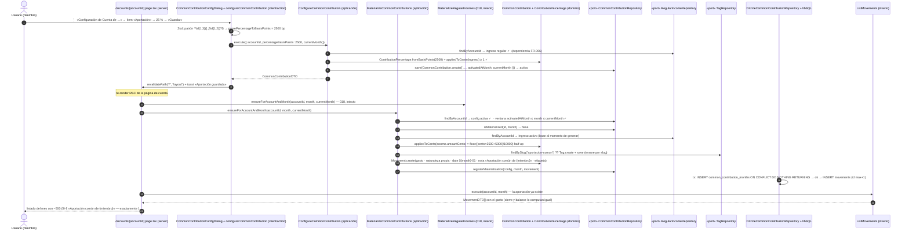

# Secuencia: aportación común — configurar porcentaje → consultar mes → gasto materializado (019)

Happy path de la feature 019: el miembro configura qué porcentaje de su ingreso regular (018) aporta a la cuenta común y la siguiente consulta de la página de la cuenta del mes materializa el gasto propio exactamente una vez (base: `specs/019-aportacion-comun/plan.md` §Diagramas de diseño). La entrada es el ítem «Aportación» del menú ⋮ de la tarjeta en `/`, bajo «Ingreso regular», y solo se habilita si el miembro tiene ingreso regular configurado (FR-006).

Notas:

- La materialización de la aportación corre **inmediatamente después** de la de 018 y antes del `Promise.all` (dos awaits secuenciales): listado, cierre y balance ven el mismo estado (ADR 0016/0017).
- `/summary` y `/annual` no materializan (decisión del propietario 2026-10-12): solo leen movimientos existentes.
- Si el par `(config, mes)` ya está registrado (reconsulta o carrera concurrente), `registerMaterialization` devuelve `false` sin escribir movimiento; el borrado del gasto generado es definitivo.
- Sin ingreso regular (o inactivo): el ítem del menú queda deshabilitado con «Requiere ingreso regular» y la materialización es no-op (FR-006).
- La cuenta común no recibe contrapartida automática (decisión del propietario; Out of Scope de 019).
