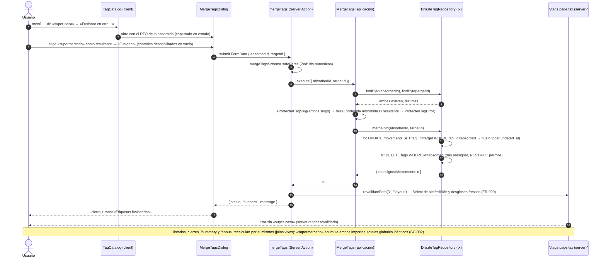

# Secuencia: mantenimiento del catálogo de etiquetas (feature 004)

Fusión de dos etiquetas — la operación más rica del mantenimiento (`/tags`). Renombrar, desactivar y reactivar siguen el mismo recorrido con su acción y diálogo correspondientes.

Reactivar es la excepción de forma: ítem de menú directo → `reactivateTag` (action directa + `useTransition`, familia ADR 0015) → toast; sin diálogo ni formulario.
