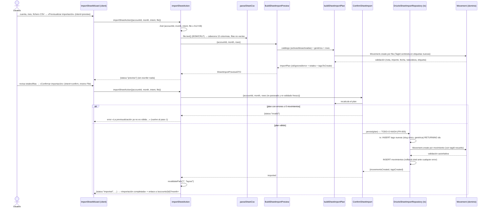

# Secuencia: importación de la hoja mensual (feature 028)

Flujo crítico «subida → previsualización → confirmación → listado» de `/import`. La confirmación **re-parsea y re-valida el fichero en servidor** (recalcula el plan fresco desde las filas con `buildSheetImportPlan`, no confía en la previsualización previa) y persiste en una **única transacción todo-o-nada** (`DrizzleSheetImportRepository`; FR-005). `Movement.create` es la única vía de validación/escritura (FR-006). Fuente: `specs/028-importacion-excel/plan.md` (diagrama de diseño congelado, reutilizado como documentación viva).

Notas:

- La UI **nunca** mapea ni calcula totales: solo renderiza `SheetImportPreviewDTO` (constitución VII).
- El `File` viaja como argumento desde estado del cliente (acción directa, familia ADR 0015; un file input no puede ser controlado — SC-004).
- Cambiar cuenta/mes/fichero tras previsualizar **invalida la previsualización en cliente** (vuelve al paso 1): se evita confirmar algo distinto de lo revisado.
