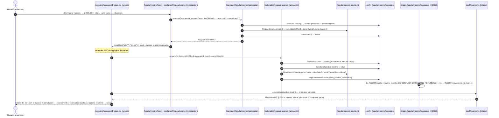

# Secuencia: ingreso regular — configurar → consultar mes → ingreso materializado (018)

Happy path de la feature 018: el miembro configura su ingreso regular y la siguiente consulta de la página de la cuenta del mes materializa el ingreso exactamente una vez (base: `specs/018-ingresos-regulares/plan.md` §Diagramas de diseño).

Notas:

- La materialización ocurre **antes del `Promise.all`** de lecturas de la página: listado, cierre y balance ven el mismo estado (ADR 0016).
- `/summary` y `/annual` no aparecen porque **no materializan** (decisión del propietario 2026-10-12): solo leen movimientos existentes.
- Si el par `(config, mes)` ya está registrado (reconsulta o carrera concurrente), `registerMaterialization` devuelve `false` sin escribir movimiento.
