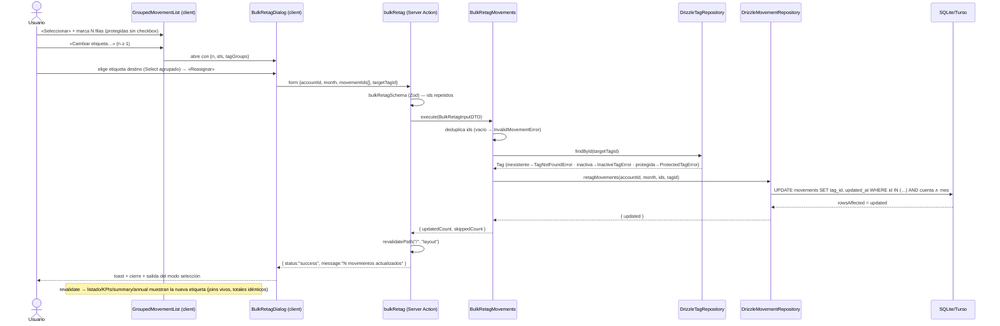

# Reasignación masiva de etiquetas — secuencia

Flujo crítico «seleccionar → confirmar → listado y desgloses actualizados» de la página de cuenta (`/accounts/{id}?month=`). La confirmación re-valida en servidor: los ids ajenos a la cuenta/mes o desaparecidos quedan fuera del `WHERE` de la única sentencia `UPDATE` (decisión «ignorar con aviso» — el toast compone «{u} de {t} movimientos actualizados»); la fila protegida «Aportación Común» no ofrece checkbox ni aparece como destino. `updated_at` de los reasignados se actualiza (diferencia deliberada con `mergeInto` de 004 — ADR 0023). Fuente: `specs/029-retag-masivo/plan.md` (diagrama de diseño congelado, reutilizado como documentación viva).

