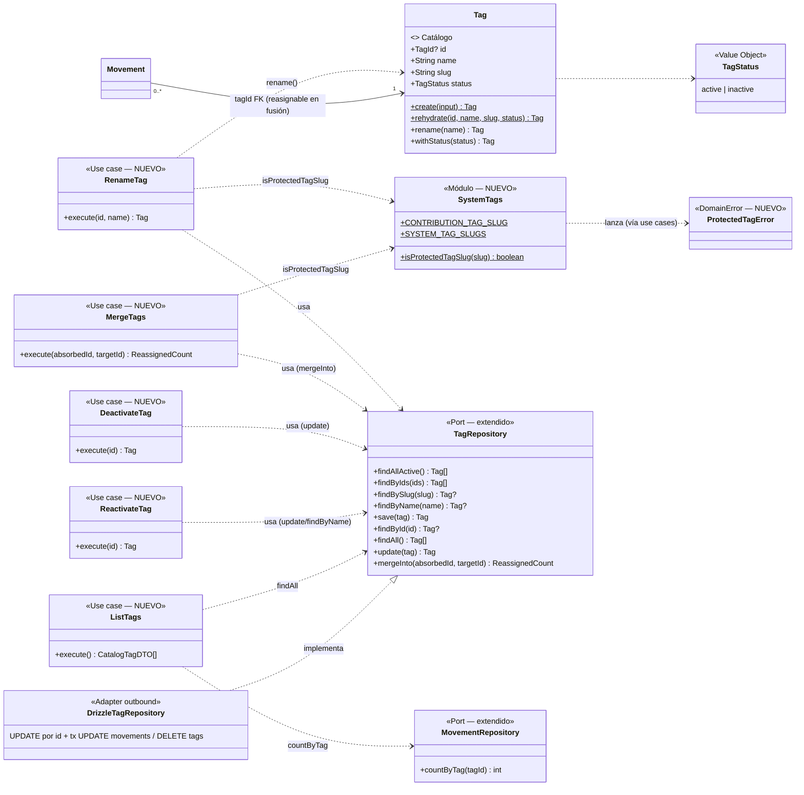

# Data Model: Gestión del catálogo de etiquetas

**Feature**: `004-gestion-tags` | **Fecha**: 2026-10-17

Dos vistas del mismo modelo: **dominio** (entidades, funciones puras y errores, principio VII) y **persistencia** (tablas Drizzle, principio V). La feature añade el **mantenimiento** del catálogo que su `status` anticipaba desde 0000: comportamiento de renombrado y transición de estado en `Tag`, protección de la etiqueta de sistema en el dominio, cuatro casos de uso más uno de listado, y la extensión del puerto `TagRepository` con lectura completa, actualización y **fusión transaccional**. **Sin migración** (research §1/§3): `tags`, `movements` y sus restricciones ya materializan todas las invariantes.

---

## 1. Vista de Dominio

### 1.1 Entidades y funciones puras

#### `Tag` — EXTENDIDA (comportamiento nuevo, forma intacta)

| Campo | Tipo | Regla |
|---|---|---|
| id | `TagId \| null` | Intacto |
| name | `string` | Único ignorando mayúsculas frente a las **demás** etiquetas (validado en el caso de uso con `findByName`; la propia no cuenta — «luz»→«Luz» es válido); no vacío tras trim |
| slug | `string` | Único; **inmutable tras la creación** (el renombrado NO lo re-deriva: 019 localiza «Aportación Común» por slug) |
| status | `TagStatus` | `'active' \| 'inactive'`; transiciones `active→inactive` (desactivar) e `inactive→active` (reactivar) |

```ts
// NUEVOS (la entidad congelada devuelve nuevas instancias; create/rehydrate intactos)
Tag.rename(name: string): Tag          // trimea; "" → InvalidTagError («El nombre de la etiqueta es obligatorio.»)
                                       // conserva id, slug y status (slug inmutable)
Tag.withStatus(status: TagStatus): Tag // nueva instancia con el estado dado (desactivar/reactivar comparten método)
```

#### `SystemTags` — NUEVO (`src/domain/tag/SystemTags.ts`)

```ts
export const CONTRIBUTION_TAG_SLUG = "aportacion-comun";     // único dueño del literal (019 pasa a importarlo)
export const SYSTEM_TAG_SLUGS = [CONTRIBUTION_TAG_SLUG] as const;
export function isProtectedTagSlug(slug: string): boolean;   // pura, sin dependencias
```

#### `TagErrors` — EXTENDIDO

```ts
// NUEVO
export class ProtectedTagError extends DomainError {
  constructor(name: string) { super(`La etiqueta "${name}" pertenece al sistema y no puede modificarse.`); }
}
```

`InvalidTagError`, `DuplicateTagNameError` («Ya existe una etiqueta con el nombre "…".»), `TagNotFoundError` intactos (los dos primeros pasan a usarse también en renombrado/reactivación).

#### Resto del dominio — INTACTO

`Money` (ADR 0007), `Movement` (la fusión reasigna `tag_id` sin reconstruir la entidad; FR-006), IDs, `deriveTagSlug` (solo se usa al crear, 017).

### 1.2 Casos de uso (aplicación) — NUEVOS

Los cinco comparten la inyección de puertos y la devolución de `Tag` persistida (o DTO en el listado). Regla por paso; detalles y alternativas en [research §1–§4](./research.md).

```ts
class RenameTag {
  constructor(tags: TagRepository)
  async execute(input: { id: TagId; name: string }): Promise<Tag>
}
class MergeTags {
  constructor(tags: TagRepository)
  async execute(input: { absorbedId: TagId; targetId: TagId }): Promise<{ reassignedMovements: number }>
}
class DeactivateTag {
  constructor(tags: TagRepository)
  async execute(input: { id: TagId }): Promise<Tag>
}
class ReactivateTag {
  constructor(tags: TagRepository)
  async execute(input: { id: TagId }): Promise<Tag>
}
class ListTags {
  constructor(tags: TagRepository, movements: MovementRepository)
  async execute(): Promise<CatalogTagDTO[]>
}
```

**`RenameTag`**: 1) cargar por id (`findById`, puerto nuevo) → `TagNotFoundError` si no existe; 2) `isProtectedTagSlug(tag.slug)` → `ProtectedTagError`; 3) `tag.rename(name)` → `InvalidTagError` si vacío tras trim; 4) `findByName(newName)` → `DuplicateTagNameError(newName)` solo si la encontrada **no es ella misma** (edge solo-caja); 5) `update(tag)` (puerto nuevo).

**`MergeTags`**: 1) cargar ambas por id → `TagNotFoundError`; 2) `absorbedId === targetId` → `InvalidTagError`(mensaje claro); 3) protegida **absorbida** o **resultante** (clarificación 2026-10-17) → `ProtectedTagError`; 4) `mergeInto(absorbedId, targetId)` → recuento de movimientos reasignados. El estado de la resultante **no cambia** (fusionar hacia una inactiva es válido).

**`DeactivateTag`**: 1) cargar → `TagNotFoundError`; 2) protegida → `ProtectedTagError`; 3) ya inactiva → idempotente (devuelve la etiqueta como está); 4) `update(tag.withStatus("inactive"))`.

**`ReactivateTag`**: 1) cargar → `TagNotFoundError`; 2) `findByName(tag.name)` → `DuplicateTagNameError(tag.name)` si es **otra** etiqueta (edge colisión con activa); 3) `update(tag.withStatus("active"))`.

**`ListTags`**: `findAll()` + `countByTag(id)` por etiqueta → `CatalogTagDTO`; orden: activas primero, luego inactivas, cada bloque alfabético (`es`); `isProtected = isProtectedTagSlug(slug)`.

### 1.3 Puertos — EXTENDIDOS (definidos en aplicación, constitución VII)

```ts
export interface TagRepository {
  findAllActive(): Promise<Tag[]>;                         // existente
  findByIds(ids: readonly TagId[]): Promise<Tag[]>;        // existente
  findBySlug(slug: string): Promise<Tag | null>;           // existente
  findByName(name: string): Promise<Tag | null>;           // existente (017)
  save(tag: Tag): Promise<Tag>;                            // existente (017; insert)
  findById(id: TagId): Promise<Tag | null>;                // NUEVO
  findAll(): Promise<Tag[]>;                               // NUEVO: activas e inactivas, orden alfabético
  update(tag: Tag): Promise<Tag>;                          // NUEVO: UPDATE por id (nombre/estado; slug estable);
                                                           //   violación lower(name) → DuplicateTagNameError (carrera)
  mergeInto(absorbedId: TagId, targetId: TagId): Promise<{ reassignedMovements: number }>;
                                                           // NUEVO: transaccional — reasigna movimientos y borra la absorbida
}

// MovementRepository (puerto existente) gana:
countByTag(tagId: TagId): Promise<number>;                 // NUEVO: nº de movimientos con esa etiqueta (listado /tags)
```

### 1.4 Diagrama de clases (diseño)



> Diferencias con `docs/architecture/diagrams/domain-model.md` (vivo, a actualizar en implementación): `Tag` gana `rename`/`withStatus`; aparece `SystemTags`/`ProtectedTagError`; `TagRepository` gana `findById`/`findAll`/`update`/`mergeInto`; `MovementRepository` gana `countByTag`. `Movement`, `Money` y relaciones intactas.

### 1.5 Transiciones de estado

```mermaid
stateDiagram-v2
    direction LR
    [*] --> active : crear (017 / seed / ensure 019)
    active --> inactive : DeactivateTag (confirmación; protegida → ProtectedTagError)
    inactive --> active : ReactivateTag (sin colisión de lower(name) ajena; si no, DuplicateTagNameError)
    active --> absorbed : MergeTags (reasigna movimientos → borra; ni protegida ni resultante protegida)
    inactive --> absorbed : MergeTags (como absorbida)
    note right of absorbed
        Estado final de la absorbida: fila eliminada
        (los movimientos pasan a la resultante)
    end note
```



- **Nombre**: `rename` cambia el nombre en cualquier estado (protegida excluida); el slug y el id **nunca** cambian tras la creación.
- **UI de administración** (adaptador inbound): `[lista /tags] → menú ⋮ → [diálogo renombrar|fusión|confirmación desactivar] | [reactivar → useTransition] → éxito (toast + revalidación + cierre) | error (mensaje, datos conservados)`. Detalle congelado en [contracts/ui-contract.md](./contracts/ui-contract.md).

---

## 2. Vista de Persistencia (Drizzle, SQLite/Turso)

### 2.1 Tablas

**SIN CAMBIOS. Sin migración** (research §3, principio V):

```text
tags
├── id: integer PK autoincrement
├── name: text NOT NULL                    ← UPDATE sujeto a UNIQUE lower(name) (tags_name_nocase_uq)
├── slug: text NOT NULL UNIQUE             ← inmutable tras creación (nunca se re-deriva)
└── status: text NOT NULL DEFAULT 'active' ← 'active' | 'inactive'

movements                                  # INTACTA: la fusión solo reasigna tag_id
├── tag_id: integer NULL → tags.id ON DELETE RESTRICT   (ADR 0014)
└── índice idx_movements_tag_id (existe desde 0002)     ← soporta el UPDATE masivo de la fusión
```

### 2.2 Repositorio `DrizzleTagRepository` — EXTENDIDO

- `findById(id)`: select por pk → `Tag | null`.
- `findAll()`: select completo ordenado por `name` (activas e inactivas).
- `update(tag)`: `update(tags).set({ name, status }).where(eq(tags.id, id))` → `Tag.rehydrate` con el estado final; catch → `translateUniqueViolation` existente (carrera del `lower(name)` → `DuplicateTagNameError`).
- `mergeInto(absorbedId, targetId)`: **`db.transaction`**: (1) `update(movements).set({ tagId: targetId }).where(eq(movements.tagId, absorbedId))` → recuento; (2) `delete(tags).where(eq(tags.id, absorbedId))`. Tras (1), RESTRICT no bloquea (2); ambas escrituras son atómicas. **No** se toca `movements.updated_at` (FR-006: operación de catálogo, no edición).
- `save`/`findAllActive`/`findByIds`/`findBySlug`/`findByName` intactos.

`DrizzleMovementRepository` gana `countByTag(tagId)`: `select count(*)` filtrando por `tagId` (uso del índice existente).

### 2.3 Seed y catálogo

`seed-data.ts`, `scripts/seed.ts` y `drizzle/` **intactos** (FR-007): catálogo del seed, «Sin Clasificar» y «Aportación Común» sin cambios; la fila protegida se distingue en tiempo de lectura por su slug (`isProtectedTagSlug`), no por datos nuevos.

---

## 3. Validación por capa (dónde vive cada regla)

| Regla | Zod (frontera, actions) | Dominio / Aplicación | DB (constraint) |
|---|---|---|---|
| Nombre presente, no vacío tras trim (renombrar) | ✅ `renameTagSchema`: id + `z.string().trim().min(1)` «El nombre de la etiqueta es obligatorio.» | ✅ `Tag.rename` → `InvalidTagError` (mismo literal) | `name NOT NULL` |
| Nombre único ignorando mayúsculas, excluyéndose a sí misma | — | ✅ `RenameTag` vía `findByName` (≠ id propio) → `DuplicateTagNameError`; solo-caja de sí misma permitida | ✅ UNIQUE `lower(name)` (red de seguridad en UPDATE → traducido) |
| Reactivar sin colisión con activa existente | — | ✅ `ReactivateTag` vía `findByName` (otra fila) → `DuplicateTagNameError` | ✅ ídem |
| Etiqueta de sistema intocable (renombrar, desactivar, absorbida, resultante) | — | ✅ `isProtectedTagSlug` en `RenameTag`/`DeactivateTag`/`MergeTags` → `ProtectedTagError` | — (protección por regla, no por esquema — research §1) |
| Fusión: ambas existen, distintas | ✅ ids numéricos en FormData | ✅ `MergeTags`: `TagNotFoundError` / `InvalidTagError` («Elige dos etiquetas distintas.») | FK + tx |
| Totales/importes/fechas intactos (FR-006) | — | ✅ la fusión solo reasigna `tag_id`; renombrado/desactivación solo tocan `tags` | RESTRICT protege el borrado con referencias |
| Recuento de movimientos por etiqueta (consecuencia) | — | ✅ `countByTag` (puerto) + `ListTags` | índice `idx_movements_tag_id` |

**Mapeo de errores en las actions**: `InvalidTagError`/`DuplicateTagNameError`/`ProtectedTagError`/`TagNotFoundError` → mensaje exacto del error de dominio en el estado del formulario (o toast en reactivar); cualquier otro `DomainError` → mensaje genérico; nunca se lanza al cliente.

---

## 4. DTOs y contratos de Server Actions (frontera)

```ts
// NUEVO — src/application/tag/dto.ts (o dto existente de tag si se prefiere co-localizar)
export interface CatalogTagDTO {
  id: number;
  name: string;
  slug: string;
  status: TagStatus;        // "active" | "inactive"
  movementCount: number;    // nº de movimientos con esta etiqueta
  isProtected: boolean;     // fila «Sistema» — sin menú de acciones
}

// Actions nuevas — src/infrastructure/primary/actions/
renameTagSchema:    { tagId: number; name: z.string().trim().min(1) }
mergeTagsSchema:    { absorbedId: number; targetId: number }
deactivateTagSchema:{ tagId: number }
reactivateTagSchema:{ tagId: number }

export type TagActionState =
  | { status: "idle" }
  | { status: "success"; message: string }   // toasts congelados en ui-contract §5
  | { status: "error"; message: string };    // mensaje de dominio exacto; datos del form conservados

renameTag(prev, formData): Promise<TagActionState>          // useActionState (diálogo con form)
mergeTags(prev, formData): Promise<TagActionState>          // useActionState (diálogo con form)
deactivateTag(prev, formData): Promise<TagActionState>      // useActionState (AlertDialog)
reactivateTag(tagId: number): Promise<ReactivateTagResult> // action directa + useTransition (familia ADR 0015)
  export type ReactivateTagResult = { ok: true } | { ok: false; message: string };

// Éxito (las cuatro): revalidatePath("/", "layout") — catálogo global (FR-009)
```

`createTag` (017), `createMovement`/`updateMovement` y `movement-form.schema.ts` **sin cambios**.

---

## 5. Glosario ES ↔ EN (constitución VI)

| Español (UI/spec) | English (código) | Notas |
|---|---|---|
| Mantenimiento del catálogo | tag catalog management | Renombrar, fusionar, desactivar, reactivar |
| Renombrar | `RenameTag` / `Tag.rename` / `renameTag` | Caso de uso / entidad / action |
| Fusionar | `MergeTags` / `mergeInto` / `mergeTags` | Absorbida desaparece; resultante conserva su estado |
| Etiqueta absorbida | absorbed tag (`absorbedId`) | Se elimina tras reasignar sus movimientos |
| Etiqueta resultante | target tag (`targetId`) | Recibe los movimientos; puede estar inactiva |
| Desactivar / Reactivar | `DeactivateTag` / `ReactivateTag` (`Tag.withStatus`) | Transición de estado sin borrado |
| Etiqueta de sistema | protected/system tag (`isProtectedTagSlug`, `SYSTEM_TAG_SLUGS`) | Protegida por slug; hoy solo «Aportación Común» |
| Recuento de movimientos | `movementCount` / `countByTag` | Consecuencia mostrada en la fila y confirmaciones |
| Vista de administración | `TagCatalog` (`/tags`) | Lista con menús por fila; diálogos a nivel del listado |
| Reasignación | tag reassignment (`mergeInto`) | `UPDATE movements SET tag_id` transaccional |

Sin identificadores intraducibles nuevos fuera de los listados.
