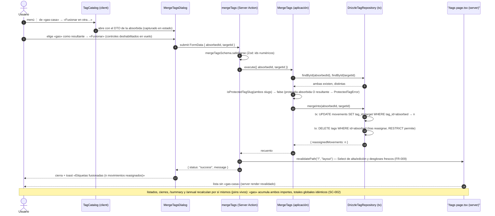

# Implementation Plan: Gestión del catálogo de etiquetas (renombrar, fusionar, desactivar)

**Branch**: `feature/004-gestion-tags` | **Date**: 2026-10-17 | **Spec**: [spec.md](./spec.md)

**Input**: Feature specification from `/specs/004-gestion-tags/spec.md`

## Summary

Mantenimiento del catálogo de etiquetas — la vía que faltaba al catálogo `Tag`, cuyo `status` existe desde 0000 pero no tenía ninguna operación de gestión: **renombrar, fusionar dos etiquetas en una, desactivar y reactivar**, desde una vista de administración `/tags` accesible desde la navegación global, **sin perder ni alterar el histórico** de movimientos (FR-006) y protegiendo la etiqueta de sistema «Aportación Común» de las cuatro operaciones (FR-007, clarificación 2026-10-17).

Enfoque técnico (detalles y alternativas en [research.md](./research.md)):

- **Comportamiento de dominio**: `Tag.rename(name)` (slug e id inmutables — 019 localiza la etiqueta por slug) y `Tag.withStatus(status)`; módulo puro `SystemTags` como único dueño del slug protegido (`isProtectedTagSlug`), que 019 pasa a importar; nuevo error `ProtectedTagError`.
- **Cinco casos de uso** (`RenameTag`, `MergeTags`, `DeactivateTag`, `ReactivateTag`, `ListTags`) contra el puerto `TagRepository` ampliado (`findById`, `findAll`, `update`, `mergeInto`) y `countByTag` en `MovementRepository`. Duplicados con `findByName` excluyéndose a sí misma (edge solo-caja «luz»→«Luz» permitido).
- **Fusión transaccional**: `mergeInto` (reasignar `movements.tag_id` → borrar la absorbida) en una sola `db.transaction` — obligado por `ON DELETE RESTRICT` (ADR 0014) — sin tocar `updated_at` (FR-006). Las vistas derivadas (joins vivos) recalculan solas (FR-009/SC-002).
- **Vista `/tags`**: lista con estado, recuento de movimientos y menú ⋮ por fila; diálogos montados a nivel del listado (patrón canónico de fila); AlertDialog para desactivar y confirmación integrada en fusión (FR-008); **reactivar** como action directa + `useTransition` (familia ADR 0015, sin formulario que preservar).
- **Sin migración** (el esquema ya soporta todo) y **cero dependencias nuevas**.

## Technical Context

**Language/Version**: TypeScript 5.x en modo estricto sobre Node.js LTS; Next.js 16 (App Router), React 19.

**Primary Dependencies**: las fijadas por la constitución v1.2.1 (next, react, drizzle-orm ~0.44.7, @libsql/client, zod 4, tailwind + shadcn/ui en el repo, sonner, radix-ui). **Cero dependencias nuevas.**

**Storage**: SQLite (dev) / Turso (prod) vía Drizzle. **Sin cambios de esquema y sin migración**: `tags` (unicidad `lower(name)` desde 0000) y `movements.tag_id` FK `ON DELETE RESTRICT` + índice `idx_movements_tag_id` ya materializan las invariantes; la fusión es reasignación + borrado dentro de una transacción (research §3).

**Testing**: Vitest (projects node/ui, co-localizados) — dominio (`Tag.rename/withStatus`, `SystemTags`), aplicación (5 casos de uso con fake en memoria: duplicados, solo-caja, protección en los cuatro papeles, colisión de reactivación), repositorio (`update`, `mergeInto` transaccional, `countByTag` contra libsql `:memory:`), actions (4 nuevas con Zod y mapeo de errores) y componentes (catálogo, 3 diálogos, nav). Playwright e2e: **spec nueva** `gestion-tags.spec.ts` (Miembro B + **septiembre 2026**, combinación verificada libre — research §6) que cubre el flujo crítico «renombrar + fusionar + desactivar verificando el histórico» más reactivar y protección (FR-011, constitución III).

**Target Platform**: Web (escritorio primero; usable en móvil), Vercel + Turso; sin cambios.

**Project Type**: web-app (monolito Next.js, App Router); sin proyectos ni paquetes nuevos.

**Performance Goals**: SC-001 — cualquier operación de catálogo se completa en < 30 s incluida su confirmación; con un catálogo de ~15 etiquetas y < 5k movimientos, la reasignación de la fusión es un UPDATE indexado instantáneo. Sin metas nuevas.

**Constraints**: UI en español (literales congelados en el ui-contract); integridad del histórico (FR-006: ninguna operación toca importes/fechas/notas/cuentas/`updated_at`); protección total de «Aportación Común» (FR-007); formularios de movimiento y vistas de desglose sin cambios de código.

**Scale/Scope**: 1 usuario, 3 cuentas; 1 módulo de dominio nuevo (`SystemTags`) + 2 métodos en `Tag` + 1 error (+tests), 5 casos de uso + 5 métodos de puerto (+tests), 2 repositorios ampliados (+tests), 4 actions nuevas (+tests), 1 ruta/página + 4 componentes UI nuevos + nav ampliada (+tests), 1 spec e2e nueva; documentación viva (ADR 0018, diagramas) y roadmap maestro (FR-010).

## Constitution Check

*GATE: Must pass before Phase 0 research. Re-check after Phase 1 design.*

| # | Principio | Estado pre-diseño | Notas |
|---|-----------|-------------------|-------|
| I | Simplicidad Primero | ✅ PASS | Reutiliza el esquema vigente (sin migración), el error `DuplicateTagNameError` ya existente, `findByName` de 017, AlertDialog/Dialog/DropdownMenu shadcn ya en el repo y los patrones de listado/diálogo/tanda fijados por 003/014/020. Sin proyectos, librerías ni abstracciones nuevas (la fusión no introduce UnitOfWork: una operación transaccional en el adaptador, como 018/019). |
| II | Spec-Driven Development | ✅ PASS | Este plan deriva de `specs/004-gestion-tags/spec.md` (fila del roadmap maestro US5/FR-005, reducida por el propietario 2026-10-04; clarificación de protección total 2026-10-17). Una única US pequeña con valor propio; las cuatro operaciones comparten vista y recorrido UI (granularidad justificada en la propia spec). |
| III | Calidad Verificada | ✅ PASS | Lógica nueva (duplicados con autoexclusión, fusión transaccional con integridad de totales, protección en cuatro papeles, colisión de reactivación) cubierta por tests de dominio/aplicación/repositorio/action; flujo crítico «renombrar + fusionar + desactivar con histórico verificado» cubierto por e2e nueva (FR-011, exigencia explícita de la spec). |
| IV | TypeScript Estricto + Zod | ✅ PASS | Cuatro fronteras nuevas con Zod (`renameTag`, `mergeTags`, `deactivateTag`, `reactivateTag`); estados tipados como unión discriminada `TagActionState` / `ReactivateTagResult`; DTO nuevo `CatalogTagDTO` con `status` y `isProtected`; sin `any`. |
| V | Persistencia SQLite con Drizzle | ✅ PASS | Sin cambios de esquema ni migración; `update`/`mergeInto`/`countByTag` viven en los repositorios Drizzle; `ON DELETE RESTRICT` existente queda como auditoría del borrado (la fusión reasigna antes de borrar, en una tx); sin SQL ad-hoc fuera de Drizzle. |
| VI | Producto en español, código en inglés | ✅ PASS | Literales nuevos en español congelados en el ui-contract («Etiquetas», «Renombrar…», «Fusionar en otra…», «Desactivar…», «Reactivar», «Sistema», toasts y mensajes de error); identificadores en inglés (`RenameTag`, `mergeInto`, `withStatus`, `isProtectedTagSlug`); glosario actualizado (data-model §5). |
| VII | Arquitectura Hexagonal + DDD Táctico | ✅ PASS | `Tag.rename/withStatus` y `SystemTags` son dominio puro (sin deps); los 5 casos de uso y los puertos ampliados viven en aplicación; `DrizzleTagRepository`/`DrizzleMovementRepository` y las 4 actions son adaptadores; la UI solo lista y delega. Sin CQRS/EDA/eventos; la tx queda encapsulada en el adaptador (precedente 018/019). |

**Resultado**: sin violaciones → Phase 0 autorizada.

## Project Structure

### Documentation (this feature)

```text
specs/004-gestion-tags/
├── plan.md                     # This file (/speckit.plan command output)
├── research.md                 # Phase 0 output (/speckit.plan command)
├── data-model.md               # Phase 1 output (/speckit.plan command)
├── quickstart.md               # Phase 1 output (/speckit.plan command)
├── contracts/
│   └── ui-contract.md          # Contrato UI + Server Actions de catálogo (vista /tags)
└── tasks.md                    # Phase 2 output (/speckit.tasks command - NOT created by /speckit.plan)
```

### Source Code (repository root)

```text
├── src/
│   ├── domain/
│   │   └── tag/
│   │       ├── Tag.ts                       # MODIFICADO: + rename(name) y withStatus(status) (nuevas instancias; slug/id/estado estables en rename)
│   │       ├── Tag.test.ts                  # NUEVO: rename (trim, vacío, conserva slug/estado), withStatus
│   │       ├── SystemTags.ts                # NUEVO: CONTRIBUTION_TAG_SLUG, SYSTEM_TAG_SLUGS, isProtectedTagSlug (puro)
│   │       ├── SystemTags.test.ts           # NUEVO: slug protegido sí, resto no
│   │       └── TagErrors.ts                 # MODIFICADO: + ProtectedTagError
│   ├── application/
│   │   ├── tag/
│   │   │   ├── TagRepository.ts             # MODIFICADO: + findById, findAll, update, mergeInto (transaccional)
│   │   │   ├── dto.ts                       # NUEVO: CatalogTagDTO { id, name, slug, status, movementCount, isProtected }
│   │   │   ├── ListTags.ts (+test)          # NUEVO: findAll + countByTag → DTO ordenado (activas→inactivas, alfabético)
│   │   │   ├── RenameTag.ts (+test)         # NUEVO: findById, protección, rename, findByName ≠ sí misma, update
│   │   │   ├── MergeTags.ts (+test)         # NUEVO: ambas existen, distintas, protegida absorbida O resultante → error; mergeInto
│   │   │   ├── DeactivateTag.ts (+test)     # NUEVO: protección; idempotente si ya inactiva; withStatus
│   │   │   └── ReactivateTag.ts (+test)     # NUEVO: findByName ajena → DuplicateTagNameError; withStatus
│   │   ├── movement/
│   │   │   └── MovementRepository.ts        # MODIFICADO: + countByTag(tagId)
│   │   └── common-contribution/
│   │       └── MaterializeCommonContributions.ts  # MODIFICADO: importa CONTRIBUTION_TAG_SLUG de SystemTags (elimina copia local)
│   ├── app/
│   │   └── tags/
│   │       └── page.tsx                     # NUEVO: server — GlobalNav active="tags" + ListTags → TagCatalog
│   └── infrastructure/
│       ├── db/
│       │   ├── DrizzleTagRepository.ts      # MODIFICADO: + findById, findAll, update (traducción de carrera), mergeInto (tx: UPDATE movements → DELETE tag)
│       │   ├── DrizzleMovementRepository.ts # MODIFICADO: + countByTag
│       │   └── DrizzleRepositories.test.ts  # AMPLIADO: update (renombre/estado, carrera lower(name)), mergeInto (reasigna+borra, sin movimientos), countByTag
│       └── primary/
│           ├── actions/
│           │   ├── tag-actions.schema.ts    # NUEVO: Zod de las 4 fronteras (ids numéricos + nombre trim min 1)
│           │   ├── rename-tag.action.ts (+test)        # NUEVO: useActionState-style; revalidatePath("/", "layout")
│           │   ├── merge-tags.action.ts (+test)        # NUEVO: ídem
│           │   ├── deactivate-tag.action.ts (+test)    # NUEVO: ídem
│           │   └── reactivate-tag.action.ts (+test)    # NUEVO: action directa (resultado, no estado de form) — familia ADR 0015
│           └── ui/
│               ├── global-nav.tsx (+test)   # MODIFICADO: enlace «Etiquetas» + active "tags"
│               ├── tag-catalog.tsx (+test)  # NUEVO (client): lista con estado/recuento, menú ⋮ por fila, host de los 3 diálogos (DTO en estado)
│               ├── rename-tag-dialog.tsx (+test)    # NUEVO: form + useActionState; error conserva nombre tecleado
│               ├── merge-tags-dialog.tsx (+test)    # NUEVO: Select destino (excluye propia y protegidas; inactivas visibles); confirmación integrada
│               └── deactivate-tag-dialog.tsx (+test) # NUEVO: AlertDialog con consecuencia (n movimientos)
├── e2e/
│   └── gestion-tags.spec.ts       # NUEVO: renombrar+fusionar+desactivar con histórico verificado; reactivar; protección; nav (Miembro B, septiembre 2026)
│   (resto de specs)               # INTACTAS (combinación cuenta/mes verificada — research §6)
├── scripts/seed.ts, src/infrastructure/db/seed-data.ts, drizzle/   # INTACTOS (sin migración; catálogo y «Aportación Común» intactos — FR-006/FR-007)
├── specs/001-family-wallet/spec.md  # ACTUALIZADO (implementación, FR-010): fila 004 «Completada» + FR-005 íntegro (crear→017; renombrar/fusionar/desactivar/reactivar→004)
└── docs/architecture/
    ├── overview.md, diagrams/domain-model.md, diagrams/(secuencia)  # ACTUALIZADOS (implementación): mantenimiento de catálogo, puerto ampliado
    └── adr/0018-mantenimiento-catalogo-tags.md  # NUEVO: fusión transaccional bajo RESTRICT; protección por slug en dominio; slug inmutable; reactivar directa
```

**Structure Decision**: misma estructura por capas concéntricas que 002–020 (`docs/architecture/overview.md`). El cambio atraviesa las capas en la dirección de dependencias: comportamiento de catálogo y protección en el dominio (puro), reglas de unicidad/fusión y puertos ampliados en aplicación, Drizzle y las 4 actions como adaptadores, y una página fina que compone puertos. Sin cambios de esquema. Tests co-localizados; e2e nueva en fichero propio con combinación cuenta/mes exclusiva (`workers: 1`).

## Diagramas de diseño

Foto del diseño de esta feature (mermaid, como la documentación viva del proyecto); `docs/architecture/diagrams/` se extiende en la fase de implementación reutilizándolos como base. El diagrama de clases del modelo vive en [data-model.md §1.4](./data-model.md).

### Componentes que intervienen

```mermaid
flowchart LR
    U((Usuario))

    subgraph Inbound["Adaptadores inbound — src/app, src/infrastructure/primary"]
        TagsPage["/tags page.tsx (server; ListTags → TagCatalog)"]
        Catalog["TagCatalog (client; NUEVO: lista + menús ⋮, host de diálogos)"]
        RenameDlg["RenameTagDialog (client; NUEVO)"]
        MergeDlg["MergeTagsDialog (client; NUEVO)"]
        DeactDlg["DeactivateTagDialog (client; NUEVO, AlertDialog)"]
        RenameAction["renameTag (Server Action NUEVA)"]
        MergeAction["mergeTags (Server Action NUEVA)"]
        DeactAction["deactivateTag (Server Action NUEVA)"]
        ReactAction["reactivateTag (Server Action NUEVA, directa + useTransition)"]
        Nav["GlobalNav (MODIFICADA: enlace «Etiquetas»)"]
    end

    subgraph Aplicacion["Capa de aplicación — src/application"]
        LT["ListTags (NUEVO)"]
        RT["RenameTag (NUEVO)"]
        MT["MergeTags (NUEVO)"]
        DT["DeactivateTag (NUEVO)"]
        RRT["ReactivateTag (NUEVO)"]
        PortTag["«port» TagRepository (+ findById, findAll, update, mergeInto)"]
        PortMov["«port» MovementRepository (+ countByTag)"]
    end

    subgraph Domain["Dominio — src/domain"]
        TagEnt["Tag (+ rename, withStatus)"]
        SysTags["SystemTags — isProtectedTagSlug (NUEVO)"]
        TagErr["ProtectedTagError (NUEVO) · DuplicateTagNameError · InvalidTagError · TagNotFoundError"]
    end

    subgraph Outbound["Adaptadores outbound — src/infrastructure/db"]
        DrizzleTag["DrizzleTagRepository (MODIFICADO: update, mergeInto transaccional)"]
        DrizzleMov["DrizzleMovementRepository (MODIFICADO: countByTag)"]
        LibSQL[("SQLite / Turso — tags, movements SIN cambios; RESTRICT como auditoría")]
    end

    U -->|"GET /tags"| TagsPage
    U --> Nav
    TagsPage --> LT
    TagsPage --> Catalog
    Catalog --> RenameDlg
    Catalog --> MergeDlg
    Catalog --> DeactDlg
    RenameDlg --> RenameAction
    MergeDlg --> MergeAction
    DeactDlg --> DeactAction
    Catalog -->|"menú Reactivar (useTransition)"| ReactAction
    RenameAction --> RT
    MergeAction --> MT
    DeactAction --> DT
    ReactAction --> RRT
    LT --> PortTag
    LT --> PortMov
    RT --> PortTag
    MT --> PortTag
    DT --> PortTag
    RRT --> PortTag
    RT -. valida .-> SysTags
    MT -. valida .-> SysTags
    DT -. valida .-> SysTags
    RT -. llama .-> TagEnt
    DT -. llama .-> TagEnt
    RRT -. llama .-> TagEnt
    DrizzleTag -. implementa .-> PortTag
    DrizzleMov -. implementa .-> PortMov
    DrizzleTag --> LibSQL
    DrizzleMov --> LibSQL
    RenameAction -. revalidatePath("/", "layout") .-> TagsPage
```

> Nota: dependencias siempre hacia el dominio (constitución VII). La UI no decide negocio: lista lo que `ListTags` compone (incluida `isProtected`) y delega cada operación a su action; las reglas (duplicado con autoexclusión, protección en los cuatro papeles, atomicidad de la fusión) viven en los casos de uso y el dominio. El DTO capturado en el cliente es estado de adaptador (patrón de fila del proyecto).

### Secuencia — happy path: fusión de dos etiquetas (operación más rica)



## Complexity Tracking

> **Fill ONLY if Constitution Check has violations that must be justified**

| Violation | Why Needed | Simpler Alternative Rejected Because |
|-----------|------------|-------------------------------------|
| (ninguna) | — | — |

**Decisiones de diseño destacadas (sin violación, registradas para `/speckit.tasks`)**:

- **`mergeInto` como operación transaccional del puerto**, no dos llamadas orquestadas: `ON DELETE RESTRICT` (ADR 0014) exige reasignar los movimientos **antes** de borrar la absorbida y ambas escrituras deben ser atómicas; el recuento devuelto alimenta toast y tests. La tx vive en el adaptador, como en 018/019 (research §3).
- **Slug inmutable en el renombrado** (el id tampoco cambia): «Aportación Común» se localiza por slug (019) y los slugs son identidad estable del catálogo; re-derivar crearía colisiones inexistentes y rompería la materialización.
- **Protección por slug en el dominio (`SystemTags`)** y no por columna `is_system`: un único caso real hoy (la spec lo fija expresamente); 019 pasa a importar la constante (un solo dueño del literal); futuras etiquetas de sistema solo se añaden a la lista (research §1).
- **Duplicados con `findByName` autoexcluyéndose**: permite el edge «luz»→«Luz» (no es duplicada de sí misma) y bloquea cualquier otra colisión, activa o inactiva; el índice `lower(name)` sigue como red de seguridad en el UPDATE (carrera) (research §2).
- **La fusión no toca `movements.updated_at`**: es una operación de catálogo sobre la dimensión etiqueta (FR-006), no una edición de movimientos; `updated_at` refleja ediciones del usuario.
- **Reactivar como action directa + `useTransition`** (excepción documentada, familia ADR 0015): no hay formulario que preservar — la etiqueta ya vive en el servidor — y FR-008 no exige confirmación (reversible, sin efecto sobre movimientos); el resultado es un mensaje (toast), no un estado de formulario.
- **Diálogos a nivel del listado (`TagCatalog`)** con el DTO capturado en estado del cliente: convención de fila del proyecto — la fila puede desaparecer tras `revalidatePath` (fusión) y el diálogo anclado a ella perdería el estado de `useActionState`.
- **Spec e2e nueva `gestion-tags.spec.ts` con Miembro B + septiembre 2026**: el flujo crítico (renombrar + fusionar + desactivar con histórico verificado) merece fichero propio; la combinación queda analizada frente a todas las specs existentes y su orden alfabético efectivo (research §6).

## Constitution Check (post-diseño, Phase 1)

Re-evaluación tras generar [research.md](./research.md), [data-model.md](./data-model.md), [contracts/ui-contract.md](./contracts/ui-contract.md) y [quickstart.md](./quickstart.md):

| # | Principio | Estado post-diseño | Notas |
|---|-----------|--------------------|-------|
| I | Simplicidad Primero | ✅ PASS | El diseño añade un módulo puro, dos métodos de entidad, un error, cinco casos de uso, cuatro métodos de puerto/repositorio y una vista con tres diálogos; reutiliza índices, restricciones, patrones de fila/AlertDialog y el `findByName` de 017. Sin migraciones, librerías ni abstracciones nuevas (research §1–§4). |
| II | Spec-Driven Development | ✅ PASS | Cada FR traza a artefacto: FR-001 → ui-contract §1/§2 + ListTags (data-model §1.2); FR-002 → RenameTag + ui-contract §3.1; FR-003 → MergeTags/mergeInto + ui-contract §3.2; FR-004 → DeactivateTag + §3.3; FR-005 → ReactivateTag + §3.4; FR-006 → mergeInto sin `updated_at` + matriz §3 del data-model; FR-007 → SystemTags (protección en los 4 papeles, clarificación 2026-10-17); FR-008 → AlertDialog/confirmación integrada; FR-009 → revalidación + joins vivos (§4); FR-010 → research §7; FR-011 → research §6 + quickstart gates. Los 6 escenarios y 9 edge cases de la spec quedan cubiertos en ui-contract/quickstart/research. |
| III | Calidad Verificada | ✅ PASS | Quickstart con 6 escenarios (espejo de los de aceptación) + gates; suites nuevas por capa donde la feature arriesga (autoexclusión de duplicado, fusión transaccional con integridad de totales, protección en cuatro papeles, colisión de reactivación); flujo crítico e2e nuevo con aislamiento verificado (SC-005, constitución III). |
| IV | TypeScript Estricto + Zod | ✅ PASS | Cuatro fronteras Zod (ids numéricos, nombre trim min 1); `TagActionState`/`ReactivateTagResult` uniones discriminadas; `CatalogTagDTO` tipado con `status`/`isProtected`; sin `any` (data-model §3/§4, ui-contract §5). |
| V | SQLite con Drizzle | ✅ PASS | Sin esquema nuevo ni migración: `lower(name)` UNIQUE, `slug` UNIQUE y FK RESTRICT existentes materializan las invariantes; `update`/`mergeInto`/`countByTag` son Drizzle puro, con tx reutilizando el patrón de 018/019 (data-model §2). |
| VI | Español / inglés | ✅ PASS | Literales congelados en el ui-contract («Etiquetas», «Renombrar…», «Fusionar en otra…», «Desactivar…», «Reactivar», «Sistema», «Activa/Inactiva», toasts y errores); identificadores en inglés (`renameTag`, `mergeInto`, `withStatus`, `isProtectedTagSlug`, `TagCatalog`); glosario ES↔EN ampliado (data-model §5). |
| VII | Hexagonal + DDD táctico | ✅ PASS | `Tag.rename/withStatus` y `SystemTags` puros en dominio; reglas y puertos en aplicación; Drizzle y las actions como adaptadores; la UI lista y delega sin duplicar negocio (decide con `isProtected` del DTO, calculado en dominio); sin eventos, CQRS ni EDA; la tx encapsulada en el outbound (data-model §1, diagramas). |

**Resultado**: diseño aprobado; sin desviaciones que justificar. El plan queda listo para `/speckit.tasks`.
