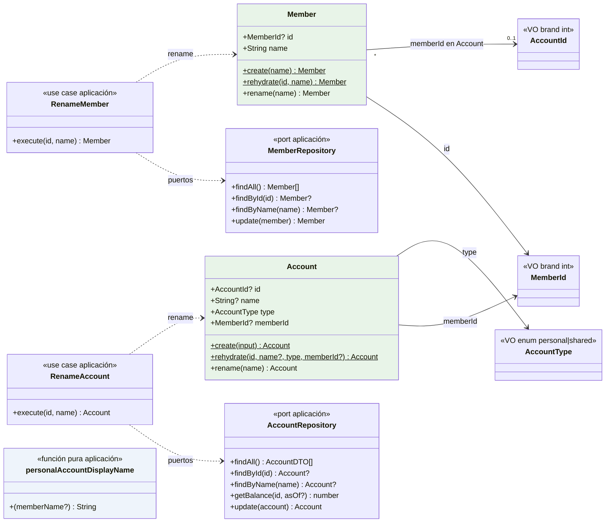
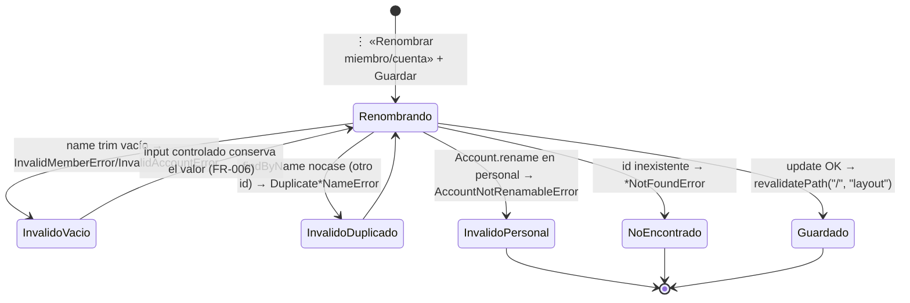

# Data Model — Gestión de cuentas y miembros: renombrado y nombre derivado (008)

**Feature**: `008-gestion-cuentas-miembros` | **Fecha**: 2026-10-29 | **Spec**: [spec.md](./spec.md) · **Research**: [research.md](./research.md)

Modelo de datos de la feature: renombrado de miembros y de la cuenta común, y **nombre de cuenta personal derivado** «Cuenta de {miembro}» (FR-004). No hay entidades nuevas: `Member` y `Account` amplían su comportamiento; el esquema cambia (`accounts.name` nullable + índices `lower(name)`) con **una migración**; `movements`, configs (018/019/023) y agregados **no cambian** (FR-005).

---

## 1. Vista de Dominio (MODIFICADA: `src/domain/member/`, `src/domain/account/`)

### 1.1 `Member` (entidad, ampliada)

| Campo | Tipo | Regla |
|-------|------|-------|
| `id` | `MemberId \| null` | Brand de entero positivo; `null` hasta persistir. |
| `name` | `string` | Trimado, no vacío. Único entre miembros **ignorando mayúsculas** (garantía del puerto + índice BD, §3). |

```ts
Member.create(name): Member                    // existente, sin cambios (trim + no vacío)
Member.rehydrate(id, name): Member             // existente, sin cambios
member.rename(name): Member                    // NUEVO: trim + InvalidMemberError si vacío; devuelve
                                               //   nueva instancia congelada con el MISMO id (patrón Tag.rename / ADR 0011)
```

### 1.2 `Account` (entidad, ampliada — nombre nullable)

| Campo | Tipo | Regla |
|-------|------|-------|
| `id` | `AccountId \| null` | Sin cambios. |
| `name` | `string \| null` | **`shared` ⇒ nombre almacenado** (trimado, no vacío). **`personal` ⇒ `null`**: el nombre mostrado se deriva siempre del miembro (FR-004); no existe renombrado independiente. |
| `type` | `AccountType` | `personal \| shared`; inmutable (FR-005). |
| `memberId` | `MemberId \| null` | `personal ⇒ no null`; `shared ⇒ null`; inmutable (FR-005). |

Invariantes de `create(input: { name: string | null; type; memberId })` (reconstrucción en `rehydrate` confía en el dato persistido, como hoy):

| Regla | Error |
|---|---|
| `shared` con `name` vacío/espacios | `InvalidAccountError` «El nombre de la cuenta es obligatorio.» |
| `personal` con `name !== null` | `InvalidAccountError` «Las cuentas personales no tienen nombre propio: se deriva del miembro.» |
| `personal` sin `memberId` / `shared` con `memberId` | `InvalidAccountError` (mensajes actuales, sin cambios) |

```ts
account.rename(name): Account                  // NUEVO: solo shared — personal lanza AccountNotRenamableError;
                                               //   trim + InvalidAccountError si vacío; conserva id/type/memberId
```

### 1.3 Errores nuevos

| Error | Regla que la dispara | Mensaje (literal congelado) |
|-------|----------------------|------------------------------|
| `DuplicateMemberNameError` (MemberErrors) | `findByName` nocase encuentra otro miembro con el mismo nombre (FR-001, escenario 5) | `` `Ya existe un miembro con el nombre "${name}".` `` |
| `DuplicateAccountNameError` (AccountErrors) | `findByName` nocase encuentra otra cuenta con el mismo nombre almacenado (FR-002, escenario 5) | `` `Ya existe una cuenta con el nombre "${name}".` `` |
| `AccountNotRenamableError` (AccountErrors) | `rename` sobre cuenta `personal` (FR-004: no existe renombrado independiente) | «Las cuentas personales no se renombran: su nombre se deduce del miembro.» |
| `MemberNotFoundError` (MemberErrors) | `RenameMember` con id inexistente | «El miembro seleccionado no existe.» |

`InvalidMemberError`, `InvalidAccountError` y `AccountNotFoundError` se reutilizan con sus mensajes actuales.

### 1.4 Diagrama de clases (diseño)



> Verde = dominio modificado; azul = aplicación. `personalAccountDisplayName` vive en `src/application/account/display-name.ts` y la consume el mapper del repositorio (§2.2); la UI nunca concatena «Cuenta de» (VII).

## 2. Vista de Aplicación (MODIFICADA: `src/application/member/`, `src/application/account/`)

### 2.1 Puertos (definidos en aplicación, constitución VII)

```ts
interface MemberRepository {                       // AMPLIADO (antes solo findAll)
  findAll(): Promise<Member[]>;
  findById(id: MemberId): Promise<Member | null>;  // NUEVO
  findByName(name: string): Promise<Member | null>;// NUEVO — case-insensitive (índice lower(name))
  update(member: Member): Promise<Member>;         // NUEVO — MemberId requerido; traduce carrera UNIQUE
}

interface AccountRepository {                      // AMPLIADO
  findAll(): Promise<AccountDTO[]>;                // DTO.name pasa a ser el NOMBRE MOSTRADO (§2.2)
  findById(id: AccountId): Promise<Account | null>;
  findByName(name: string): Promise<Account | null>; // NUEVO — case-insensitive; solo nombres almacenados (comunes)
  getBalance(id: AccountId, asOf?: string): Promise<number>;
  update(account: Account): Promise<Account>;      // NUEVO — AccountId requerido; traduce carrera UNIQUE
}
```

### 2.2 Derivación del nombre mostrado (FR-004)

```ts
// src/application/account/display-name.ts (NUEVO, función pura)
personalAccountDisplayName(memberName: string | null): string
  // → `Cuenta de ${memberName ?? "miembro"}` — fallback «miembro», paridad con notas/etiquetas existentes
```

Aplicación del contrato de lectura (en `DrizzleAccountRepository.findAll`, §3.3):

| type | `AccountDTO.name` (nombre mostrado) |
|---|---|
| `shared` | nombre almacenado (`accounts.name`) |
| `personal` | `personalAccountDisplayName(memberName)` — **nunca** `accounts.name` (que es NULL) |

`AccountDTO` **no cambia de forma** (`{ id, name, type, memberId, memberName }`): cambia la semántica de `name` a «nombre mostrado». Consumidores intactos: panel (tarjeta), página de cuenta (`<h1>`, `accountName` de listado/balance), `GetGlobalMonthlySummary`, `GetAnnualIncomeStatement` (estos dos usan `memberName`, ya vigente).

### 2.3 Casos de uso (NUEVOS — espejo exacto de `RenameTag`, research §2)

| Caso de uso | Puertos | Flujo (guardas en orden) |
|-------------|---------|--------------------------|
| `RenameMember` | `MemberRepository` | 1. `findById(id)` → `MemberNotFoundError` si null. 2. `member.rename(name)` (valida trim/vacío). 3. `findByName(renamed.name)` → `DuplicateMemberNameError` si existe con `id !== member.id`. 4. `update(renamed)`. |
| `RenameAccount` | `AccountRepository` | 1. `findById(id)` → `AccountNotFoundError` si null. 2. `account.rename(name)` (`AccountNotRenamableError` si `personal`; valida trim/vacío). 3. `findByName(renamed.name)` → `DuplicateAccountNameError` si existe con `id !== account.id` (las personales, con NULL, nunca matchean). 4. `update(renamed)`. |

Ambos son idempotentes en efecto neto sobre terceros: **no tocan** movimientos, notas, tags, configs, balances ni `activatedAtMonth` (FR-001/FR-002/FR-005).

## 3. Persistencia (MODIFICADA: `src/infrastructure/db/schema/`, `drizzle/0007_*`)

### 3.1 Esquema nuevo

```ts
// schema/members.ts
export const members = sqliteTable("members", {
  id: integer("id").primaryKey({ autoIncrement: true }),
  name: text("name").notNull(),
}, (table) => [uniqueIndex("members_name_nocase_uq").on(sql`lower(${table.name})`)]);
//                                            ↑ sustituye a members_name_unique (patrón tags_name_nocase_uq, 004)

// schema/accounts.ts
export const accounts = sqliteTable("accounts", {
  id: integer("id").primaryKey({ autoIncrement: true }),
  name: text("name"),            // ← nullable: NULL en personales (nombre derivado, FR-004)
  type: text("type").notNull(),
  memberId: integer("member_id").references(() => members.id),
}, (table) => [uniqueIndex("accounts_name_nocase_uq").on(sql`lower(${table.name})`)]);
//                                            ↑ sustituye a accounts_name_unique
```

Propiedades: unicidad ignorando mayúsculas **en BD** para miembros y para nombres almacenados de cuentas; los NULL de las personales no colisionan (edge «Colisión visual del derivado»: la común puede llamarse «Cuenta de Isma» sin conflicto de datos).

### 3.2 Migración `drizzle/0007_nombre-cuenta-derivado.sql` (NUEVA — única vía, constitución V)

Generada con drizzle-kit sobre el esquema de §3.1 y **ajustada a mano** en el INSERT de accounts (transformación de datos); estilo de recreación de `0002`:

```sql
-- members: cambio de índices (sin recreación de tabla)
DROP INDEX `members_name_unique`;
CREATE UNIQUE INDEX `members_name_nocase_uq` ON `members` (lower("name"));
--> statement-breakpoint
-- accounts: name nullable + índice nocase → recreación de tabla
CREATE TABLE `__new_accounts` (
  `id` integer PRIMARY KEY AUTOINCREMENT NOT NULL,
  `name` text,
  `type` text NOT NULL,
  `member_id` integer,
  FOREIGN KEY (`member_id`) REFERENCES `members`(`id`) ON UPDATE no action ON DELETE no action
);
INSERT INTO `__new_accounts` ("id","name","type","member_id")
  SELECT "id", CASE WHEN "type" = 'personal' THEN NULL ELSE "name" END, "type", "member_id" FROM `accounts`;
DROP TABLE `accounts`;
ALTER TABLE `__new_accounts` RENAME TO `accounts`;
CREATE UNIQUE INDEX `accounts_name_nocase_uq` ON `accounts` (lower("name"));
CREATE INDEX `idx_accounts_member_id` ON `accounts` (`member_id`);
```

Notas: se preservan ids (FKs de `movements` y configs intactas); la creación de los índices nocase fallaría si existieran duplicados case-insensitive previos — imposible con el seed actual (verificado); en ejecución con `PRAGMA foreign_keys=OFF` (patrón drizzle-kit), sin pérdida de datos. Nombre final del fichero: el que genere drizzle-kit (prefijo `0007_`).

### 3.3 Repositorios (MODIFICADOS)

- `DrizzleMemberRepository` += `findById`, `findByName` (`sql`lower(${members.name}) = lower(${name})``, espejo de tags) y `update` (con traducción de violación `members_name_nocase_uq` → `DuplicateMemberNameError`, espejo de `translateUniqueViolation` de `DrizzleTagRepository`).
- `DrizzleAccountRepository` += `findByName` (nocase sobre `accounts.name`; las filas NULL nunca matchean) y `update` (traducción `accounts_name_nocase_uq` → `DuplicateAccountNameError`). `findAll` mapea el DTO aplicando §2.2 (la común con su nombre almacenado; las personales con `personalAccountDisplayName(memberName)`).

### 3.4 Seed (MODIFICADO, idempotente)

`seed-data.ts`: `SEED_ACCOUNTS` pasa a `{ name: string | null; type; memberName }` — personales a `name: null`, común con `SHARED_ACCOUNT_NAME`. `scripts/seed.ts`: la común se inserta con `onConflictDoNothing({ target: accounts.name })`; cada personal se inserta solo si **no existe** cuenta con `(type = 'personal', member_id = miembro resuelto)` (select previo). Mismos 2 miembros y 3 cuentas de siempre (assumption de la spec; la forma se adapta al esquema nuevo, research §7).

## 4. Flujo de estado del renombrado (máquina mínima)

No hay máquinas complejas: `Member`/`Account` son inmutables y `rename` valida y reconstruye. La unicidad es una guarda del use case con backstop BD; **no existen** transiciones de tipo, atribución ni borrado (FR-005).



## 5. Glosario ES ↔ EN

| Español (UI/spec) | Inglés (código) |
|---|---|
| Miembro | `Member`, `MemberId`, `MemberRepository`, `RenameMember` |
| Cuenta | `Account`, `AccountId`, `AccountRepository`, `RenameAccount` |
| Cuenta personal / común | `AccountType = "personal" \| "shared"` |
| Nombre derivado (mostrado) | `personalAccountDisplayName`, display name (`AccountDTO.name`) |
| Nombre almacenado | stored name (`accounts.name`, solo comunes) |
| Unicidad ignorando mayúsculas | case-insensitive uniqueness (`*_name_nocase_uq`, `findByName`) |
| Renombrado | `rename` (entidad), `Rename*` (use case), `rename-member.action` / `rename-account.action` |
| Duplicado | `DuplicateMemberNameError`, `DuplicateAccountNameError` |
