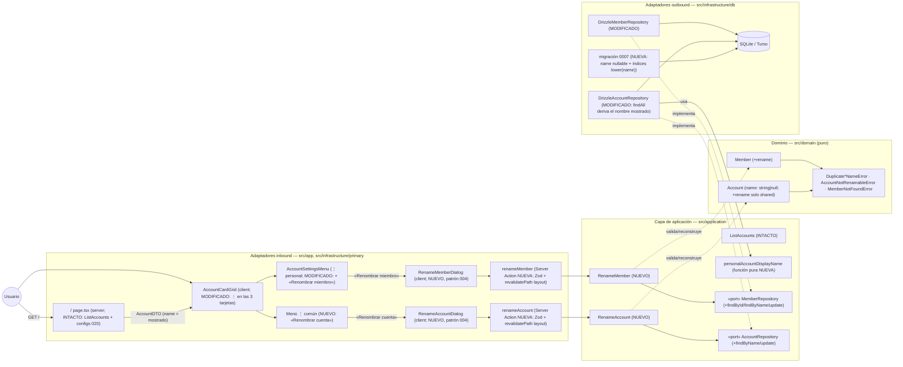

# Implementation Plan: Gestión de cuentas y miembros — renombrado y nombre derivado

**Branch**: `feature/008-gestion-cuentas-miembros` | **Date**: 2026-10-29 | **Spec**: [spec.md](./spec.md)

**Input**: Feature specification from `/specs/008-gestion-cuentas-miembros/spec.md`

## Summary

El catálogo de miembros y cuentas nace del seed con nombres de plataforma («Miembro A/B», «Cuenta común») y no tiene ninguna vía de gestión. Esta feature entrega la mitad «renombrar» de la fila del roadmap (alcance reducido por el propietario, 2026-10-29): **renombrar miembros** —con lo que el nombre mostrado de su cuenta personal pasa a **derivarse siempre** como «Cuenta de {miembro}»— y **renombrar la cuenta común**, desde el panel `/` extendiendo el menú ⋮ de 020. El renombrado de miembros **no escribe nada** en cuentas, movimientos, configs ni balances: toda vista derivada (panel, página de cuenta, `/summary`, `/annual`) ya lee nombres vigentes, así que el cambio se refleja en la siguiente lectura con importes idénticos.

Enfoque técnico (detalles y alternativas en [research.md](./research.md)):

- **Esquema**: migración única (`0007_*`) que hace `accounts.name` **nullable** (NULL en personales: su nombre no existe como dato, FR-004) y sustituye los UNIQUE actuales por índices **`lower(name)`** en `members` y `accounts` — patrón exacto de `tags_name_nocase_uq` (004) para unicidad ignorando mayúsculas en la propia BD, con NULLs de las personales que nunca colisionan (edge «colisión visual» aceptado por la spec).
- **Dominio**: `Member.rename`/`Account.rename` (reconstrucción validada, patrón `Tag.rename`/ADR 0011); `Account.name: string | null` con invariante type↔nombre; `rename` sobre personal lanza `AccountNotRenamableError`. Errores nuevos `Duplicate*NameError` + `MemberNotFoundError`.
- **Aplicación**: use cases `RenameMember`/`RenameAccount` espejo de `RenameTag` (find → rename → duplicate-check nocase → update), puertos ampliados (`findById`/`findByName`/`update`) y función pura `personalAccountDisplayName(memberName)` = «Cuenta de {miembro}» que el repositorio aplica en `findAll`: **`AccountDTO.name` pasa a ser el nombre mostrado** y todas las vistas lo consumen sin cambios.
- **UI**: «Renombrar miembro» como primer ítem del ⋮ personal; la tarjeta común **gana ⋮** con único ítem «Renombrar cuenta»; dos diálogos que replican `rename-tag-dialog.tsx` (004: input controlado, `role="alert"`, valor conservado); actions `useActionState` + Zod + `revalidatePath("/", "layout")`. Seed idempotente adaptado (personales por `(type, member_id)`).

## Technical Context

**Language/Version**: TypeScript 5.x en modo estricto sobre Node.js LTS; Next.js 16 (App Router), React 19.

**Primary Dependencies**: las fijadas por la constitución v1.2.1 (next, react, drizzle-orm, @libsql/client, zod 4, tailwind + shadcn/ui en el repo, sonner, radix-ui, lucide-react). **Cero dependencias nuevas**: menús y diálogos reutilizan los primitivos existentes (`dropdown-menu`, `dialog`, `input`, `label`, `button`, `sonner`).

**Storage**: SQLite (dev) / Turso (prod) vía Drizzle. **Una migración nueva** (`drizzle/0007_*`): `accounts.name` nullable + NULL en personales (recreación de tabla con transformación en el INSERT, estilo `0002`) e índices `lower(name)` en `members`/`accounts` (research §1, data-model §3). Seed adaptado para idempotencia (research §7).

**Testing**: Vitest (projects node/ui, co-localizados): dominio (`Member`/`Account` nuevos), aplicación (`RenameMember`/`RenameAccount` con mocks `vi.fn()`), repositorios contra libsql `:memory:` con migraciones reales (derivación en `findAll`, `findByName` nocase, carrera UNIQUE), actions (mock use case + `revalidatePath`), componentes (grid ampliado + 2 diálogos, mocks de actions). Playwright: **e2e nueva** `renombrado-cuentas-miembros.spec.ts` (serial, restauración final de los nombres del seed, sin movimientos nuevos) y enmienda puntual de `panel-cuentas.spec.ts` N1 (⋮ en las 3 tarjetas) (FR-007, research §8).

**Target Platform**: Web (escritorio primero; usable en móvil — triggers ≥ 44 px ya existentes), Vercel + Turso; sin cambios.

**Project Type**: web-app (monolito Next.js, App Router); sin proyectos ni paquetes nuevos.

**Performance Goals**: `/` sin lecturas nuevas (el ⋮ de la común no lee configs); renombrado = 2 SELECT por id único + 1 UPDATE sobre catálogo de 3 filas — despreciable. Sin metas nuevas (1-2 usuarios, 3 cuentas).

**Constraints**: solo renombrados (FR-005: sin altas/borrado/cambio de tipo o atribución); UI en español con literales congelados en el ui-contract (FR-003/FR-006); TS estricto + Zod en frontera (IV); direcciones de dependencia hexagonales — la UI nunca concatena «Cuenta de» (VII); histórico intocable (SC-002: nada se reescribe, ni siquiera notas materializadas).

**Scale/Scope**: 1-2 usuarios, 3 cuentas; 1 migración, 2 use cases, 2 actions, 2 diálogos, 1 grid ampliado, seed y 2 ficheros de schema; suites nuevas por capa + 1 e2e nueva + 1 e2e enmendada; documentación viva (ADR 0020, diagramas, AGENTS.md) y roadmap maestro (FR-008).

## Constitution Check

*GATE: Must pass before Phase 0 research. Re-check after Phase 1 design.*

| # | Principio | Estado pre-diseño | Notas |
|---|-----------|-------------------|-------|
| I | Simplicidad Primero | ✅ PASS | Sin proyectos, paquetes ni abstracciones nuevas: se replican los patrones existentes (rename de 004, menú ⋮ de 020, migración de 0002). Función pura única para la derivación (sin VO nuevo: no hay reglas más allá de trim+no-vacío, YAGNI). |
| II | Spec-Driven Development | ✅ PASS | Este plan deriva de `specs/008-gestion-cuentas-miembros/spec.md` (alcance reducido por el propietario 2026-10-29, decisions cerradas en Clarifications). Una única US pequeña (renombrados) con valor propio; enmienda al roadmap como FR-008. |
| III | Calidad Verificada | ✅ PASS | Cobertura por capa prevista (FR-007): dominio/aplicación (validación y derivación), repositorios con migración real, actions, componentes y **e2e nueva** del flujo crítico con restauración final + enmienda N1; gates en verde como DoD (SC-003). |
| IV | TypeScript Estricto + Zod | ✅ PASS | Frontera nueva (2 forms) validada con Zod (trim + `min(1)` con mensajes exactos); `Account.name: string \| null` tipado end-to-end (entidad, fila, mapper, DTO); sin `any`. |
| V | Persistencia SQLite con Drizzle | ✅ PASS | Evolución de esquema **solo** por migración versionada (`0007_*`, generada con drizzle-kit y ajustada en el INSERT); índices expression-based ya usados en el repo (tags). |
| VI | Producto en español, código en inglés | ✅ PASS | Literales congelados en el ui-contract («Renombrar miembro/cuenta», mensajes de error y toasts); identificadores en inglés (`RenameMember`, `personalAccountDisplayName`); glosario ampliado (data-model §5). |
| VII | Arquitectura Hexagonal + DDD Táctico | ✅ PASS | Reglas de renombrado y del nombre derivado en dominio/aplicación puras; puertos nuevos en aplicación, implementados por Drizzle; la derivación vive en UNA función de aplicación aplicada en el repositorio — la UI consume `AccountDTO.name` y jamás recalcula; actions como adaptadores finos (Zod → use case → revalidación). |

**Resultado**: sin violaciones → Phase 0 autorizada.

## Project Structure

### Documentation (this feature)

```text
specs/008-gestion-cuentas-miembros/
├── plan.md                     # This file (/speckit.plan command output)
├── research.md                 # Phase 0 output (/speckit.plan command)
├── data-model.md               # Phase 1 output (/speckit.plan command)
├── quickstart.md               # Phase 1 output (/speckit.plan command)
├── contracts/
│   └── ui-contract.md          # Contrato UI: menús ⋮, diálogos, literales, propagación
└── tasks.md                    # Phase 2 output (/speckit.tasks command - NOT created by /speckit.plan)
```

### Source Code (repository root)

```text
├── drizzle/
│   └── 0007_nombre-cuenta-derivado.sql       # NUEVO (nombre final: el de drizzle-kit): índices nocase en
│                                             #   members; accounts.name nullable + NULL en personales
├── src/
│   ├── domain/
│   │   ├── member/
│   │   │   ├── Member.ts                     # MODIFICADO: + rename(name) (trim + no vacío, conserva id)
│   │   │   ├── Member.test.ts                # NUEVO
│   │   │   └── MemberErrors.ts               # MODIFICADO: + DuplicateMemberNameError, MemberNotFoundError
│   │   └── account/
│   │       ├── Account.ts                    # MODIFICADO: name string|null (personal ⇒ null); + rename(name)
│   │       │                                 #   (solo shared; AccountNotRenamableError en personal)
│   │       ├── Account.test.ts               # NUEVO
│   │       └── AccountErrors.ts              # MODIFICADO: + DuplicateAccountNameError, AccountNotRenamableError
│   ├── application/
│   │   ├── member/
│   │   │   ├── MemberRepository.ts           # MODIFICADO (puerto): + findById, findByName (nocase), update
│   │   │   └── RenameMember.ts               # NUEVO (+ RenameMember.test.ts): espejo de RenameTag
│   │   └── account/
│   │       ├── AccountRepository.ts          # MODIFICADO (puerto): + findByName (nocase), update
│   │       ├── RenameAccount.ts              # NUEVO (+ RenameAccount.test.ts): espejo de RenameTag
│   │       └── display-name.ts               # NUEVO: personalAccountDisplayName(memberName) — «Cuenta de {m}»
│   ├── app/                                  # INTACTO (panel y páginas consumen AccountDTO sin cambios)
│   └── infrastructure/
│       ├── db/
│       │   ├── schema/members.ts             # MODIFICADO: uniqueIndex lower(name) (members_name_nocase_uq)
│       │   ├── schema/accounts.ts            # MODIFICADO: name nullable + uniqueIndex lower(name)
│       │   ├── DrizzleMemberRepository.ts    # MODIFICADO: + findById/findByName/update (+ carrera UNIQUE)
│       │   ├── DrizzleAccountRepository.ts   # MODIFICADO: + findByName/update; findAll aplica la derivación
│       │   ├── mappers/account.mapper.ts     # MODIFICADO: DTO con nombre mostrado (display-name)
│       │   ├── DrizzleRepositories.test.ts   # MODIFICADO: fixtures personales con name null + derivación
│       │   ├── seed-data.ts                  # MODIFICADO: SEED_ACCOUNTS personales a name: null
│       │   └── (tests de repos nuevo/ampliados)
│       └── primary/
│           ├── actions/
│           │   ├── rename-member.action.ts   # NUEVO (+ .test.ts): Zod {memberId, name} + RenameMember
│           │   │                             #   + revalidatePath("/", "layout")
│           │   └── rename-account.action.ts  # NUEVO (+ .test.ts): Zod {accountId, name} + RenameAccount
│           └── ui/
│               ├── account-card-grid.tsx     # MODIFICADO: ⋮ también en común (CommonAccountMenu o ítem
│               │                             #   condicional); ítem «Renombrar miembro» primero en personal;
│               │                             #   diálogos montados dentro de la tarjeta (catálogo estable)
│               ├── account-card-grid.test.tsx  # MODIFICADO/AMPLIADO
│               ├── rename-member-dialog.tsx    # NUEVO (+ .test.tsx): patrón rename-tag-dialog (004)
│               └── rename-account-dialog.tsx   # NUEVO (+ .test.tsx): ídem
├── scripts/seed.ts                           # MODIFICADO: personales por existencia (type, member_id);
│                                             #   común por onConflictDoNothing(name)
├── e2e/
│   ├── renombrado-cuentas-miembros.spec.ts  # NUEVO: renombrados + propagación + errores + restauración final
│   └── panel-cuentas.spec.ts                # MODIFICADO: N1 — ⋮ en las 3 tarjetas (común con «Renombrar cuenta»)
├── specs/001-family-wallet/spec.md           # ACTUALIZADO (implementación, FR-008): fila 008 Completada en su
│                                             #   mitad «renombrar»; «añadir» aplazada a feature futura
└── docs/architecture/
    ├── adr/0020-nombre-cuenta-personal-derivado.md  # NUEVO (implementación): nullable + derivación + nocase
    ├── diagrams/domain-model.md             # ACTUALIZADO: Account.name nullable + rename
    ├── diagrams/panel-cuentas-sequence.md   # ACTUALIZADO: variante «renombrar desde la tarjeta»
    └── (AGENTS.md: convención de tarjetas ampliada — ⋮ en las 3, nombre derivado)
```

**Structure Decision**: misma estructura por capas concéntricas que 002–023 (`docs/architecture/overview.md`). El cambio de modelo vive en dominio (rename + nombre nullable) y aplicación (use cases espejo de 004 + derivación pura); la persistencia evoluciona con una migración versionada; la UI reutiliza el patrón ⋮ de 020 y los diálogos de 004 montados dentro de la tarjeta (catálogo estable, excepción documentada). Tests co-localizados junto a su SUT; e2e nueva en fichero propio con restauración final y orden alfabético verificado (`registro-movimientos` < `renombrado-*` < `resumen-global`) con `workers: 1`.

## Diagramas de diseño

Foto del diseño de esta feature (mermaid, como la documentación viva del proyecto); `docs/architecture/diagrams/` se extiende en la fase de implementación reutilizándolos como base. El diagrama de clases del modelo vive en [data-model.md §1.4](./data-model.md).

### Componentes que intervienen



> Nota: dependencias siempre hacia el dominio (constitución VII). La derivación «Cuenta de {miembro}» vive en UNA función de aplicación usada solo por el repositorio (research §4); la UI consume `AccountDTO.name` sin recomponerlo. Las páginas (`/`, cuenta, `/summary`, `/annual`) y los materializadores quedan intactos.

### Secuencia — happy path: renombrar un miembro desde el panel (con propagación del derivado)

```mermaid
sequenceDiagram
    autonumber
    actor U as Usuario (propietario)
    participant G as AccountCardGrid (client)
    participant M as Menú ⋮ personal
    participant D as RenameMemberDialog (client)
    participant A as renameMember (action)
    participant UC as RenameMember (aplicación)
    participant Port as MemberRepository (puerto)
    participant Dom as Member.rename (dominio)
    participant DB as DrizzleMemberRepository (SQLite)

    U->>G: GET / (tarjeta «Cuenta de Miembro A»)
    U->>M: ⋮ «Configuración de Cuenta de Miembro A»
    M-->>U: ítem «Renombrar miembro» (primero)
    U->>M: selecciona (menú cierra; no navega)
    G->>D: monta {renameMemberOpen ? diálogo : null} — useActionState fresco
    U->>D: «Isma» → «Guardar»
    D->>A: FormData { memberId, name: "Isma" }
    A->>A: Zod (trim, min 1)
    A->>UC: execute({ id, name: "Isma" })
    UC->>Port: findById(id)
    Port-->>UC: Member(«Miembro A»)
    UC->>Dom: member.rename("Isma") → nueva instancia validada
    UC->>Port: findByName("Isma") (nocase)
    Port-->>UC: null (sin duplicado)
    UC->>Port: update(renamed)
    Port->>DB: UPDATE members SET name='Isma' WHERE id=…
    DB-->>UC: Member(«Isma») — accounts/movimientos intactos
    UC-->>A: Member
    A->>A: revalidatePath("/", "layout") → re-render de /, cuenta, /summary, /annual
    A-->>D: { status: "success", message: "Miembro renombrado" }
    D-->>U: toast «Miembro renombrado» + cierre
    Note over G: la tarjeta muestra el derivado «Cuenta de Isma» (AccountDTO.name del re-render;<br/>sin escritura sobre accounts — FR-004); balances y notas históricas intactos (SC-002)
```

> El renombrado de la cuenta común (`RenameAccount`) es la misma secuencia contra `AccountRepository`/`Account.rename`, con la guarda extra `AccountNotRenamableError` si la cuenta fuera personal y el duplicado consultando nombres almacenados (las personales, con NULL, nunca matchean).

## Complexity Tracking

> **Fill ONLY if Constitution Check has violations that must be justified**

| Violation | Why Needed | Simpler Alternative Rejected Because |
|-----------|------------|-------------------------------------|
| (ninguna) | — | — |

**Decisiones de diseño destacadas (sin violación, registradas para `/speckit.tasks`)**:

- **`accounts.name` nullable + NULL en personales, no nombre almacenado silencioso** (FR-004, research §1): el nombre de una personal no es dato; con NULL, renombrar el miembro no escribe en cuentas y la colisión visual aceptada por la spec no choca con ningún UNIQUE. Alternativa «seguir guardando el derivado» habría bloqueado renombrar la común a un derivado y duplicado el dato.
- **Unicidad nocase con índice `lower(name)` + `findByName` + traducción de carrera** (FR-001/FR-002, research §2): patrón tags (004) replicado fichero a fichero; la BD responde la carrera final.
- **`AccountDTO.name` = nombre mostrado** (FR-004, research §4): la derivación se aplica una vez en el repositorio (`personalAccountDisplayName`); todas las vistas (panel, cuenta, agregados) y sus tests quedan intactos en forma — con el seed, el derivado es literalmente el nombre actual y no hay regresión visual.
- **Diálogos montados dentro de la tarjeta** (FR-003/FR-006): catálogo estable, excepción ya documentada de «diálogos por fila» (020/AGENTS.md); input controlado anti-reset de React 19 (patrón 004, SC-004 de aquella).
- **Notas materializadas intactas** (FR-001/SC-002, research §6): son contenido del movimiento congelado en su momento; las materializaciones futuras usan el nombre vigente, como ya ocurre ante cualquier edición de config.
- **Seed idempotente por atribución** (research §7): las personales no tienen nombre que conflictar; la idempotencia pasa a `(type, member_id)`.
- **e2e nueva con restauración final** (FR-007, research §8): los renombrados son globales de etiqueta pero no tocan números; la spec restaura los nombres del seed en el último test (serial) y su posición alfabética (`registro…` < `renombrado…` < `resumen…`) mantiene el aislamiento del resto; enmienda puntual de N1 (la común ahora tiene ⋮).

## Constitution Check (post-diseño, Phase 1)

Re-evaluación tras generar [research.md](./research.md), [data-model.md](./data-model.md), [contracts/ui-contract.md](./contracts/ui-contract.md) y [quickstart.md](./quickstart.md):

| # | Principio | Estado post-diseño | Notas |
|---|-----------|--------------------|-------|
| I | Simplicidad Primero | ✅ PASS | El diseño reusa patrones existentes (rename de 004, ⋮ de 020, recreación de 0002, función pura estilo `*MenuStatus`); sin VO/trigger/endpoint nuevos; la única pieza estructural nueva son 2 use cases + 2 actions + 2 diálogos y una migración justificada por el modelo (research §1–§5). |
| II | Spec-Driven Development | ✅ PASS | Cada FR traza a artefacto: FR-001 → data-model §1.1/§2.3 + ui-contract §1/§3; FR-002 → §1.2/§2.3 + ui-contract §2/§4; FR-003 → ui-contract §1–§2 + research §5; FR-004 → data-model §2.2 (derivación única) + research §1/§4; FR-005 → data-model §4 (sin transiciones prohibidas) + research §6; FR-006 → ui-contract §3/§4/§7 (literales y valor conservado); FR-007 → research §8 + quickstart gates; FR-008 → Project Structure (roadmap). Escenarios 1–6 y edges cubiertos en ui-contract §5 y quickstart Q1–Q7. |
| III | Calidad Verificada | ✅ PASS | Suites por capa (dominio Member/Account, use cases, repos con migración real y carrera UNIQUE, actions `it.each`, componentes) + e2e nueva del flujo crítico con restauración y enmienda N1; gates completos en el quickstart (SC-003/FR-007). |
| IV | TypeScript Estricto + Zod | ✅ PASS | `string \| null` tipado end-to-end (entidad → fila → mapper → DTO); Zod en las 2 fronteras nuevas con mensajes exactos; sin `any` (data-model §1–§3). |
| V | SQLite con Drizzle | ✅ PASS | Una migración versionada (0007, generada con drizzle-kit + ajuste de datos en el INSERT, data-model §3.2); índices expression-based con precedente en el repo (tags); ejecución solo por script, nunca en runtime. |
| VI | Español / inglés | ✅ PASS | Literales congelados («Renombrar miembro/cuenta», labels, toasts, mensajes de duplicado/no encontrado, fallback «miembro»); identificadores en inglés (`RenameMember`, `RenameAccount`, `personalAccountDisplayName`, `CommonAccountMenu`); glosario ES↔EN (data-model §5). |
| VII | Arquitectura Hexagonal + DDD Táctico | ✅ PASS | Reglas en dominio puro (`rename` con invariantes) y aplicación (use cases espejo, puertos nuevos); la derivación es UNA función de aplicación consumida por el repositorio — la UI jamás concatena «Cuenta de» ni recalcula (data-model §2.2, diagramas); las notas/flags de la secuencia muestran las escrituras acotadas a `members`/`accounts`. |

**Resultado**: diseño aprobado; sin desviaciones que justificar. El plan queda listo para `/speckit.tasks`.
