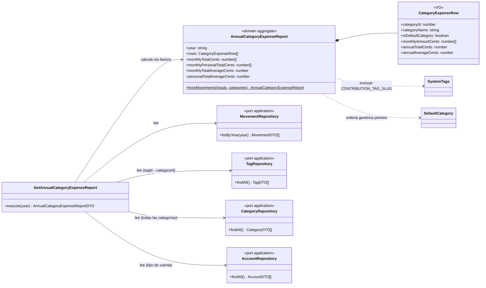

# Data Model: Informe anual de gastos por categorías

**Branch**: `015-informe-anual-gastos` | **Date**: 2026-11-04

## Modelo de datos persistente

**Sin cambios.** FR-005: el informe es una agregación de lectura calculada en la capa de aplicación/dominio a partir de `movements`, `tags` y `tag_categories` existentes. No hay migraciones, ni nuevas tablas, ni columnas.

El join tag → categoría se resuelve **en memoria** en el caso de uso (`TagRepository.findAll()` → mapa `tagId → categoryId`), sin extender `MovementTagDTO` (congelado por 027).

## Entidades nuevas (cálculo puro, no persistidas)

### Agregado de dominio `AnnualCategoryExpenseReport`

Construido por su factory `AnnualCategoryExpenseReport.fromMovements(inputs, categories)`; inmutable.

| Miembro | Tipo | Descripción |
|---|---|---|
| `year` | `string` | Año consultado (`^\d{4}$`) |
| `rows` | `ReadonlyArray<CategoryExpenseRow>` | Una fila por categoría (todas), orden catálogo: genérica (`DEFAULT_CATEGORY_SLUG`) primero, resto `localeCompare("es")` |
| `monthlyTotalCents` | `ReadonlyArray<number>` (12) | Fila «Gasto mensual»: total de gastos por mes, mismas exclusiones |
| `monthlyPersonalTotalCents` | `ReadonlyArray<number>` (12) | Fila de gastos personales por mes |
| `monthlyTotalAverageCents` | `number` | Media anual de «Gasto mensual» = total ÷ 12 (half-up) |
| `personalTotalAverageCents` | `number` | Media anual de gastos personales = total ÷ 12 (half-up) |

`CategoryExpenseRow` (VO inmutable del agregado):

| Campo | Tipo | Validación/Regla |
|---|---|---|
| `categoryId` | `number` | — |
| `categoryName` | `string` | No vacío |
| `isDefaultCategory` | `boolean` | `true` para la genérica (orden de fila) |
| `monthlyAmountCents` | `ReadonlyArray<number>` | Siempre 12 posiciones, 0 en meses sin gastos |
| `annualTotalCents` | `number` | Σ de los 12 meses |
| `annualAverageCents` | `number` | `annualTotalCents ÷ 12`, redondeo half-up al céntimo |

Entrada del factory (`AnnualExpenseInput`, tipo de entrada del caso de uso — mapeo de DTOs a primitivas):

| Campo | Descripción |
|---|---|
| `month` (`"YYYY-MM"`) | Mes del movimiento (de `date`) |
| `type` | Solo computan `"expense"` |
| `nature` | `"own" \| "shared"` |
| `amountCents` | Importe positivo del gasto |
| `tagSlug` | Para exclusión por etiqueta protegida (`isProtectedTagSlug`) |
| `tagCategoryId` | Categoría de la etiqueta del movimiento (1..N, obligatoria por 026) |
| `accountKind` | `"personal" \| "common"` (para la fila de gastos personales) |

**Reglas de cálculo (selladas en el dominio):**

1. Celda (categoría × mes) = Σ `amountCents` de gastos del mes cuya etiqueta pertenece a la categoría, excluida la etiqueta protegida `CONTRIBUTION_TAG_SLUG` («Aportación Común»), con independencia del estado activa/inactiva de la etiqueta y de la cuenta/naturaleza.
2. Fila «Gasto mensual» (mes) = Σ de todos los gastos del mes con la misma exclusión.
3. Fila de gastos personales (mes) = Σ de gastos con `nature = "own"` **y** `accountKind = "personal"`, misma exclusión.
4. Media anual = total ÷ 12 siempre (también año en curso), half-up al céntimo, en céntimos enteros (ADR 0007).
5. Todas las categorías aparecen como fila (a 0,00 € si no hay gastos); las 12 columnas mensuales existen siempre.

### Caso de uso `GetAnnualCategoryExpenseReport`

`src/application/movement/GetAnnualCategoryExpenseReport.ts`. Puertos inyectados (todos existentes, sin métodos nuevos):

- `MovementRepository.listByYear(year)` → `MovementDTO[]`
- `TagRepository.findAll()` → `TagDTO[]` (incluye desactivadas)
- `CategoryRepository.findAll()` → `CategoryDTO[]`
- `AccountRepository.findAll()` → `AccountDTO[]` (tipo de cuenta para la fila personal)

`execute(year: string)` valida `^\d{4}$` (lanza error de dominio si no), mapea DTOs → entradas primitivas (resolviendo `tagId → categoryId` en memoria) y devuelve `AnnualCategoryExpenseReportDTO`.

### DTO de aplicación

En `src/application/movement/dto.ts`:

```ts
type CategoryExpenseRowDTO = {
  categoryId: number;
  categoryName: string;
  monthlyAmountCents: number[]; // 12
  annualTotalCents: number;
  annualAverageCents: number;
};
type AnnualCategoryExpenseReportDTO = {
  year: string;
  rows: CategoryExpenseRowDTO[];           // orden catálogo
  monthlyTotalCents: number[];             // 12, fila «Gasto mensual»
  monthlyPersonalTotalCents: number[];     // 12
  monthlyTotalAverageCents: number;
  personalTotalAverageCents: number;
};
```

### Diagrama de clases (diseño)



## Glosario

- **Aportación Común**: etiqueta protegida (slug `aportacion-comun`), excluida de todo el informe.
- **Categoría genérica**: slug `general` (`DEFAULT_CATEGORY_SLUG`); siempre primera fila.
- **Gasto personal**: gasto de naturaleza propia registrado en una cuenta personal, excluida la aportación común.

## State transitions

No aplica: agregado de lectura inmutable, sin estados ni persistencia.
