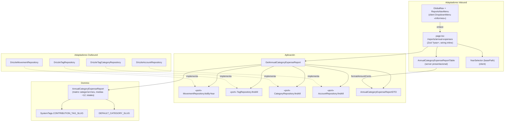

# Implementation Plan: Informe anual de gastos por categorías

**Branch**: `015-informe-anual-gastos` | **Date**: 2026-11-04 | **Spec**: [spec.md](./spec.md)

**Input**: Feature specification from `/specs/015-informe-anual-gastos/spec.md`

## Summary

Informe nuevo de lectura pura en `/reports/annual-expenses?year=YYYY`: una fila por categoría del catálogo (todas, también sin gastos), 12 columnas mensuales fijas + «Media anual» (total ÷ 12 half-up), y dos filas finales («Gasto mensual» y gastos personales). Computan todos los gastos de todas las cuentas y naturalezas, excluida la etiqueta protegida «Aportación Común». Acceso desde un menú nuevo «Informes» en la navegación global. Agregación calculada en un agregado puro de dominio (`AnnualCategoryExpenseReport`, patrón de `AnnualIncomeStatement` de 009) a partir de puertos existentes: **sin cambios de esquema, sin puertos nuevos, sin tocar `/summary` ni `/annual`** (FR-005).

## Technical Context

**Language/Version**: TypeScript estricto, Node.js LTS, Next.js (App Router).

**Primary Dependencies**: Next.js, React 19, Drizzle ORM + SQLite/Turso (solo lectura de esquema existente), Zod (validación de `searchParams`), Tailwind CSS + shadcn/ui (DropdownMenu, Select ya versionados).

**Storage**: SQLite/Turso vía Drizzle — **sin cambios**: lee `movements`, `tags`, `tag_categories`, `accounts` existentes.

**Testing**: Vitest (dominio/aplicación con puertos dobles; UI con Testing Library jsdom), Playwright e2e (`e2e/informe-anual-gastos.spec.ts`, año propio 2024, `workers: 1`).

**Target Platform**: Web (local `npm run dev`; Vercel + Turso en prod).

**Project Type**: Monolito Next.js con arquitectura hexagonal (web-app).

**Performance Goals**: N/A (uso individual; agregación en memoria de un año de movimientos familiares).

**Constraints**: Server component de lectura pura, sin estado mutable ni envíos; UI solo anidadora (constitución VII).

**Scale/Scope**: 1 US; ~6 ficheros nuevos + 2 tocados (`global-nav.tsx`, `year-selector.tsx`).

## Constitution Check

*GATE: Must pass before Phase 0 research. Re-check after Phase 1 design.*

| Principio | Estado | Notas |
|---|---|---|
| I. Simplicidad Primero | ✅ | Monolito, cero artefactos nuevos; reutiliza puertos, `YearSelector` y `DropdownMenu` existentes |
| II. Spec-Driven | ✅ | Spec 015 aprobada; este plan la desarrolla; tasks después |
| III. Calidad Verificada | ✅ | Tests de agregación (dominio), componentes y e2e aislado por año (FR-007) |
| IV. TypeScript Estricto | ✅ | DTOs tipados; Zod en la frontera (`searchParams`) |
| V. Persistencia SQLite/Drizzle | ✅ | Sin migraciones ni cambios de esquema (FR-005) |
| VI. Producto en español, código en inglés | ✅ | Literales UI en español; identificadores en inglés (`AnnualCategoryExpenseReport`, `reports/annual-expenses`) |
| VII. Hexagonal + DDD | ✅ | Aritmética en dominio puro; caso de uso orquesta puertos existentes; UI presentacional; puertos en aplicación, sin puertos nuevos |

Re-evaluado tras Phase 1: sin desviaciones → **Complexity Tracking vacío**.

## Project Structure

### Documentation (this feature)

```text
specs/015-informe-anual-gastos/
├── plan.md              # This file
├── research.md          # Phase 0 output
├── data-model.md        # Phase 1 output
├── quickstart.md        # Phase 1 output
├── contracts/
│   └── ui-contracts.md  # Phase 1 output
└── tasks.md             # Phase 2 output (/speckit.tasks)
```

### Source Code (repository root)

```text
src/
├── domain/
│   └── movement/
│       └── AnnualCategoryExpenseReport.ts        # agregado puro: matriz, exclusiones, medias, totales (+ .test.ts)
├── application/
│   └── movement/
│       ├── GetAnnualCategoryExpenseReport.ts     # caso de uso: 4 puertos existentes, join tag→categoría en memoria (+ .test.ts)
│       └── dto.ts                                # + AnnualCategoryExpenseReportDTO, CategoryExpenseRowDTO
├── app/
│   └── reports/
│       └── annual-expenses/
│           └── page.tsx                          # adaptador inbound fino: Zod ?year=, wiring inline, render
└── infrastructure/
    └── primary/
        └── ui/
            ├── annual-expense-report-table.tsx   # server presentacional: tabla 12 meses + media + 2 totales (+ .test.tsx)
            ├── reports-nav-menu.tsx              # client: DropdownMenu «Informes» → único ítem (+ .test.tsx)
            ├── global-nav.tsx                    # (tocado) integra ReportsNavMenu, active: "reports"
            └── year-selector.tsx                 # (tocado) prop basePath opcional, retrocompatible
e2e/
└── informe-anual-gastos.spec.ts                  # año propio 2024: filas, medias, totales, exclusión
```

**Structure Decision**: única estructura (monolito Next.js existente); réplica del patrón 009 (`GetAnnualIncomeStatement` + `AnnualIncomeStatement` + página server con wiring inline por render).

## Diagramas de diseño

### Componentes que intervienen



### Secuencia — happy path

```mermaid
sequenceDiagram
    actor User as Propietario
    participant Nav as GlobalNav / ReportsNavMenu
    participant Page as page.tsx (/reports/annual-expenses)
    participant UC as GetAnnualCategoryExpenseReport
    participant Repo as Repositorios Drizzle
    participant Dom as AnnualCategoryExpenseReport (dominio)

    User->>Nav: abre «Informes» → «Gastos por categoría»
    Nav-->>User: GET /reports/annual-expenses (año actual)
    User->>Page: GET /reports/annual-expenses?year=2026
    Page->>Page: Zod valida year (fallback currentYear())
    Page->>UC: execute("2026")
    par lecturas
        UC->>Repo: MovementRepository.listByYear("2026")
        UC->>Repo: TagRepository.findAll()
        UC->>Repo: CategoryRepository.findAll()
        UC->>Repo: AccountRepository.findAll()
    end
    UC->>UC: mapea DTOs → entradas (tagId → categoryId, accountKind)
    UC->>Dom: AnnualCategoryExpenseReport.fromMovements(inputs, categories)
    Dom->>Dom: excluye CONTRIBUTION_TAG_SLUG; acumula categoría×mes;<br/>medias = total ÷ 12 (half-up);<br/>totales «Gasto mensual» y personales (own + cuenta personal)
    Dom-->>UC: agregado (todas las categorías, 12 meses)
    UC-->>Page: AnnualCategoryExpenseReportDTO
    Page-->>User: GlobalNav + YearSelector + tabla (filas por categoría,<br/>12 columnas, «Media anual», 2 filas de totales)
```

## Complexity Tracking

> **Fill ONLY if Constitution Check has violations that must be justified**

| Violation | Why Needed | Simpler Alternative Rejected Because |
|-----------|------------|-------------------------------------|
| — (sin violaciones) | — | — |
