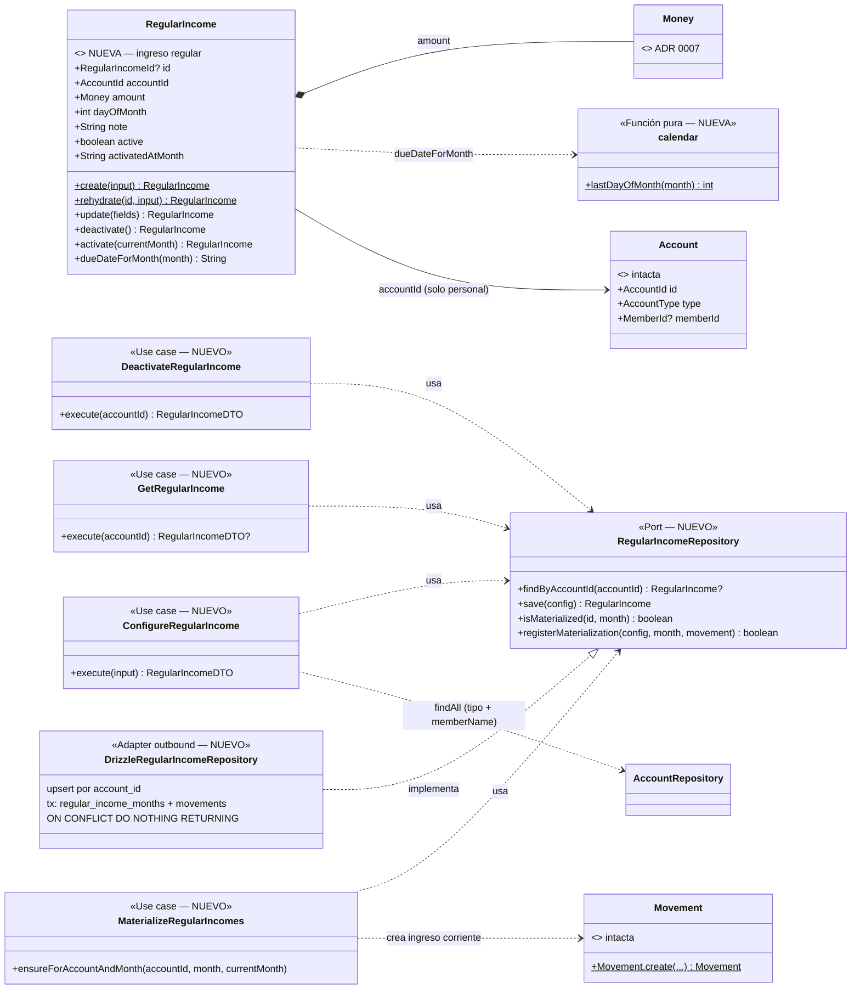
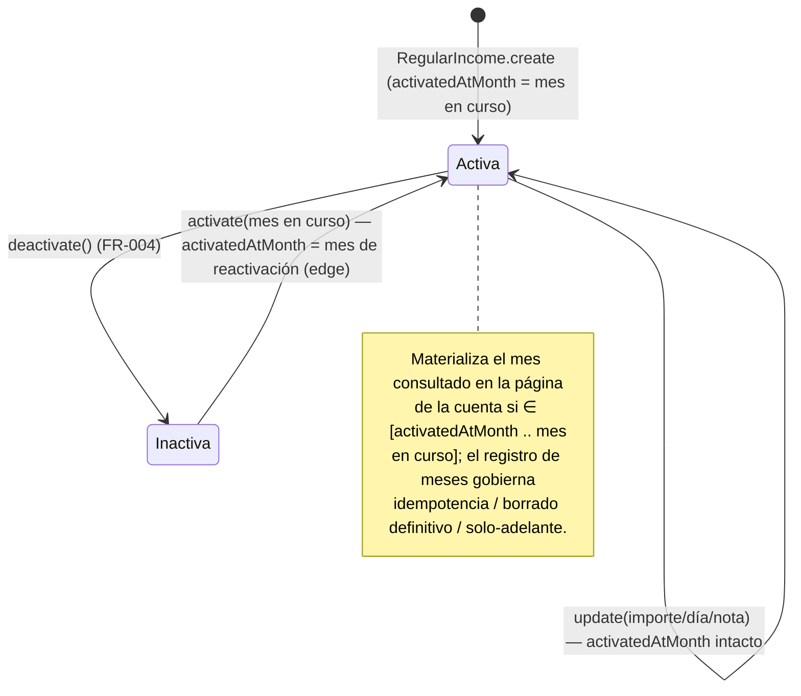

# Data Model: Ingresos mensuales regulares por miembro

**Feature**: `018-ingresos-regulares` | **Fecha**: 2026-10-12

Dos vistas del mismo modelo: **dominio** (entidades, funciones puras, principio VII) y **persistencia** (tablas Drizzle, principio V). Esta feature añade el agregado **`RegularIncome`** (ingreso regular) con su registro de meses materializados; `Movement`, `Account`, `Member` y `Tag` quedan **intactos** (el ingreso materializado es un movimiento corriente más, FR-003). Añade una migración aditiva (dos tablas nuevas).

---

## 1. Vista de Dominio

### 1.1 Value Objects y funciones puras

Sin cambios: `Money` (ADR 0007), `MovementType`, `ExpenseNature`, `AccountType`, IDs existentes (`MemberId`, `AccountId`, `TagId`, `MovementId`).

**NUEVO — `RegularIncomeId`** (`src/domain/regular-income/RegularIncomeId.ts`): branded type número entero > 0, mismo patrón que `MovementId`.

**NUEVO — helper calendario puro** (`src/domain/shared/calendar.ts`, sin dependencias — el dominio no puede importar `ui/format.ts`, VII):

| Función | Regla | Ejemplo |
|---|---|---|
| `lastDayOfMonth(month: string): number` | `new Date(y, m, 0).getDate()` sobre `YYYY-MM` | `"2026-02"` → 28; `"2028-02"` → 29; `"2026-04"` → 30 |

Invariante documentada del formato `YYYY-MM`: la comparación lexicográfica coincide con la cronológica (longitud fija, prefijo cero) — ordenar, comparar y acotar meses (guardas de materialización) es comparar strings. Un helper `monthRange` solo volvería si la materialización se re-extiende a rangos (YAGNI, principio I; decisión del propietario 2026-10-12).

### 1.2 Entidad `RegularIncome` (Ingreso regular) — NUEVA

`src/domain/regular-income/RegularIncome.ts` (inmutable, `Object.freeze`, patrón de `Movement`):

| Campo | Tipo | Regla |
|---|---|---|
| id | `RegularIncomeId \| null` | `null` en transitoria; asignado al persistir |
| accountId | `AccountId` | Cuenta **personal** del miembro; única por cuenta (un ingreso regular por miembro, asunción de la spec) |
| amount | `Money` | `amountCents > 0`, entero, ≤ `MAX_AMOUNT_CENTS` (vía `Money.fromCents`) |
| dayOfMonth | `number` | Entero 1–31; **default 1**; se conserva tal cual aunque el mes no lo tenga (clarificación 2026-10-12) |
| note | `string` | No vacía tras trim; default aplicado en el caso de uso: **«Ingreso regular de {memberName}»** |
| active | `boolean` | Nace `true`; desactivable/reactivable |
| activatedAtMonth | `string` | `YYYY-MM`; mes de alta o última reactivación; **no cambia en las ediciones** (solo-adelante + edge reactivación) |

Factories y métodos:

```ts
RegularIncome.create(input): RegularIncome          // valida todo; activatedAtMonth obligatorio
RegularIncome.rehydrate(id, input): RegularIncome   // desde persistencia
regularIncome.update({ amount?, dayOfMonth?, note? }): RegularIncome   // NO toca active ni activatedAtMonth
regularIncome.deactivate(): RegularIncome           // active=false; conservando el resto (y activatedAtMonth)
regularIncome.activate(currentMonth): RegularIncome  // active=true; activatedAtMonth = currentMonth (reset)
regularIncome.dueDateForMonth(month: string): string  // `${month}-${min(dayOfMonth, lastDayOfMonth(month))}` → "YYYY-MM-DD"
```

Errores de dominio (`src/domain/regular-income/RegularIncomeErrors.ts`):

| Error | Regla que la dispara | Mensaje (literal congelado) |
|---|---|---|
| `InvalidRegularIncomeError(field, message)` — fields: `"dayOfMonth" \| "note" \| "activatedAtMonth"` | día fuera de 1–31; nota vacía; mes mal formado | «El día del mes debe estar entre 1 y 31.» |
| `InvalidMoneyError` (reutilizado de `movement`) | importe ≤ 0 / no entero / > máximo | «El importe debe ser mayor que cero.» |
| `SharedAccountIncomeError` | configurar la cuenta común (desde el caso de uso) | «La cuenta común no puede tener ingreso regular.» |
| `RegularIncomeNotFoundError` | desactivar sin configuración previa | «No existe ingreso regular para esta cuenta.» |

### 1.3 Casos de uso (aplicación) — NUEVOS en `src/application/regular-income/`

```ts
class ConfigureRegularIncome {          // upsert → siempre activa (crea o (re)activa)
  constructor(regularIncomes: RegularIncomeRepository, accounts: AccountRepository)
  async execute(input: {
    accountId: number; amountCents: number; dayOfMonth: number;
    note: string | null; currentMonth: string;   // YYYY-MM, calculado por el adaptador
  }): Promise<RegularIncomeDTO>
}

class DeactivateRegularIncome {
  constructor(regularIncomes: RegularIncomeRepository)
  async execute(accountId: number): Promise<RegularIncomeDTO>   // sin config → RegularIncomeNotFoundError
}

class GetRegularIncome {
  constructor(regularIncomes: RegularIncomeRepository)
  async execute(accountId: number): Promise<RegularIncomeDTO | null>
}

class MaterializeRegularIncomes {
  constructor(regularIncomes: RegularIncomeRepository)
  async ensureForAccountAndMonth(accountId: number, month: string, currentMonth: string): Promise<void>
}
```

Orquestación de `ConfigureRegularIncome` (research §4): resolver cuenta con `accounts.findAll()` (valida existencia, rechaza `type === "shared"` con `SharedAccountIncomeError` y proporciona `memberName` para el default de nota) → nota final `input.note?.trim() || "Ingreso regular de {memberName}"` → si había config: `existing.update({...})` + `existing.activate(currentMonth)` solo si estaba inactiva; si no: `RegularIncome.create({..., activatedAtMonth: currentMonth})` → `save`.

Orquestación de `MaterializeRegularIncomes` (research §3; invocada solo por la página de cuenta, antes de leer — decisión del propietario 2026-10-12): cargar la config de la cuenta (`findByAccountId`; inexistente o inactiva → no-op) → si `activatedAtMonth ≤ mes ≤ currentMonth` (comparación lexicográfica) y `isMaterialized` es falso → `Movement.create({ accountId, type: "income", date: config.dueDateForMonth(mes), note: config.note, amount: config.amount, nature: null, tagId: null })` + `registerMaterialization(config, mes, movement)` (transaccional). Guardas estructurales: mes futuro (`mes > currentMonth`) y mes anterior a la activación nunca se materializan (FR-005); config inactiva no participa (FR-004 desactivación).

### 1.4 Puerto `RegularIncomeRepository` — NUEVO (`src/application/regular-income/RegularIncomeRepository.ts`)

```ts
export interface RegularIncomeRepository {
  findByAccountId(accountId: AccountId): Promise<RegularIncome | null>;
  save(config: RegularIncome): Promise<RegularIncome>;            // upsert por account_id → entidad con id
  isMaterialized(regularIncomeId: RegularIncomeId, month: string): Promise<boolean>;
  registerMaterialization(config: RegularIncome, month: string, movement: Movement): Promise<boolean>;
  // true  = par (config, mes) registrado ahora + movimiento creado (tx única)
  // false = el par ya existía (carrera perdida o reintentos) → NO se crea movimiento
}
```

El puerto queda en aplicación (VII); `registerMaterialization` encapsula la atomicidad registro+movimiento para que la idempotencia no dependa del orden de dos llamadas del use case.

### 1.5 Diagrama de clases (diseño)



> Diferencias con `docs/architecture/diagrams/domain-model.md` (vivo, a actualizar en la implementación): aparecen `RegularIncome`, `calendar` y los cuatro casos de uso/puerto nuevos; `Movement`, `Account` y `Money` no cambian.

### 1.6 Transiciones de estado



---

## 2. Vista de Persistencia (Drizzle, SQLite/Turso)

### 2.1 Tablas — NUEVAS (migración aditiva `drizzle/0003_*.sql`, generada con drizzle-kit y commiteada)

`src/infrastructure/db/schema/regular-incomes.ts` (reexportada en `schema/index.ts`):

```text
regular_incomes                                   # configuración (1 por cuenta personal)
├── id: integer PK
├── account_id: integer NOT NULL UNIQUE → accounts(id)     ← un ingreso regular por miembro
├── amount_cents: integer NOT NULL                          ← > 0 (valida dominio)
├── day_of_month: integer NOT NULL                          ← 1–31 (default 1 aplica la UI/caso de uso)
├── note: text NOT NULL
├── active: integer(0/1) NOT NULL
├── activated_at_month: text NOT NULL                       ← YYYY-MM
├── created_at: text NOT NULL
└── updated_at: text NULL

regular_income_months                             # registro de meses materializados (idempotencia)
├── id: integer PK
├── regular_income_id: integer NOT NULL → regular_incomes(id) ON DELETE CASCADE
├── month: text NOT NULL                                     ← YYYY-MM materializado
├── created_at: text NOT NULL
└── UNIQUE (regular_income_id, month)                        ← invariante FR-002/FR-004

movements, accounts, members, tags                # INTACTAS (el ingreso materializado es un movimiento corriente)
```

`movements` **no gana columnas ni unicidades**: la marca de «ya generado» vive en `regular_income_months`, no en el movimiento (research §2) — así el borrado físico del movimiento no regenera el mes (FR-004) y la edición manual es libre (FR-003).

### 2.2 Repositorio `DrizzleRegularIncomeRepository` — NUEVO

- `findByAccountId`: SELECT → `RegularIncome.rehydrate`.
- `save`: upsert `insert ... onConflictDoUpdate({ target: account_id })` returning → entidad con id.
- `isMaterialized(id, month)`: `SELECT 1 WHERE regular_income_id = ? AND month = ? LIMIT 1` (comparación exacta de `YYYY-MM`).
- `registerMaterialization(config, month, movement)`: **transacción Drizzle**: (1) `INSERT INTO regular_income_months (regular_income_id, month, created_at) ON CONFLICT DO NOTHING RETURNING id`; (2) solo si devolvió fila: insert del movimiento en `movements` (id con `coalesce(max(id),0)+1`, mismo patrón que `DrizzleMovementRepository.create`, dentro de la misma tx) → `true`; sin fila → `false` sin escribir. Bajo dos renders concurrentes del mismo mes, exactamente una petición inserta el movimiento.

### 2.3 Seed y migraciones

- `seed-data.ts` / `scripts/seed.ts` **intactos**: la configuración nace del usuario, no del catálogo.
- Migración **aditiva** (`CREATE TABLE` ×2 + FK + unique): sin recreaciones destructivas (contraste con 0002/ADR 0014); `npm run db:migrate` en dev, y en prod como paso pre-deploy con `drizzle.prod.config.ts` (convención AGENTS.md).

---

## 3. Validación por capa (dónde vive cada regla)

| Regla | Zod (frontera, action) | Dominio / Aplicación | DB (constraint) |
|---|---|---|---|
| Importe obligatorio, > 0, formato ES (`2000`, `2000,50`) | ✅ `regularIncomeFormSchema` + `parseAmountToCents` reutilizado; «El importe es obligatorio.» / «Introduce un importe válido (ej. 2000,00).» / «El importe debe ser mayor que cero.» | ✅ `Money.fromCents` → `InvalidMoneyError` (mismo literal de importe) | `amount_cents` integer (sin CHECK; la regla vive arriba) |
| Día del mes 1–31 (default 1) | ✅ `z.string()` dígitos → int 1–31; «El día del mes debe estar entre 1 y 31.» | ✅ `RegularIncome.create/update` → `InvalidRegularIncomeError` | `day_of_month integer NOT NULL` |
| Nota no vacía (default «Ingreso regular de {miembro}») | ✅ opcional `trim` → `string \| null` | ✅ default en `ConfigureRegularIncome`; no-vacía validada en la entidad | `note text NOT NULL` |
| Solo cuentas personales | — (el panel no se monta en la común) | ✅ `ConfigureRegularIncome` → `SharedAccountIncomeError` | — (invariante de negocio, no de esquema) |
| Un ingreso regular por miembro | — | ✅ upsert por cuenta | ✅ `account_id UNIQUE` |
| Un movimiento por (config, mes) | — | ✅ `registerMaterialization` condicionado al registro | ✅ `UNIQUE (regular_income_id, month)` + `ON CONFLICT DO NOTHING` |
| Meses válidos `YYYY-MM` (URL) | ✅ `monthParamSchema` existente en páginas | ✅ `activatedAtMonth` validado en la entidad | texto |
| Sin retroactivo ni futuro | — | ✅ guardas `activatedAtMonth ≤ mes ≤ currentMonth` (comparación lexicográfica de `YYYY-MM`) | — |

**Mapeo de errores en la action** `configureRegularIncome`: Zod → `errors` por campo (`amount`/`dayOfMonth`/`note`) con `values` conservados; `InvalidMoneyError` → `amount`; `InvalidRegularIncomeError` → su campo; `SharedAccountIncomeError` / `RegularIncomeNotFoundError` / resto de `DomainError` → `_form` con su mensaje. Nunca se lanza al cliente (mismos criterios que `create-movement.action.ts`).

---

## 4. DTOs y contrato de la Server Action

```ts
// NUEVO — src/application/regular-income/dto.ts
RegularIncomeDTO {
  accountId: number;
  amountCents: number;
  dayOfMonth: number;
  note: string;
  active: boolean;
  activatedAtMonth: string;   // YYYY-MM
}

// NUEVO — src/infrastructure/primary/actions/configure-regular-income.action.ts
type ConfigureRegularIncomeState =
  | { status: "idle" }
  | { status: "success"; message: string }        // «Ingreso regular guardado» | «Ingreso regular desactivado»
  | { status: "error"; errors: { amount?: string[]; dayOfMonth?: string[]; note?: string[]; _form?: string[] };
      values: { amount: string; dayOfMonth: string; note: string } };

configureRegularIncome(_prevState, formData): Promise<ConfigureRegularIncomeState>
// FormData: accountId, amount, dayOfMonth, note, intent ("save" | "deactivate")
// intent="deactivate" → valida solo accountId → DeactivateRegularIncome (no exige importe/día)
// éxito → revalidatePath("/", "layout") → el refresco RSC dispara la materialización del mes en curso
```

Las actions y el schema de movimientos (`create/update/delete`, `movement-form.schema`) **no cambian**; solo se reutiliza `parseAmountToCents`.

---

## 5. Glosario ES ↔ EN (constitución VI)

| Español (UI/spec) | English (código) | Notas |
|---|---|---|
| Ingreso regular | `RegularIncome` | Entidad de dominio; término de la spec |
| Ingreso regular del miembro | `RegularIncome` anclado a la cuenta personal | `account_id` (la propiedad vive en `Account.memberId`) |
| Mes de activación | `activatedAtMonth` | Alta o última reactivación; no cambia al editar |
| Materialización (del ingreso de un mes) | `registerMaterialization` / materialization | Creación perezosa del movimiento al consultar el mes en la página de la cuenta (único disparador; decisión 2026-10-12) |
| Registro de meses materializados | `regular_income_months` (tabla) / `isMaterialized` | Fuente de idempotencia y borrado definitivo |
| Solo hacia adelante | forward-only semantics | Emergente: solo meses sin registro leen la config vigente |
| Último día del mes (clamp) | `lastDayOfMonth` / `dueDateForMonth` | Día 30/31 en meses cortos (clarificación 2026-10-12) |
| Desactivar / Reactivar | `deactivate` / `activate` | Reactivar resetea `activatedAtMonth` |
| Configurar ingreso (CTA) | `configureRegularIncome` | Caso de uso + Server Action |

Sin identificadores intraducibles nuevos fuera de los listados.
