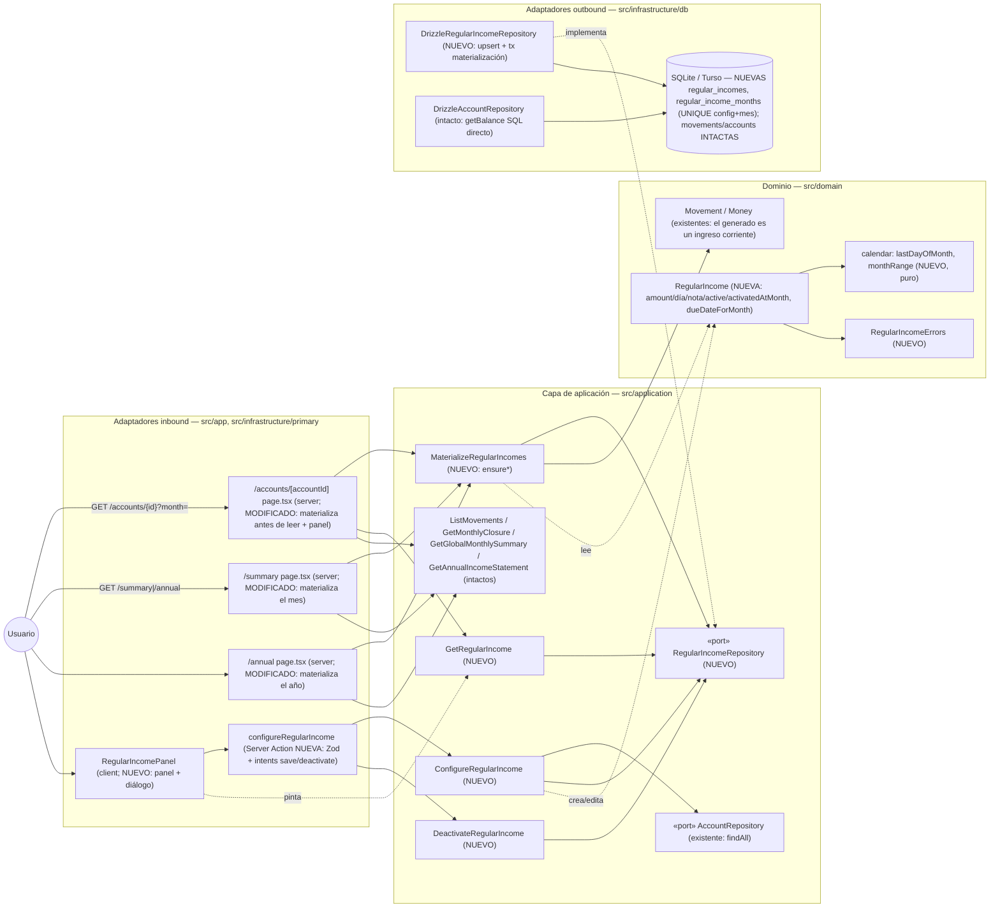
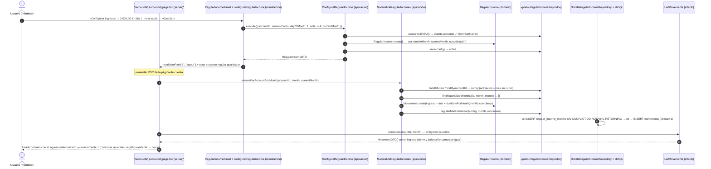

# Implementation Plan: Ingresos mensuales regulares por miembro

**Branch**: `feature/018-ingresos-regulares` | **Date**: 2026-10-12 | **Spec**: [spec.md](./spec.md)

**Input**: Feature specification from `/specs/018-ingresos-regulares/spec.md`

## Summary

La captura más repetitiva de la app —el ingreso habitual de cada miembro (p. ej. la nómina), registrado a mano mes a mes— pasa a ser **configuración**: cada miembro define una sola vez su ingreso regular (importe > 0, día del mes, nota) en su cuenta personal, y cada mes consultado desde la activación hasta el mes en curso lo trae **ya materializado como movimiento de ingreso corriente**, de forma idempotente y sin retroactivo. La aportación porcentual a la cuenta común queda como feature hija futura (p. ej. 019) que se construirá sobre este ingreso regular (decisión del propietario 2026-10-09).

Enfoque técnico (detalles y alternativas en [research.md](./research.md)):

- **Entidad `RegularIncome`** anclada a la **cuenta personal** (`account_id UNIQUE`): la propiedad miembro→cuenta ya vive en `Account.memberId`; la invariante «no en la cuenta común» usa el `AccountType` existente. Defaults: día 1, nota «Ingreso regular de {miembro}», sin etiqueta.
- **Idempotencia por registro de meses materializados** (`regular_income_months`, `UNIQUE (config, mes)`): la materialización de un mes es «si el par no existe, crear movimiento + fila en una transacción (`ON CONFLICT DO NOTHING RETURNING`)». Así las consultas repetidas nunca duplican, **el borrado del movimiento no regenera el mes** (la fila sobrevive al borrado físico) y los cambios de config solo aplican a meses sin registro (solo-adelante, clarificación 2026-10-12). **`movements` queda intacta**: el generado es un movimiento corriente (FR-003), editable/borrable con los flujos existentes.
- **Materialización perezosa al consultar** (serverless sin cron, asunción de la spec): caso de uso `MaterializeRegularIncomes` invocado **antes de leer** por las tres páginas que muestran datos de mes/año — cuenta (`ensureForAccountAndMonth`), `/summary` (`ensureForMonth`) y `/annual` (`ensureForYear`) — con guardas estructurales `activación ≤ mes ≤ currentMonth` (meses futuros alcanzables por URL en `/summary` quedan blindados, FR-005). Coste habitual: una SELECT.
- **Semántica de activación**: alta y reactivación fijan `activatedAtMonth = mes en curso` (sin relleno retroactivo del periodo inactivo); las **ediciones no lo tocan**. `currentMonth` entra como parámetro del adaptador (aplicación pura, sin puerto Clock).
- **UI**: `RegularIncomePanel` al final de la página de la cuenta personal (respeta el list-first de 016) con diálogo `useActionState(configureRegularIncome)` e intents `save`/`deactivate` (patrón 014); `revalidatePath("/", "layout")` hace visible el ingreso del mes al guardar.
- **Migración aditiva** (dos tablas nuevas, cero destructivos) y **cero dependencias nuevas**.

## Technical Context

**Language/Version**: TypeScript 5.x en modo estricto sobre Node.js LTS; Next.js 16 (App Router), React 19.

**Primary Dependencies**: las fijadas por la constitución v1.2.1 (next, react, drizzle-orm ~0.44.7, @libsql/client, zod 4, tailwind + shadcn/ui en el repo, sonner, radix-ui). **Cero dependencias nuevas.**

**Storage**: SQLite (dev) / Turso (prod) vía Drizzle. **Migración aditiva nueva** (`drizzle/0003_*.sql` generada con drizzle-kit y commiteada): tablas `regular_incomes` (config, 1 por cuenta personal) y `regular_income_months` (registro de meses materializados, `UNIQUE (regular_income_id, month)`). `movements`, `accounts`, `members` y `tags` intactas; seed intacto (la config nace del usuario). Puerto nuevo `RegularIncomeRepository` (aplicación) + `DrizzleRegularIncomeRepository`.

**Testing**: Vitest (projects node/ui, co-localizados) — dominio (`RegularIncome`, helpers `calendar` con bisiestos y clamping), aplicación (`ConfigureRegularIncome`, `DeactivateRegularIncome`, `GetRegularIncome`, `MaterializeRegularIncomes` con dobles: idempotencia, solo-adelante, sin retroactivo/futuro, borrado-no-regenera, reactivación sin huecos), repositorio (libsql `:memory:`: upsert, rango, transacción `registerMaterialization` ante conflicto), action (Zod, intents, mapeo de errores) y componente (panel/diálogo). Playwright e2e: **spec nueva** `ingresos-regulares.spec.ts` (Cuenta de Miembro A + **mes en curso real dinámico**, con limpieza final natural por escenarios de borrado+desactivación — research §7) que cubre el flujo crítico «configurar → consultar mes → ver ingreso sin duplicados» (FR-008, constitución III).

**Target Platform**: Web (escritorio primero; usable en móvil), Vercel + Turso; sin cambios. La materialización en lectura es precisamente la vía viable en serverless sin estado ni planificador.

**Project Type**: web-app (monolito Next.js, App Router); sin proyectos ni paquetes nuevos.

**Performance Goals**: edge de la spec — la materialización no degrada la apertura del mes: caso habitual (mes ya materializado o sin config) = una SELECT sobre las tablas nuevas; primera materialización = 1 movimiento por mes pendiente (máx. 12 en la primera apertura anual). Sin metas nuevas (1-2 usuarios, 3 cuentas).

**Constraints**: UI en español (literales congelados en el ui-contract); TS estricto + Zod en fronteras (IV); EUR con aritmética en céntimos enteros (ADR 0007); direcciones de dependencia hexagonales (VII); formularios de movimiento (013/014) y tanda de captación intactos (asunción de la spec).

**Scale/Scope**: 1-2 usuarios, 3 cuentas; 1 entidad de dominio + 2 helpers puros (+tests), 4 casos de uso + 1 puerto (+tests), 1 repositorio Drizzle (+tests), 1 migración aditiva, 1 action (+test), 1 componente UI (+test), 3 páginas tocadas (una línea de enganche cada una), 1 spec e2e nueva; documentación viva (ADR 0016, diagramas, overview) y roadmap maestro (FR-007).

## Constitution Check

*GATE: Must pass before Phase 0 research. Re-check after Phase 1 design.*

| # | Principio | Estado pre-diseño | Notas |
|---|-----------|-------------------|-------|
| I | Simplicidad Primero | ✅ PASS | Sin proyectos, paquetes ni abstracciones nuevas: 1 entidad + registro, 1 puerto/use cases siguiendo el patrón existente, 1 action, 1 panel. La materialización perezosa evita cron/infra; el registro de meses es la mínima estructura que sostiene idempotencia + borrado-definitivo + solo-adelante (research §2). Migración aditiva. |
| II | Spec-Driven Development | ✅ PASS | Este plan deriva de `specs/018-ingresos-regulares/spec.md` (petición del propietario 2026-10-09, clarificaciones cerradas 2026-10-12). Una única US pequeña con valor propio; la división en dos features (configuración ahora, aportación % después) es decisión del propietario recogida en la spec. Enmiendas al maestro como FR-007. |
| III | Calidad Verificada | ✅ PASS | La lógica nueva (idempotencia, solo-adelante, sin retroactivo/futuro, clamping de día, validaciones) cubierta por tests de dominio/aplicación/repositorio; flujo crítico «configurar → consultar → ver ingreso sin duplicados» con e2e nueva (FR-008, exigencia explícita de constitución III). |
| IV | TypeScript Estricto + Zod | ✅ PASS | Frontera nueva `regularIncomeFormSchema` (Zod, reutiliza `parseAmountToCents`), param schemas existentes en páginas intactos; `RegularIncomeDTO` y estado de action tipados como unión discriminada; sin `any`. |
| V | Persistencia SQLite con Drizzle | ✅ PASS | Dos tablas nuevas vía migración versionada (drizzle-kit, única vía de evolución); sin SQL ad-hoc fuera de Drizzle; sin destructivos (contraste 0002). El `UNIQUE (config, mes)` materializa en BD la invariante de idempotencia ante carreras. |
| VI | Producto en español, código en inglés | ✅ PASS | Literales nuevos en español congelados en el ui-contract («Ingreso regular», «Configurar ingreso», «Guardar», «Desactivar», toasts y errores exactos); identificadores en inglés (`RegularIncome`, `MaterializeRegularIncomes`, `registerMaterialization`); glosario ampliado (data-model §5). |
| VII | Arquitectura Hexagonal + DDD Táctico | ✅ PASS | `RegularIncome` y helpers `calendar` puros en dominio (sin imports de infra; `ui/format.ts` queda en el adaptador); casos de uso y puerto `RegularIncomeRepository` en aplicación; páginas, action, panel y repositorio Drizzle como adaptadores; las páginas solo orquestan (materializar antes de leer). Sin eventos, CQRS ni EDA; `movements` y su agregado intactos. |

**Resultado**: sin violaciones → Phase 0 autorizada.

## Project Structure

### Documentation (this feature)

```text
specs/018-ingresos-regulares/
├── plan.md                     # This file (/speckit.plan command output)
├── research.md                 # Phase 0 output (/speckit.plan command)
├── data-model.md               # Phase 1 output (/speckit.plan command)
├── quickstart.md               # Phase 1 output (/speckit.plan command)
├── contracts/
│   └── ui-contract.md          # Contrato UI + Server Action configureRegularIncome + garantías de la materialización
└── tasks.md                    # Phase 2 output (/speckit.tasks command - NOT created by /speckit.plan)
```

### Source Code (repository root)

```text
├── src/
│   ├── domain/
│   │   ├── regular-income/             # NUEVO agregado
│   │   │   ├── RegularIncome.ts        # NUEVO: entidad (amount: Money, dayOfMonth 1-31, note, active, activatedAtMonth; create/rehydrate/update/deactivate/activate/dueDateForMonth con clamp)
│   │   │   ├── RegularIncome.test.ts   # NUEVO: validaciones, clamping (31→feb/abr), transiciones y conservación de activatedAtMonth en update
│   │   │   ├── RegularIncomeId.ts      # NUEVO: branded id (patrón MovementId)
│   │   │   └── RegularIncomeErrors.ts  # NUEVO: InvalidRegularIncomeError, SharedAccountIncomeError, RegularIncomeNotFoundError
│   │   ├── shared/
│   │   │   ├── calendar.ts             # NUEVO: lastDayOfMonth + monthRange (puros; el dominio no importa ui/format)
│   │   │   └── calendar.test.ts        # NUEVO: bisiestos, cruce de año, from > to → []
│   │   └── movement/, account/, member/, tag/   # INTACTOS (el ingreso materializado es un movimiento corriente)
│   ├── application/
│   │   └── regular-income/             # NUEVO módulo
│   │       ├── RegularIncomeRepository.ts     # NUEVO puerto: findByAccountId, findAllActive, save (upsert), findMaterializedMonths, registerMaterialization (tx)
│   │       ├── dto.ts                  # NUEVO: RegularIncomeDTO
│   │       ├── ConfigureRegularIncome.ts       # NUEVO: upsert siempre-activo; cuenta común rechazada; defaults día 1 y nota «Ingreso regular de {miembro}»; edición no resetea activación
│   │       ├── DeactivateRegularIncome.ts      # NUEVO: sin config → RegularIncomeNotFoundError
│   │       ├── GetRegularIncome.ts             # NUEVO: DTO | null (panel)
│   │       ├── MaterializeRegularIncomes.ts    # NUEVO: ensureForAccountAndMonth / ensureForMonth / ensureForYear; guardas activación ≤ mes ≤ currentMonth; Movement.create + registerMaterialization por mes pendiente
│   │       └── *.test.ts               # NUEVOS: dobles en memoria — idempotencia, solo-adelante, sin retroactivo/futuro, borrado-no-regenera, reactivación, clamping
│   ├── app/
│   │   ├── accounts/[accountId]/page.tsx      # MODIFICADO: materialize antes del Promise.all (solo lectura de datos de mes) + render de RegularIncomePanel en cuentas personales (FR-006)
│   │   ├── summary/page.tsx                   # MODIFICADO: ensureForMonth antes de GetGlobalMonthlySummary
│   │   └── annual/page.tsx                    # MODIFICADO: ensureForYear antes de GetAnnualIncomeStatement
│   └── infrastructure/
│       ├── db/
│       │   ├── schema/regular-incomes.ts      # NUEVO: regularIncomes + regularIncomeMonths (reexport en schema/index.ts)
│       │   ├── DrizzleRegularIncomeRepository.ts    # NUEVO: upsert por account_id; findMaterializedMonths por rango; registerMaterialization en tx (ON CONFLICT DO NOTHING RETURNING + insert de movimiento con id max+1 en la misma tx)
│       │   └── DrizzleRegularIncomeRepository.test.ts  # NUEVO: libsql :memory: — upsert, rango, conflicto concurrente sin duplicar movimiento, movimiento visible a listByMonthAndAccount/getBalance
│       └── primary/
│           ├── actions/
│           │   ├── configure-regular-income.action.ts       # NUEVO: useActionState + regularIncomeFormSchema (reusa parseAmountToCents) + intents save/deactivate + revalidatePath("/", "layout")
│           │   └── configure-regular-income.action.test.ts  # NUEVO: mensajes exactos de importe/día, intent deactivate sin campos, mapeo de dominio, revalidación
│           └── ui/
│               ├── regular-income-panel.tsx        # NUEVO: panel (3 estados) + diálogo de configuración + toasts (data-testid="regular-income-panel")
│               └── regular-income-panel.test.tsx   # NUEVO: estados, guardado, errores con valores conservados, pending deshabilita, desactivar/reactivar
├── drizzle/
│   └── 0003_*.sql                            # NUEVO (generada con drizzle-kit, commiteada): CREATE TABLE regular_incomes + regular_income_months + UNIQUE (config, mes)
├── e2e/
│   └── ingresos-regulares.spec.ts            # NUEVO: flujo crítico — configurar, ver ingreso sin dup en cuenta//summary/annual, editar config conservando mes, borrar no regenera, desactivar (Miembro A, mes en curso dinámico; limpieza final)
│   (resto de specs)                          # INTACTAS (combinación verificada — research §7)
├── scripts/seed.ts, src/infrastructure/db/seed-data.ts   # INTACTOS (la configuración nace del usuario)
├── specs/001-family-wallet/spec.md           # ACTUALIZADO (implementación, FR-007): fila 018 «Completada» + nota de la decisión 2026-10-09 (aportación % a la común como feature hija futura ~019, revive alcance diferido)
└── docs/architecture/
    ├── overview.md, diagrams/domain-model.md, diagrams/ingreso-regular-secuencia.md  # ACTUALIZADOS/NUEVO (implementación): nuevo módulo por capa + secuencia
    ├── adr/0016-materializacion-perezosa-ingresos-regulares.md   # NUEVO: pereza al consultar, registro de meses como idempotencia, movements intacta, enganche en páginas
    └── (AGENTS.md: convención «materialización perezosa» si la implementación la fija — research §8)
```

**Structure Decision**: misma estructura por capas concéntricas que 002–017 (`docs/architecture/overview.md`). El cambio atraviesa las capas en la dirección de dependencias: `RegularIncome` + helpers calendario en el dominio (puros), cuatro casos de uso y el puerto `RegularIncomeRepository` en aplicación, y como adaptadores el repositorio Drizzle (dos tablas nuevas, migración aditiva), tres páginas que materializan antes de leer, y una action + panel de UI. `movements` y sus flujos quedan intactos (FR-003). Tests co-localizados; e2e nueva en fichero propio con combinación cuenta/mes exclusiva (`workers: 1`).

## Diagramas de diseño

Foto del diseño de esta feature (mermaid, como la documentación viva del proyecto); `docs/architecture/diagrams/` se extiende en la fase de implementación reutilizándolos como base. El diagrama de clases del modelo vive en [data-model.md §1.5](./data-model.md).

### Componentes que intervienen



> Nota: dependencias siempre hacia el dominio (constitución VII). Las páginas (adaptadores) orquestan el orden «materializar antes de leer»; la lógica de negocio (qué meses, qué fecha, cuánto) vive en `MaterializeRegularIncomes`/dominio; la UI no decide nada de negocio (captura config, pinta estado).

### Secuencia — happy path: configurar y ver el ingreso del mes materializado



## Complexity Tracking

> **Fill ONLY if Constitution Check has violations that must be justified**

| Violation | Why Needed | Simpler Alternative Rejected Because |
|-----------|------------|-------------------------------------|
| (ninguna) | — | — |

**Decisiones de diseño destacadas (sin violación, registradas para `/speckit.tasks`)**:

- **Registro de meses materializados (`regular_income_months`), no marca en `movements`** (resuelve la nota de la spec sobre la marca de origen): es la única estructura que sostiene a la vez idempotencia ante carreras (`UNIQUE` + `ON CONFLICT DO NOTHING`), «el borrado del mes es definitivo» (la fila sobrevive al borrado físico del movimiento) y solo-adelante (la config solo se lee para meses sin registro); además deja `Movement` y los flujos de edición/borrado intactos (FR-003/FR-004) (research §2).
- **Materialización en las 3 páginas lectoras, antes de leer**: cubre las cinco vías de lectura (incluido `getBalance`, que va detrás en el mismo render de la página de cuenta) y evita huecos en vistas agregadas (`/annual`); guardas `activación ≤ mes ≤ currentMonth` independientes de la UI (FR-005 con `/summary` navegable a meses futuros) (research §3).
- **`currentMonth` como parámetro del adaptador**: misma convención que `?month=`/`year=`; aplicación pura y tests deterministas sin un puerto `Clock` de un solo método (research §3.3/§4).
- **Edición no resetea `activatedAtMonth`; (re)activación sí**: exacta semántica de la clarificación 2026-10-12 y del edge «borrado + reactivación» (meses del periodo inactivo nunca se rellenan; un mes no consultado del periodo activo sí se materializa al consultarlo) (research §4).
- **Helpers calendario propios del dominio** (`lastDayOfMonth`, `monthRange`): el dominio no puede importar `ui/format.ts` (VII); el clamping al último día conserva el día configurado (clarificación 2026-10-12) (research §5).
- **Panel al final de la página de la cuenta personal + diálogo `useActionState` con intents**: respeta el list-first de 016; la desactivación es un botón con intención explícita (no un switch que se envía de rebote) y no exige importe/día válidos (rama Zod propia) (research §6).
- **Spec e2e `ingresos-regulares.spec.ts` con Miembro A + mes en curso dinámico y limpieza final natural**: los escenarios 5-6 (borrar no regenera, desactivar) dejan la BD como estaba — `registro-movimientos` (A+común, mes actual, balances exactos) corre después alfabéticamente y quedaría contaminado; combinación verificada frente a las 8 specs existentes y su orden efectivo (research §7).

## Constitution Check (post-diseño, Phase 1)

Re-evaluación tras generar [research.md](./research.md), [data-model.md](./data-model.md), [contracts/ui-contract.md](./contracts/ui-contract.md) y [quickstart.md](./quickstart.md):

| # | Principio | Estado post-diseño | Notas |
|---|-----------|--------------------|-------|
| I | Simplicidad Primero | ✅ PASS | El diseño añade una entidad + una tabla de registro (mínima estructura que cumple FR-002/FR-004 sin tocar `movements`), cuatro casos de uso, un puerto/repo, una action y un panel; reutiliza `Money`, `parseAmountToCents`, diálogos Radix, toasts e intents de 014. Sin cron, sin borrado blando, sin página nueva, sin dependencias (research §1–§6). |
| II | Spec-Driven Development | ✅ PASS | Cada FR traza a artefacto: FR-001 → data-model §1.2/§2.1 + ui-contract §1–§4; FR-002 → §1.3 `MaterializeRegularIncomes` + §2.2 tx + ui-contract §6; FR-003 → `movements` intacta + ui-contract §6; FR-004 → registro de meses + §1.6 transiciones; FR-005 → guardas de rango; FR-006 → ui-contract §1–§2; FR-007 → Project Structure (roadmap); FR-008 → research §7 + quickstart gates. Los 9 escenarios y los 10 edges quedan cubiertos en ui-contract/quickstart/research §7. |
| III | Calidad Verificada | ✅ PASS | Quickstart con 10 escenarios (espejo de aceptación + edges) + gates; suites nuevas por capa donde la feature arriesga (idempotencia, solo-adelante, futuro/retroactivo, clamping, carrera concurrente en tx); flujo crítico e2e nuevo con aislamiento verificado contra las 8 specs y orden alfabético (SC-005, constitución III). |
| IV | TypeScript Estricto + Zod | ✅ PASS | `regularIncomeFormSchema` valida la frontera con mensajes congelados (rama propia para `intent="deactivate"`); `RegularIncomeDTO` y `ConfigureRegularIncomeState` uniones tipadas; branded `RegularIncomeId`; sin `any` (data-model §3/§4). |
| V | SQLite con Drizzle | ✅ PASS | Migración aditiva versionada (única vía de evolución, sin destructivos); `UNIQUE (regular_income_id, month)` como respaldo de la invariante ante carreras; tx Drizzle para registro+movimiento; sin SQL ad-hoc (data-model §2). |
| VI | Español / inglés | ✅ PASS | Literales congelados en el ui-contract («Ingreso regular», «Configurar ingreso», «Editar ingreso», «Desactivar», «Guardando…», toasts, errores de importe/día/dominio); defaults «día 1» y «Ingreso regular de {miembro}»; identificadores en inglés (`RegularIncome`, `MaterializeRegularIncomes`, `registerMaterialization`, `dueDateForMonth`); glosario ES↔EN ampliado (data-model §5). |
| VII | Arquitectura Hexagonal + DDD táctico | ✅ PASS | Dominio puro (`RegularIncome`, `calendar`, errores — sin imports de infra); puerto y casos de uso en aplicación; páginas/action/panel/repositorio como adaptadores finos; la UI no duplica negocio (pinta DTO, envía FormData); sin eventos/CQRS/EDA; `Movement`/`Account` intactos (data-model §1, diagramas). |

**Resultado**: diseño aprobado; sin desviaciones que justificar. El plan queda listo para `/speckit.tasks`.
