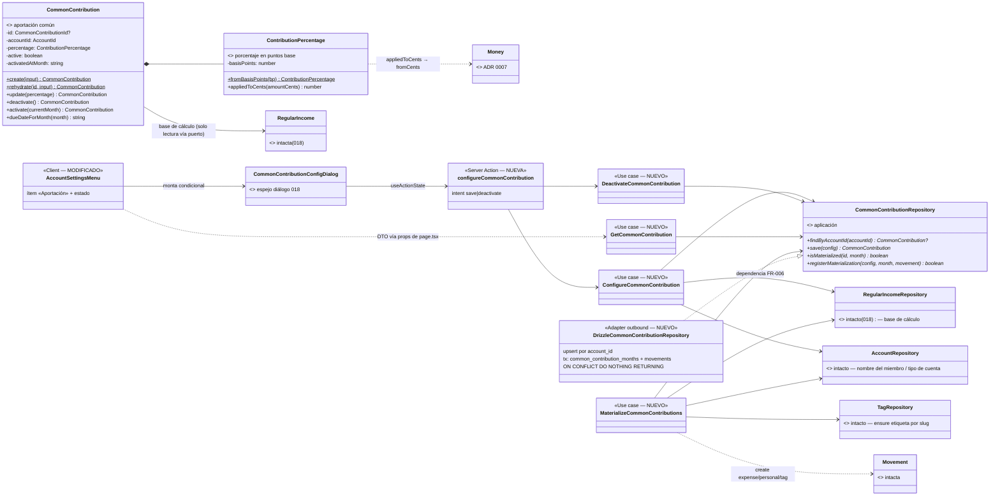
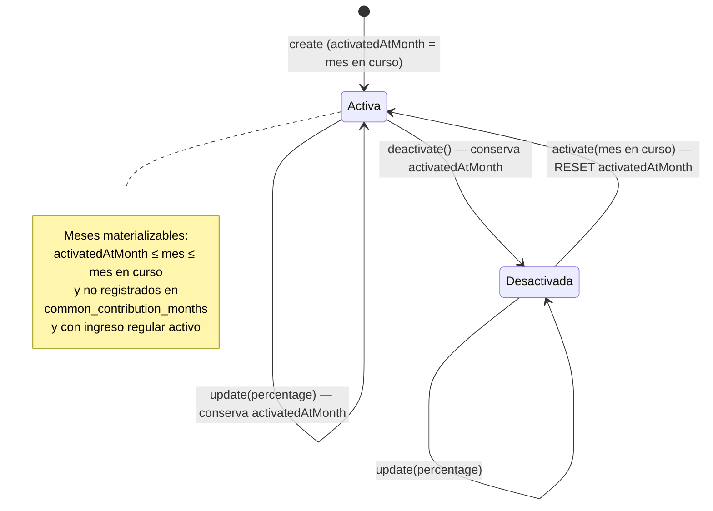

# Data Model — Aportación porcentual a la cuenta común por miembro (019)

**Feature**: `019-aportacion-comun` | **Fecha**: 2026-10-14 | **Spec**: [spec.md](./spec.md) · **Research**: [research.md](./research.md)

Modelo de datos de la feature: un agregado nuevo (`CommonContribution` + VO `ContributionPercentage`), su registro de meses materializados (`common_contribution_months`), un movimiento generado por mes (reglas fijas) y la etiqueta de catálogo «Aportación Común». `movements`, `regular_incomes` y el resto del esquema **no cambian**.

---

## 1. Vista de Dominio (nueva) y de Aplicación

### 1.1 Dominio — `src/domain/common-contribution/` (NUEVO)

#### `ContributionPercentage` (Value Object, nuevo)

| Campo | Tipo | Regla |
|-------|------|-------|
| `basisPoints` | `number` (entero) | `1..10 000`; 1 % = 100 bp, 100,00 % = 10 000 bp. Equivale a porcentaje > 0 y ≤ 100 con ≤ 2 decimales (FR-001). |

```ts
ContributionPercentage.fromBasisPoints(basisPoints: number): ContributionPercentage
  // rechaza no-enteros y fuera de rango con InvalidCommonContributionError("percentage", …)
contributionPercentage.basisPoints: number
contributionPercentage.appliedToCents(amountCents: number): number
  // floor((amountCents × basisPoints + 5_000) / 10_000) — half-up al céntimo, enteros puros (research §1)
contributionPercentage.equals(other): boolean
```

Casos congelados de `appliedToCents` (tests tabla; spec, edge «Redondeo al céntimo»):

| Entrada | Cálculo | Salida |
|---------|---------|--------|
| 25 % × 200 000 céntimos (2.000,00 €) | floor((200 000×2 500 + 5 000)/10 000) | 50 000 → **500,00 €** |
| 33,33 % × 200 000 | floor((200 000×3 333 + 5 000)/10 000) | 66 660 → **666,60 €** |
| 25 % × 150 050 (1.500,50 €) | floor((150 050×2 500 + 5 000)/10 000) | 37 513 → **375,13 €** (.5 hacia arriba) |
| 12,5 % × 200 000 | floor((200 000×1 250 + 5 000)/10 000) | 25 000 → **250,00 €** |

#### `CommonContribution` (Entity, nueva)

| Campo | Tipo | Regla |
|-------|------|-------|
| `id` | `CommonContributionId \| null` | Entero positivo con brand; `null` hasta persistir. |
| `accountId` | `AccountId` | Cuenta **personal** del miembro; única configuración por cuenta (FR-001). La cuenta común no puede tener aportación (validado en el caso de uso, como en 018). |
| `percentage` | `ContributionPercentage` | Ver VO arriba. |
| `active` | `boolean` | Estado activa/inactiva. |
| `activatedAtMonth` | `string` `YYYY-MM` | Mes de alta o última reactivación; **no cambia en las ediciones** (FR-004; misma semántica que 018). |

```ts
CommonContribution.create(input): CommonContribution          // nace active: true, activatedAtMonth = currentMonth
CommonContribution.rehydrate(id, input): CommonContribution
contribution.update({ percentage }): CommonContribution       // revalida; conserva active y activatedAtMonth
contribution.deactivate(): CommonContribution                // conserva activatedAtMonth
contribution.activate(currentMonth): CommonContribution       // active: true y RESET activatedAtMonth = currentMonth
contribution.dueDateForMonth(month): string                   // `${month}-01` — día 1 fijo (research §5)
```

#### Errores (nuevos) — `CommonContributionErrors.ts`

| Error | Regla que la dispara | Mensaje (literal congelado) |
|-------|----------------------|------------------------------|
| `InvalidCommonContributionError` | `percentage` fuera de `1..10 000` bp, no entero; `activatedAtMonth` malformado; importe resultante < 1 céntimo (research §7) | «El porcentaje debe estar entre 0 y 100.» / «El mes de activación no es válido.» / «El porcentaje aplicado a tu ingreso regular debe resultar en al menos 0,01 €.» |
| `SharedAccountContributionError` | Configurar aportación en cuenta común (escenario 8) | «La cuenta común no puede tener aportación.» |
| `CommonContributionNotFoundError` | Desactivar sin configuración previa | «No existe aportación configurada para esta cuenta.» |
| `MissingRegularIncomeError` | Configurar aportación sin ingreso regular (018) (FR-006, escenario 10) | «Configura primero el ingreso regular de este miembro.» |

`CommonContributionId` (brand de entero positivo, espejo de `RegularIncomeId`) completa el módulo.

### 1.2 Aplicación — `src/application/common-contribution/` (NUEVO)

Puerto (definido en aplicación, constitución VII):

```ts
interface CommonContributionRepository {
  findByAccountId(accountId: AccountId): Promise<CommonContribution | null>;
  save(config: CommonContribution): Promise<CommonContribution>;              // upsert por account_id (espejo 018)
  isMaterialized(contributionId: CommonContributionId, month: string): Promise<boolean>;
  registerMaterialization(config: CommonContribution, month: string, movement: Movement): Promise<boolean>;
}
```

Casos de uso:

| Caso de uso | Depende de (puertos) | Comportamiento clave |
|-------------|----------------------|----------------------|
| `ConfigureCommonContribution` | `CommonContributionRepository`, `RegularIncomeRepository`, `AccountRepository` | Guardas: cuenta existe → personal → **existe ingreso regular** (`MissingRegularIncomeError`) → porcentaje válido → `appliedToCents(income.amountCents) ≥ 1`. Alta: `create` nace activa en `currentMonth`; edición: `update({percentage})`; si estaba inactiva: `activate(currentMonth)` (reset del mes, FR-004). |
| `DeactivateCommonContribution` | `CommonContributionRepository` | `CommonContributionNotFoundError` si no existe; `save(existing.deactivate())` conservando `activatedAtMonth`. |
| `GetCommonContribution` | `CommonContributionRepository` | Devuelve `CommonContributionDTO \| null`. |
| `MaterializeCommonContributions` | `CommonContributionRepository`, `RegularIncomeRepository`, `TagRepository`, `AccountRepository` | `ensureForAccountAndMonth(accountId, month, currentMonth)` — ver §1.2.1. |

#### 1.2.1 `MaterializeCommonContributions.ensureForAccountAndMonth` — guardas en orden (research §3)

1. Config existe, `active`, `id !== null` → si no, return.
2. `activatedAtMonth ≤ month ≤ currentMonth` (lexicográfico `YYYY-MM`) → si no, return (FR-005: sin retroactivo ni futuro).
3. `!isMaterialized(id, month)` → si ya registrado, return (FR-002 idempotencia).
4. Ingreso regular del miembro existe **y activo** → si no, return (FR-006; decisión: ingreso inactivo = sin base).
5. `percentage.appliedToCents(income.amountCents) ≥ 1` → si no, return **sin registrar el mes** (research §7).
6. Etiqueta: `TagRepository.findBySlug("aportacion-comun")` ?? crear (`Tag.create` + `save`) — ensure por slug en cada generación (research §4).
7. `Movement.create({ accountId, type: "expense", date: `${month}-01`, note: `Aportación común de ${memberName ?? "miembro"}`, amount: Money.fromCents(cents), nature: "personal", tagId })`.
8. `registerMaterialization(config, month, movement)` — mes + movimiento en la misma tx (§2.2).

La base de cálculo (`income.amount`) se lee en el momento de generar (solo-adelante, FR-004).

### 1.3 Contratos de datos (props y derivaciones UI)

```ts
// account-card-grid.tsx (MODIFICADO)
interface AccountCardGridProps {
  accounts: AccountDTO[];
  regularIncomes: Record<number, RegularIncomeDTO | null>;      // intacto (018/020)
  commonContributions: Record<number, CommonContributionDTO | null>; // NUEVO
}

// Función pura exportada (espejo de regularIncomeMenuStatus; ui-contract §1)
commonContributionMenuStatus(
  contribution: CommonContributionDTO | null,
  regularIncome: RegularIncomeDTO | null,
): "Requiere ingreso regular" | "Sin configurar" | "Activa" | "Desactivada";

// common-contribution-config-dialog.tsx (NUEVO)
interface CommonContributionConfigDialogProps {
  accountId: number;
  memberName: string | null;
  config: CommonContributionDTO | null;
  onClose: () => void;
}
```

`Reglas`: el ítem «Aportación» solo se renderiza en cuentas personales junto a «Ingreso regular»; con `regularIncome === null` el ítem está **deshabilitado** y no abre diálogo; el diálogo se monta condicionalmente dentro de la tarjeta (excepción documentada en AGENTS.md, catálogo estable).

### 1.4 Diagrama de clases (diseño)



> Diferencias con `docs/architecture/diagrams/domain-model.md` (vivo, a actualizar en la implementación): se añaden `CommonContribution`, `ContributionPercentage`, su puerto y adaptador, los 4 casos de uso y la action/diálogo; nada del modelo existente cambia de forma.

### 1.5 Transiciones de estado

Estados de la configuración por miembro (una por cuenta personal, como 018):



El registro `common_contribution_months` es append-only por `(config, mes)`: un mes registrado nunca se vuelve a generar aunque se borre su movimiento (definitivo; FR-004, escenario 5).

---

## 2. Vista de Persistencia (Drizzle, SQLite/Turso)

### 2.1 Esquema — `src/infrastructure/db/schema/common-contributions.ts` (NUEVO) y migración `drizzle/0004_aportacion-comun.sql`

```text
common_contributions                              # configuración (1 por cuenta personal)
├── id: integer PK (autoincrement)
├── account_id: integer NOT NULL UNIQUE → accounts(id)      ← una aportación por miembro
├── percentage_basis_points: integer NOT NULL                ← 1..10 000 (valida dominio)
├── active: integer(0/1) NOT NULL
├── activated_at_month: text NOT NULL                        ← YYYY-MM
├── created_at: text NOT NULL
└── updated_at: text NULL

common_contribution_months                         # registro de meses materializados (idempotencia)
├── id: integer PK (autoincrement)
├── common_contribution_id: integer NOT NULL → common_contributions(id) ON DELETE CASCADE
├── month: text NOT NULL                                      ← YYYY-MM materializado
├── created_at: text NOT NULL
└── UNIQUE (common_contribution_id, month)                    ← invariante FR-002/FR-004

tags                                               # catálogo (SIN cambios estructurales)
└── fila nueva garantizada: name 'Aportación Común', slug 'aportacion-comun', status 'active'
```

La migración `0004` crea ambas tablas + índice único e incluye el dato:

```sql
INSERT OR IGNORE INTO tags (name, slug, status) VALUES ('Aportación Común', 'aportacion-comun', 'active');
```

(idempotente por `tags.slug UNIQUE`; cubre BDs existentes sin re-seed — research §4). `movements` **no gana columnas ni unicidades**: la marca de «ya generado» vive en `common_contribution_months`, no en el movimiento (ADR 0016/0017). `SEED_TAGS` (`seed-data.ts`) añade la misma etiqueta para instalaciones frescas.

### 2.2 Repositorio — `DrizzleCommonContributionRepository` (NUEVO) + mapper

Espejo exacto de `DrizzleRegularIncomeRepository`:

- `save`: `insert … onConflictDoUpdate({ target: commonContributions.accountId, set: … })` + `.returning()`.
- `isMaterialized`: `select 1` por `(common_contribution_id, month)`.
- `registerMaterialization` (única tx):

```text
INSERT INTO common_contribution_months (…)
  ON CONFLICT (common_contribution_id, month) DO NOTHING RETURNING id;
  → sin fila (perdió la carrera otro render): rollback lógico, NO inserta movimiento, devuelve false
  → con fila: INSERT INTO movements (id = coalesce(max(id),0)+1, …movimiento…) en la MISMA tx; devuelve true
```

El movimiento queda visible a `listByMonthAndAccount` / `getBalance` como cualquier otro (mismo patrón verificado de 018).

---

## 3. Validación por capa

| Regla | Dominio (entidad/VO) | Aplicación (casos de uso) | Frontera (action/Zod) | UI |
|-------|----------------------|---------------------------|------------------------|-----|
| Porcentaje > 0, ≤ 100, ≤ 2 decimales (FR-001) | `ContributionPercentage.fromBasisPoints` (1..10 000) | `ConfigureCommonContribution` reconstruye el VO | `percentageSchema`: patrón `^\d{1,3}([.,]\d{1,2})?$` + `parsePercentageToBasisPoints` ∈ (0, 10 000] | `inputMode="decimal"`, mensajes `role="alert"` (ui-contract §3) |
| Solo cuentas personales (FR-001, escenario 8) | — (como 018) | `SharedAccountContributionError` en `Configure` | mapea a `_form` | ítem de menú solo en tarjetas personales (intacto 020) |
| Requiere ingreso regular (FR-006, escenario 10) | `MissingRegularIncomeError` (feature) | `Configure` consulta `RegularIncomeRepository` | mapea a `_form` | ítem deshabilitado + «Requiere ingreso regular» |
| Importe ≥ 0,01 € (research §7) | `InvalidCommonContributionError("percentage", literal)` | `Configure` calcula sobre el ingreso actual; `Materialize` no-op sin registrar | mapea a `percentage` | — |
| `activatedAtMonth` `YYYY-MM` (FR-004) | patrón en `buildValidatedState` (espejo 018) | — | — | — |
| Ventana solo-adelante (FR-004/FR-005) | — | guardas lexicográficas de `Materialize` (§1.2.1) | — | — |
| Idempotencia (FR-002, escenario 2) | — | `isMaterialized` + tx `ON CONFLICT DO NOTHING RETURNING` | — | — |
| accountId numérico | — | `AccountNotFoundError` | `z.string().regex(/^\d+$/)` (espejo 018) | hidden input |

## 4. DTOs

```ts
// src/application/common-contribution/dto.ts (NUEVO) — espejo del DTO de 018, sin id
interface CommonContributionDTO {
  accountId: number;
  percentageBasisPoints: number;   // 1..10 000
  active: boolean;
  activatedAtMonth: string;        // YYYY-MM
}
```

Formateo a texto de input solo en el adaptador UI: `formatBasisPointsForInput(2500) = "25"`, `(1250) = "12,5"` (`src/infrastructure/primary/ui/format.ts`, MODIFICADO). Parse inverso `parsePercentageToBasisPoints` en la action.

## 5. Glosario ES ↔ EN (constitución VI)

| Español (UI/spec) | English (código) | Notas |
|-------------------|------------------|-------|
| Aportación (a la cuenta común) | `CommonContribution` | Entidad de dominio; término de la spec. Módulo `common-contribution`. |
| Porcentaje (de aportación) | `ContributionPercentage` | VO en puntos base (`basisPoints`); 25 % = 2 500. |
| Puntos base | `basis points` | 1 % = 100 bp; precisión máxima de la spec: 2 decimales de porcentaje. |
| Redondeo half-up | half-up rounding | `floor((cents×bp + 5 000)/10 000)`; .5 hacia arriba (clarify 2026-10-14). |
| Mes de activación | `activatedAtMonth` | Alta o última reactivación; no cambia al editar (espejo 018). |
| Registro de meses (materializados) | `common_contribution_months` / `registerMaterialization` | Idempotencia; el borrado del movimiento es definitivo. |
| Materialización (de la aportación de un mes) | materialization | Creación perezosa al consultar el mes en la página de cuenta (único disparador; ADR 0016/0017). |
| Solo hacia adelante | forward-only semantics | La base y el porcentaje se leen al generar; lo generado no se recalcula. |
| Etiqueta «Aportación Común» | tag `aportacion-comun` | Slug estable; ensure por slug en cada generación (research §4). |
| Ingreso regular | `RegularIncome` | Intacto (018); base de cálculo. |

Sin identificadores intraducibles nuevos fuera de los listados.
