# Data Model: Menú de configuración en las tarjetas de cuenta

**Feature**: `020-menu-configuracion-cuenta` | **Fecha**: 2026-10-13

Feature de **adaptador UI puro** (FR-005): **sin cambios** en dominio, aplicación, action, repositorio, BD ni seed. El modelo de 018 (`RegularIncome`, casos de uso, puerto, `configureRegularIncome`, tablas `regular_incomes`/`regular_income_months`) se reutiliza tal cual; este documento modela las **piezas de UI** que se crean/modifican/retiran y sus contratos de datos.

---

## 1. Vista de Dominio (intacta) y de Adaptador UI (afectada)

### 1.1 Dominio y aplicación — SIN CAMBIOS

`RegularIncome`, `RegularIncomeId`, errores, helper `calendar`, casos de uso `ConfigureRegularIncome`/`DeactivateRegularIncome`/`GetRegularIncome`/`MaterializeRegularIncomes`, puerto `RegularIncomeRepository`, `RegularIncomeDTO` y la Server Action `configureRegularIncome` quedan exactamente como en [018 data-model](../../018-ingresos-regulares/data-model.md). Sin migraciones (§2).

### 1.2 Componentes de UI — NUEVOS/MODIFICADOS/RETIRADOS

```text
src/app/page.tsx                                   # MODIFICADO (server)
├── ListAccounts.execute()                         # intacto
├── GetRegularIncome.execute(accountId)            # llamado por cada cuenta personal (NUEVO en /)
└── <AccountCardGrid accounts regularIncomes />    # props nuevas

src/infrastructure/primary/ui/
├── account-card-grid.tsx                          # MODIFICADO → client component
│   ├── <li> div.tarjeta (relative)
│   │   ├── <Link href="/accounts/{id}" after:inset-0>  nombre + etiqueta   (stretched link, research §2)
│   │   └── [solo personal] <AccountSettingsMenu …/> (inline: DropdownMenu ⋮ + ítem)
│   │       └── {configOpen ? <RegularIncomeConfigDialog …/> : null}        (montaje condicional, research §4)
│   └── regularIncomeMenuStatus(config)            # NUEVO, función pura exportada (derivación de estado)
├── regular-income-config-dialog.tsx               # NUEVO (extraído de regular-income-panel.tsx, intacto)
├── regular-income-config-dialog.test.tsx          # NUEVO (suite adaptada de la del panel)
├── regular-income-panel.tsx                       # RETIRADO (junto a su suite y a PanelDeactivateForm)
└── components/ui/dropdown-menu.tsx                # NUEVO (primitivo shadcn copiado/versionado, ADR 0005)

src/app/accounts/[accountId]/page.tsx              # MODIFICADO: sin panel y sin lectura de GetRegularIncome;
                                                   #   MaterializeRegularIncomes intacto antes del Promise.all
```

### 1.3 Contratos de datos (props y derivaciones)

```ts
// account-card-grid.tsx (client)
interface AccountCardGridProps {
  accounts: AccountDTO[];                                  // intacto (@/application/movement/dto)
  regularIncomes: Record<number, RegularIncomeDTO | null>; // NUEVO, clave account.id; solo personales
}

// Derivación pura del estado del ítem (NUEVA, exportada para tests)
function regularIncomeMenuStatus(config: RegularIncomeDTO | null): string;
// null → "Sin configurar" | active=true → "Activa" | active=false → "Desactivada"

// regular-income-config-dialog.tsx (client) — props INTACTAS respecto de 018
interface RegularIncomeConfigDialogProps {
  accountId: number;
  memberName: string | null;
  config: RegularIncomeDTO | null;
  onClose: () => void;
}
```

Reglas:

- El menú ⋮ **solo se renderiza** en `account.type === "personal"` (FR-001); la cuenta común no tiene trigger ni ítem.
- El trigger es un `button` con `aria-label={`Configuración de ${account.name}`}` e icono ⋮ sin texto; objetivo táctil ≥ 44 px.
- El estado del ítem se **deriva** de `regularIncomes[account.id]` en cada render (nada se persiste en estado local): tras `revalidatePath("/", "layout")` el re-render de `/` actualiza el prop y el ítem muestra el estado vigente al reabrir (escenario 7).
- El diálogo se monta condicionalmente por tarjeta (`{configOpen ? … : null}`): instancia fresca de `useActionState(configureRegularIncome)` por apertura (patrón 014/018); al cerrar se desmonta.
- Server Action `configureRegularIncome`: contrato sin cambios ([018 ui-contract §5](../../018-ingresos-regulares/contracts/ui-contract.md)); `revalidatePath("/", "layout")` ya presente cubre la sincronización del ítem.

### 1.4 Diagrama de clases (diseño)

```mermaid
classDiagram
    direction LR

    class HomePage {
        <<Server component — src/app/page.tsx MODIFICADO>>
        +ListAccounts accounts
        +GetRegularIncome regularIncomes (por cuenta personal)
    }
    class AccountCardGrid {
        <<Client — MODIFICADO>>
        +AccountDTO[] accounts
        +Record~int, RegularIncomeDTO?~ regularIncomes
        +regularIncomeMenuStatus(config) String$
    }
    class AccountCard {
        <<Interno de account-card-grid — div.relative>>
        Link estirado (after:inset-0)
        +AccountSettingsMenu (solo personal)
    }
    class DropdownMenu {
        <<shadcn/Radix — components/ui NUEVO>>
        Trigger ⋮ + Item «Ingreso regular» + estado
    }
    class RegularIncomeConfigDialog {
        <<Client — EXTRAÍDO de regular-income-panel (intacto)>>
        useActionState(configureRegularIncome)
        intents save/deactivate
    }
    class RegularIncomePanel {
        <<RETIRADO>>
    }
    class configureRegularIncome {
        <<Server Action — intacta (018)>>
    }
    class GetRegularIncome {
        <<Use case — intacto (018)>>
        +execute(accountId) RegularIncomeDTO?
    }
    class ConfigureRegularIncome {
        <<Use case — intacto (018)>>
    }
    class DeactivateRegularIncome {
        <<Use case — intacto (018)>>
    }
    class RegularIncome {
        <<Entity — intacta (018)>>
    }

    HomePage --> AccountCardGrid : accounts + regularIncomes (props)
    HomePage --> GetRegularIncome
    AccountCardGrid *-- AccountCard : 1 por cuenta
    AccountCard --> DropdownMenu : solo personal
    AccountCard *-- RegularIncomeConfigDialog : montaje condicional
    DropdownMenu ..> regularIncomeMenuStatus : estado del ítem
    RegularIncomeConfigDialog --> configureRegularIncome
    configureRegularIncome --> ConfigureRegularIncome
    configureRegularIncome --> DeactivateRegularIncome
    ConfigureRegularIncome --> RegularIncome
    DeactivateRegularIncome --> RegularIncome
    GetRegularIncome --> RegularIncome
```



> Diferencias con `docs/architecture/diagrams/domain-model.md` (vivo): ninguna — el dominio no cambia. El cambio es de adaptador y se refleja en `overview.md` y `panel-cuentas-sequence.md` (DoD).

### 1.5 Transiciones de estado

No hay máquina nueva: el estado del ítem es una **derivación** sin memoria de `RegularIncomeDTO | null`, y las transiciones de `RegularIncome` (activa/inactiva/reactivación) son las de 018 ([data-model §1.6 de 018](../../018-ingresos-regulares/data-model.md)). El ciclo del diálogo (cerrado → abierto → éxito cierra / error permanece) es el de 018.

---

## 2. Vista de Persistencia (Drizzle, SQLite/Turso) — SIN CAMBIOS

- **Sin migraciones nuevas**: `regular_incomes` y `regular_income_months` (018, migración `0003`) se usan tal cual; `movements`/`accounts`/`members`/`tags` intactas.
- `DrizzleRegularIncomeRepository` y `scripts/seed.ts`/`seed-data.ts`: intactos (la lectura nueva en `/` usa el puerto existente `findByAccountId` vía `GetRegularIncome`).

---

## 3. Validación por capa — SIN FRONTERAS NUEVAS

| Regla | Dónde vive (sin cambios) |
|---|---|
| Campos del diálogo (importe/día/nota), intents, mensajes exactos | `regularIncomeFormSchema` en `configureRegularIncome` (018), reutilizado tal cual |
| `accountId` de la tarjeta al diálogo | prop tipada en servidor; el hidden input existente del diálogo |
| Solo cuentas personales | condición de render en el grid (FR-001) + `SharedAccountIncomeError` de dominio (defensa, 018) |
| Mes visible en `/` | no aplica (`/` no consulta mes; `?month=` residual se ignora, e2e N4 intacto) |

Zod, dominio y BD no ganan reglas nuevas (FR-005).

---

## 4. DTOs

`AccountDTO` (intacto) y `RegularIncomeDTO` (intacto, 018) viajan como props serializables del server component `/` al client `AccountCardGrid` (`regularIncomes: Record<number, RegularIncomeDTO | null>`). Sin DTOs nuevos.

---

## 5. Glosario ES ↔ EN (constitución VI)

| Español (UI/spec) | English (código) | Notas |
|---|---|---|
| Menú de configuración (⋮) de la cuenta | settings menu / `AccountSettingsMenu` | Trigger con `aria-label="Configuración de {nombre}"` |
| Tarjeta lanzadera | launcher card (stretched-link pattern) | `<Link>` con pseudo-elemento `after:inset-0` (research §2) |
| Estado del ítem | `regularIncomeMenuStatus(config)` | «Sin configurar» / «Activa» / «Desactivada» |
| Página de cuenta sin panel | account page without settings panel | Movimientos + cierre + balance (FR-004) |
| Materialización perezosa | `MaterializeRegularIncomes` | Intacta; único disparador la página de cuenta (ADR 0016) |

Sin identificadores intraducibles nuevos fuera de los listados.
