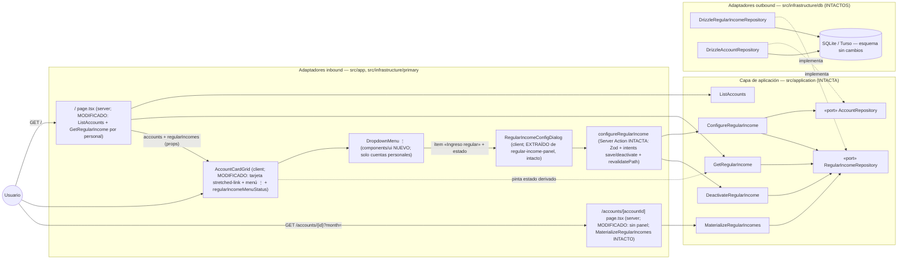

# Implementation Plan: Menú de configuración en las tarjetas de cuenta

**Branch**: `feature/020-menu-configuracion-cuenta` | **Date**: 2026-10-13 | **Spec**: [spec.md](./spec.md)

**Input**: Feature specification from `/specs/020-menu-configuracion-cuenta/spec.md`

## Summary

La configuración del ingreso regular (018) genera ruido permanente en la página de cuenta, que es de uso diario. Esta feature la **reubica**: la entrada pasa del panel inferior de la página de cuenta a un **menú de tres puntos (⋮) en la tarjeta de cada cuenta personal del panel de cuentas (`/`)**, cuyo único ítem «Ingreso regular» muestra su estado («Sin configurar» / «Activa» / «Desactivada») y abre **el mismo diálogo de 018** sin cambios funcionales. El panel desaparece por completo de la página de cuenta (queda en movimientos, cierre y balance) y la materialización perezosa del mes consultado no cambia. El menú de la tarjeta queda como **hogar de las opciones de cuenta**: la aportación % (019) añadirá ahí su entrada. Cambio **limitado a adaptadores de UI** (FR-005): dominio, aplicación, action, repositorio, BD y materialización intactos.

Enfoque técnico (detalles y alternativas en [research.md](./research.md)):

- **Menú con DropdownMenu de Radix**: primitivo shadcn `dropdown-menu.tsx` copiado y versionado en el repo (ADR 0005) sobre el monopaquete `radix-ui` ya presente. **Cero dependencias nuevas**. Accesibilidad completa gratis (roles menu/menuitem, teclado, toggle, Escape/focus-out, colisiones con viewport).
- **Tarjeta lanzadora válida (patrón stretched-link)**: `div.relative` con estilos de tarjeta; el `<Link>` envuelve nombre+etiqueta y se estira con `after:inset-0`; el trigger ⋮ (`relative z-10`, ≥ 44 px, `aria-label="Configuración de {nombre}"`) queda por encima: el clic en ⋮ nunca navega y el resto de la tarjeta sí (FR-003), con HTML válido.
- **Estado en `/`, leído en servidor**: `page.tsx` ejecuta `GetRegularIncome` por cuenta personal y pasa `regularIncomes: Record<number, RegularIncomeDTO | null>` al grid (que pasa a client component); el ítem deriva su literal con una función pura; `revalidatePath("/", "layout")` de la action ya sincroniza el estado al reabrir el menú.
- **Diálogo extraído, panel retirado**: `RegularIncomeConfigDialog` pasa a fichero propio sin cambios (campos, validaciones, intents, toasts); la desactivación directa del panel desaparece (su vía es el botón «Desactivar» del diálogo); montaje condicional por tarjeta — seguro porque las tarjetas son catálogo estable (desviación consciente de «diálogos por fila», documentada).
- **Enmiendas e2e**: `panel-cuentas` N1 (lanzador + ⋮) e `ingresos-regulares` (flujo re-rutado por el menú), conservando combinación cuenta/mes y limpieza final.

## Technical Context

**Language/Version**: TypeScript 5.x en modo estricto sobre Node.js LTS; Next.js 16 (App Router), React 19.

**Primary Dependencies**: las fijadas por la constitución v1.2.1 (next, react, drizzle-orm, @libsql/client, zod 4, tailwind + shadcn/ui en el repo, sonner, radix-ui, lucide-react). **Cero dependencias nuevas**: el menú usa el monopaquete `radix-ui` existente y un primitivo shadcn copiado/versionado.

**Storage**: SQLite (dev) / Turso (prod) vía Drizzle. **Sin migraciones ni cambios de esquema**: `regular_incomes`/`regular_income_months` (018) se leen por el puerto existente; seed intacto.

**Testing**: Vitest (projects node/ui, co-localizados) — componente del grid ampliado (estados por tipo de cuenta, apertura del diálogo, no-navegación estructural del menú), suite del diálogo adaptada de la del panel, action/dominio/aplicación intactas en verde. Playwright e2e: `panel-cuentas.spec.ts` (N1 enmendado) e `ingresos-regulares.spec.ts` (flujo re-rutado desde el menú de la tarjeta), misma combinación cuenta/mes y aislamiento que 018 (FR-006/FR-008).

**Target Platform**: Web (escritorio primero; usable en móvil — trigger ≥ 44 px y menú sin descortes por Radix), Vercel + Turso; sin cambios.

**Project Type**: web-app (monolito Next.js, App Router); sin proyectos ni paquetes nuevos.

**Performance Goals**: `/` añade una SELECT por cuenta personal (2 en el repertorio real) sobre tabla con `account_id UNIQUE` — despreciable; nada más cambia. Sin metas nuevas (1-2 usuarios, 3 cuentas).

**Constraints**: alcance estricto a adaptadores de UI (FR-005); UI en español (literales congelados en el ui-contract); TS estricto (IV); direcciones de dependencia hexagonales (VII); comportamiento 018 (action, diálogo, materialización) intacto (FR-002/FR-004).

**Scale/Scope**: 1-2 usuarios, 3 cuentas; 1 primitivo UI nuevo (dropdown-menu), 1 componente extraído + suite adaptada, 1 grid ampliado + suite, 2 páginas tocadas (montaje/desmontaje), 2 specs e2e enmendadas; documentación viva (overview, diagrama panel-cuentas, convención AGENTS.md) y roadmap maestro (FR-007). Sin dominio, aplicación, action, repositorio, BD ni migraciones.

## Constitution Check

*GATE: Must pass before Phase 0 research. Re-check after Phase 1 design.*

| # | Principio | Estado pre-diseño | Notas |
|---|-----------|-------------------|-------|
| I | Simplicidad Primero | ✅ PASS | Sin proyectos, paquetes ni abstracciones nuevas: se reutilizan use case/action/diálogo/DTO de 018; el único añadido es un primitivo shadcn (convención ADR 0005) y un componente cliente. La lectura en `/` son 2 SELECT por id único; sin endpoint ni puerto nuevo (YAGNI). |
| II | Spec-Driven Development | ✅ PASS | Este plan deriva de `specs/020-menu-configuracion-cuenta/spec.md` (petición del propietario 2026-10-13, decisiones cerradas en la propia spec). Una única US pequeña con valor propio; feature nueva en vez de enmienda de 018 (decisión del propietario). Enmienda al roadmap como FR-007. |
| III | Calidad Verificada | ✅ PASS | Cobertura de componente (estados, apertura, no-navegación), suite del diálogo adaptada, suites 018 intactas en verde y e2e del flujo crítico reubicado (FR-008); enmiendas e2e explícitas (FR-006). |
| IV | TypeScript Estricto + Zod | ✅ PASS | Sin fronteras nuevas: el schema Zod y el estado de la action de 018 se reutilizan tal cual; props tipadas (`Record<number, RegularIncomeDTO \| null>`); sin `any`. |
| V | Persistencia SQLite con Drizzle | ✅ PASS | Sin cambios de esquema ni migraciones; solo lectura por el puerto existente. |
| VI | Producto en español, código en inglés | ✅ PASS | Literales nuevos congelados en el ui-contract («Configuración de {nombre}», «Ingreso regular», «Sin configurar»/«Activa»/«Desactivada»); identificadores en inglés (`AccountCardGrid`, `regularIncomeMenuStatus`, `RegularIncomeConfigDialog`); glosario ampliado (data-model §5). |
| VII | Arquitectura Hexagonal + DDD Táctico | ✅ PASS | Dominio y aplicación intactos; `/` (server) orquesta `ListAccounts` + `GetRegularIncome` y pasa DTOs serializables al client component; la UI no duplica negocio (pinta estado derivado del DTO, envía el FormData existente); direcciones de dependencia sin cambios. |

**Resultado**: sin violaciones → Phase 0 autorizada.

## Project Structure

### Documentation (this feature)

```text
specs/020-menu-configuracion-cuenta/
├── plan.md                     # This file (/speckit.plan command output)
├── research.md                 # Phase 0 output (/speckit.plan command)
├── data-model.md               # Phase 1 output (/speckit.plan command)
├── quickstart.md               # Phase 1 output (/speckit.plan command)
├── contracts/
│   └── ui-contract.md          # Contrato UI del menú/ítem/estados + reutilización del contrato de 018
└── tasks.md                    # Phase 2 output (/speckit.tasks command - NOT created by /speckit.plan)
```

### Source Code (repository root)

```text
├── src/
│   ├── domain/                          # INTACTO (RegularIncome y resto, FR-005)
│   ├── application/                     # INTACTO (GetRegularIncome se reutiliza tal cual; sin puertos nuevos)
│   ├── app/
│   │   ├── page.tsx                     # MODIFICADO: GetRegularIncome por cuenta personal + prop regularIncomes al grid
│   │   └── accounts/[accountId]/page.tsx  # MODIFICADO: sin RegularIncomePanel ni lectura de GetRegularIncome;
│   │                                    #   MaterializeRegularIncomes intacto antes del Promise.all (FR-004)
│   └── infrastructure/
│       └── primary/
│           ├── actions/
│           │   └── configure-regular-income.action.ts(.test.ts)  # INTACTOS (FR-002/FR-005)
│           └── ui/
│               ├── components/ui/dropdown-menu.tsx   # NUEVO: primitivo shadcn copiado/versionado (radix-ui, ADR 0005)
│               ├── account-card-grid.tsx             # MODIFICADO: client; tarjeta stretched-link + menú ⋮ solo en
│               │                                     #   personales + ítem con estado (regularIncomeMenuStatus pura) +
│               │                                     #   montaje condicional del diálogo por tarjeta
│               ├── account-card-grid.test.tsx        # MODIFICADO/AMPLIADO: menús por tipo de cuenta, estado del ítem,
│               │                                     #   apertura del diálogo, botón fuera del <a>, links intactos, sin €
│               ├── regular-income-config-dialog.tsx      # NUEVO: extraído de regular-income-panel.tsx, intacto (FR-002)
│               ├── regular-income-config-dialog.test.tsx # NUEVO: suite adaptada de la del panel (casos de diálogo)
│               ├── regular-income-panel.tsx          # RETIRADO (panel + PanelDeactivateForm)
│               └── regular-income-panel.test.tsx     # RETIRADO (sustituida por la del diálogo)
├── e2e/
│   ├── panel-cuentas.spec.ts           # MODIFICADO: N1 enmendado — lanzador + ⋮ en personales, sin menú en la común (FR-006)
│   ├── ingresos-regulares.spec.ts      # MODIFICADO: flujo re-rutado por el menú de la tarjeta (R1/R3/R5), estado del ítem,
│   │                                    #   desactivación vía diálogo, testid del panel ausente; combinación y limpieza final conservadas
│   └── (resto de specs)                # INTACTAS (pagina-cuenta no referencia el panel — verificado)
├── specs/001-family-wallet/spec.md      # ACTUALIZADO (implementación, FR-007): fila 020 «Completada» + nota «el menú ⋮ de la
│                                         #   tarjeta es el hogar de las opciones de cuenta (019 añadirá su entrada)»
└── docs/architecture/
    ├── overview.md                      # ACTUALIZADO (implementación): configuración accesible desde la tarjeta en /;
    │                                    #   página de cuenta = movimientos + cierre + balance
    ├── diagrams/panel-cuentas-sequence.md  # ACTUALIZADO (implementación): variante «configurar desde la tarjeta» (base: diagrama de este plan)
    └── (AGENTS.md: convención «tarjetas lanzaderas con menú de configuración» — research §7)
```

**Structure Decision**: misma estructura por capas concéntricas que 002–018 (`docs/architecture/overview.md`), sin tocar dominio ni aplicación: el cambio vive íntegro en los adaptadores inbound — `/` lee el DTO existente en servidor y lo pasa al grid (client), que gana el menú (primitivo shadcn nuevo, sin dependencias) y monta el diálogo extraído; la página de cuenta pierde el panel. Tests co-localizados junto a su SUT; e2e enmendadas en sus ficheros, conservando la combinación cuenta/mes y el aislamiento mutuo (`workers: 1`).

## Diagramas de diseño

Foto del diseño de esta feature (mermaid, como la documentación viva del proyecto); `docs/architecture/diagrams/` se extiende en la fase de implementación reutilizándolos como base. El diagrama de clases del modelo vive en [data-model.md §1.4](./data-model.md).

### Componentes que intervienen



> Nota: dependencias siempre hacia el dominio (constitución VII); dominio y aplicación quedan intactos (FR-005) — todos los bloques nuevos/modificados son adaptadores inbound. La UI no decide negocio: pinta el estado derivado del DTO y envía el FormData existente; la materialización sigue disparándose solo desde la página de cuenta (ADR 0016).

### Secuencia — happy path: configurar el ingreso regular desde el menú de la tarjeta

```mermaid
sequenceDiagram
    autonumber
    actor U as Usuario (miembro)
    participant P as "/ page.tsx (server)"
    participant G as AccountCardGrid (client)
    participant M as Menú ⋮ (Radix)
    participant D as RegularIncomeConfigDialog (client)
    participant A as configureRegularIncome (action)
    participant UC as ConfigureRegularIncome (aplicación, intacto)
    participant AP as "/accounts/[accountId] page.tsx"
    participant MRI as MaterializeRegularIncomes (intacto)

    U->>P: GET /
    P->>UC2: GetRegularIncome por cada cuenta personal (2 SELECT)
    P-->>G: accounts + regularIncomes (props)
    U->>M: ⋮ «Configuración de Cuenta de Miembro A»
    M-->>U: ítem «Ingreso regular · Sin configurar»
    U->>M: selecciona el ítem (menú cierra; no navega)
    G->>D: monta {configOpen ? diálogo : null} — instancia fresca de useActionState
    U->>D: 2.000,00 € · día 1 · nota vacía → «Guardar» (intent save)
    D->>A: FormData { accountId, amount, dayOfMonth, note, intent }
    A->>UC: execute({ …, currentMonth })
    UC-->>A: RegularIncomeDTO (activa)
    A->>A: revalidatePath("/", "layout") → re-render RSC de /
    A-->>D: { status: "success", message: "Ingreso regular guardado" }
    D-->>U: toast «Ingreso regular guardado» + cierre
    Note over G: al reabrir ⋮, el ítem muestra «Activa» (prop revalidado)
    U->>AP: GET /accounts/1 (mes en curso)
    AP->>MRI: ensureForAccountAndMonth(accountId, month, currentMonth) — antes de leer (ADR 0016)
    AP-->>U: listado del mes con el ingreso materializado exactamente 1 (comportamiento 018 intacto)
```

## Complexity Tracking

> **Fill ONLY if Constitution Check has violations that must be justified**

| Violation | Why Needed | Simpler Alternative Rejected Because |
|-----------|------------|-------------------------------------|
| (ninguna) | — | — |

**Decisiones de diseño destacadas (sin violación, registradas para `/speckit.tasks`)**:

- **Patrón stretched-link para la tarjeta lanzadora** (FR-003): el `<Link>` se estira con pseudo-elemento y el trigger ⋮ queda por encima con `z-10`; es la única variante con HTML válido (`<button>` dentro de `<a>` está prohibido), semántica de enlace intacta (cmd+click, nombre accesible) y el menú en portal no anida interactivos. Los asserts de N1 (3 links con nombre accesible) se mantienen (research §2).
- **Estado del ítem derivado, no almacenado**: `regularIncomeMenuStatus(config)` función pura sobre el prop `regularIncomes`; la sincronización tras guardar/desactivar la da la `revalidatePath("/", "layout")` que la action ya hace (escenario 7, SC-002, sin recarga manual) (research §3/§4).
- **Lectura en servidor en `/` con el use case existente**: 2 SELECT por `account_id UNIQUE`; sin endpoint cliente ni puerto nuevo (YAGNI, principio I) (research §3).
- **Diálogo extraído a fichero propio, intacto (FR-002)**; la desactivación directa del panel desaparece — su única vía es el intent `deactivate` del diálogo (escenario 3 de la spec); montaje condicional por tarjeta: instancia fresca de `useActionState` por apertura (patrón 014/018) (research §4).
- **Excepción consciente a «diálogos por fila»**: el diálogo vive dentro de la tarjeta porque las tarjetas son catálogo estable (no desaparecen tras revalidar), a diferencia de las filas de movimientos; se fija como convención propia en AGENTS.md (research §4/§7).
- **Primitivo shadcn nuevo, cero dependencias**: `dropdown-menu.tsx` copiado/versionado sobre `radix-ui` existente; da roles de menú, teclado, toggle, Escape y evitación de colisiones (edge móvil) sin librerías nuevas (research §1).
- **e2e enmendadas conservando aislamiento**: `ingresos-regulares` mantiene Cuenta de Miembro A + mes en curso dinámico y limpieza final (borrado + desactivación) — el orden alfabético verificado en 018 research §7 sigue válido; `panel-cuentas` N1 enmienda «lanzador puro» a «tarjeta + ⋮ en personales» (research §6).

## Constitution Check (post-diseño, Phase 1)

Re-evaluación tras generar [research.md](./research.md), [data-model.md](./data-model.md), [contracts/ui-contract.md](./contracts/ui-contract.md) y [quickstart.md](./quickstart.md):

| # | Principio | Estado post-diseño | Notas |
|---|-----------|--------------------|-------|
| I | Simplicidad Primero | ✅ PASS | El diseño solo añade un primitivo shadcn (convención del stack), extrae un componente a fichero propio y amplía el grid a client; reutiliza use case/action/DTO/diálogo de 018. Sin endpoints, puertos ni migraciones (research §1–§5). |
| II | Spec-Driven Development | ✅ PASS | Cada FR traza a artefacto: FR-001 → ui-contract §1–§2 + data-model §1.2/§1.3; FR-002 → ui-contract §3 (reutilización íntegra de 018); FR-003 → ui-contract §1 + research §2; FR-004 → ui-contract §4; FR-005 → data-model §1.1/§2 (dominio/aplicación/BD intactos); FR-006 → research §6; FR-007 → Project Structure (roadmap); FR-008 → research §6 + quickstart gates. Los 8 escenarios y los edges quedan cubiertos en ui-contract/quickstart. |
| III | Calidad Verificada | ✅ PASS | Quickstart con 8 escenarios (espejo de aceptación + edges) + gates; suites de componente (grid y diálogo) y suites 018 en verde; e2e del flujo crítico reubicado con aislamiento conservado (SC-004, constitución III). |
| IV | TypeScript Estricto + Zod | ✅ PASS | Sin fronteras nuevas: schema/estado de la action de 018 reutilizados; props tipadas (`Record<number, RegularIncomeDTO \| null>`, función pura de derivación); sin `any` (data-model §1.3/§3). |
| V | SQLite con Drizzle | ✅ PASS | Sin migraciones ni cambios de esquema; lectura por el puerto existente (data-model §2). |
| VI | Español / inglés | ✅ PASS | Literales congelados en el ui-contract («Configuración de {nombre}», «Ingreso regular», «Sin configurar»/«Activa»/«Desactivada»); mensajes y toasts de 018 intactos; identificadores en inglés (`AccountSettingsMenu`, `regularIncomeMenuStatus`, `RegularIncomeConfigDialog`); glosario ES↔EN ampliado (data-model §5). |
| VII | Arquitectura Hexagonal + DDD Táctico | ✅ PASS | Dominio y aplicación intactos y puros; `/` orquesta en servidor y pasa DTOs serializables al client component; la UI pinta estado derivado y envía el FormData existente — cero lógica de negocio duplicada; la materialización sigue disparándose solo desde la página de cuenta (ADR 0016) (data-model §1, diagramas). |

**Resultado**: diseño aprobado; sin desviaciones que justificar. El plan queda listo para `/speckit.tasks`.
