# Data Model — Descuento de gastos comunes en la aportación mensual (021)

**Feature**: `021-descuento-gastos-comunes` | **Fecha**: 2026-10-18 | **Spec**: [spec.md](./spec.md) · **Research**: [research.md](./research.md)

Modelo de datos de la feature: una operación nueva del VO `ContributionPercentage`, un método de lectura y dos de escritura en el repositorio de aportaciones, un método de agregación en el de movimientos, una columna opcional en `common_contribution_months` y la reformulación del flujo de `MaterializeCommonContributions` (generación neta + re-sincronización del mes en curso). No hay entidades ni tablas nuevas; `movements`, `common_contributions`, `regular_incomes` y el resto del esquema **no cambian**.

---

## 1. Vista de Dominio y de Aplicación

### 1.1 Dominio — `src/domain/common-contribution/` (MODIFICADO)

#### `ContributionPercentage` (VO — operación nueva)

Además de `fromBasisPoints` / `appliedToCents` / `equals` (intactos, 019):

```ts
netAppliedToCents(incomeCents: number, sharedExpenseCents: number): number
  // max(0, appliedToCents(incomeCents) − sharedExpenseCents)
  // enteros puros; el redondeo half-up vive solo en appliedToCents (FR-001)
```

Casos congelados (tests tabla; spec escenarios 2–4 y edge «céntimos»):

| Entrada (ingreso, gastos, %) | Cálculo | Salida |
|------------------------------|---------|--------|
| 200 000, 12 000, 25 % | max(0, 50 000 − 12 000) | 38 000 → **380,00 €** |
| 200 000, 12 055, 25 % | max(0, 50 000 − 12 055) | 37 945 → **379,45 €** (céntimos exactos) |
| 200 000, 20 000 + 30 000, 25 % | max(0, 50 000 − 50 000) | 0 → sin movimiento (FR-004) |
| 200 000, 62 000, 25 % | max(0, 50 000 − 62 000) | 0 → sin movimiento ni arrastre (edge «excedente») |

#### Resto del dominio: INTACTO

`CommonContribution` (entidad, ciclo de vida y semántica de `activatedAtMonth`), `CommonContributionId`, `CommonContributionErrors`, `Movement`, `Money`, `ExpenseNature` (`"shared"` = naturaleza común), `Tag`/`SystemTags`: sin cambios.

### 1.2 Aplicación — `src/application/` (MODIFICADO)

#### Puertos

```ts
// src/application/common-contribution/CommonContributionRepository.ts (MODIFICADO)
interface CommonContributionRepository {
  findByAccountId(accountId: AccountId): Promise<CommonContribution | null>;
  save(config: CommonContribution): Promise<CommonContribution>;
  isMaterialized(contributionId: CommonContributionId, month: string): Promise<boolean>;
  registerMaterialization(config: CommonContribution, month: string, movement: Movement): Promise<boolean>;
  // NUEVOS (021):
  findMaterializedMovement(contributionId: CommonContributionId, month: string): Promise<Movement | null>;
    // movimiento enlazado por movement_id; si NULL (fila legacy), resolución perezosa
    // por heurística acotada + persistencia del enlace (research §3);
    // null ⇒ borrado del usuario ⇒ mes congelado (FR-006)
  withdrawMaterialization(contributionId: CommonContributionId, month: string): Promise<boolean>;
    // tx: DELETE del movimiento enlazado + DELETE de la fila del registro (retirada, research §4);
    // false si la fila ya no existe (idempotente)
}

// src/application/movement/MovementRepository.ts (MODIFICADO)
interface MovementRepository {
  // …métodos existentes intactos…
  sumSharedExpenseCents(accountId: AccountId, month: string): Promise<number>;  // NUEVO
    // SUM(amount_cents) de gastos nature='shared' de la cuenta en el mes de la FECHA;
    // coalesce a 0 (FR-001/FR-005)
}
```

#### 1.2.1 `MaterializeCommonContributions.ensureForAccountAndMonth` — flujo nuevo (research §2/§4/§5)

```text
1. config = findByAccountId(accountId)
2. si config === null || config.id === null → return
3. ventana 019: si config.activatedAtMonth > month || month > currentMonth → return (FR-007)
4. si isMaterialized(config.id, month):                 # rama de re-sincronización
     4a. si month !== currentMonth → return (mes cerrado congelado, FR-003)
     4b. movement = findMaterializedMovement(config.id, month)
     4c. si movement === null → return (borrado del usuario: definitivo, FR-006)
     4d. income = regularIncomes.findByAccountId(accountId)
     4e. si income === null || !income.active → return (conserva el último importe, research §5.3)
     4f. neto = netAppliedToCents(income.amount.amountCents,
                                   movements.sumSharedExpenseCents(accountId, month))
     4g. si neto < 1 → withdrawMaterialization(config.id, month) → return (retirada, FR-004)
     4h. si neto === movement.amount.amountCents → return (idempotente sin escritura, FR-002/SC-002)
     4i. si neto ≠ importe → movements.update(Movement.recreate(movement.id, {…campos intactos…,
                        amount: Money.fromCents(neto)}, movement.createdAt))
5. rama de generación (mes no registrado):
     5a. si !config.active → return (condiciones de generación de 019 intactas, FR-007)
     5b. income existe y activo; si no → return
     5c. neto = netAppliedToCents(income.amount.amountCents, movements.sumSharedExpenseCents(accountId, month))
     5d. si neto < 1 → return SIN registrar el mes (FR-004; reaparece si bajan los gastos)
     5e. ensure de etiqueta por slug (intacto 019) → Movement.create(…, Money.fromCents(neto), …) → registerMaterialization
```

> **La config desactivada entra por la misma rama 4**: `findByAccountId` devuelve la config inactiva, la ventana sigue válida (`deactivate()` conserva `activatedAtMonth`) y el mes en curso se re-sincroniza igualmente (clarify 2026-10-18, escenario 13; FR-007: la desactivación detiene la generación futura, no congela el importe del mes en curso). Solo la **generación** (paso 5a) exige `config.active`.

#### Dependencias del caso de uso (constructor)

```ts
new MaterializeCommonContributions(
  commonContributions: CommonContributionRepository,
  regularIncomes: RegularIncomeRepository,
  movements: MovementRepository,        // NUEVO (021)
  tags: TagRepository,
  accounts: AccountRepository,
)
```

`src/app/accounts/[accountId]/page.tsx` (único disparador, intacto en estructura) pasa el `DrizzleMovementRepository(db)` ya instanciado en la página (L45).

### 1.3 Diagrama de clases (diseño)

```mermaid
classDiagram
    direction LR

    class ContributionPercentage {
        <<VO — 019, MODIFICADO>>
        -basisPoints: number
        +fromBasisPoints(bp)$ ContributionPercentage
        +appliedToCents(incomeCents) number
        +netAppliedToCents(incomeCents, sharedExpenseCents) number$
    }

    class CommonContributionRepository {
        <<Port — MODIFICADO>>
        +findByAccountId(accountId) CommonContribution?
        +save(config) CommonContribution
        +isMaterialized(id, month) boolean
        +registerMaterialization(config, month, movement) boolean
        +findMaterializedMovement(id, month) Movement?
        +withdrawMaterialization(id, month) boolean
    }

    class MovementRepository {
        <<Port — MODIFICADO>>
        +sumSharedExpenseCents(accountId, month) number
        +update(movement) void
        (resto intacto)
    }

    class MaterializeCommonContributions {
        <<Use case — MODIFICADO>>
        +ensureForAccountAndMonth(accountId, month, currentMonth) void
        generación neta · re-sincronización mes en curso · retirada
    }

    class Movement {
        <<Entity — intacta>>
        +recreate(id, input, createdAt)$ Movement
    }

    class CommonContribution {
        <<Entity — intacta>>
    }
    class RegularIncomeRepository {
        <<Port — intacto>>
    }
    class TagRepository {
        <<Port — intacto>>
    }
    class AccountRepository {
        <<Port — intacto>>
    }

    class DrizzleCommonContributionRepository {
        <<Adapter outbound — MODIFICADO>>
        tx registro (con movement_id) + movimiento
        findMaterializedMovement: enlace directo / resolución perezosa
        withdrawMaterialization: DELETE movimiento + fila
    }
    class DrizzleMovementRepository {
        <<Adapter outbound — MODIFICADO>>
        sumSharedExpenseCents: SUM SQL con alcance sellado
    }
    class AccountPage {
        <<Server page — intacta en estructura>>
        único disparador; inyecta MovementRepository
    }

    MaterializeCommonContributions --> CommonContributionRepository
    MaterializeCommonContributions --> RegularIncomeRepository
    MaterializeCommonContributions --> MovementRepository
    MaterializeCommonContributions --> TagRepository
    MaterializeCommonContributions --> AccountRepository
    MaterializeCommonContributions ..> ContributionPercentage : netAppliedToCents
    MaterializeCommonContributions ..> Movement : recreate / create
    ContributionPercentage ..> CommonContribution : compone (019)
    DrizzleCommonContributionRepository ..|> CommonContributionRepository
    DrizzleMovementRepository ..|> MovementRepository
    AccountPage --> MaterializeCommonContributions : ensureForAccountAndMonth
```

### 1.4 Transiciones de estado (movimiento de aportación de un mes)

```mermaid
stateDiagram-v2
    [*] --> NoGenerado : mes dentro de ventana, no registrado
    NoGenerado --> Generado : neto ≥ 1 céntimo → registro (fila + movement_id) + movimiento
    NoGenerado --> NoGenerado : neto 0 → sin registrar (reaparece si bajan gastos)
    Generado --> Generado : re-sincronización (mes en curso): neto ≠ importe → update
    Generado --> Retirado : re-sincronización con neto 0 → withdraw (DELETE movimiento + fila)
    Retirado --> Generado : gastos comunes bajan → nueva generación con neto vigente
    Generado --> BorradoPorUsuario : fila ⋮ → Eliminar (solo el movimiento)
    BorradoPorUsuario --> BorradoPorUsuario : fila del registro presente, movimiento ausente → no-op DEFINITIVO (FR-006)
    Generado --> Congelado : month < currentMonth (al cerrarse el mes) → inmutable (FR-003)
    Congelado --> Congelado : cualquier mutación de gastos del mes → sin efecto

    note right of Retirado
        Distinguir de BorradoPorUsuario:
        retirada borra también la fila del registro
        (la generación queda reabierta); el borrado del
        usuario deja la fila (generación cerrada para siempre)
    end note
```



---

## 2. Vista de Persistencia (Drizzle, SQLite/Turso)

### 2.1 Esquema — `common_contribution_months` (MODIFICADO) y migración `drizzle/0005_descuento-gastos-comunes.sql`

```text
common_contribution_months
├── id: integer PK (autoincrement)
├── common_contribution_id: integer NOT NULL → common_contributions(id) ON DELETE CASCADE
├── month: text NOT NULL                                      ← YYYY-MM
├── created_at: text NOT NULL
└── movement_id: integer NULL                                 ← NUEVO (021): enlace blando al
                                                                 movimiento generado; SIN FK
                                                                 (sobrevive al borrado del usuario)

UNIQUE (common_contribution_id, month)                        ← intacto (invariante 019)
```

Migración `0005` (única sentencia + journal; sin datos):

```sql
ALTER TABLE common_contribution_months ADD COLUMN movement_id integer;
```

`movements`, `common_contributions`, `regular_incomes`, `regular_income_months`, `tags`: **sin cambios**.

### 2.2 Repositorios

**`DrizzleCommonContributionRepository` (MODIFICADO)**:

- `registerMaterialization` (tx): calcula `id = coalesce(max(movements.id),0)+1`, inserta el movimiento y la fila del registro **con `movement_id = id`** (misma tx, mismo `ON CONFLICT DO NOTHING RETURNING`).
- `findMaterializedMovement(id, month)` (NUEVO): lee la fila → si `movement_id` no es NULL, `movements.findById` y, si no existe, `null` (borrado del usuario; el enlace queda huérfano a propósito). Si `movement_id` es NULL (fila legacy pre-021): resolución perezosa — primer movimiento de la misma cuenta con `date = {month}-01`, `type = 'expense'`, `nature = 'personal'`, etiqueta slug `aportacion-comun` y nota con prefijo `Aportación común de ` (`ORDER BY id LIMIT 1`); si se encuentra, persiste el enlace (`UPDATE … SET movement_id`) y devuelve el movimiento; si no, `null`.
- `withdrawMaterialization(id, month)` (NUEVO, tx): `SELECT movement_id` → `DELETE movements WHERE id = movement_id` (si existe) → `DELETE FROM common_contribution_months WHERE (config, month)`; devuelve `true` si borró fila (o `false` si ya no existía: idempotente).

**`DrizzleMovementRepository` (MODIFICADO)**:

- `sumSharedExpenseCents(accountId, month)` (NUEVO):

```sql
SELECT coalesce(sum(amount_cents), 0) FROM movements
WHERE account_id = ? AND type = 'expense' AND nature = 'shared'
  AND date >= '{month}-01' AND date < '{nextMonth}-01'
```

  Rango `[month-01, nextMonth-01)` idéntico al de `listByMonthAndAccount` (convención existente); índice `idx_movements_account_date` lo sirve.

---

## 3. Validación por capa

| Regla | Dominio | Aplicación | Persistencia | Frontera/UI |
|-------|---------|------------|--------------|-------------|
| Neto = max(0, bruto − gastos), céntimos enteros (FR-001) | `netAppliedToCents` (tabla §1.1) | `MaterializeCommonContributions` lo invoca | — | — |
| Alcance del descuento: solo gastos `shared` de la cuenta en el mes de su fecha (FR-005) | — | delega en `sumSharedExpenseCents` | SQL sellada (`account_id`+`type`+`nature`+rango fecha) testeada en repo | — |
| Suelo cero sin arrastre (FR-004) | `netAppliedToCents` nunca < 0 | generación: no-op sin registrar; re-sincronización: retirada | `withdrawMaterialization` tx | — |
| Mes en curso sincronizado, idempotente (FR-002) | — | guardas 4a–4i; sin escritura si el importe no cambia | `UPDATE movements` solo si `neto ≠ importe` | — |
| Meses cerrados congelados (FR-003) | — | guarda 4a (`month !== currentMonth`) | — | — |
| Borrado del usuario definitivo (FR-006) | — | guarda 4c (`movement === null`) | fila del registro sin `movement_id` válido | flujo ⋮ → Eliminar intacto (003/014) |
| Ventana/activación/desactivación de 019 intactas (FR-007) | entidad intacta | guarda 3 + 5a; la re-sincronización ignora `active` | — | — |
| Enlace blando legacy (research §3) | — | — | resolución perezosa + persistencia del enlace | — |
| `movement_id` válido | — | — | sin FK; columnas nuevas solo por migración 0005 | — |

## 4. DTOs

Sin DTOs nuevos ni modificados. `MovementDTO`, `CommonContributionDTO`, `MonthlyClosureDTO`, `GlobalMonthlySummaryDTO` y `AnnualIncomeStatementDTO` quedan exactamente como están: la aportación ajustada es un movimiento corriente y las vistas la leen sin cambios (FR-008).

## 5. Glosario ES ↔ EN (constitución VI)

| Español (UI/spec) | English (código) | Notas |
|-------------------|------------------|-------|
| Aportación neta | net contribution / `netAppliedToCents` | Bruto − gastos comunes del mes, suelo 0. |
| Gastos comunes (que descuentan) | shared expenses / `sumSharedExpenseCents` | Gastos de naturaleza `shared` («común») en la cuenta personal del miembro. |
| Re-sincronización (del mes en curso) | current-month re-sync | Ajuste en lectura dentro de `ensureForAccountAndMonth` (único disparador). |
| Retirada (de la aportación) | withdrawal / `withdrawMaterialization` | Borrado de movimiento **y fila** del registro cuando el neto es 0; reabre la generación. |
| Borrado (del usuario; definitivo) | user deletion | Borra solo el movimiento; la fila del registro bloquea la regeneración para siempre. |
| Enlace blando | soft link (`movement_id`) | Columna opcional sin FK del registro al movimiento generado. |
| Resolución perezosa (legacy) | lazy resolution | Completar `movement_id` NULL por heurística acotada en la primera re-sincronización. |
| Mes cerrado / congelado | closed/frozen month | `month !== currentMonth` ⇒ inmutable. |
| Movimiento generado | generated movement | Gasto propia, día 1, nota «Aportación común de {miembro}», etiqueta `aportacion-comun` (019). |

Sin identificadores intraducibles nuevos fuera de los listados.
