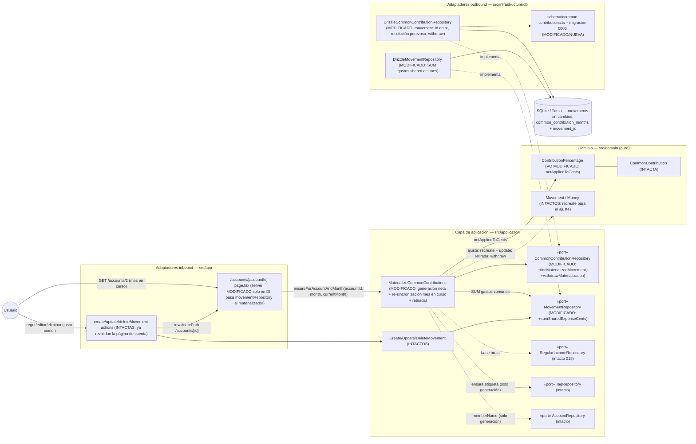

# Implementation Plan: Descuento de gastos comunes en la aportación mensual

**Branch**: `feature/021-descuento-gastos-comunes` | **Date**: 2026-10-18 | **Spec**: [spec.md](./spec.md)

**Input**: Feature specification from `/specs/021-descuento-gastos-comunes/spec.md`

## Summary

La aportación mensual de cada miembro (019) pasa de importe bruto fijo a **importe neto**: al bruto (porcentaje half-up sobre el ingreso regular) se le restan los **gastos de naturaleza común fechados en ese mes y registrados en la cuenta personal del miembro**, con suelo 0. El **mes en curso** se mantiene sincronizado con la regla en la propia lectura de la página de cuenta (mismo disparador único que 019, ADR 0016/0017): altas, ediciones y eliminaciones de gastos comunes ajustan el importe del movimiento generado al consultar, sin duplicados; si el neto llega a 0 la aportación se **retira** (movimiento + fila del registro) y reaparece si los gastos bajan; el **borrado del usuario** sigue siendo definitivo (la fila del registro sin movimiento lo bloquea para siempre). Meses cerrados y condiciones de generación de 019 quedan congelados/intactos (FR-003/FR-007), incluida la re-sincronización del mes en curso con la config desactivada (clarify 2026-10-18).

**Enfoque técnico** (detalles y alternativas en [research.md](./research.md)):

- **Cálculo neto en el dominio**: `ContributionPercentage.netAppliedToCents(incomeCents, sharedExpenseCents) = max(0, appliedToCents − gastos)` — extensión entera pura del VO de 019 (ADR 0007/0017); la suma de gastos comunes vive en `MovementRepository.sumSharedExpenseCents` (SUM SQL con el alcance sellado: cuenta + gasto + naturaleza `shared` + rango de fechas del mes).
- **Re-sincronización en lectura** dentro de `MaterializeCommonContributions.ensureForAccountAndMonth` (nuevo flujo de guardas en data-model §1.2.1): sin hooks en el CRUD de movimientos — las actions ya revalidan la página de cuenta.
- **Enlace blando** `common_contribution_months.movement_id` (migración `0005`, solo `ALTER TABLE`): identifica el movimiento generado sin tocar `movements`; filas legacy se resuelven perezosamente por heurística acotada.
- **Retirada vs. borrado**: neto 0 ⇒ `withdrawMaterialization` (tx: DELETE movimiento + fila, generación reabierta); borrado del usuario ⇒ fila presente sin movimiento ⇒ no-op definitivo.
- **Sin UI nueva**: formularios, diálogos, vistas y agregados intactos (FR-008); el cambio es invisible salvo en el importe.

## Technical Context

**Language/Version**: TypeScript estricto sobre Next.js (App Router) — monolito existente; sin versiones nuevas.

**Primary Dependencies**: Next.js App Router + Server Actions, React, Drizzle ORM, Zod, Tailwind CSS + shadcn/ui, sonner (toasts existentes). Ninguna dependencia nueva.

**Storage**: SQLite (fichero en dev) / Turso libSQL (prod) vía Drizzle. Migración versionada `drizzle/0005_descuento-gastos-comunes.sql` (una columna opcional en `common_contribution_months`; sin datos). `movements` y el resto del esquema sin cambios.

**Testing**: Vitest (`test.projects` node + ui/jsdom) co-localizado con el SUT; repos contra libsql `:memory:` con migraciones reales (`createTestDb`); Playwright e2e (`workers: 1`, orden alfabético, `e2e.sqlite` recreada).

**Target Platform**: local (`npm run dev`) y Vercel serverless + Turso (sin estado en filesystem; sin cron — ajuste en lectura).

**Project Type**: web-app monolito (Family Wallet).

**Performance Goals**: la re-sincronización no degrada apreciablemente la apertura del mes (edge «Rendimiento»): 1 SELECT de config + 1 de registro + 1 SUM indexado (`idx_movements_account_date`) + como máximo 1 UPDATE/DELETE/INSERT en tx; sin escrituras cuando el importe no cambia.

**Constraints**: EUR en céntimos enteros, half-up solo en la parte porcentual (ADR 0007 + 0017); sin doble anotación; sin cambios en cierres/resumen/anual ni en formularios; sin arrastre de excedentes; UI y specs en español.

**Scale/Scope**: uso individual, 3 cuentas (2 personales + 1 común), 2 miembros; una única US (constitución II, sin excepción).

## Constitution Check

*GATE: Must pass before Phase 0 research. Re-check after Phase 1 design.*

| # | Principio | Estado pre-diseño | Notas |
|---|-----------|-------------------|-------|
| I | Simplicidad Primero | ✅ PASS | Mismo monolito, cero dependencias nuevas; se extiende el materializador y los puertos existentes en lugar de introducer patrones nuevos (sin eventos, sin CQRS, sin servicios de dominio extra); un único registro de decisión nuevo (ADR 0019). |
| II | Spec-Driven Development | ✅ PASS | Spec aprobada con clarify (2026-10-18) y una única US; este plan diseña FR-001..FR-010; FR-009 (roadmap + ADR) queda trazado en la estructura y tasks. |
| III | Calidad Verificada | ✅ PASS | FR-010 exige y este plan planifica: tabla de dominio del neto, casos de aplicación (re-sincronización, retirada, congelado, definitivo), repos contra libsql `:memory:` (SUM, enlace, withdraw) y e2e Playwright con combinación cuenta/mes propia y barrido/restauración (convención de aislamiento). |
| IV | TypeScript estricto + Zod | ✅ PASS | Sin fronteras nuevas (no hay actions ni forms); validación de dominio en el VO y guardas del caso de uso; sin `any`. |
| V | Persistencia SQLite con Drizzle | ✅ PASS | Única evolución: migración versionada `0005` (ALTER TABLE, sin datos); todo acceso por Drizzle; el backfill legacy se resuelve por código testeado, no por SQL sin cobertura (justificado en research §3/§7). |
| VI | Producto en español, código en inglés | ✅ PASS | Sin literales de UI nuevos; identificadores en inglés (`netAppliedToCents`, `sumSharedExpenseCents`, `withdrawMaterialization`…); glosario ES↔EN ampliado en data-model §5. |
| VII | Arquitectura Hexagonal + DDD táctico | ✅ PASS | El cálculo neto vive en el VO del dominio (puro); puertos extendidos en `src/application`; adaptadores Drizzle implementan; la página sigue siendo el adaptador inbound fino que inyecta `MovementRepository`; dependencias siempre hacia el dominio (diagrama §Componentes). |

**Resultado**: sin violaciones → Phase 0 autorizada.

## Project Structure

### Documentation (this feature)

```text
specs/021-descuento-gastos-comunes/
├── spec.md                      # Especificación (aprobada con clarify 2026-10-18)
├── plan.md                      # Este fichero (/speckit.plan)
├── research.md                  # Phase 0 — 9 secciones de decisiones verificadas contra código
├── data-model.md                # Phase 1 — flujo de guardas, persistencia, glosario
├── contracts/
│   └── behavior-contract.md     # Phase 1 — comportamiento observable congelado (sin UI nueva)
├── quickstart.md                # Phase 1 — Q1–Q11 de validación manual
└── tasks.md                     # Phase 2 (/speckit.tasks — NO lo crea este comando)
```

### Source Code (repository root)

```text
src/
├── domain/
│   └── common-contribution/
│       └── ContributionPercentage.ts               # MODIFICADO — netAppliedToCents (max(0, bruto − gastos))
│       └── ContributionPercentage.test.ts          # MODIFICADO — tabla neta (380,00 / 379,45 / 0 / excedente)
│   └── (resto INTACTO: Movement, Money, CommonContribution, …)
├── application/
│   ├── common-contribution/
│   │   ├── CommonContributionRepository.ts         # MODIFICADO — findMaterializedMovement + withdrawMaterialization
│   │   └── MaterializeCommonContributions.ts       # MODIFICADO — generación neta + re-sincronización + retirada
│   │   └── MaterializeCommonContributions.test.ts  # MODIFICADO — matriz §8.4 de research (doble in-memory + SUM)
│   └── movement/
│       ├── MovementRepository.ts                   # MODIFICADO — sumSharedExpenseCents
│       └── (CRUD y lecturas INTACTOS)
├── app/
│   └── accounts/[accountId]/page.tsx               # MODIFICADO — inyecta movementRepository al materializador (línea de construcción)
└── infrastructure/
    └── db/
        ├── schema/common-contributions.ts          # MODIFICADO — movementId integer (sin FK)
        ├── DrizzleCommonContributionRepository.ts  # MODIFICADO — registerMaterialization persiste movement_id;
        │                                            #   findMaterializedMovement (enlace + resolución perezosa);
        │                                            #   withdrawMaterialization (tx DELETE movimiento + fila)
        ├── DrizzleCommonContributionRepository.test.ts  # MODIFICADO — enlace/legacy/withdraw/idempotencia
        ├── DrizzleMovementRepository.ts            # MODIFICADO — sumSharedExpenseCents (SUM SQL sellada)
        └── DrizzleMovementRepository.test.ts       # MODIFICADO — alcance del SUM (naturaleza/cuenta/mes/tipo)

drizzle/
└── 0005_descuento-gastos-comunes.sql               # NUEVO — ALTER TABLE … ADD COLUMN movement_id (+ journal)
e2e/
└── descuento-gastos-comunes.spec.ts                # NUEVO — Cuenta de Miembro B + mes en curso; barrido inicial
                                                     #   de «Hipoteca» + restauración final; serial (research §8)
docs/
└── architecture/
    ├── adr/0019-aportacion-neta-gastos-comunes.md  # NUEVO — FR-009
    └── diagrams/aportacion-comun-secuencia.md      # ACTUALIZADO — variante re-sincronización (base: §Diagramas)
AGENTS.md                                            # ACTUALIZADO — convención materialización: nota 021
specs/001-family-wallet/spec.md                      # ACTUALIZADO (FR-009): fila 021 + nota datada (amend cálculo 019)
```

**Structure Decision**: se mantiene la estructura hexagonal existente sin excepciones: la feature es una modificación quirúrgica del módulo `common-contribution` (VO + caso de uso + puerto) y del puerto/adaptador de movimientos; la única pieza nueva de infraestructura es una columna por migración versionada y la spec e2e. Nada se reorganiza.

## Diagramas de diseño

### Componentes que intervienen



> Nota: todas las dependencias apuntan hacia el dominio; el dominio no importa Next/Drizzle/Zod. Cierres, resumen global, anual, formularios y flujos de edición/eliminación **no participan** (intactos; FR-008).

### Secuencia — happy path: registrar un gasto común y consultar la cuenta (re-sincronización)

```mermaid
sequenceDiagram
    autonumber
    actor U as Usuario (miembro B, mes en curso)
    participant AP as "/accounts/[accountId] page.tsx (server)"
    participant MUC as MaterializeCommonContributions (aplicación)
    participant PortCC as CommonContributionRepository (puerto)
    participant PortMov as MovementRepository (puerto)
    participant Dom as ContributionPercentage (dominio)
    participant SQL as SQLite/Turso

    U->>AP: GET /accounts/2 (mes en curso; aportación ya materializada a −500,00)
    AP->>MUC: ensureForAccountAndMonth(accountId, month, currentMonth)
    MUC->>PortCC: findByAccountId → config (activa, ventana válida)
    MUC->>PortCC: isMaterialized(config, month) → true
    Note over MUC: month === currentMonth → rama de re-sincronización
    MUC->>PortCC: findMaterializedMovement(config, month)
    PortCC-->>MUC: movimiento generado (enlazado por movement_id) — existe
    MUC->>PortMov: sumSharedExpenseCents(accountId, month)
    PortMov->>SQL: SELECT coalesce(sum(amount_cents),0) WHERE account_id=? AND type='expense' AND nature='shared' AND date IN [month-01, next)
    SQL-->>PortMov: 12055
    MUC->>Dom: netAppliedToCents(200000, 12055) (ingreso regular leído antes)
    Dom-->>MUC: 37945
    Note over MUC: neto ≠ importe vigente (50000) → ajustar
    MUC->>PortMov: update(Movement.recreate(id, {…, amount: Money.fromCents(37945)}, createdAt))
    AP->>AP: Promise.all de listado, balance y cierre ya ve −379,45
    AP-->>U: listado con la aportación −379,45 €, exactamente 1 vez
```

Variante retirada (neto 0): el paso «ajustar» se sustituye por `withdrawMaterialization(config, month)` (tx: DELETE movimiento + DELETE fila del registro); una consulta posterior con gastos por debajo del bruto regenera por la rama de creación (ya neta).

## Complexity Tracking

> **Fill ONLY if Constitution Check has violations that must be justified**

| Violation | Why Needed | Simpler Alternative Rejected Because |
|-----------|------------|-------------------------------------|
| (ninguna) | — | — |

**Decisiones de diseño destacadas (sin violación, registradas para `/speckit.tasks`)**:

- **Cálculo neto en el VO** `ContributionPercentage.netAppliedToCents` con suelo 0 (tabla congelada) y **SUM SQL sellada** `sumSharedExpenseCents` para el alcance (research §1).
- **Re-sincronización en lectura** dentro de `ensureForAccountAndMonth`; sin hooks en el CRUD: las actions ya revalidan la página de cuenta (research §2). Orden de guardas congelado en data-model §1.2.1 (la config desactivada NO bloquea la re-sincronización del mes en curso — clarify 2026-10-18).
- **Enlace blando `movement_id`** en `common_contribution_months` (sin FK) + resolución perezosa de filas legacy por heurística acotada; backfill SQL descartado por testabilidad (research §3/§7).
- **Retirada vs. borrado definitivo**: neto 0 ⇒ `withdrawMaterialization` (movimiento + fila, generación reabierta); borrado del usuario ⇒ fila sin movimiento ⇒ no-op para siempre (research §4).
- **Ingreso regular ausente/inactivo en re-sincronización ⇒ conserva el último importe** (research §5).
- **E2E en Cuenta de Miembro B + mes en curso** (única combinación viable) con barrido inicial del gasto compartido de `cierre-mensual` y restauración final exacta + desactivación de configs (research §8).
- **ADR 0019** registra la modificación del cálculo de 019; AGENTS.md y roadmap se actualizan al cerrar (research §9).

## Constitution Check (post-diseño, Phase 1)

Re-evaluación tras generar `research.md`, `data-model.md`, `contracts/behavior-contract.md` y `quickstart.md`:

| # | Principio | Estado post-diseño | Notas |
|---|-----------|--------------------|-------|
| I | Simplicidad Primero | ✅ PASS | El diseño añade una operación de VO, tres métodos de puerto y una columna: extiende los mecanismos verificados de 019 en lugar de introducir notificación, jobs o marcadores en `movements`. Complejidad tracked: (ninguna). |
| II | Spec-Driven Development | ✅ PASS | FR-001→research §1/data-model §1.1; FR-002→§1.2.1 (4a–4i); FR-003→guarda 4a; FR-004→retirada §4; FR-005→SUM sellada; FR-006→guarda 4c; FR-007→guarda 3+5a con clarify 2026-10-18; FR-008→research §6 + behavior-contract §5; FR-009→estructura/ADR 0019; FR-010→research §8 + quickstart gates. Una US (II, sin excepción). |
| III | Calidad Verificada | ✅ PASS | Matriz por capa en research §8.4 (tabla VO, casos de aplicación con dobles, repos libsql `:memory:` con migración 0005 real, e2e con aislamiento por barrido/restauración); quickstart «Gates automáticos» cierra SC-005. |
| IV | TypeScript estricto + Zod | ✅ PASS | Sin fronteras nuevas que validar con Zod (no hay actions/forms); tipado estricto en los métodos nuevos; sin `any`. |
| V | Persistencia SQLite con Drizzle | ✅ PASS | `0005` única vía de evolución (ALTER TABLE sin datos, journal actualizado); toda lectura/escritura por Drizzle; el caso legacy se resuelve con código testeado, decisión documentada en ADR 0019 (desviación del patrón backfill justificada en research §3/§7). |
| VI | Producto en español, código en inglés | ✅ PASS | Sin literales nuevos de UI (sin superficie nueva); identificadores en inglés y glosario ES↔EN ampliado (data-model §5); artefactos en español. |
| VII | Arquitectura Hexagonal + DDD táctico | ✅ PASS | Regla de cálculo en el VO del dominio puro; puertos extendidos en aplicación e implementados por adaptadores Drizzle; página = adaptador inbound fino (solo DI); CRUD y vistas intactos; sin eventos/CQRS (ADR 0019 registra decisiones, no introduce patrón). |

**Resultado**: diseño aprobado; sin desviaciones que justificar. El plan queda listo para `/speckit.tasks`.
