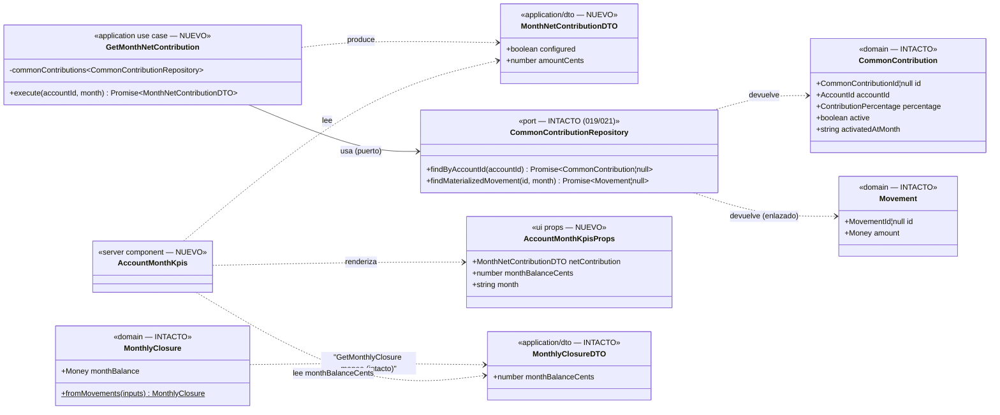

# Data Model — KPIs fijos y destacados en la página de cuenta personal (022)

**Feature**: `022-kpis-fijos-cuenta` | **Fecha**: 2026-10-21 | **Spec**: [spec.md](./spec.md) · **Research**: [research.md](./research.md)

Feature de **lectura/UI sin entidades nuevas**: los KPIs son agregaciones de lectura sobre entidades existentes (`Movement`, `CommonContribution` y su registro de materialización). El modelo cambia solo con **un caso de uso de lectura + DTO nuevo** en aplicación y **un componente servidor** de UI. Esquema, dominio, puertos y adaptadores Drizzle: **intactos**.

---

## 1. Vista de Dominio y de Aplicación

### 1.1 Dominio — `src/domain/` (INTACTO)

Sin cambios. Los KPIs consumen resultados ya calculados:

- **Saldo del mes**: `MonthlyClosure.fromMovements` → `monthBalance = Σ income − Σ expense` del mes consultado (incluida la aportación como gasto que es; FR-003).
- **Aportación neta**: el importe del movimiento generado por `MaterializeCommonContributions` (neto de 021, re-sincronizado para el mes en curso por el mismo disparador de consulta; ADR 0016/0017/0019).

### 1.2 Aplicación — `src/application/common-contribution/` (MODIFICADO)

#### Caso de uso nuevo: `GetMonthNetContribution` (lectura)

```ts
// src/application/common-contribution/GetMonthNetContribution.ts (NUEVO)
export interface MonthNetContributionDTO {
  configured: boolean;   // false ⇔ no existe config de aportación para la cuenta
  amountCents: number;   // céntimos del movimiento materializado enlazado; 0 si no existe
}

export class GetMonthNetContribution {
  constructor(commonContributions: CommonContributionRepository) {}

  async execute(accountId: AccountId, month: string): Promise<MonthNetContributionDTO>;
}
```

Flujo (sin puertos nuevos; reusa `findByAccountId` y `findMaterializedMovement` de 019/021):

```text
0. valida month contra /^\d{4}-(0[1-9]|1[0-2])$/ → Error si inválido (igual que GetMonthlyClosure)
1. config = findByAccountId(accountId)
2. si config === null || config.id === null → { configured: false, amountCents: 0 }
3. movement = findMaterializedMovement(config.id, month)
4. → { configured: true, amountCents: movement?.amount.amountCents ?? 0 }
```

Invariante de coherencia (FR-006): el importe es **exactamente** el del movimiento «Aportación Común» del mes que el listado muestra (número idéntico, nunca un recalculo). El caso de uso corre **después** de la materialización (orden intacto de la página) y **no dispara** materialización él mismo (FR-008).

#### Tabla de casos congelada (spec FR-002, escenarios 3–5, edges)

| Situación (mes consultado) | `configured` | `amountCents` | Render del KPI |
|---|---|---|---|
| Sin fila de config en `common_contributions` | `false` | `0` | **«Sin aportación configurada»** + 0,00 € |
| Config activa, neto materializado | `true` | importe neto | importe (p. ej. 379,45 €) |
| Config activa, neto 0 → retirada (021) | `true` | `0` | 0,00 € **sin** literal |
| Config, movimiento borrado por el usuario (definitivo) | `true` | `0` | 0,00 € sin literal |
| Mes fuera de ventana (`< activatedAtMonth` o futuro) | `true` | `0` | 0,00 € sin literal |
| Config desactivada a mitad de mes, movimiento existente | `true` | importe vigente | importe (021) |
| Mes cerrado congelado | `true` | importe histórico | importe |

#### Resto de aplicación: INTACTA

`MaterializeCommonContributions`, `MaterializeRegularIncomes`, `GetCommonContribution`, CRUD de movimientos, cierres y agregados: sin cambios (FR-008/FR-009).

### 1.3 UI — `src/infrastructure/primary/ui/` (MODIFICADO)

#### Componente nuevo: `AccountMonthKpis` (servidor, presentacional puro)

```tsx
// src/infrastructure/primary/ui/account-month-kpis.tsx (NUEVO — server component)
interface AccountMonthKpisProps {
  netContribution: MonthNetContributionDTO;
  monthBalanceCents: number;   // closure.monthBalanceCents (mismo render)
  month: string;               // mes consultado, para la etiqueta pasiva
}
```

- `<section aria-labelledby="account-month-kpis-title">` con `<h2>` «KPIs del mes»; `dl` de dos `dt/dd`: «Aportación común» (`formatAmountCents`; subtexto «Sin aportación configurada» si `!configured`) y «Saldo del mes» (`formatSignedCents`; `text-red-600` si < 0).
- Sticky: `sticky top-0 z-20` sobre fondo `bg-background` con sangrado horizontal `-mx-4 px-4 sm:-mx-6 sm:px-6` (cubre el padding de `main`) y tarjeta interior `rounded-lg border bg-card p-4`. Hijo directo de `<main>` entre `MonthStepper` y `GroupedMovementList`.
- Etiqueta pasiva del mes consultado (`monthLabel(month)`) dentro de la barra: texto informativo, no el selector (clarify 2026-10-21).

#### Página — `src/app/accounts/[accountId]/page.tsx` (MODIFICADO)

- El `Promise.all` añade `new GetMonthNetContribution(commonContributionRepository).execute(AccountId(account.id), month)` — **solo si `account.type === "personal"`** (FR-005); para `shared` no se consulta ni se renderiza el bloque (paridad con el cierre, que hoy se calcula para ambas: aquí el condicional evita la lectura inútil).
- El saldo del mes viaja desde el `closure` ya obtenido (cero cálculo nuevo).
- Render: `<AccountMonthKpis … />` entre `MonthStepper` y `GroupedMovementList` cuando la cuenta es personal.
- Materialización y resto de orden/lecturas: intactos (FR-008).

### Diagrama de clases (diseño)



> Sin entidades/VOs/tipos de dominio nuevos; sin cambios en el esquema (verificado: cero migraciones). Las relaciones punteadas del repositorio reflejan tipos devueltos, no propiedad.

---

## 2. Vista de Persistencia

**Sin cambios.** No hay migración nueva (`drizzle/` intacto). `GetMonthNetContribution` reusa los métodos existentes de `DrizzleCommonContributionRepository`:

- `findByAccountId` — `SELECT` única por `account_id` (índice único de `common_contributions`).
- `findMaterializedMovement` — `SELECT` de la fila del registro por `(common_contribution_id, month)` (índice único `common_contribution_months_config_month_uq`) + `SELECT` del movimiento por `id` (PK); la resolución perezosa de filas legacy solo puede darse una vez por fila (021 ya persiste el enlace).

Coste de lectura añadido por render de cuenta personal: 2–3 `SELECT` indexados sin escritura.

---

## 3. Validación por capa

| Regla | Dominio | Aplicación | Persistencia | Frontera/UI |
|---|---|---|---|---|
| Mes consultado (FR-004): KPIs del mes del selector | — | `month` validado (`YYYY-MM`, paso 0); mismo valor que listado/cierre | índice único `(config, month)` | selector intacto (`?month=`); etiqueta `monthLabel(month)` en la barra |
| Aportación = importe del movimiento enlazado, nunca recálculo (FR-002/FR-006) | — | paso 3–4 del flujo; DTO plano | `findMaterializedMovement` intacto (021) | `formatAmountCents(amountCents)` |
| Sin config ⇒ literal + 0,00 € (FR-002, esc. 3) | — | `configured: false` | — | subtexto «Sin aportación configurada» solo si `!configured` |
| Neto 0 / borrado / fuera de ventana ⇒ 0,00 € sin literal (edges) | — | `configured: true, amountCents: 0` | fila ausente o sin movimiento (021) | sin subtexto con `configured: true` |
| Saldo del mes = Σ ingresos − Σ gastos (FR-003) | `MonthlyClosure.monthBalance` (intacto) | `GetMonthlyClosure` (intacto) | — | `formatSignedCents` + rojo si < 0 |
| Solo cuentas personales (FR-005) | — | — (el UC no se invoca para `shared`) | — | condicional `account.type === "personal"` en la página |
| Actualización al reconsultar (FR-007) | — | orden materialización → lectura intacto | — | `revalidatePath` existente de las actions (intacto) |
| Materialización intacta (FR-008) | — | ningún cambio en materializadores | — | la página no añade disparadores |
| Sticky continuo (FR-001, SC-001) | — | — | — | `sticky top-0 z-20 bg-background` (test de clases + e2e scroll) |

## 4. DTOs

**Nuevo**: `MonthNetContributionDTO` (§1.2). **Modificados**: ninguno. `MovementDTO`, `MonthlyClosureDTO`, `CommonContributionDTO`, `AccountDTO`: exactos.

## 5. Glosario ES ↔ EN (constitución VI)

| Español (UI/spec) | English (código) | Notas |
|-------------------|------------------|-------|
| KPIs del mes (bloque) | `AccountMonthKpis` | Región accesible homónima (`h2`). |
| Aportación común (KPI) | month net contribution / `GetMonthNetContribution`, `MonthNetContributionDTO` | Importe neto vigente del mes consultado (regla 021). |
| Sin aportación configurada (literal) | `configured: false` | Único caso con subtexto. |
| Saldo del mes (KPI) | month balance / `monthBalanceCents` | Σ ingresos − Σ gastos del mes consultado (no el acumulado). |
| Mes consultado | consulted month (`month` param) | Mes del selector; `MonthStepper` intacto. |
| Bloque/barra sticky | sticky KPI block | CSS `position: sticky`, sin selector dentro. |

Sin identificadores intraducibles nuevos fuera de los listados.
