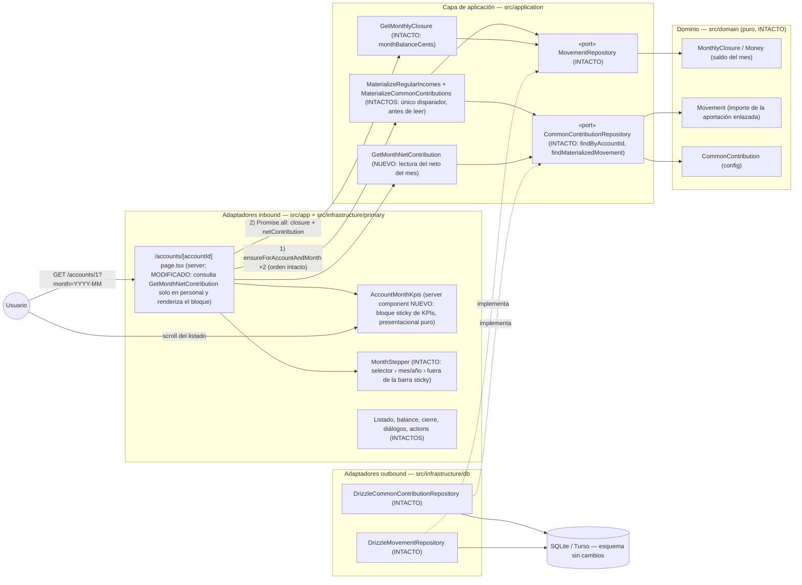

# Implementation Plan: KPIs fijos y destacados en la página de cuenta personal

**Branch**: `feature/022-kpis-fijos-cuenta` | **Date**: 2026-10-21 | **Spec**: [spec.md](./spec.md)

**Input**: Feature specification from `/specs/022-kpis-fijos-cuenta/spec.md`

## Summary

Cada página de **cuenta personal** gana un bloque destacado de dos KPIs del **mes consultado** — la **aportación neta a la cuenta común** y el **saldo del mes** (Σ ingresos − Σ gastos) — fijado con CSS `position: sticky` de modo que permanece visible durante todo el recorrido del listado de movimientos (mecanismo cerrado en clarify 2026-10-21: barra sticky **sin** el selector ‹ mes/año › dentro). Sin entidades, esquema, actions ni agregados nuevos: el saldo reutiliza el `monthBalanceCents` del cierre que la página ya calcula y la aportación se lee del **movimiento materializado enlazado** del registro de 021 (`findMaterializedMovement`), garantizando coherencia por construcción con listado y cierre (FR-006). La cuenta común no cambia (FR-005) y la materialización queda intacta (FR-008).

**Enfoque técnico** (detalles y alternativas en [research.md](./research.md)):

- **`GetMonthNetContribution`** (aplicación, NUEVO): caso de uso de lectura mínimo → `MonthNetContributionDTO { configured, amountCents }`; reusa los puertos existentes (`findByAccountId`, `findMaterializedMovement`), **sin recálculo** del neto (el importe es el del movimiento, cero deriva posible).
- **`AccountMonthKpis`** (UI servidor, NUEVO): componente presentacional puro con `dl` de dos KPIs + etiqueta pasiva del mes; sticky puro CSS (`sticky top-0 z-20` + fondo con sangrado); solo se monta en cuentas personales.
- **Página de cuenta** (MODIFICADA): añade el caso de uso al `Promise.all` solo para cuentas personales y renderiza el bloque entre el stepper y el listado; orden materialización → lectura intacto.
- **Único cambio contractual del layout**: `e2e/pagina-cuenta.spec.ts` P1 actualiza su aserción de orden (selector → KPIs → listado).

## Technical Context

**Language/Version**: TypeScript estricto sobre Next.js (App Router) — monolito existente; sin versiones nuevas.

**Primary Dependencies**: Next.js App Router (RSC), React, Tailwind CSS (sin shadcn nuevo: no existe `card.tsx` ni se necesita), Drizzle ORM, Zod (frontera ya existente de `?month=`). Ninguna dependencia nueva.

**Storage**: SQLite (dev) / Turso libSQL (prod) vía Drizzle. **Sin migraciones**: el esquema no cambia.

**Testing**: Vitest (`test.projects`: node para el caso de uso, ui/jsdom para el componente) co-localizado con el SUT; Playwright e2e (`workers: 1`, orden alfabético, `e2e.sqlite` recreada) — fichero nuevo con combinación cuenta/mes propia (Cuenta de Miembro A + mes en curso) y limpieza total UI-driven.

**Target Platform**: local (`npm run dev`) y Vercel serverless + Turso (lectura sin estado nuevo).

**Project Type**: web-app monolito (Family Wallet).

**Performance Goals**: sin degradación perceptible de la apertura del mes: +2–3 `SELECT` indexados por render de cuenta personal (`common_contributions` por índice único + fila del registro por índice único + movimiento por PK), cero escrituras nuevas; sticky es CSS puro (sin JS de scroll).

**Constraints**: EUR en céntimos enteros (formato solo vía `ui/format.ts`); sin alterar materialización ni agregados (FR-008/FR-009); UI y specs en español; sticky sin el selector dentro (clarify 2026-10-21).

**Scale/Scope**: uso individual, 3 cuentas (2 personales + 1 común); una única US (constitución II, sin excepción).

## Constitution Check

*GATE: Must pass before Phase 0 research. Re-check after Phase 1 design.*

| # | Principio | Estado pre-diseño | Notas |
|---|-----------|-------------------|-------|
| I | Simplicidad Primero | ✅ PASS | Mismo monolito, cero dependencias nuevas, cero esquema nuevo; un caso de uso de lectura y un componente presentacional. Sin patrones adicionales. |
| II | Spec-Driven Development | ✅ PASS | Spec aprobada con clarify (2026-10-21) y una única US; este plan diseña FR-001..FR-011. |
| III | Calidad Verificada | ✅ PASS | FR-010 exige y este plan planifica: tests de aplicación (tabla de casos del DTO), tests de componente (casos con/sin config, neto 0, mes vacío, saldo negativo), e2e propio con aislamiento cuenta/mes + actualización de `pagina-cuenta` P1. |
| IV | TypeScript estricto + Zod | ✅ PASS | Sin fronteras nuevas (no hay actions/forms); `?month=` ya se valida con Zod en la página; tipado estricto en DTO nuevo; sin `any`. |
| V | Persistencia SQLite con Drizzle | ✅ PASS | Sin cambios de esquema ni de acceso: se reusan métodos existentes de `DrizzleCommonContributionRepository`. |
| VI | Producto en español, código en inglés | ✅ PASS | Literales nuevos en español («KPIs del mes», «Aportación común», «Saldo del mes», «Sin aportación configurada»); identificadores en inglés (`GetMonthNetContribution`, `AccountMonthKpis`, `MonthNetContributionDTO`); glosario en data-model §5. |
| VII | Arquitectura Hexagonal + DDD táctico | ✅ PASS | Caso de uso en aplicación reusando puertos existentes; UI como adaptador presentacional puro (sin lógica de negocio en componentes — el saldo llega calculado y la aportación leída); página sigue siendo adaptador inbound fino; dominio intacto (diagrama §Componentes). |

**Resultado**: sin violaciones → Phase 0 autorizada.

## Project Structure

### Documentation (this feature)

```text
specs/022-kpis-fijos-cuenta/
├── spec.md                      # Especificación (aprobada con clarify 2026-10-21)
├── plan.md                      # Este fichero (/speckit.plan)
├── research.md                  # Phase 0 — 8 secciones de decisiones verificadas contra código
├── data-model.md                # Phase 1 — caso de uso, tabla de casos, diagrama de clases, glosario
├── contracts/
│   └── ui-contract.md           # Phase 1 — literales, layout sticky y selectores congelados
├── quickstart.md                # Phase 1 — Q1–Q8 de validación manual + gates
└── tasks.md                     # Phase 2 (/speckit.tasks — NO lo crea este comando)
```

### Source Code (repository root)

```text
src/
├── domain/                                        # INTACTO (sin cambios)
├── application/
│   └── common-contribution/
│       ├── GetMonthNetContribution.ts             # NUEVO — lectura: {configured, amountCents}
│       └── GetMonthNetContribution.test.ts        # NUEVO — tabla de casos (data-model §1.2)
├── app/
│   └── accounts/[accountId]/page.tsx              # MODIFICADO — Promise.all + render condicional
│                                                  #   (solo personal) de AccountMonthKpis
└── infrastructure/
    └── primary/
        └── ui/
            ├── account-month-kpis.tsx             # NUEVO — server component sticky, dl 2 KPIs
            └── account-month-kpis.test.tsx        # NUEVO — casos FR-010 (ui/jsdom)
e2e/
├── kpis-fijos-cuenta.spec.ts                      # NUEVO — Cuenta A + mes en curso; K0–K7; limpieza total
└── pagina-cuenta.spec.ts                          # MODIFICADO — P1: orden selector → KPIs → listado
AGENTS.md                                          # ACTUALIZADO (FR-011) — convención «bloque KPIs sticky»
specs/001-family-wallet/spec.md                    # ACTUALIZADO (FR-011): fila 022 → Completada + nota datada
docs/architecture/diagrams/                        # ACTUALIZADO — diagrama página de cuenta ampliado (base: §Diagramas)
```

**Structure Decision**: la estructura hexagonal existente se mantiene sin excepciones: la feature es lectura pura — un caso de uso nuevo en el módulo `common-contribution` (reusando puertos), un componente servidor nuevo en la UI y una línea de composición más en la página. Nada se reorganiza; dominio y persistencia intactos.

## Diagramas de diseño

### Componentes que intervienen



> Nota: todas las dependencias apuntan hacia el dominio; el dominio no cambia ni importa nada de infraestructura. `/summary`, `/annual`, formularios y menú ⋮ **no participan** (intactos; FR-009).

### Secuencia — happy path: consultar la cuenta personal con gastos comunes en el mes

```mermaid
sequenceDiagram
    autonumber
    actor U as Usuario (miembro A, mes en curso)
    participant AP as "/accounts/[accountId] page.tsx (server)"
    participant MatUC as "MaterializeCommonContributions (aplicación, INTACTO)"
    participant GNC as GetMonthNetContribution (aplicación, NUEVO)
    participant GMC as GetMonthlyClosure (aplicación, intacto)
    participant PortCC as CommonContributionRepository (puerto)
    participant SQL as SQLite/Turso
    participant Kpis as AccountMonthKpis (UI servidor)

    U->>AP: GET /accounts/1 (mes en curso; gasto común 120,55 ya registrado)
    AP->>MatUC: ensureForAccountAndMonth(accountId, month, currentMonth)
    Note over MatUC: re-sincroniza el mes en curso (021): aportación ajustada a −379,45
    AP->>AP: Promise.all de lecturas
    AP->>GMC: execute(accountId, month)
    GMC-->>AP: MonthlyClosureDTO { monthBalanceCents: −500,00 }
    AP->>GNC: execute(accountId, month)
    GNC->>PortCC: findByAccountId(accountId)
    PortCC->>SQL: SELECT common_contributions WHERE account_id = 1
    SQL-->>PortCC: config (activa, 25 %)
    GNC->>PortCC: findMaterializedMovement(config.id, month)
    PortCC->>SQL: SELECT common_contribution_months (config, month) → movement_id → movements
    SQL-->>PortCC: movimiento 37945
    GNC-->>AP: { configured: true, amountCents: 37945 }
    AP->>Kpis: netContribution + monthBalanceCents + month (solo cuenta personal)
    Kpis-->>U: barra «KPIs del mes» sticky: Aportación común 379,45 € · Saldo del mes −500,00 €
    U->>U: recorre el listado → la barra permanece fija arriba (CSS sticky)
```

## Complexity Tracking

> **Fill ONLY if Constitution Check has violations that must be justified**

| Violation | Why Needed | Simpler Alternative Rejected Because |
|-----------|------------|-------------------------------------|
| (ninguna) | — | — |

**Decisiones de diseño destacadas (sin violación, registradas para `/speckit.tasks`)**:

- **Lectura del neto = movimiento enlazado**, nunca recálculo (research §1): coherencia con listado/cierre por construcción; alcance del descuento sellado en `sumSharedExpenseCents` (ADR 0019) intacto.
- **Saldo del mes = `closure.monthBalanceCents`** ya calculado en el mismo render (research §2): cero cálculo duplicado.
- **Caso de uso mínimo** `GetMonthNetContribution` con DTO `{configured, amountCents}` y sin puertos nuevos (research §3).
- **Sticky puro CSS + componente servidor** sin el selector; etiqueta pasiva del mes dentro de la barra (research §4).
- **E2E en Cuenta de Miembro A + mes en curso** con limpieza total UI-driven (research §6): única combinación viable verificada contra la matriz de ocupación e2e; actualización de la aserción de orden de `pagina-cuenta` P1.
- **Sin ADR nuevo** (research §8): consecuencia directa de ADR 0016/0017/0019; convención de UI nueva a AGENTS.md + roadmap al cerrar (FR-011).

## Constitution Check (post-diseño, Phase 1)

Re-evaluación tras generar `research.md`, `data-model.md`, `contracts/ui-contract.md` y `quickstart.md`:

| # | Principio | Estado post-diseño | Notas |
|---|-----------|--------------------|-------|
| I | Simplicidad Primero | ✅ PASS | Un caso de uso de lectura (~15 líneas de flujo) y un componente presentacional; sin esquema, sin puertos, sin actions, sin JS de scroll. Complejidad tracked: (ninguna). |
| II | Spec-Driven Development | ✅ PASS | FR-001→research §4/ui-contract §1; FR-002→§1+§5/§2; FR-003→§2/§3; FR-004→§4/§4; FR-005→§4/§1; FR-006→§1–§2/§1 (invariante); FR-007→orden intacto/§4; FR-008→§1/§5; FR-009→intactos por diseño; FR-010→§7 matriz; FR-011→§8 + estructura. Una US (II, sin excepción). |
| III | Calidad Verificada | ✅ PASS | Matriz por capa en research §7 (aplicación con dobles, componente jsdom con los 5 casos de FR-010 + clases sticky, e2e K0–K7 con aislamiento verificado §6 y actualización de P1); quickstart «Gates automáticos» cierra SC-005. |
| IV | TypeScript estricto + Zod | ✅ PASS | Sin fronteras nuevas que validar (mes ya Zod en la página); DTO estricto; sin `any`. |
| V | Persistencia SQLite con Drizzle | ✅ PASS | Cero migraciones; solo reuso de `SELECT` indexados por Drizzle existentes. |
| VI | Producto en español, código en inglés | ✅ PASS | Literales congelados en ui-contract §1–§3; identificadores en inglés; glosario ES↔EN en data-model §5. |
| VII | Arquitectura Hexagonal + DDD táctico | ✅ PASS | Lectura orquestada en aplicación (caso de uso nuevo, puertos reusados); UI presentacional sin lógica de negocio; página como adaptador fino con condicional de cuenta personal; dominio intacto. |

**Resultado**: diseño aprobado; sin desviaciones que justificar. El plan queda listo para `/speckit.tasks`.
