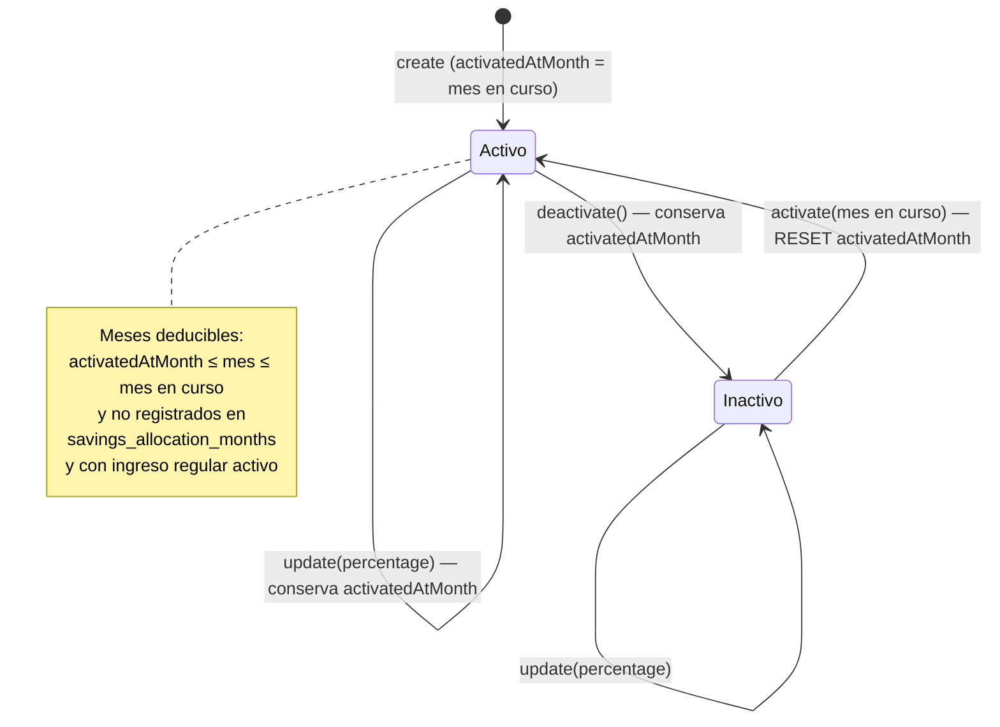

# Data Model — Porcentaje de ahorro por miembro con apartado mensual (023)

**Feature**: `023-porcentaje-ahorro` | **Fecha**: 2026-10-27 | **Spec**: [spec.md](./spec.md) · **Research**: [research.md](./research.md)

Modelo de datos de la feature: un agregado nuevo (`SavingsAllocation` + VO `SavingsPercentage`), su registro de meses deducidos **con importe congelado** (`savings_allocation_months`, sin movimiento asociado), la lectura para el KPI (`GetMonthSavings`) y la amenda al bloque «KPIs del mes» de 022 (3 métricas). `movements`, `regular_incomes`, `common_contributions` y el resto del esquema **no cambian**.

---

## 1. Vista de Dominio (nueva) y de Aplicación

### 1.1 Dominio — `src/domain/savings/` (NUEVO)

#### `SavingsPercentage` (Value Object, nuevo)

| Campo | Tipo | Regla |
|-------|------|-------|
| `percent` | `number` (entero) | `1..100`; **número entero, sin decimales** (decisión del propietario, 2026-10-26; FR-001). |

```ts
SavingsPercentage.fromPercent(percent: number): SavingsPercentage
  // rechaza no-enteros y fuera de 1..100 con InvalidSavingsAllocationError("percentage", …)
savingsPercentage.percent: number
savingsPercentage.appliedToCents(amountCents: number): number
  // floor((amountCents × percent + 50) / 100) — half-up al céntimo, enteros puros (FR-002)
savingsPercentage.equals(other): boolean
```

Casos congelados de `appliedToCents` (tests tabla; spec, edge «Redondeo al céntimo»):

| Entrada | Cálculo | Salida |
|---------|---------|--------|
| 10 % × 300 000 céntimos (3.000,00 €) | floor((300 000×10 + 50)/100) | 30 000 → **300,00 €** |
| 10 % × 300 005 (3.000,05 €) | floor((300 005×10 + 50)/100) | 30 001 → **300,01 €** (edge de la spec) |
| 33 % × 150 (1,50 €) | floor((150×33 + 50)/100) | 50 → **0,50 €** (49,5 c → .5 hacia arriba) |
| 10 % × 5 (0,05 €) | floor((5×10 + 50)/100) | 1 → **0,01 €** (0,5 c → .5 hacia arriba) |
| 1 % × 99 (0,99 €) | floor((99×1 + 50)/100) | 1 → **0,01 €** |

#### `SavingsAllocation` (Entity, nueva)

| Campo | Tipo | Regla |
|-------|------|-------|
| `id` | `SavingsAllocationId \| null` | Entero positivo con brand; `null` hasta persistir. |
| `accountId` | `AccountId` | Cuenta **personal** del miembro; única configuración por cuenta (FR-001). La cuenta común no puede tener ahorro (validado en el caso de uso, como 018/019). |
| `percentage` | `SavingsPercentage` | Ver VO arriba. |
| `active` | `boolean` | Estado activo/inactivo. |
| `activatedAtMonth` | `string` `YYYY-MM` | Mes de alta o última reactivación; **no cambia en las ediciones** (FR-004; misma semántica que 018/019). |

```ts
SavingsAllocation.create(input): SavingsAllocation            // nace active: true, activatedAtMonth = currentMonth
SavingsAllocation.rehydrate(id, input): SavingsAllocation
allocation.update({ percentage }): SavingsAllocation          // revalida; conserva active y activatedAtMonth
allocation.deactivate(): SavingsAllocation                   // conserva activatedAtMonth
allocation.activate(currentMonth): SavingsAllocation          // active: true y RESET activatedAtMonth = currentMonth
```

Sin `dueDateForMonth` ni referencias a movimiento/etiqueta: el apartado es informativo (decisión del propietario, 2026-10-26).

#### Errores (nuevos) — `SavingsAllocationErrors.ts`

| Error | Regla que la dispara | Mensaje (literal congelado) |
|-------|----------------------|------------------------------|
| `InvalidSavingsAllocationError` | `percentage` fuera de `1..100` o no entero; `activatedAtMonth` malformado; importe resultante < 1 céntimo | «El porcentaje debe ser un número entero entre 1 y 100.» / «El mes de activación no es válido.» / «El porcentaje aplicado a tu ingreso regular debe resultar en al menos 0,01 €.» |
| `SharedAccountSavingsError` | Configurar ahorro en cuenta común (esc. 6) | «La cuenta común no puede tener ahorro.» |
| `SavingsAllocationNotFoundError` | Desactivar sin configuración previa | «No existe ahorro configurado para esta cuenta.» |
| `MissingRegularIncomeError` | Configurar ahorro sin ingreso regular (018) (FR-001, esc. 8) | «Configura primero el ingreso regular de este miembro.» |

`SavingsAllocationId` (brand de entero positivo, espejo de `CommonContributionId`) completa el módulo.

### 1.2 Aplicación — `src/application/savings/` (NUEVO)

Puerto (definido en aplicación, constitución VII):

```ts
interface SavingsAllocationRepository {
  findByAccountId(accountId: AccountId): Promise<SavingsAllocation | null>;
  save(config: SavingsAllocation): Promise<SavingsAllocation>;            // upsert por account_id (espejo 018/019)
  isDeducted(allocationId: SavingsAllocationId, month: string): Promise<boolean>;
  registerDeduction(config: SavingsAllocation, month: string, amountCents: number): Promise<boolean>;
  findDeductedAmount(allocationId: SavingsAllocationId, month: string): Promise<number | null>;
}
```

Casos de uso:

| Caso de uso | Depende de (puertos) | Comportamiento clave |
|-------------|----------------------|----------------------|
| `ConfigureSavingsAllocation` | `SavingsAllocationRepository`, `RegularIncomeRepository`, `AccountRepository` | Guardas: cuenta existe → personal → **existe ingreso regular** (`MissingRegularIncomeError`; paridad `ConfigureCommonContribution`: existencia, no estado activo) → porcentaje válido → `appliedToCents(income.amountCents) ≥ 1`. Alta: `create` nace activa en `currentMonth`; edición: `update({percentage})`; si estaba inactiva: `activate(currentMonth)` (reset del mes, FR-004). |
| `DeactivateSavingsAllocation` | `SavingsAllocationRepository` | `SavingsAllocationNotFoundError` si no existe; `save(existing.deactivate())` conservando `activatedAtMonth`. |
| `GetSavingsAllocation` | `SavingsAllocationRepository` | Devuelve `SavingsAllocationDTO \| null` (panel `/`). |
| `MaterializeSavingsAllocations` | `SavingsAllocationRepository`, `RegularIncomeRepository` | `ensureForAccountAndMonth(accountId, month, currentMonth)` — ver §1.2.1. **Sin** re-sync del mes en curso (research §3). |
| `GetMonthSavings` | `SavingsAllocationRepository` | Ver §1.2.2; lectura del KPI. |

#### 1.2.1 `MaterializeSavingsAllocations.ensureForAccountAndMonth` — guardas en orden (research §3)

1. Config existe, `active`, `id !== null` → si no, return.
2. `activatedAtMonth ≤ month ≤ currentMonth` (lexicográfico `YYYY-MM`) → si no, return (FR-003: sin retroactivo ni futuro).
3. `!isDeducted(id, month)` → si ya registrada, return (idempotencia; la fila está congelada: ni duplica ni reajusta, FR-004).
4. Ingreso regular del miembro existe **y activo** → si no, return **sin registrar el mes** (mes abierto; clarify 2026-10-26, paridad 019).
5. `percentage.appliedToCents(income.amount.amountCents) ≥ 1` → si no, return sin registrar (espejo guarda `netCents < 1` de 019).
6. `registerDeduction(config, month, amountCents)` — INSERT único `ON CONFLICT DO NOTHING RETURNING` en tx (carrera → false, no-op silencioso).

La base (`income.amount`) y el porcentaje se leen en el momento de registrar (solo-adelante, FR-004). No existe borrado del mes ni reajuste: sin movimiento, la fila es la única verdad del importe congelado.

#### 1.2.2 `GetMonthSavings` — lectura del KPI (espejo de `GetMonthNetContribution`)

```ts
interface MonthSavingsDTO { configured: boolean; amountCents: number }

GetMonthSavings.execute(accountId: AccountId, month: string): Promise<MonthSavingsDTO>
// month inválido (no YYYY-MM) → throw Error (paridad GetMonthlyClosure/GetMonthNetContribution)
// sin config → { configured: false, amountCents: 0 }
// con config → { configured: true, amountCents: fila del registro ?? 0 }
//   importe = findDeductedAmount(config.id, month), NUNCA recálculo (research §1)
// Se invoca tras el materializador (orden de página intacto) y nunca lo dispara.
```

### 1.3 Contratos de datos (props y derivaciones UI)

```ts
// account-card-grid.tsx (MODIFICADO)
interface AccountCardGridProps {
  accounts: AccountDTO[];
  regularIncomes: Record<number, RegularIncomeDTO | null>;          // intacto (018/020)
  commonContributions: Record<number, CommonContributionDTO | null>; // intacto (019)
  savingsAllocations: Record<number, SavingsAllocationDTO | null>;   // NUEVO
}

// Función pura exportada (espejo de commonContributionMenuStatus; ui-contract §1)
savingsMenuStatus(
  savings: SavingsAllocationDTO | null,
  regularIncome: RegularIncomeDTO | null,
): "Requiere ingreso regular" | "Sin configurar" | "Activo" | "Desactivado";

// savings-config-dialog.tsx (NUEVO)
interface SavingsConfigDialogProps {
  accountId: number;
  memberName: string | null;
  config: SavingsAllocationDTO | null;
  onClose: () => void;
}

// account-month-kpis.tsx (MODIFICADO — amenda 022)
interface AccountMonthKpisProps {
  netContribution: MonthNetContributionDTO;   // intacto (022)
  savings: MonthSavingsDTO;                   // NUEVO
  netMonthBalanceCents: number;               // NUEVO: closure.monthBalanceCents − savings.amountCents (lo compone la página)
  month: string;
}
```

`Reglas`: el ítem «Ahorro» solo se renderiza en cuentas personales, tras «Aportación»; con `regularIncome === null` está **deshabilitado** y no abre diálogo; el diálogo se monta condicionalmente dentro de la tarjeta (excepción documentada en AGENTS.md, catálogo estable). La resta neta vive una única vez en la página (research §4); el componente solo formatea.

### 1.4 Diagrama de clases (diseño)

```mermaid
classDiagram
    direction LR

    class SavingsAllocation {
        <<Entity — NUEVA>> ahorro (config)
        -id: SavingsAllocationId?
        -accountId: AccountId
        -percentage: SavingsPercentage
        -active: boolean
        -activatedAtMonth: string
        +create(input) SavingsAllocation$
        +rehydrate(id, input) SavingsAllocation$
        +update(percentage) SavingsAllocation
        +deactivate() SavingsAllocation
        +activate(currentMonth) SavingsAllocation
    }

    class SavingsPercentage {
        <<VO — NUEVO>> entero 1..100 (sin decimales)
        -percent: number
        +fromPercent(n)$ SavingsPercentage
        +appliedToCents(amountCents) number
    }

    class SavingsAllocationRepository {
        <<Port — NUEVO>> aplicación
        +findByAccountId(accountId) SavingsAllocation?
        +save(config) SavingsAllocation
        +isDeducted(id, month) boolean
        +registerDeduction(config, month, amountCents) boolean
        +findDeductedAmount(id, month) number?
    }

    class ConfigureSavingsAllocation {
        <<Use case — NUEVO>>
    }
    class DeactivateSavingsAllocation {
        <<Use case — NUEVO>>
    }
    class GetSavingsAllocation {
        <<Use case — NUEVO>>
    }
    class MaterializeSavingsAllocations {
        <<Use case — NUEVO>>
    }
    class GetMonthSavings {
        <<Use case — NUEVO>>
    }

    class RegularIncome {
        <<Entity>> intacta (018) — base plana
    }
    class RegularIncomeRepository {
        <<Port>> intacto (018)
    }
    class AccountRepository {
        <<Port>> intacto — tipo de cuenta
    }
    class CommonContribution {
        <<Entity>> intacta (019) — coexistencia independiente (FR-006)
    }

    class DrizzleSavingsAllocationRepository {
        <<Adapter outbound — NUEVO>>
        upsert por account_id
        tx: INSERT registro ON CONFLICT DO NOTHING
    }

    class configureSavingsAllocation {
        <<Server Action — NUEVA>>
        intent save o deactivate
    }
    class SavingsConfigDialog {
        <<Client — NUEVO>> espejo diálogo aportación
    }
    class AccountSettingsMenu {
        <<Client — MODIFICADO>>
        ítem «Ahorro» + estado
    }
    class AccountMonthKpis {
        <<Server — MODIFICADO>>
        dl 3 métricas; saldo neto
    }

    SavingsAllocation *-- SavingsPercentage
    SavingsPercentage ..> Money : appliedToCents (half-up)
    SavingsAllocation --> RegularIncome : base de cálculo (solo lectura vía puerto)
    ConfigureSavingsAllocation --> SavingsAllocationRepository
    ConfigureSavingsAllocation --> RegularIncomeRepository : guardia FR-001
    ConfigureSavingsAllocation --> AccountRepository
    DeactivateSavingsAllocation --> SavingsAllocationRepository
    GetSavingsAllocation --> SavingsAllocationRepository
    MaterializeSavingsAllocations --> SavingsAllocationRepository
    MaterializeSavingsAllocations --> RegularIncomeRepository
    GetMonthSavings --> SavingsAllocationRepository
    DrizzleSavingsAllocationRepository ..|> SavingsAllocationRepository
    configureSavingsAllocation --> ConfigureSavingsAllocation
    configureSavingsAllocation --> DeactivateSavingsAllocation
    SavingsConfigDialog --> configureSavingsAllocation : useActionState
    AccountSettingsMenu --> SavingsConfigDialog : monta condicional
    AccountMonthKpis --> GetMonthSavings : MonthSavingsDTO vía props de page.tsx
```



> Diferencias con `docs/architecture/diagrams/domain-model.md` (vivo, a actualizar en la implementación): se añaden `SavingsAllocation`, `SavingsPercentage`, su puerto y adaptador, los 5 casos de uso, la action/diálogo y la amenda del bloque KPIs; nada del modelo existente cambia de forma (ni `Movement`, ni `CommonContribution`).

### 1.5 Transiciones de estado

Estados de la configuración por miembro (una por cuenta personal, como 018/019):



El registro `savings_allocation_months` es **append-only** por `(config, mes)` con importe congelado: un mes registrado nunca se vuelve a calcular ni se borra (no hay movimiento que borrar; FR-004).

---

## 2. Vista de Persistencia (Drizzle, SQLite/Turso)

### 2.1 Esquema — `src/infrastructure/db/schema/savings-allocations.ts` (NUEVO) y migración `drizzle/0006_porcentaje-ahorro.sql`

```text
savings_allocations                                 # configuración (1 por cuenta personal)
├── id: integer PK (autoincrement)
├── account_id: integer NOT NULL UNIQUE → accounts(id)        ← un ahorro por miembro
├── percentage: integer NOT NULL                              ← 1..100 entero (valida dominio)
├── active: integer(0/1) NOT NULL
├── activated_at_month: text NOT NULL                         ← YYYY-MM
├── created_at: text NOT NULL
└── updated_at: text NULL

savings_allocation_months                           # registro de meses deducidos (idempotencia + congelado)
├── id: integer PK (autoincrement)
├── savings_allocation_id: integer NOT NULL → savings_allocations(id) ON DELETE CASCADE
├── month: text NOT NULL                                       ← YYYY-MM deducido
├── amount_cents: integer NOT NULL                             ← importe congelado al registrar (research §1)
├── created_at: text NOT NULL
└── UNIQUE (savings_allocation_id, month)                      ← invariante FR-003/FR-004
```

La migración `0006` crea ambas tablas + índice único. **Sin datos sembrados** (no hay etiqueta ni catálogo nuevo, a diferencia de 019) y **sin cambios** en `movements`, `tags`, `regular_incomes` ni `common_contributions`. Columna de porcentaje como **entero** (no puntos base): refleja el VO y hace no-representables los decimales.

### 2.2 Repositorio — `DrizzleSavingsAllocationRepository` (NUEVO) + mapper

Espejo de `DrizzleCommonContributionRepository` simplificado (sin movimiento):

- `save`: `insert … onConflictDoUpdate({ target: savingsAllocations.accountId, set: … })` + `.returning()`.
- `isDeducted`: `select 1` por `(savings_allocation_id, month)`.
- `registerDeduction` (única tx, un solo INSERT — sin reserva de ids de movimiento):

```text
INSERT INTO savings_allocation_months (savings_allocation_id, month, amount_cents, created_at)
  ON CONFLICT (savings_allocation_id, month) DO NOTHING RETURNING id;
  → sin fila (perdió la carrera otro render): devuelve false, no-op
  → con fila: devuelve true
```

- `findDeductedAmount`: `select amount_cents` por `(savings_allocation_id, month)` → `number | null`.

`movements` **no participa**: ninguna vista ni agregado toca las tablas nuevas; solo el materializador escribe y `GetMonthSavings` lee.

---

## 3. Validación por capa

| Regla | Dominio (entidad/VO) | Aplicación (casos de uso) | Frontera (action/Zod) | UI |
|-------|----------------------|---------------------------|------------------------|-----|
| Porcentaje entero > 0, ≤ 100, sin decimales (FR-001) | `SavingsPercentage.fromPercent` (1..100 entero) | `ConfigureSavingsAllocation` reconstruye el VO | `percentageSchema`: patrón `^\d{1,3}$` + `parseIntegerPercentage` ∈ [1, 100]; **decimales («12,5») caen en formato** | `inputMode="numeric"`, mensajes `role="alert"` (ui-contract §3) |
| Solo cuentas personales (FR-001, esc. 6) | — (como 018/019) | `SharedAccountSavingsError` en `Configure` | mapea a `_form` | ítem de menú solo en tarjetas personales (intacto 020) |
| Requiere ingreso regular (FR-001, esc. 8) | `MissingRegularIncomeError` (módulo savings) | `Configure` consulta `RegularIncomeRepository` (existencia) | mapea a `_form` | ítem deshabilitado + «Requiere ingreso regular» |
| Importe ≥ 0,01 € (paridad 019) | `InvalidSavingsAllocationError("percentage", literal)` | `Configure` calcula sobre el ingreso actual; `Materialize` no-op sin registrar | mapea a `percentage` | — |
| `activatedAtMonth` `YYYY-MM` (FR-004) | patrón en `buildValidatedState` (espejo 018/019) | — | — | — |
| Ventana solo-adelante (FR-003/FR-004) | — | guardas lexicográficas de `Materialize` (§1.2.1) | — | — |
| Idempotencia y congelado (FR-003, esc. 2; FR-004) | — | `isDeducted` + tx `ON CONFLICT DO NOTHING RETURNING`; fila nunca actualizada | — | — |
| Sin movimiento ni cómputo en agregados (FR-003, FR-007) | — | el materializador no toca `movements`; agregados intactos | — | saldo neto = resta única en la página (research §4) |
| accountId numérico | — | `AccountNotFoundError` | `z.string().regex(/^\d+$/)` (espejo 018/019) | hidden input |

## 4. DTOs

```ts
// src/application/savings/dto.ts (NUEVO) — espejo del DTO de aportación, con porcentaje entero
interface SavingsAllocationDTO {
  accountId: number;
  percentage: number;        // 1..100 entero
  active: boolean;
  activatedAtMonth: string;  // YYYY-MM
}

// src/application/savings/GetMonthSavings.ts (NUEVO)
interface MonthSavingsDTO { configured: boolean; amountCents: number }
```

Formateo a texto de input solo en el adaptador UI: `String(config.percentage)` (entero, sin `formatBasisPointsForInput`). Parse inverso `parseIntegerPercentage` en la action (`savings-form.schema.ts`).

## 5. Glosario ES ↔ EN (constitución VI)

| Español (UI/spec) | English (código) | Notas |
|-------------------|------------------|-------|
| Ahorro (mensual) | `SavingsAllocation` | Entidad de dominio; término de la spec. Módulo `savings`. |
| Porcentaje (de ahorro) | `SavingsPercentage` | VO entero 1–100 (`percent`); **sin** puntos base (contraste deliberado con 019). |
| Apartado / deducción (del mes) | deduction / `registerDeduction` | Importe informativo restado del disponible; nunca movimiento. |
| Registro de meses (deducidos) | `savings_allocation_months` | Idempotencia + importe congelado (variante sin movimiento del patrón de 018/019). |
| Saldo neto (del mes) | `netMonthBalanceCents` | `closure.monthBalanceCents − savings.amountCents`; compuesto una única vez en la página. |
| Mes de activación | `activatedAtMonth` | Alta o última reactivación; no cambia al editar (espejo 018/019). |
| Materialización perezosa | lazy deduction on read | Único disparador: la página de cuenta, antes de leer (ADR 0016/0017). |
| Solo hacia adelante | forward-only semantics | Base y porcentaje se leen al registrar; lo registrado no se recalcula. |
| Redondeo half-up | half-up rounding | `floor((cents×pct + 50)/100)`; .5 hacia arriba (solo al importe, nunca al porcentaje). |
| Ingreso regular | `RegularIncome` | Intacto (018); base plana del cálculo. |
| Aportación común | `CommonContribution` | Intacta (019); coexistencia independiente (FR-006). |

Sin identificadores intraducibles nuevos fuera de los listados.
