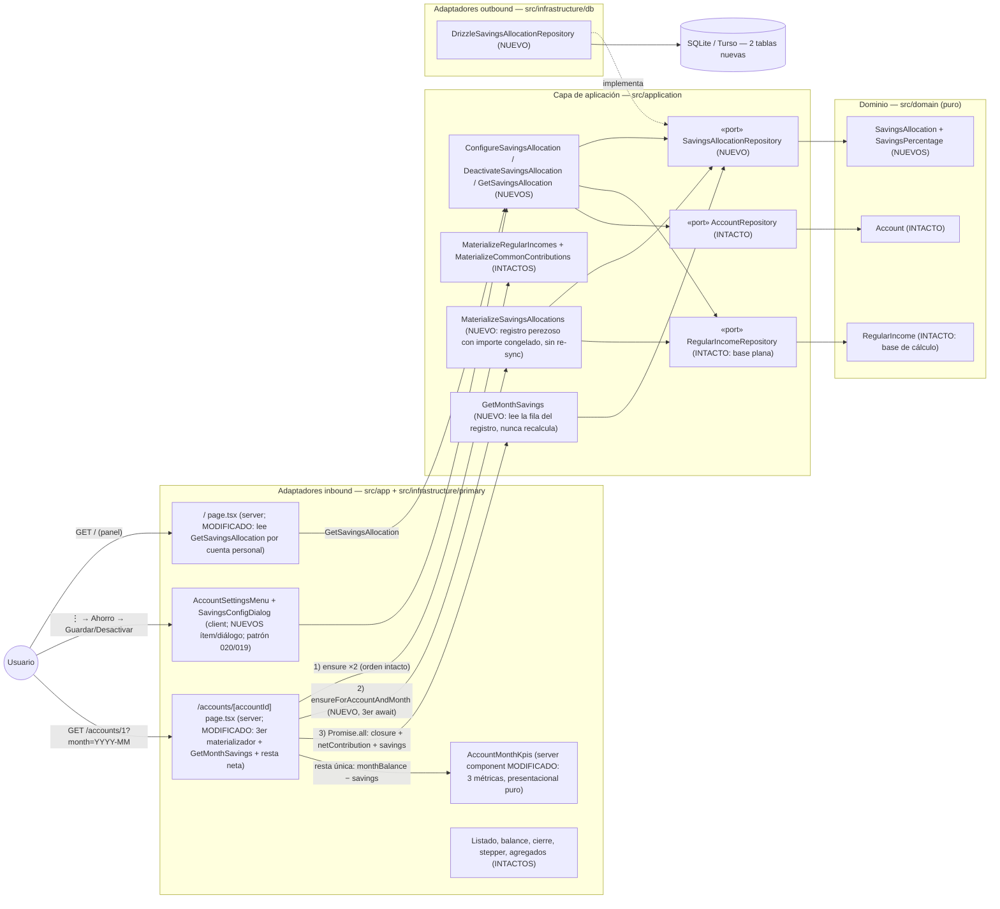

# Implementation Plan: Porcentaje de ahorro por miembro con apartado mensual

**Branch**: `feature/023-porcentaje-ahorro` | **Date**: 2026-10-27 | **Spec**: [spec.md](./spec.md)

**Input**: Feature specification from `/specs/023-porcentaje-ahorro/spec.md`

## Summary

Cada miembro con cuenta personal e ingreso regular (018) puede configurar un **porcentaje de ahorro entero (1–100)** desde el ítem **«Ahorro»** del menú ⋮ de su tarjeta (patrón 020/019). El importe resultante (p. ej. 10 % de 3.000 € = 300 €, half-up al céntimo, base plana sobre el ingreso bruto) se deduce **de forma perezosa e idempotente al consultar el mes** —con la mecánica de registro de meses de 018/019, adaptada a que **no existe movimiento**: la fila del registro congela el importe— y se muestra como **KPI propio del bloque «KPIs del mes»** (amenda el contrato de 022: 3 métricas — aportación común, ahorro del mes y **saldo del mes neto del ahorro**), sin generar movimientos ni alterar cierre, resumen global, anual, balance acumulado ni la cuenta común (FR-007).

**Enfoque técnico** (detalles y alternativas en [research.md](./research.md)):

- **Agregado nuevo** `SavingsAllocation` + VO `SavingsPercentage` (entero 1–100, sin puntos base) en `src/domain/savings/`, espejo de `common-contribution` sin la maquinaria de movimiento (research §2).
- **Registro con importe congelado**: tablas `savings_allocations` + `savings_allocation_months` (`amount_cents`, `UNIQUE (config, mes)`, `ON CONFLICT DO NOTHING` en tx) — idempotencia, solo-adelante y congelado por construcción; **sin re-sync del mes en curso** (base plana; diferencia explícita con 021; research §1/§3).
- **`MaterializeSavingsAllocations`**: tercer await secuencial de la página de cuenta, antes de leer (guardas espejo §1.2.1 de 019); `GetMonthSavings` lee la fila (nunca recalcula) y la página compone una única resta `netMonthBalanceCents = closure.monthBalanceCents − savings.amountCents` para el KPI neto (research §4).
- **UI espejo 019**: ítem «Ahorro» con `savingsMenuStatus` («Requiere ingreso regular»/«Sin configurar»/«Activo»/«Desactivado»), diálogo «Ahorro mensual» con input entero, action con Zod (`^\d{1,3}$`; «12,5» → error de formato) y bloque KPIs de 3 celdas (research §5).
- **E2E propio** `e2e/porcentaje-ahorro.spec.ts` (Cuenta de Miembro B + mes en curso, limpieza total UI-driven), verificado contra la matriz de ocupación de la suite (research §6).

## Technical Context

**Language/Version**: TypeScript estricto sobre Next.js (App Router) — monolito existente; sin versiones nuevas.

**Primary Dependencies**: Next.js App Router (RSC), React, Tailwind CSS + shadcn/ui (componentes existentes: Dialog, DropdownMenu, Input, Label, Button), Drizzle ORM, Zod (frontera de la action nueva). Ninguna dependencia nueva.

**Storage**: SQLite (dev) / Turso libSQL (prod) vía Drizzle. **Migración nueva** `drizzle/0006_porcentaje-ahorro.sql`: 2 tablas + índice único (data-model §2.1); resto del esquema intacto.

**Testing**: Vitest (`test.projects`: node para dominio/aplicación/actions/repositorio, ui/jsdom para componentes) co-localizado con el SUT; repositorio contra libsql `:memory:` con las migraciones de `drizzle/`; Playwright e2e (`workers: 1`, orden alfabético, `e2e.sqlite` recreada) — fichero nuevo con combinación cuenta/mes propia (Cuenta de Miembro B + mes en curso) y limpieza total UI-driven.

**Target Platform**: local (`npm run dev`) y Vercel serverless + Turso (sin estado nuevo; migración pre-deploy con `drizzle.prod.config.ts`).

**Project Type**: web-app monolito (Family Wallet).

**Performance Goals**: sin degradación apreciable de la apertura del mes (edge «Rendimiento»): +1–2 `SELECT` indexados y a lo sumo 1 `INSERT` por render de cuenta personal (`savings_allocations` por índice único + fila del registro por índice único); la deducción no toca `movements`.

**Constraints**: EUR en céntimos enteros con half-up (ADR 0007; formateo solo vía `ui/format.ts`); porcentaje entero 1–100 sin decimales (decisión del propietario 2026-10-26); agregados, balance acumulado y cuenta común intocables (FR-007); cálculo plano sin interacción 021/019 (FR-002/FR-006); UI y specs en español; único disparador de la deducción = la página de cuenta (ADR 0016/0017).

**Scale/Scope**: uso individual, 3 cuentas (2 personales + 1 común); una única US (constitución II, sin excepción).

## Constitution Check

*GATE: Must pass before Phase 0 research. Re-check after Phase 1 design.*

| # | Principio | Estado pre-diseño | Notas |
|---|-----------|-------------------|-------|
| I | Simplicidad Primero | ✅ PASS | Mismo monolito, cero dependencias nuevas; un agregado espejo del existente, una migración aditiva y superficies UI que replican patrones de 019/022. Sin patrones adicionales (el registro de meses es el ya adoptado por 018/019). |
| II | Spec-Driven Development | ✅ PASS | Spec aprobada con clarify (2026-10-26, 4 respuestas) y una única US; este plan diseña FR-001..FR-009. |
| III | Calidad Verificada | ✅ PASS | FR-009 exige y este plan planifica: dominio (VO/tabla half-up, entidad), aplicación (materializador, configure, lectura), repositorio (libsql :memory:), action, componentes y e2e propio con aislamiento cuenta/mes verificado (research §6/§7). |
| IV | TypeScript estricto + Zod | ✅ PASS | Frontera nueva (form del diálogo) validada con Zod + parse de cadenas (`savings-form.schema.ts`, espejo 019); `?month=` ya validado en la página; tipado estricto en DTOs; sin `any`. |
| V | Persistencia SQLite con Drizzle | ✅ PASS | Migración versionada `0006_porcentaje-ahorro.sql` como única vía de evolución; acceso solo vía `DrizzleSavingsAllocationRepository`; sin SQL ad hoc. |
| VI | Producto en español, código en inglés | ✅ PASS | Literales nuevos en español («Ahorro», «Ahorro mensual», «Ahorro del mes», «Sin ahorro configurado», «Activo»/«Desactivado»); identificadores en inglés (`SavingsAllocation`, `SavingsPercentage`, `GetMonthSavings`); glosario en data-model §5. |
| VII | Arquitectura Hexagonal + DDD táctico | ✅ PASS | Dominio puro nuevo (entidad + VO + errores, sin deps); puerto en aplicación, adaptador Drizzle nuevo; página como adaptador inbound fino (tercer materializador + composición de la resta); componente KPI presentacional puro; agregados y agregados de lectura intactos (FR-007). |

**Resultado**: sin violaciones → Phase 0 autorizada.

## Project Structure

### Documentation (this feature)

```text
specs/023-porcentaje-ahorro/
├── spec.md                      # Especificación (aprobada con clarify 2026-10-26)
├── plan.md                      # Este fichero (/speckit.plan)
├── research.md                  # Phase 0 — 8 secciones de decisiones verificadas contra código
├── data-model.md                # Phase 1 — agregado, guardas, diagrama de clases, glosario
├── contracts/
│   └── ui-contract.md           # Phase 1 — menú, diálogo, KPIs (amenda 022), literales congelados
├── quickstart.md                # Phase 1 — Q1–Q10 de validación manual + gates
└── tasks.md                     # Phase 2 (/speckit.tasks — NO lo crea este comando)
```

### Source Code (repository root)

```text
src/
├── domain/
│   └── savings/                                   # NUEVO — módulo espejo de common-contribution
│       ├── SavingsAllocation.ts                   #   entidad (config por miembro)
│       ├── SavingsAllocation.test.ts
│       ├── SavingsAllocationId.ts                 #   brand de entero positivo
│       ├── SavingsPercentage.ts                   #   VO entero 1..100 + appliedToCents half-up
│       ├── SavingsPercentage.test.ts
│       └── SavingsAllocationErrors.ts             #   4 errores (espejo 019)
├── application/
│   └── savings/                                   # NUEVO
│       ├── SavingsAllocationRepository.ts         #   puerto (isDeducted/registerDeduction/findDeductedAmount)
│       ├── dto.ts                                 #   SavingsAllocationDTO
│       ├── ConfigureSavingsAllocation.ts          #   guardas: personal + ingreso regular + importe ≥ 1 c
│       ├── ConfigureSavingsAllocation.test.ts
│       ├── DeactivateSavingsAllocation.ts
│       ├── DeactivateSavingsAllocation.test.ts
│       ├── GetSavingsAllocation.ts                #   lectura para el panel (/)
│       ├── GetSavingsAllocation.test.ts
│       ├── MaterializeSavingsAllocations.ts       #   ensureForAccountAndMonth — guardas §1.2.1, sin re-sync
│       ├── MaterializeSavingsAllocations.test.ts
│       ├── GetMonthSavings.ts                     #   MonthSavingsDTO {configured, amountCents} — lee el registro
│       └── GetMonthSavings.test.ts
├── app/
│   ├── page.tsx                                   # MODIFICADO — lee GetSavingsAllocation por cuenta personal
│   └── accounts/[accountId]/page.tsx              # MODIFICADO — tercer materializador + GetMonthSavings
│                                                  #   + netMonthBalanceCents + props del bloque KPIs
└── infrastructure/
    ├── db/
    │   ├── schema/savings-allocations.ts          # NUEVO — 2 tablas + índice único
    │   ├── mappers/savings-allocation.mapper.ts   # NUEVO
    │   ├── DrizzleSavingsAllocationRepository.ts  # NUEVO — upsert + registerDeduction (tx, ON CONFLICT)
    │   └── DrizzleSavingsAllocationRepository.test.ts  # NUEVO — libsql :memory: + migraciones
    └── primary/
        ├── actions/
        │   ├── savings-form.schema.ts             # NUEVO — INTEGER_PERCENTAGE_PATTERN + parseIntegerPercentage
        │   ├── configure-savings-allocation.action.ts      # NUEVA — intent save|deactivate
        │   └── configure-savings-allocation.action.test.ts # NUEVA
        └── ui/
            ├── savings-config-dialog.tsx          # NUEVO — espejo diálogo aportación, input entero
            ├── savings-config-dialog.test.tsx     # NUEVO
            ├── account-card-grid.tsx              # MODIFICADO — prop savingsAllocations, ítem «Ahorro»,
            │                                      #   savingsMenuStatus, diálogo montado en la tarjeta
            ├── account-card-grid.test.tsx         # MODIFICADO — 4 estados del ítem + deshabilitado
            ├── account-month-kpis.tsx             # MODIFICADO — dl 3 celdas, ahorro + saldo neto
            └── account-month-kpis.test.tsx        # MODIFICADO — casos FR-005
drizzle/
└── 0006_porcentaje-ahorro.sql                     # NUEVO — savings_allocations + savings_allocation_months
e2e/
└── porcentaje-ahorro.spec.ts                      # NUEVO — Cuenta B + mes en curso; flujo SC-005; limpieza total
AGENTS.md                                          # ACTUALIZADO (FR-008) — convención KPIs 3 métricas + ahorro informativo
specs/001-family-wallet/spec.md                    # ACTUALIZADO (FR-008): fila 023 → Completada + nota datada
docs/architecture/diagrams/                        # ACTUALIZADO — dominio/página de cuenta ampliados (base: §Diagramas)
```

**Structure Decision**: la estructura hexagonal existente se mantiene sin excepciones: módulo nuevo de dominio (puro), módulo nuevo de aplicación con su puerto, adaptador Drizzle nuevo, una action y dos componentes cliente/servidor espejo de los de 019/022. Nada se reorganiza; `movements`, `regular_incomes`, `common_contributions`, agregados y cuenta común intactos (FR-007).

## Diagramas de diseño

### Componentes que intervienen



> Nota: todas las dependencias apuntan hacia el dominio; el dominio nuevo no importa nada de infraestructura. `/summary`, `/annual`, cierre, formularios de movimiento y cuenta común **no participan** (intactos; FR-007).

### Secuencia — happy path: configurar 10 % de ahorro y consultar el mes

```mermaid
sequenceDiagram
    autonumber
    actor U as Usuario (Miembro B, ingreso regular 3.000 € de 018)
    participant Menu as AccountSettingsMenu (/ panel)
    participant Act as configureSavingsAllocation (action)
    participant Conf as ConfigureSavingsAllocation (aplicación)
    participant AP as "/accounts/[accountId] page.tsx (server)"
    participant Mat as MaterializeSavingsAllocations (aplicación)
    participant GMS as GetMonthSavings (aplicación)
    participant Port as SavingsAllocationRepository (puerto)
    participant SQL as SQLite/Turso
    participant Kpis as AccountMonthKpis (UI servidor)

    U->>Menu: ⋮ → «Ahorro» → 10 → Guardar
    Menu->>Act: FormData {accountId, percentage: "10", intent: save}
    Act->>Conf: execute({accountId, percent: 10, currentMonth})
    Conf->>Port: findByAccountId / RegularIncomeRepository.findByAccountId (guardas)
    Conf->>Port: save(SavingsAllocation.create — activa, activatedAtMonth = mes en curso)
    Port->>SQL: INSERT … ON CONFLICT (account_id) DO UPDATE
    Act-->>Menu: success «Ahorro guardado» + revalidatePath
    U->>AP: GET /accounts/2 (mes en curso)
    AP->>Mat: ensureForAccountAndMonth(accountId, month, currentMonth)
    Mat->>Port: findByAccountId → config activa, mes en ventana, !isDeducted
    Mat->>Port: RegularIncomeRepository → 300 000 céntimos, activo
    Note over Mat: amount = floor((300000×10 + 50)/100) = 30 000 c
    Mat->>Port: registerDeduction(config, month, 30000)
    Port->>SQL: INSERT savings_allocation_months ON CONFLICT DO NOTHING
    AP->>GMS: execute(accountId, month)
    GMS->>Port: findByAccountId + findDeductedAmount
    Port-->>GMS: 30 000
    GMS-->>AP: { configured: true, amountCents: 30000 }
    AP->>AP: netMonthBalanceCents = closure.monthBalanceCents − 30000
    AP->>Kpis: netContribution + savings + netMonthBalanceCents + month
    Kpis-->>U: barra sticky: Aportación común · Ahorro del mes 300,00 € · Saldo del mes (neto −300,00 € respecto al cierre)
    Note over U,AP: re-consultas: isDeducted → true → no-op; importe congelado estable (SC-002)
```

## Complexity Tracking

> **Fill ONLY if Constitution Check has violations that must be justified**

| Violation | Why Needed | Simpler Alternative Rejected Because |
|-----------|------------|-------------------------------------|
| (ninguna) | — | — |

**Decisiones de diseño destacadas (sin violación, registradas para `/speckit.tasks`)**:

- **Registro con importe congelado** en `savings_allocation_months` (research §1): idempotencia + solo-adelante + congelado por construcción, variante sin movimiento del patrón ADR 0016/0017; el KPI lee la fila, nunca recalcula.
- **VO entero 1–100** `SavingsPercentage` con half-up propio (research §2): hace irrepresentables los decimales y desacopla el módulo de `common-contribution` (FR-006).
- **Sin re-sync del mes en curso** (research §3): base plana sobre configs; FR-004 congela el mes consultado. Diferencia explícita y justificada con 021.
- **Resta neta única en la página** (`netMonthBalanceCents`), componente KPI presentacional puro (research §4): KPI y cierre coherentes por construcción, difieren exactamente en el importe deducido (edge «Sin doble cómputo»).
- **Guardas de configuración por existencia de ingreso regular** (`income === null`), paridad literal con 019; el requisito de activo aplica en la deducción (guarda 4; research §5).
- **E2E en Cuenta de Miembro B + mes en curso** con limpieza total UI-driven (research §6): única combinación viable verificada contra la matriz de ocupación (registro-movimientos aserta balance absoluto de la cuenta 1); `kpis-fijos-cuenta.spec.ts` sigue verde sin cambios (aserciones tolerantes; sin ahorro configurado el neto coincide con el bruto).
- **Sin ADR nuevo** (research §8): consecuencia directa de ADR 0016/0017 + decisiones de la spec; convención nueva a AGENTS.md + roadmap al cerrar (FR-008).

## Constitution Check (post-diseño, Phase 1)

Re-evaluación tras generar `research.md`, `data-model.md`, `contracts/ui-contract.md` y `quickstart.md`:

| # | Principio | Estado post-diseño | Notas |
|---|-----------|--------------------|-------|
| I | Simplicidad Primero | ✅ PASS | Un agregado espejo, una migración aditiva (2 tablas), 5 casos de uso pequeños, 1 action, 1 diálogo y la amenda de un componente. Sin patrones ni proyectos nuevos. Complejidad tracked: (ninguna). |
| II | Spec-Driven Development | ✅ PASS | FR-001→research §5/ui-contract §1–§3; FR-002→§2/data-model §1.1; FR-003→§1+§3/data-model §1.2.1; FR-004→§3/§1.5; FR-005→§4+§5/ui-contract §4; FR-006→§2/invariante; FR-007→§4/ui-contract §9; FR-008→§8 + estructura; FR-009→§6+§7 matriz. Una US (II, sin excepción). |
| III | Calidad Verificada | ✅ PASS | Matriz por capa en research §7 (dominio tabla half-up, aplicación con dobles — idempotencia, ventana, no-op sin registrar —, repositorio libsql :memory:, action tabla de validación, 3 componentes jsdom, e2e propio con aislamiento verificado §6); quickstart «Gates automáticos» cierra SC-005. |
| IV | TypeScript estricto + Zod | ✅ PASS | Frontera nueva de la action validada con Zod + parse de cadenas (`^\d{1,3}$`, decimales rechazados); DTOs estrictos; sin `any`. |
| V | Persistencia SQLite con Drizzle | ✅ PASS | Migración versionada única (`0006`), UNIQUE + ON CONFLICT en Drizzle, sin SQL ad hoc; `movements` intacto. |
| VI | Producto en español, código en inglés | ✅ PASS | Literales congelados en ui-contract §1–§4; identificadores en inglés; glosario ES↔EN en data-model §5. |
| VII | Arquitectura Hexagonal + DDD Táctico | ✅ PASS | Dominio puro nuevo; puerto en aplicación, adaptador Drizzle; página adaptador fino (3 awaits secuenciales + Promise.all + resta de composición); componente KPI presentacional; agregados de lectura y cuenta común intactos (FR-007); sin eventos/CQRS (sin justificación necesaria). |

**Resultado**: diseño aprobado; sin desviaciones que justificar. El plan queda listo para `/speckit.tasks`.
