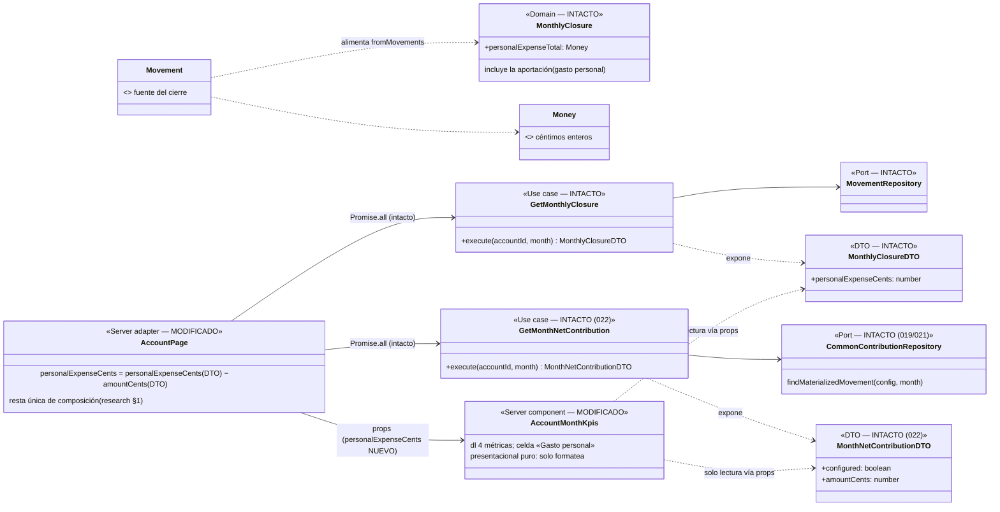

# Data Model — KPI de gasto personal del mes en cuentas personales (024)

**Feature**: `024-kpi-gasto-personal` | **Fecha**: 2026-10-31 | **Spec**: [spec.md](./spec.md) · **Research**: [research.md](./research.md)

Modelo de datos de la feature: **no se introducen entidades, value objects, tablas ni migraciones** (spec, «Key Entities»). El KPI es una **agregación de lectura derivada**, compuesta una única vez en la página de cuenta a partir de dos datos que esta ya lee hoy (`MonthlyClosure` y `GetMonthNetContribution`), y renderizada como cuarta métrica del bloque «KPIs del mes» (amenda del contrato 022/023: 3 → 4). `movements`, configs (018/019/023), agregados y el resto del esquema **no cambian**.

---

## 1. Vista de Dominio (SIN CAMBIOS) y de Aplicación (SIN CAMBIOS)

### 1.1 Dominio — intacto

| Pieza | Papel en 024 | Cambio |
|-------|--------------|--------|
| `MonthlyClosure.personalExpenseTotal` | Σ gastos `nature = "personal"` del mes consultado — **incluye** el movimiento de aportación (019 lo materializa como gasto personal) | Ninguno (`src/domain/movement/MonthlyClosure.ts` intacto) |
| `Movement`, `Money`, `ExpenseNature`, `MovementType` | Datos fuente del cierre | Ninguno |

### 1.2 Aplicación — intacta

| Caso de uso / DTO | Papel en 024 | Cambio |
|-------------------|--------------|--------|
| `GetMonthlyClosure` → `MonthlyClosureDTO.personalExpenseCents` | Operando 1 de la composición | Ninguno |
| `GetMonthNetContribution` → `MonthNetContributionDTO.amountCents` | Operando 2: importe del movimiento de aportación enlazado del mes (0 si no hay config/movimiento) | Ninguno |
| `MaterializeRegularIncomes` / `MaterializeCommonContributions` / `MaterializeSavingsAllocations` | Los 3 awaits secuenciales previos a la lectura — orden de página intacto (FR-005) | Ninguno |
| Puertos y repositorios | — | Ninguno (ni firma ni implementación) |

### 1.3 Regla de derivación del KPI (NUEVA, vive una única vez en la página)

```text
personalExpenseCents = MonthlyClosureDTO.personalExpenseCents − MonthNetContributionDTO.amountCents
```

- La compone **`src/app/accounts/[accountId]/page.tsx`** (adaptador inbound) dentro de la rama `account.type === "personal"` y se la pasa calculada a `AccountMonthKpis` — misma figura que `netMonthBalanceCents` en 022/023 (research §1). El componente **jamás** recalcula ni resta (constitución VII).
- Semántica (FR-002, composición cerrada): Σ gastos del mes consultado con **naturaleza propia, excluida la aportación común**. Los gastos `nature = "shared"` no computan (quedan reflejados en la aportación neta de 021); los ingresos nunca computan; el ahorro deducido (023) no es movimiento y no computa. Cada euro del listado computa como máximo en un KPI de gasto del bloque (aportación o gasto personal), sin dobles conteos.
- Invariante: exacta mientras el movimiento de aportación conserve la `nature: "personal"` con la que lo crea el materializador de 019 (el re-sync de 021 la preserva). La manipulación manual de ese movimiento del sistema queda fuera de la composición congelada (research §1).
- Casos límite (todos derivan de la tabla de research §1): mes sin gastos computables → `0`; aportación retirada/borrada/futura → sustrando `0` y el cierre tampoco la incluye; mes cerrado → valor histórico sin recálculo ni congelación adicionales (lectura pura).

## 1.4 Contratos de datos (props UI)

```ts
// account-month-kpis.tsx (MODIFICADO — amenda 022/023)
interface AccountMonthKpisProps {
  netContribution: MonthNetContributionDTO; // intacto (022)
  personalExpenseCents: number;             // NUEVO: closure.personalExpenseCents − netContribution.amountCents
                                            //        (lo compone la página; el componente solo formatea)
  savings: MonthSavingsDTO;                 // intacto (023)
  netMonthBalanceCents: number;             // intacto (023)
  month: string;                            // intacto (022)
}
```

**Reglas**: el `dl` pasa de 3 a **4 métricas** (`grid grid-cols-2 gap-3 sm:grid-cols-4`) en orden congelado Aportación común · **Gasto personal** · Ahorro del mes · Saldo del mes; la celda nueva muestra `formatAmountCents(personalExpenseCents)` (magnitud, sin signo, sin color de alerta) y **no tiene** estados ni subtexto (no existe configuración detrás). Detalle completo en [contracts/ui-contract.md](./contracts/ui-contract.md).

### 1.5 Diagrama de clases (diseño)



> Diferencias con `docs/architecture/diagrams/` (vivo, a actualizar en la implementación): **ninguna clase nueva ni modificada en dominio/aplicación**; solo la prop `personalExpenseCents` en `AccountMonthKpis` y la resta de composición en `AccountPage`. Los diagramas de la página de cuenta se extienden con la cuarta celda.

### 1.6 Transiciones de estado

No aplica: el KPI no tiene estado propio (lectura pura, sin configuración ni registro de meses). Los estados existentes que lo influyen (aportación configurada/retirada/borrada, mes consultado, mes cerrado) están modelados en 019/021 y se derivan por la tabla de casos de research §1.

---

## 2. Vista de Persistencia (Drizzle, SQLite/Turso) — SIN CAMBIOS

- **Sin migraciones nuevas** (la última sigue siendo `drizzle/0007_...`): no hay tablas, columnas ni índices nuevos.
- **Sin cambios de repositorio**: `DrizzleMovementRepository`, `DrizzleCommonContributionRepository` y el resto quedan exactamente como están; ninguna query nueva (el KPI no añade lecturas: reutiliza los resultados ya obtenidos por la página).
- **Sin cambios de seed**: `seed-data.ts` intacto.

---

## 3. Validación por capa

| Regla | Dominio | Aplicación | Frontera | UI |
|-------|---------|------------|----------|-----|
| Composición cerrada: naturaleza propia, excluida la aportación (FR-002) | intacta (`MonthlyClosure` clasifica por naturaleza) | intacta (`GetMonthlyClosure`, `GetMonthNetContribution`) | — | resta única en `page.tsx` (adaptador); componente solo formatea |
| Ingresos nunca computan (edge) | intacta (`MonthlyClosure.fromMovements` ramifica por `type`) | intacta | — | — |
| Mes consultado `YYYY-MM` (FR-003) | — | validación existente en ambos casos de uso (`throw`) | `monthParamSchema` Zod existente en la página | etiqueta pasiva `monthLabel` |
| Siempre presente, 0,00 sin subtexto (FR-002, edge) | — | — | — | celda sin estados; `formatAmountCents(0)` |
| Sin dobles conteos (FR-002) | por construcción (clasificación disjunta por naturaleza) | por construcción (mismo cierre y mismo movimiento enlazado) | — | resta exacta de la aportación |
| Actualización al reconsultar (FR-007) | — | — | `revalidatePath` existente de actions CRUD | re-render de servidor del bloque |

---

## 4. DTOs

Sin DTOs nuevos. La única firma nueva es la prop `personalExpenseCents: number` de `AccountMonthKpisProps` (§1.4), calculada por la página; los tipos existentes (`MonthlyClosureDTO`, `MonthNetContributionDTO`, `MonthSavingsDTO`) viajan intactos.

---

## 5. Glosario ES ↔ EN (constitución VI)

| Español (UI/spec) | English (código) | Notas |
|-------------------|------------------|-------|
| Gasto personal (del mes) | `personalExpenseCents` / `personalExpenseTotal` | Prop de UI compuesta / total del cierre (este **incluye** la aportación; el KPI la excluye). |
| Composición / resta única | page-level composition | `page.tsx` resta una sola vez; precedente `netMonthBalanceCents` (022/023). |
| Aportación común | `CommonContribution` / `MonthNetContributionDTO` | Intacta (019/021); sustrando de la composición. |
| Naturaleza propia / común | `nature: "personal" \| "shared"` (`ExpenseNature`) | Intacta; clasificación disjunta del cierre. |
| Lectura pura | pure read aggregation | Sin configuración, sin materialización, sin registro de meses. |
| Mes consultado | queried month (`?month=YYYY-MM`) | Intacto; el KPI refleja el mes del selector. |
| Visibilidad continua | sticky KPI block (022) | `sticky top-0 z-20` intacto; el grid pasa a 4 métricas. |

Sin identificadores intraducibles nuevos fuera de los listados.
