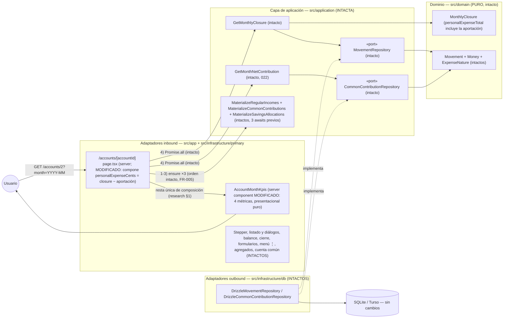
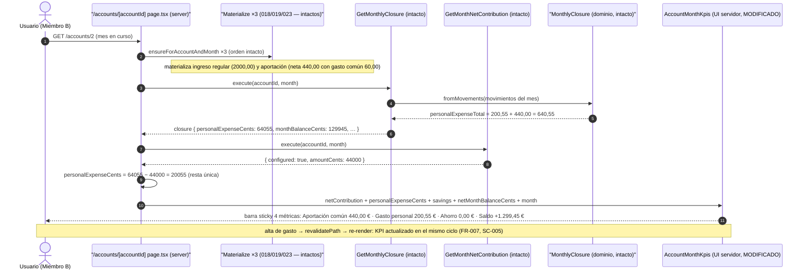

# Implementation Plan: KPI de gasto personal del mes en la página de cuenta personal

**Branch**: `feature/024-kpi-gasto-personal` | **Date**: 2026-10-31 | **Spec**: [spec.md](./spec.md)

**Input**: Feature specification from `/specs/024-kpi-gasto-personal/spec.md`

## Summary

El bloque «KPIs del mes» de las cuentas personales pasa de 3 a **4 métricas**: se añade **«Gasto personal»** (segunda posición, entre la aportación común y el ahorro) con la suma de los gastos del mes consultado de **naturaleza propia, excluida la aportación común** — para comparar de un vistazo lo gastado personalmente con el saldo del mes antes de asumir gastos futuros. Es una **agregación de lectura pura**: sin configuración, sin materialización, sin reglas nuevas y sin cambios en dominio, aplicación, persistencia ni agregados (FR-005/FR-006).

**Enfoque técnico** (detalles y alternativas en [research.md](./research.md)):

- **Composición sobre datos ya leídos** (research §1): `personalExpenseCents = closure.personalExpenseCents − netContribution.amountCents`, restado **una única vez en la página de cuenta** (precedente `netMonthBalanceCents` de 022/023) y pasado como prop a `AccountMonthKpis`, que solo formatea. Cero casos de uso, puertos, queries o migraciones nuevas (FR-004: coherente con listado y cierre por construcción).
- **Grid de 4** `grid grid-cols-2 gap-3 sm:grid-cols-4` (research §2): móvil 2×2 (legibilidad de literales congelados), ≥`sm` una fila; sticky de 022 intacto → visibilidad continua (SC-001).
- **E2E propio** `e2e/kpi-gasto-personal.spec.ts` (Cuenta de Miembro B + mes en curso, barrido defensivo + limpieza que restaura el estado de entrada, espejo D11), única combinación viable verificada contra la matriz de ocupación de la suite (research §5).

## Technical Context

**Language/Version**: TypeScript estricto sobre Next.js (App Router) — monolito existente; sin versiones nuevas.

**Primary Dependencies**: Next.js App Router (RSC), React, Tailwind CSS (sin componentes shadcn nuevos). **Ninguna dependencia nueva** ni nueva frontera de datos (no hay action ni formulario: lectura pura).

**Storage**: SQLite (dev) / Turso libSQL (prod) vía Drizzle. **Sin migraciones** y sin cambios de esquema, repositorios ni seed (data-model §2).

**Testing**: Vitest (`test.projects`: node/ui jsdom) co-localizado con el SUT; Playwright e2e (`workers: 1`, orden alfabético, `e2e.sqlite` recreada) — fichero nuevo con combinación cuenta/mes propia (Cuenta de Miembro B + mes en curso) y limpieza total UI-driven con restauración del estado de entrada.

**Target Platform**: local (`npm run dev`) y Vercel serverless + Turso (sin estado nuevo).

**Project Type**: web-app monolito (Family Wallet).

**Performance Goals**: idéntica a la actual: **cero** consultas ni renders adicionales (el KPI reutiliza resultados ya obtenidos en el mismo `Promise.all` de la página); sin JS de cliente nuevo.

**Constraints**: EUR en céntimos enteros (ADR 0007; formateo solo vía `ui/format.ts`); composición cerrada por el propietario (2026-10-30: naturaleza propia, excluida la aportación); agregados, balance acumulado, cuenta común y semántica 018/019/021/023 intocables (FR-005/FR-006); UI y specs en español; paridad de literales con los contratos 022/023.

**Scale/Scope**: uso individual, 3 cuentas (2 personales + 1 común); una única US (constitución II, sin excepción).

## Constitution Check

*GATE: Must pass before Phase 0 research. Re-check after Phase 1 design.*

| # | Principio | Estado pre-diseño | Notas |
|---|-----------|-------------------|-------|
| I | Simplicidad Primero | ✅ PASS | La feature más pequeña posible: una prop compuesta, una celda de `dl`, tests y docs. Sin entidades, tablas, patrones ni proyectos nuevos. |
| II | Spec-Driven Development | ✅ PASS | Spec aprobada (2026-10-30, composición cerrada con el propietario); una única US con valor propio; este plan diseña FR-001..FR-009. |
| III | Calidad Verificada | ✅ PASS | FR-008 exige y este plan planifica: tests de componente del bloque (orden, importe, 0,00 sin subtexto, grid) y e2e propio con aislamiento verificado contra la matriz de la suite (research §5/§7). |
| IV | TypeScript estricto + Zod | ✅ PASS | Sin `any`; la única firma nueva es `personalExpenseCents: number` (prop tipada); sin fronteras de datos nuevas (`?month=` ya validado con Zod en la página). |
| V | Persistencia SQLite con Drizzle | ✅ PASS | Sin cambios de persistencia: ni migraciones, ni esquema, ni repositorios, ni seed (data-model §2). |
| VI | Producto en español, código en inglés | ✅ PASS | Literal nuevo «Gasto personal» (español, congelado en ui-contract §1); identificador `personalExpenseCents` (inglés); glosario en data-model §5. |
| VII | Arquitectura Hexagonal + DDD Táctico | ✅ PASS | Sin cambios en dominio ni aplicación; la página (adaptador inbound) compone una única resta — precedente congelado 022/023 — y el componente KPI sigue presentacional puro (solo formatea); sin lógica de negocio duplicada en UI. |

**Resultado**: sin violaciones → Phase 0 autorizada.

## Project Structure

### Documentation (this feature)

```text
specs/024-kpi-gasto-personal/
├── spec.md                      # Especificación (2026-10-30, composición cerrada)
├── plan.md                      # Este fichero (/speckit.plan)
├── research.md                  # Phase 0 — 8 secciones de decisiones verificadas contra código
├── data-model.md                # Phase 1 — sin entidades nuevas; derivación, diagrama, glosario
├── contracts/
│   └── ui-contract.md           # Phase 1 — amenda bloque KPIs (022/023): 4 métricas
├── quickstart.md                # Phase 1 — Q1–Q7 de validación manual + gates
└── tasks.md                     # Phase 2 (/speckit.tasks — NO lo crea este comando)
```

### Source Code (repository root)

```text
src/
├── domain/                          # INTACTO (sin cambios)
├── application/                     # INTACTO (sin cambios: use cases, puertos, DTOs)
├── app/
│   └── accounts/[accountId]/
│       └── page.tsx                 # MODIFICADO — compone personalExpenseCents (resta única)
│                                    #   y lo pasa a AccountMonthKpis; orden de materialización
│                                    #   y Promise.all intactos (FR-005)
└── infrastructure/
    └── primary/
        └── ui/
            ├── account-month-kpis.tsx       # MODIFICADO — prop nueva, dl 4 métricas,
            │                                #   grid grid-cols-2 sm:grid-cols-4, celda «Gasto personal»
            └── account-month-kpis.test.tsx  # MODIFICADO — casos FR-008 (orden 4, importe, 0,00
                                             #   sin subtexto, grid, región sticky intacta)
e2e/
└── kpi-gasto-personal.spec.ts      # NUEVO — Cuenta B + mes en curso; G1–G7 (research §7);
                                     #   barrido defensivo + limpieza que restaura el estado de entrada
AGENTS.md                           # ACTUALIZADO (FR-009) — convención bloque KPIs: 4 métricas, grid 2/4
specs/001-family-wallet/spec.md     # ACTUALIZADO (FR-009): fila 024 → Completada
docs/architecture/diagrams/         # ACTUALIZADO (FR-009) — celda nueva en los diagramas de página de cuenta
```

**Structure Decision**: la estructura hexagonal existente se mantiene sin excepciones y **sin ningún fichero nuevo en dominio/aplicación/infraestructura de salida** — exactamente 2 ficheros de producto modificados (`page.tsx`, `account-month-kpis.tsx`), sus tests, el e2e nuevo y documentación. Todo lo demás intacto (FR-005/FR-006).

## Diagramas de diseño

### Componentes que intervienen



> Nota: todas las dependencias apuntan hacia el dominio; nada nuevo se importa desde la UI hacia casos de uso adicionales (el KPI reutiliza los ya invocados). `/summary`, `/annual`, cierre, formularios, actions y cuenta común **no participan** (FR-006).

### Secuencia — happy path: consultar el mes con gastos de distinta naturaleza



## Complexity Tracking

> **Fill ONLY if Constitution Check has violations that must be justified**

| Violation | Why Needed | Simpler Alternative Rejected Because |
|-----------|------------|-------------------------------------|
| (ninguna) | — | — |

**Decisiones de diseño destacadas (sin violación, registradas para `/speckit.tasks`)**:

- **Composición en la página, no caso de uso nuevo** (research §1): la resta `closure.personalExpenseCents − netContribution.amountCents` reutiliza los dos datos ya leídos en el mismo `Promise.all`; precedida por el patrón congelado de 022/023 (`netMonthBalanceCents`). FR-004 por construcción.
- **Invariante de la aportación como gasto personal** (research §1): 019 materializa con `nature: "personal"` y 021 la preserva en el re-sync; la manipulación manual del movimiento del sistema queda fuera de la composición congelada.
- **Grid `grid-cols-2 sm:grid-cols-4`** (research §2): resuelve el punto abierto del roadmap (layout de 4 métricas): legibilidad en móvil y una fila en ≥`sm`; visibilidad continua intacta con independencia de las filas.
- **E2E en Cuenta de Miembro B + mes en curso** con barrido defensivo y limpieza que restaura el estado de entrada (research §5): cuenta 1 descartada porque `kpis-fijos-cuenta.spec.ts` K0 exige literalmente «Sin aportación configurada» y la UI no permite borrar configs; un mes pasado fijo no puede tener aportación materializada (ventana solo-adelante) y no probaría la exclusión FR-002.
- **Sin ADR nuevo** (research §8): consecuencia directa de los contratos 022/023; convención de AGENTS.md amendada (3 → 4 métricas) y roadmap al cerrar (FR-009).

## Constitution Check (post-diseño, Phase 1)

Re-evaluación tras generar `research.md`, `data-model.md`, `contracts/ui-contract.md` y `quickstart.md`:

| # | Principio | Estado post-diseño | Notas |
|---|-----------|--------------------|-------|
| I | Simplicidad Primero | ✅ PASS | 2 ficheros de producto modificados + tests + e2e + docs; cero entidades/tablas/casos de uso/puertos/queries nuevos. Complejidad tracked: (ninguna). |
| II | Spec-Driven Development | ✅ PASS | FR-001→ui-contract §1; FR-002→§2/data-model §1.3; FR-003→§2; FR-004→research §1; FR-005/FR-006→research §6; FR-007→§2/quickstart Q4; FR-008→research §5/§7 + quickstart gates; FR-009→research §8 + estructura. Una US (II, sin excepción). |
| III | Calidad Verificada | ✅ PASS | Matriz por capa en research §7 (componente jsdom: orden 4, importe, 0,00 sin subtexto, grid; e2e G1–G7 con exclusión exacta, visibilidad continua, mes consultado, actualización y limpieza con restauración); quickstart «Gates automáticos» cierra SC-005. |
| IV | TypeScript estricto + Zod | ✅ PASS | Prop `personalExpenseCents: number` estricta; sin `any`; sin fronteras nuevas. |
| V | Persistencia SQLite con Drizzle | ✅ PASS | Sin cambios de persistencia (data-model §2): ni migraciones ni repositorios. |
| VI | Producto en español, código en inglés | ✅ PASS | «Gasto personal» congelado en ui-contract; `personalExpenseCents` en inglés; glosario data-model §5. |
| VII | Arquitectura Hexagonal + DDD Táctico | ✅ PASS | Dominio y aplicación intactos; página adaptador fino con una resta de composición (precedente 022/023); componente presentacional puro (solo formatea); agregados y cuenta común intactos (FR-006); sin eventos/CQRS. |

**Resultado**: diseño aprobado; sin desviaciones que justificar. El plan queda listo para `/speckit.tasks`.
