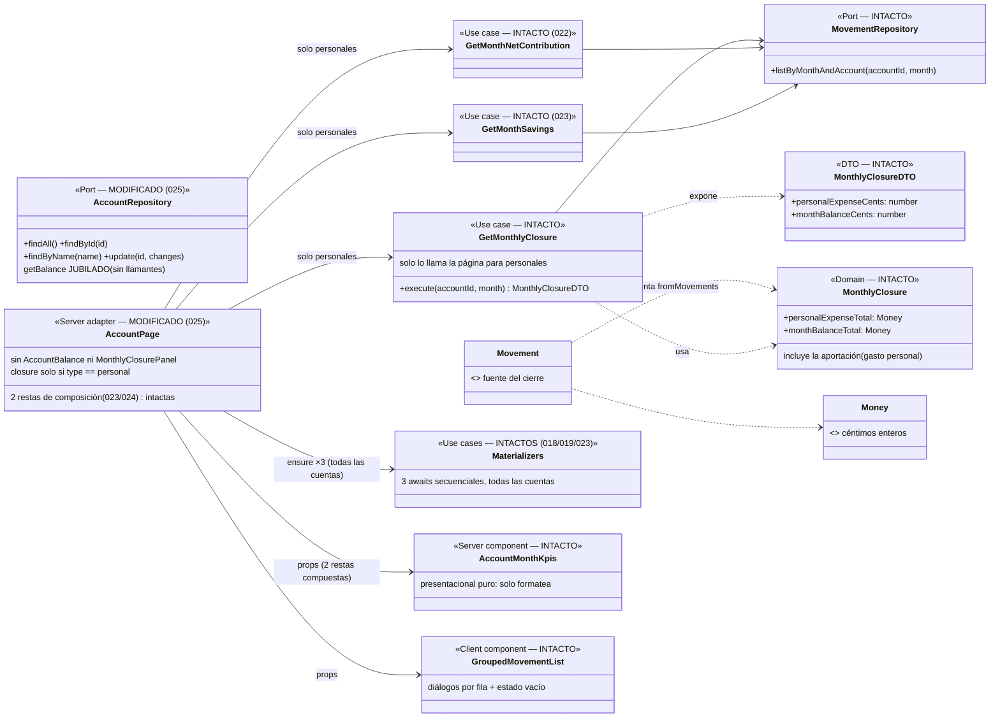

# Data Model — Simplificación de la página de cuenta (025)

**Feature**: `025-simplificar-pagina-cuenta` | **Fecha**: 2026-11-02 | **Spec**: [spec.md](./spec.md) · **Research**: [research.md](./research.md)

Modelo de datos de la feature: **no se introducen ni modifican entidades, value objects, tablas ni migraciones** (spec, «Key Entities»). Es una **retirada de presentación y de código muerto resultante**: dos componentes UI con sus tests, un método de puerto con su implementación Drizzle y los tests que lo cubren, y un helper colateral (`monthEndIsoDate`). `MonthlyClosure` y `GetMonthlyClosure` se conservan tal cual como agregado de lectura interno (fuente de composición de los KPIs).

---

## 1. Jubilaciones (el «modelo negativo» de la feature)

### 1.1 Elementos retirados y por qué quedan sin llamantes

| Elemento | Capa | Último llamador (verificado) | Destino |
|---|---|---|---|
| `AccountBalance` + `account-balance.test.tsx` | UI (server component) | `page.tsx:21,138-142` | **ELIMINADO** (FR-002) |
| `MonthlyClosurePanel` + `monthly-closure-panel.test.tsx` | UI (server component) | `page.tsx:27,144` | **ELIMINADO** (FR-002) |
| `AccountRepository.getBalance(id, asOf?)` | Puerto (aplicación) | `page.tsx:91` | **ELIMINADO** del puerto (FR-004) |
| `DrizzleAccountRepository.getBalance` | Adaptador outbound | el puerto | **ELIMINADO** (FR-004) |
| 5 tests de `getBalance` en `DrizzleRepositories.test.ts:120-218` | Repositorio | el método | **ELIMINADOS** |
| Mitad `getBalance` de 2 tests de visibilidad (018/019) | Repositorio | el método | **RE-ANCLADOS** a `listByMonthAndAccount` (FR-004) |
| `getBalance` en 10 dobles de test de `AccountRepository` | Tests de aplicación | la interfaz | **RETIRADO de los dobles** (FR-004) |
| `monthEndIsoDate` (`ui/format.ts:55`) + 2 tests | Helper de UI | `page.tsx:91` | **ELIMINADO** (colateral SC-004; `shiftMonth` se conserva — lo usa `MonthStepper`) |
| `e2e/cierre-mensual.spec.ts` | E2E | el panel retirado | **ELIMINADO** (FR-005) |

### 1.2 Puerto resultante

```ts
// src/application/account/AccountRepository.ts (MODIFICADO — sin getBalance)
export interface AccountRepository {
  findAll(): Promise<AccountDTO[]>;
  findById(id: AccountId): Promise<AccountDTO | null>;
  findByName(name: string): Promise<AccountDTO | null>;
  update(id: AccountId, changes: { name?: string }): Promise<void>;
}
```

`/summary` y `/annual` no se ven afectados: usan `findAll` (`GetGlobalMonthlySummary.ts:24-27`, `GetAnnualIncomeStatement.ts:27-31`), nunca `getBalance`.

## 2. Vista de Dominio (SIN CAMBIOS) y de Aplicación (una condición de llamada, cero cambios de contrato)

### 2.1 Dominio — intacto

| Pieza | Papel tras 025 | Cambio |
|-------|----------------|--------|
| `MonthlyClosure` (+ `personalExpenseTotal`, `monthBalanceTotal`) | Agregado de lectura interno; fuente de `personalExpenseCents`/`monthBalanceCents` de los KPIs | Ninguno |
| `Movement`, `Money`, `ExpenseNature`, `MovementType` | Datos fuente | Ninguno |

### 2.2 Aplicación — contratos intactos; la página condiciona la llamada

| Caso de uso / puerto | Papel tras 025 | Cambio |
|----------------------|----------------|--------|
| `GetMonthlyClosure.execute(accountId, month)` → `MonthlyClosureDTO` | Se ejecuta **solo para cuentas personales** (patrón idéntico a `GetMonthNetContribution`/`GetMonthSavings`: `account.type === "personal" ? execute : Promise.resolve(null)`); sus dos campos alimentan las restas de composición de 023/024 | **Ninguno** en firma, lógica ni tests (FR-003) |
| `ListMovements`, `ListActiveTags`, `GetMonthNetContribution`, `GetMonthSavings` | Igual que hoy (`netContribution`/`savings` ya eran solo personales) | Ninguno |
| `MaterializeRegularIncomes` · `MaterializeCommonContributions` · `MaterializeSavingsAllocations` | Los 3 awaits secuenciales previos a la lectura, para **todas** las cuentas — único disparador de la materialización (FR-006) | Ninguno |
| `AccountRepository` | Pierde `getBalance` (§1.2) | Firma reducida |

### 2.3 Composición de KPIs — intacta (023/024)

```text
personalExpenseCents = closure.personalExpenseCents − netContribution.amountCents   // 024
netMonthBalanceCents = closure.monthBalanceCents − savings.amountCents              // 023
```

Ambas restas siguen compuestas **una única vez en `page.tsx`**, dentro de la rama `account.type === "personal"` (guarda ampliada con `closure !== null`); `AccountMonthKpis` solo formatea (constitución VII). La coherencia con «el cierre» deja de ser observable en UI y pasa a ser **por construcción**: ambos números salen del mismo `MonthlyClosureDTO` leído una vez por render.

### 2.4 Contratos de datos (props UI)

Sin cambios: `AccountMonthKpisProps` (4 métricas, contrato congelado 022/023/024) y `GroupedMovementListProps` quedan exactamente como están. Desaparecen los props de los componentes retirados (`AccountBalanceProps`, `MonthlyClosurePanelProps`) con sus componentes.

### 2.5 Diagrama de clases (diseño)



> Jubilados en 025 (no aparecen en el diseño): `AccountBalance`, `MonthlyClosurePanel` (UI) y `AccountRepository.getBalance` (puerto + implementación Drizzle). Diferencias con `docs/architecture/diagrams/` (vivo, a actualizar en la implementación): retirar dichos nodos/ops de los diagramas de página de cuenta y C4, y anotar ADR 0009/0010 (research §7).

### 2.6 Transiciones de estado

No aplica: no hay estado nuevo ni modificado. La página resultante es una lectura pura condicionada al tipo de cuenta; materialización, re-sincronización (021) y congelado de meses (023) siguen disparándose igual al consultar (FR-006).

---

## 3. Vista de Persistencia (Drizzle, SQLite/Turso) — SIN CAMBIOS DE ESQUEMA

- **Sin migraciones nuevas** (la última sigue siendo `drizzle/0007_...`): no hay tablas, columnas ni índices nuevos ni eliminados.
- **Cambio de código de repositorio sin cambio de esquema**: `DrizzleAccountRepository` pierde el método `getBalance` (la tabla `movements` y el resto de queries quedan intactas).
- **Sin cambios de seed**: `seed-data.ts` intacto.

---

## 4. Validación por capa

| Regla | Dominio | Aplicación | Frontera | UI |
|-------|---------|------------|----------|-----|
| Página sin regiones «Balance de»/«Cierre de» (FR-001, SC-001) | — | — | — | `page.tsx` no renderiza los componentes; e2e re-ancladas aserción negativa |
| `GetMonthlyClosure` intacto y solo personales (FR-003) | intacto | firma/lógica/tests intactos; condición vive en la página (adaptador) | — | KPIs reciben props compuestas |
| `getBalance` jubilado (FR-004, SC-004) | — | interfaz reducida (typecheck fuerza el barrido de dobles) | — | — |
| Invariantes 018/019/021/022/023/024 intactos (FR-006, SC-003) | intactos | intactos | `revalidatePath` intacto | KPIs/listado sin cambios de contrato |
| Mes consultado `YYYY-MM` | — | validación existente | `monthParamSchema` Zod existente | etiqueta pasiva `monthLabel` |

---

## 5. DTOs

Sin DTOs nuevos ni modificados: `MonthlyClosureDTO`, `MonthNetContributionDTO`, `MonthSavingsDTO`, `MovementDTO`, `TagDTO`, `AccountDTO` viajan intactos. Desaparecen únicamente los props-contrato de los componentes retirados (§2.4).

---

## 6. Glosario ES ↔ EN (constitución VI)

| Español (UI/spec) | English (código) | Notas |
|-------------------|------------------|-------|
| Vista operativa | operative view | La página de cuenta tras 025: registrar/editar/eliminar; consulta agregada en `/summary` y `/annual`. |
| Jubilación (de código) | retirement / dead-code removal | Misma política que `012-panel-cuentas`; SC-004 exige 0 restos. |
| Re-anclaje (de tests) | test re-anchoring | Cambiar el selector/ancla de una aserción conservando el flujo y los importes verificados. |
| Balance acumulado | accumulated balance (puerto `getBalance`, jubilado) | Sin representación UI tras 025; ADR 0009 anotado. |
| Cierre (bruto) del mes | `MonthlyClosure` / `GetMonthlyClosure` | Sobrevive como agregado interno; sin panel UI. |
| Lectura condicionada | type-conditioned read | Patrón `account.type === "personal" ? execute : Promise.resolve(null)` (022/023, ahora también closure). |
| Espera de mes establecido | month-settled wait (combobox «Mes visible») | Ancla canónica de `selectMonth` tras retirar el cierre (research §4). |

Sin identificadores intraducibles nuevos fuera de los listados.
