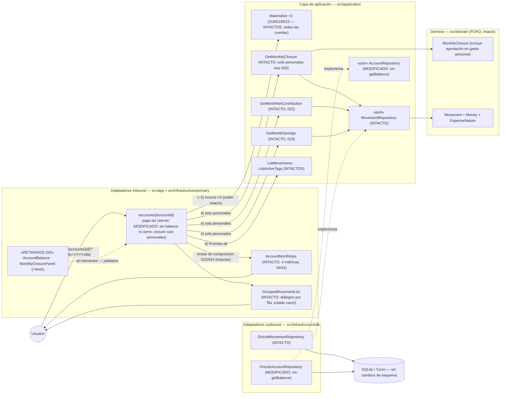

# Implementation Plan: Simplificación de la página de cuenta — retirada del balance acumulado y del panel de cierre

**Branch**: `feature/025-simplificar-pagina-cuenta` | **Date**: 2026-11-02 | **Spec**: [spec.md](./spec.md)

**Input**: Feature specification from `/specs/025-simplificar-pagina-cuenta/spec.md`

## Summary

La página de cuenta (`/accounts/{id}`) pasa a ser una **vista operativa**: en todas las cuentas (personales y común) se retiran las dos últimas secciones — «Balance de {cuenta}» (acumulado hasta el mes consultado) y «Cierre de {mes}» (panel de 005) — que solapaban magnitudes con el bloque «KPIs del mes» de 022-024 con etiquetas casi idénticas y valores distintos por diseño, o eran consulta puntual sin lugar en una vista operativa. Quedan cabecera, stepper ‹ mes/año ›, bloque KPIs (solo personales, contrato congelado intacto) y listado agrupado; la lectura financiera agregada vive en `/summary` y `/annual`.

**Enfoque técnico** (detalles y alternativas en [research.md](./research.md)):

- **Retirada + barrido de código muerto** (research §1/§3): `page.tsx` deja de renderizar `AccountBalance`/`MonthlyClosurePanel` y de leer el balance; los componentes + tests, el método `AccountRepository.getBalance` (puerto + Drizzle + tests + 10 dobles) y el helper colateral `monthEndIsoDate` se jubilan en el mismo cambio (SC-004, misma política que `012-panel-cuentas`).
- **`GetMonthlyClosure` conservado como fuente interna** (research §2): sin cambios de contrato ni lógica ni tests; la página lo ejecuta **solo en personales** (patrón condicional de `netContribution`/`savings`) y sigue componiendo las dos restas de 023/024 — coherencia KPIs por construcción.
- **E2E re-ancladas sin debilitar flujos** (research §4): `cierre-mensual.spec.ts` retirado; 10 ficheros re-anclados a celdas KPI, filas del listado y combobox «Mes visible» (ancla canónica de espera de mes); cadena de estado B intacta (G1/G7 de `cuenta-kpi-gasto-personal` se conservan).
- **Documentación en el mismo cambio** (research §7): AGENTS.md (página resultante + re-justificación del aislamiento e2e), roadmap (fila 025), diagramas vivos (`overview`, `pagina-cuenta-sequence`, `c4`, notas de otras secuencias, `domain-model`) y notas de jubilación en ADR 0009/0010.

## Technical Context

**Language/Version**: TypeScript estricto sobre Next.js (App Router) — monolito existente; sin versiones nuevas.

**Primary Dependencies**: Next.js App Router (RSC), React, Tailwind CSS. **Ninguna dependencia nueva**; solo retirada de código (sin fronteras de datos nuevas).

**Storage**: SQLite (dev) / Turso libSQL (prod) vía Drizzle. **Sin migraciones ni cambios de esquema**; `DrizzleAccountRepository` pierde el método `getBalance` (código, no esquema) (data-model §3).

**Testing**: Vitest (`test.projects` node/ui) co-localizado con el SUT; Playwright e2e (`workers: 1`, orden alfabético, `e2e.sqlite` recreada) — 1 spec retirada, 11 re-ancladas conservando flujos, importes y combinaciones cuenta/mes (research §4).

**Target Platform**: local (`npm run dev`) y Vercel serverless + Turso (sin estado nuevo).

**Project Type**: web-app monolito (Family Wallet).

**Performance Goals**: la página de la cuenta común pasa a ejecutar **menos** lecturas (sin balance ni closure); las personales, las mismas. Cero queries nuevas.

**Constraints**: EUR en céntimos enteros (ADR 0007); invariantes 018/019/021/022/023/024 y agregados `/summary`//`/annual` intocables (FR-006); sin cambios de dominio ni migraciones; UI y specs en español; contratos congelados de KPIs/listado intactos.

**Scale/Scope**: uso individual, 3 cuentas (2 personales + 1 común); una única US (constitución II, sin excepción).

## Constitution Check

*GATE: Must pass before Phase 0 research. Re-check after Phase 1 design.*

| # | Principio | Estado pre-diseño | Notas |
|---|-----------|-------------------|-------|
| I | Simplicidad Primero | ✅ PASS | La feature **reduce** superficie: retira componentes, un método de puerto, un helper y una spec e2e. Sin entidades, tablas, patrones ni proyectos nuevos. |
| II | Spec-Driven Development | ✅ PASS | Spec aprobada (decisión del propietario 2026-11-01, registrada en el roadmap); una única US pequeña con valor propio; este plan diseña FR-001..FR-007. |
| III | Calidad Verificada | ✅ PASS | FR-005 exige re-anclaje **sin debilitar** flujos; el flujo crítico de registro sigue cubierto end-to-end; la aritmética del cierre conserva unit tests + e2e KPI (research §6); gates íntegros. |
| IV | TypeScript estricto + Zod | ✅ PASS | Sin `any`; retirar `getBalance` de la interfaz fuerza vía typecheck el barrido completo de dobles (research §3). |
| V | Persistencia SQLite con Drizzle | ✅ PASS | Sin migraciones ni cambios de esquema; solo se elimina un método de repositorio (data-model §3). |
| VI | Producto en español, código en inglés | ✅ PASS | Se retiran literales españoles («Balance de…», «Cierre de…») sin añadir otros; glosario de términos de la retirada en data-model §6. |
| VII | Arquitectura Hexagonal + DDD Táctico | ✅ PASS | Dominio y aplicación sin cambios de contrato (solo firma reducida de un puerto sin llamantes); la condición por tipo de cuenta vive en el adaptador inbound (patrón 022/023); `GetMonthlyClosure` sigue siendo el único origen de la aritmética de KPIs. |

**Resultado**: sin violaciones → Phase 0 autorizada.

## Project Structure

### Documentation (this feature)

```text
specs/025-simplificar-pagina-cuenta/
├── spec.md                      # Especificación (2026-11-01)
├── plan.md                      # Este fichero (/speckit.plan)
├── research.md                  # Phase 0 — 8 secciones verificadas contra código
├── data-model.md                # Phase 1 — jubilaciones, puerto resultante, diagrama, glosario
├── contracts/
│   └── ui-contract.md           # Phase 1 — página resultante (supersede 011 §1.2 y cola de 022 §1)
├── quickstart.md                # Phase 1 — Q1–Q6 de validación manual + gates
└── tasks.md                     # Phase 2 (/speckit.tasks — NO lo crea este comando)
```

### Source Code (repository root)

```text
src/
├── domain/                          # INTACTO (sin cambios)
├── application/
│   ├── account/
│   │   └── AccountRepository.ts         # MODIFICADO — jubila getBalance (FR-004)
│   └── (resto de casos de uso/puertos)  # INTACTO; GetMonthlyClosure byte a byte igual (FR-003)
├── app/
│   └── accounts/[accountId]/
│       └── page.tsx                     # MODIFICADO — sin AccountBalance/MonthlyClosurePanel,
│                                        #   sin lectura de balance, closure solo personales,
│                                        #   materialización y restas 023/024 intactas (FR-001/FR-003)
└── infrastructure/
    ├── db/
    │   ├── DrizzleAccountRepository.ts  # MODIFICADO — sin getBalance (FR-004)
    │   ├── DrizzleRepositories.test.ts  # MODIFICADO — 5 tests de getBalance retirados
    │   ├── DrizzleRegularIncomeRepository.test.ts      # MODIFICADO — visibilidad re-anclada a
    │   ├── DrizzleCommonContributionRepository.test.ts #   listByMonthAndAccount (FR-004)
    │   └── (10 dobles de AccountRepository en *.test.ts de application)  # MODIFICADOS — sin getBalance
└── primary/
    └── ui/
        ├── account-balance.tsx                  # ELIMINADO + su .test.tsx (FR-002)
        ├── monthly-closure-panel.tsx            # ELIMINADO + su .test.tsx (FR-002)
        └── format.ts / format.test.ts           # MODIFICADO — monthEndIsoDate jubilado (colateral SC-004)
e2e/
├── cierre-mensual.spec.ts               # ELIMINADO (FR-005)
└── (11 specs re-ancladas: pagina-cuenta, edicion-movimientos, gestion-tags, creacion-tags,
     ingresos-regulares, registro-movimientos, kpis-fijos-cuenta, cuenta-kpi-gasto-personal,
     porcentaje-ahorro, panel-cuentas)   # MODIFICADAS — research §4
AGENTS.md                                # ACTUALIZADO (FR-007) — vista operativa + aislamiento e2e
specs/001-family-wallet/spec.md          # ACTUALIZADO (FR-007): fila 025 → Completada
docs/architecture/                       # ACTUALIZADO (FR-007) — overview, pagina-cuenta-sequence, c4,
                                         #   notas de secuencias 018/019/registro/panel, domain-model,
                                         #   notas de jubilación ADR 0009/0010; README.md:8 corregido
```

**Structure Decision**: la estructura hexagonal existente se mantiene; **cero ficheros nuevos de producto** — 1 fichero de producto modificado (`page.tsx`), 1 puerto y 1 repositorio reducidos, 4 ficheros UI/auxiliares eliminados con sus tests, e2e re-ancladas y documentación. Todo lo demás intacto (FR-006).

## Diagramas de diseño

### Componentes que intervienen



> Nota: todas las dependencias siguen apuntando hacia el dominio. `/summary`, `/annual` (usan `findAll`, nunca `getBalance`), formularios, actions, menús ⋮ y materializaciones **no cambian** (FR-006).

### Secuencia — happy path: consultar la página de una cuenta personal

```mermaid
sequenceDiagram
    autonumber
    actor U as Usuario (Miembro B)
    participant AP as "/accounts/[accountId] page.tsx (server)"
    participant Mat as "Materialize ×3 (018/019/023 — intactos)"
    participant GMC as GetMonthlyClosure (intacto)
    participant GMNC as GetMonthNetContribution (intacto)
    participant GMS as GetMonthSavings (intacto)
    participant Dom as "MonthlyClosure (dominio, intacto)"
    participant Kpis as AccountMonthKpis (intacto)
    participant List as GroupedMovementList (intacto)

    U->>AP: GET /accounts/2 (mes en curso)
    AP->>Mat: ensureForAccountAndMonth ×3 (orden intacto, FR-006)
    Note over Mat: materializa ingreso regular y aportación neta (021) antes de leer
    AP->>GMC: execute(accountId, month) — solo type == "personal" (FR-003)
    GMC->>Dom: fromMovements(movimientos del mes)
    Dom-->>GMC: personalExpenseTotal 640,55 · monthBalance 1.299,45
    GMC-->>AP: MonthlyClosureDTO
    AP->>GMNC: execute(accountId, month)
    GMNC-->>AP: { configured: true, amountCents: 44000 }
    AP->>GMS: execute(accountId, month)
    GMS-->>AP: { configured: false, amountCents: 0 }
    AP->>AP: restas intactas: gasto 200,55 = 640,55 − 440,00 · saldo neto +1.299,45
    AP-->>U: render: cabecera · stepper · KPIs sticky (4 métricas) · listado agrupado
    Note over U,AP: SIN región «Balance de {cuenta}» y SIN «Cierre de {mes}» (SC-001); la cuenta común no ejecuta GMC/GMNC/GMS ni consulta balance
```

## Complexity Tracking

> **Fill ONLY if Constitution Check has violations that must be justified**

| Violation | Why Needed | Simpler Alternative Rejected Because |
|-----------|------------|-------------------------------------|
| (ninguna) | — | — |

**Decisiones de diseño destacadas (sin violación, registradas para `/speckit.tasks`)**:

- **Barrido completo validado (FR-004, SC-004)** (research §3): el typecheck sobre la interfaz `AccountRepository` fuerza el barrido de los 10 dobles; `monthEndIsoDate` se jubila como colateral (su único consumidor era la lectura de balance) — mismo criterio YAGNI que el resto.
- **Condición de `GetMonthlyClosure` en la página, no en el caso de uso** (research §1/§2): replica el patrón congelado de `netContribution`/`savings` desde 022; el contrato del caso de uso no cambia (FR-003).
- **Ancla canónica de mes en e2e**: combobox «Mes visible» + `toContainText` (patrón `resumen-global.spec.ts:17-21`) sustituye la espera sobre el panel de cierre en 3 helpers `selectMonth` (research §4).
- **`porcentaje-ahorro` A2 autónomo**: el saldo bruto esperado se deriva de Σ filas del listado (parse existente), no de literals acoplados al estado de ficheros upstream ni del cierre retirado (research §4).
- **Cadena de estado B intacta**: G1 (barrido defensivo) y G7 (restauración) de `cuenta-kpi-gasto-personal.spec.ts` se conservan: G7 sigue alimentando a `porcentaje-ahorro.spec.ts` aunque desaparezca `cierre-mensual.spec.ts` (research §4).
- **Aislamiento e2e re-justificado** (research §5): `workers: 1` y combinaciones cuenta/mes se mantienen por la BD compartida determinista y las cadenas de estado entre ficheros; desaparece el motivo del «balance histórico absoluto» (última aserción re-anclada en `registro-movimientos` E1).
- **ADRs anotados, no nuevos** (research §7): 0009 (puerto `getBalance` jubilado) y 0010 (panel retirado, caso de uso sobrevive) reciben notas de jubilación; la supersession de contratos históricos (011/022) queda registrada en la fila 025 del roadmap.

## Constitution Check (post-diseño, Phase 1)

Re-evaluación tras generar `research.md`, `data-model.md`, `contracts/ui-contract.md` y `quickstart.md`:

| # | Principio | Estado post-diseño | Notas |
|---|-----------|--------------------|-------|
| I | Simplicidad Primero | ✅ PASS | Superficie neta **negativa**: 4 ficheros de producto+tests eliminados, 1 puerto y 1 repo reducidos, 1 spec e2e retirada; 0 ficheros nuevos. Complejidad tracked: (ninguna). |
| II | Spec-Driven Development | ✅ PASS | FR-001→ui-contract §1/§3; FR-002/FR-004→research §3 + data-model §1; FR-003→ui-contract §2 + data-model §2.2; FR-005→research §4 (tabla fichero a fichero); FR-006→ui-contract §3 + research §2; FR-007→research §7. Una US (II, sin excepción). |
| III | Calidad Verificada | ✅ PASS | Matriz por capa en research §8 (unit tests `GetMonthlyClosure` intactos; e2e re-ancladas conservando flujos e importes; flujo crítico de registro end-to-end intacto); quickstart cierra con gates + grep SC-004. |
| IV | TypeScript estricto + Zod | ✅ PASS | Interfaz reducida auditable por typecheck; sin `any`; sin fronteras nuevas. |
| V | Persistencia SQLite con Drizzle | ✅ PASS | 0 migraciones, 0 cambios de esquema (data-model §3); solo eliminación de método de repositorio. |
| VI | Producto en español, código en inglés | ✅ PASS | Retirada de literales sin añadir otros; glosario de la retirada en data-model §6. |
| VII | Arquitectura Hexagonal + DDD Táctico | ✅ PASS | Dominio intacto; aplicación sin cambios de contrato (solo firma reducida del puerto sin llamantes); condición por tipo de cuenta en el adaptador inbound (patrón 022/023); `GetMonthlyClosure` único origen de la aritmética de KPIs; sin eventos/CQRS. |

**Resultado**: diseño aprobado; sin desviaciones que justificar. El plan queda listo para `/speckit.tasks`.
