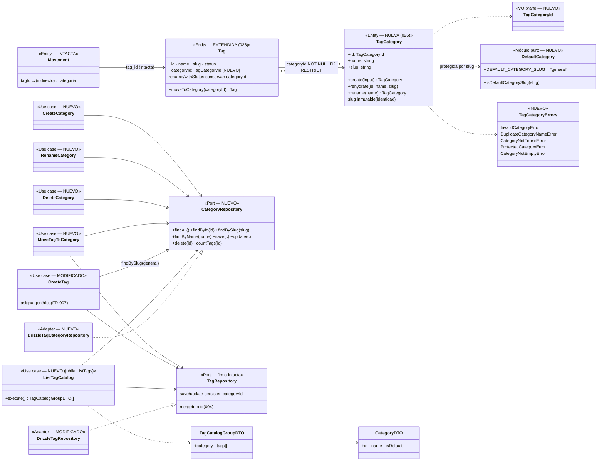

# Data Model — Categorías de etiquetas: organización del catálogo (026)

**Feature**: `026-categorias-tags` | **Fecha**: 2026-11-02 | **Spec**: [spec.md](./spec.md) · **Research**: [research.md](./research.md)

Modelo de datos de la feature: **nueva entidad `TagCategory`** (agregado propio), **extensión de `Tag`** con pertenencia obligatoria, **nueva tabla `tag_categories`** + **columna `tags.category_id` NOT NULL con FK RESTRICT** (migración `0008` con backfill). `Movement` y sus agregados de lectura quedan **intactos** (FR-008): la categoría nunca es atributo del movimiento.

---

## 1. Entidad nueva: `TagCategory` (dominio, `src/domain/tag-category/`)

```ts
// TagCategoryId.ts — brand espejo de TagId (validación entero > 0 en construcción)
export type TagCategoryId = number & { readonly __brand: "TagCategoryId" };

// TagCategory.ts — entidad congelada, paridad de estilo con Tag (src/domain/tag/Tag.ts)
export interface TagCategoryInput { name: string; slug: string }
export class TagCategory {
  readonly id: TagCategoryId | null;
  readonly name: string;   // trimeado; no vacío
  readonly slug: string;   // identidad estable, inmutable en renombrado (ADR 0018 par)
  static create(input: TagCategoryInput): TagCategory          // trim + validación
  static rehydrate(id: number, name: string, slug: string): TagCategory
  rename(name: string): TagCategory                            // conserva id y slug
}
```

- **Sin estado activa/inactiva ni fusión** (ciclo de vida mínimo, spec Out of Scope).
- **Validaciones** (Dominio): nombre y slug no vacíos tras trim (`InvalidCategoryError`). La unicidad case-insensitive del nombre **no** vive en la entidad: la guardan los casos de uso con `findByName` + el índice `lower(name)` (mismo reparto que en tags, `Tag.ts` vs `CreateTag.ts:16-19`).

### 1.1 Módulo de protección `DefaultCategory.ts` (espejo de `SystemTags.ts`)

```ts
export const DEFAULT_CATEGORY_SLUG = "general";   // único dueño del literal
export function isDefaultCategorySlug(slug: string): boolean
```

- La categoría genérica existe **siempre** (migración + seed la garantizan) y es el destino por defecto de toda etiqueta nueva (FR-007). Renombrable (el slug no cambia → sigue siendo la por defecto); **no eliminable** (`DeleteCategory` → `ProtectedCategoryError`).
- Regla de unicidad: `lower(name)` con trim previo, **sin normalizar acentos** («Alimentación» ≠ «Alimentacion»; «Hogar» = «HOGAR») — replica exactamente la vigente de tags (edge «Duplicados ignorando mayúsculas»). Aplica solo dentro del catálogo de categorías: puede coincidir con un nombre de etiqueta.

### 1.2 Errores de dominio (`TagCategoryErrors.ts`, extienden `DomainError`)

| Error | Mensaje (ES, UI) | Cuándo |
|---|---|---|
| `InvalidCategoryError` | «El nombre de la categoría es obligatorio.» | vacío tras trim |
| `DuplicateCategoryNameError` | `Ya existe una categoría con el nombre "{name}".` | duplicado case-insensitive (crear/renombrar) |
| `CategoryNotFoundError` | «La categoría seleccionada ya no está disponible.» | id inexistente (mover/renombrar/eliminar); también si falta la genérica en un alta (invariante roto, research §2) |
| `ProtectedCategoryError` | «La categoría "{name}" es la categoría por defecto y no puede eliminarse.» | eliminar la genérica |
| `CategoryNotEmptyError` | «La categoría "{name}" tiene etiquetas asignadas. Muévelas a otra categoría antes de eliminarla.» | eliminar con etiquetas (countTags > 0 o RESTRICT en carrera) |

## 2. Extensión de `Tag` (dominio, `src/domain/tag/Tag.ts`) — pertenencia obligatoria

```ts
export interface TagInput { name: string; slug: string; status: TagStatus; categoryId: TagCategoryId }
export class Tag {
  readonly categoryId: TagCategoryId;              // NUEVO — obligatorio, siempre presente
  static create(input: TagInput): Tag              // exige categoryId (FR-001 por construcción)
  static rehydrate(id, name, slug, status, categoryId): Tag
  rename(name): Tag                                // conserva categoryId
  withStatus(status): Tag                          // conserva categoryId
  moveToCategory(categoryId: TagCategoryId): Tag   // NUEVO — única vía de cambio de pertenencia
}
```

- El resto del modelo de `Tag` queda intacto: nombre único case-insensitive, slug derivado, `status`, protección de «Aportación Común» (004) — que **puede moverse de categoría** (edge case de la spec: su protección afecta a renombrar/fusionar/desactivar, no a su pertenencia).
- `deriveTagSlug` se extrae a `src/domain/shared/slug.ts` (`deriveSlug`); `TagSlug.ts` re-exporta `deriveTagSlug` — API y tests intactos, un solo dueño del algoritmo para tags y categorías (research §1).

## 3. Vista de Aplicación — puertos y casos de uso (FR-002..FR-007)

### 3.1 Puerto nuevo `CategoryRepository` (`src/application/tag-category/CategoryRepository.ts`, constitución VII)

```ts
export interface CategoryRepository {
  findAll(): Promise<TagCategory[]>;
  findById(id: TagCategoryId): Promise<TagCategory | null>;
  findBySlug(slug: string): Promise<TagCategory | null>;
  findByName(name: string): Promise<TagCategory | null>;   // case-insensitive (lower)
  save(category: TagCategory): Promise<TagCategory>;
  update(category: TagCategory): Promise<TagCategory>;
  delete(id: TagCategoryId): Promise<void>;
  countTags(id: TagCategoryId): Promise<number>;           // guarda amigable de DeleteCategory
}
```

`TagRepository` **no cambia de firma**; sus implementaciones persisten `categoryId` (`save`/`update` incluyen la columna; el mapper rehidrata con ella).

### 3.2 Casos de uso

| Caso de uso | Módulo | Firma | Reglas clave |
|---|---|---|---|
| `CreateCategory` | tag-category | `execute({ name }): Promise<TagCategory>` | trim, vacío → `InvalidCategoryError`; `findByName` → `DuplicateCategoryNameError`; slug `deriveSlug` + sufijo ante colisión. **Sin creación en línea desde el mover** (clarify). |
| `RenameCategory` | tag-category | `execute({ categoryId, name })` | NotFound; duplicado **autoexcluyéndose** (paridad `RenameTag`, edge «luz»→«Luz»); genérica renombrable. |
| `DeleteCategory` | tag-category | `execute({ categoryId })` | NotFound → `CategoryNotFoundError`; genérica → `ProtectedCategoryError`; `countTags > 0` → `CategoryNotEmptyError`; sino `delete`. |
| `MoveTagToCategory` | tag | `execute({ tagId, categoryId })` | tag → `TagNotFoundError`; categoría → `CategoryNotFoundError`; misma categoría → **no-op con éxito**; sino `update(tag.moveToCategory(...))`. Individual (sin lote, clarify). |
| `CreateTag` (modificado) | tag | `execute({ name })` (sin cambios de firma) | resuelve `findBySlug(DEFAULT_CATEGORY_SLUG)` y crea el `Tag` con esa `categoryId` → **toda etiqueta nueva nace en la genérica** (FR-007), incluida la inline de 017 (`movement-form.tsx` sin cambios). |
| `ListTagCatalog` (nuevo, sustituye a `ListTags`) | tag | `execute(): Promise<TagCatalogGroupDTO[]>` | agrupa tags por categoría; orden: genérica primero, resto `localeCompare("es")`; dentro del grupo, activas primero y luego nombre (criterio vigente de `ListTags`). `ListTags` + test jubilados (sin llamadores). |

### 3.3 DTOs

```ts
// src/application/tag-category/dto.ts (nuevo)
export interface CategoryDTO { id: number; name: string; isDefault: boolean }

// src/application/tag/dto.ts (extiende; CatalogTagDTO sin cambios)
export interface TagCatalogGroupDTO { category: CategoryDTO; tags: CatalogTagDTO[] }
```

`MovementTagDTO`, `TagDTO` y todos los DTOs de aggregates de movimiento **sin cambios** (FR-008).

### 3.4 Interacciones con 004/017 (sin cambios de comportamiento)

- **Fusión** (`MergeTags`/`mergeInto`): la absorbida se **borra** (desaparece su pertenencia); la superviviente **conserva su categoría**; los movimientos heredan etiqueta (y por tanto categoría, indirectamente) de la superviviente — sin etiquetas huérfanas (edge de la spec). Cubierto por comportamiento existente + test de regresión en `DrizzleTagRepository`.
- **Desactivar/Reactivar**: `update` persiste `categoryId` sin tocarlo — el estado de la etiqueta es ortogonal a su pertenencia (edge de la spec).
- **Inline 017**: `createTag` action → `CreateTag` → genérica; el Select «Etiqueta» del formulario sigue **plano** (FR-008).

## 4. Vista de Persistencia (Drizzle, SQLite/Turso) — migración `0008_categorias-tags.sql`

### 4.1 Esquema resultante

```ts
// src/infrastructure/db/schema/tag-categories.ts (nuevo)
export const tagCategories = sqliteTable("tag_categories", {
  id: integer("id").primaryKey({ autoIncrement: true }),
  name: text("name").notNull(),
  slug: text("slug").notNull().unique(),
}, (table) => [uniqueIndex("tag_categories_name_nocase_uq").on(sql`lower(${table.name})`)]);

// src/infrastructure/db/schema/tags.ts (modificado)
categoryId: integer("category_id").notNull()
  .references(() => tagCategories.id, { onDelete: "restrict" })
```

### 4.2 Migración (orden congelado)

1. `CREATE TABLE tag_categories` + índices (`slug` UNIQUE, `lower(name)` UNIQUE).
2. `INSERT OR IGNORE INTO tag_categories (name, slug) VALUES ('General', 'general')` — precedente `0004` (siembra en migración).
3. **Reconstrucción de `tags`** (SQLite no admite ADD COLUMN NOT NULL sin default): crear tabla nueva con el esquema resultante → `INSERT INTO nueva SELECT id, name, slug, status, (SELECT id FROM tag_categories WHERE slug='general') FROM tags` → `DROP TABLE tags` → `RENAME` → recrear índices de tags. **Los ids se conservan**; `movements.tag_id` no se toca.
4. Resultado (SC-001): 100 % de tags preexistentes en la genérica, sin tocar name/slug/status ni ningún movimiento.

### 4.3 Adaptador outbound

- `DrizzleTagCategoryRepository` (nuevo): implementa `CategoryRepository`; traduce violación `tag_categories_name_nocase_uq` → `DuplicateCategoryNameError` (espejo `translateUniqueViolation`, `DrizzleTagRepository.ts:105-114`); RESTRICT del DELETE con etiquetas → `CategoryNotEmptyError` (red de seguridad de carrera).
- `DrizzleTagRepository` (modificado): `save`/`update` incluyen `category_id`; `mappers/tag.mapper.ts` rehidrata `categoryId`; `mappers/tag-category.mapper.ts` nuevo.
- **Seed**: `seed-data.ts` gana `SEED_CATEGORIES = [{ name: "General", slug: "general" }]`; `scripts/seed.ts` inserta categorias (`onConflictDoNothing` por slug) y resuelve el id de la genérica para sembrar los `SEED_TAGS` con `category_id` (idempotencia intacta).

## 5. Validación por capa

| Regla | Dominio | Aplicación | Frontera (Zod/actions) | UI |
|-------|---------|------------|------------------------|-----|
| Pertenencia única y obligatoria (FR-001) | `Tag` irrepresentable sin `categoryId` | `CreateTag` asigna genérica; `MoveTagToCategory` valida existencia | `moveTagSchema` ids enteros positivos | agrupación siempre completa (cada tag bajo su grupo) |
| Nombre: trim + no vacío (edge) | `TagCategory.create/rename` | casos de uso replican mensaje | `name: z.string().trim().min(1)` | input controlado conserva valor en error (esc. 3) |
| Duplicado case-insensitive, sin acentos (edge) | — | `findByName` (lower) + índice `lower(name)` como red | action traduce `DuplicateCategoryNameError` | `role="alert"` con mensaje |
| Genérica no eliminable (edge) | `isDefaultCategorySlug` | `DeleteCategory` → `ProtectedCategoryError` | action traduce | menú de la genérica sin ítem «Eliminar…» |
| Categoría con etiquetas no eliminable (FR-006) | — | `countTags > 0` → `CategoryNotEmptyError`; FK RESTRICT | action traduce | `alertdialog` muestra el mensaje |
| Misma categoría = no-op (edge) | — | `MoveTagToCategory` devuelve éxito sin escribir | — | toast de éxito, catálogo igual |
| Movimientos/informes intactos (FR-008, SC-003) | `Movement` intacto | casos de uso de movimiento/agregados intactos | actions de movimiento intactas | formularios/listados/KPIs/informes sin cambios |

## 6. Transiciones de estado

- **Categoría**: `inexistente → existente (creación)` → `renombrada (N veces, slug fijo)` → `eliminada (solo si 0 etiquetas y no es la genérica)`. No hay más estados (sin activa/inactiva, sin fusión).
- **Etiqueta**: gana la transición `pertenece a C1 → pertenece a C2` (`moveToCategory`, individual); creación siempre en genérica; fusión: la absorbida desaparece (con su pertenencia), la superviviente no cambia de categoría.

## 7. Diagrama de clases (diseño)



> `docs/architecture/diagrams/domain-model.md` (vivo) se extiende en la implementación reutilizando este diagrama como base (research §7).

## 8. Glosario ES ↔ EN (constitución VI)

| Español (UI/spec) | English (código) | Notas |
|-------------------|------------------|-------|
| Categoría | `TagCategory` / `CategoryRepository` / `CategoryDTO` | Agrupación de nivel superior del catálogo de etiquetas. |
| Categoría genérica (por defecto) | default category — `DEFAULT_CATEGORY_SLUG = "general"` | Nace «General», renombrable, no eliminable; destino de toda etiqueta nueva. |
| Pertenencia | membership — `Tag.categoryId` (`tag_categories` FK) | Atributo de la etiqueta, nunca del movimiento. |
| Mover (etiqueta de categoría) | `MoveTagToCategory` / `moveToCategory` | Individual; misma categoría = no-op. |
| Agrupación (catálogo) | grouped catalog — `ListTagCatalog` / `TagCatalogGroupDTO` | Genérica primero, resto es-ES; activas primero dentro de grupo. |
| Backfill | backfill (migración `0008`) | Asignación masiva de tags preexistentes a la genérica (SC-001). |
| Reconstrucción de tabla | table rebuild | Patrón SQLite/drizzle para ADD COLUMN NOT NULL. |

Sin identificadores intraducibles nuevos fuera de los listados.
