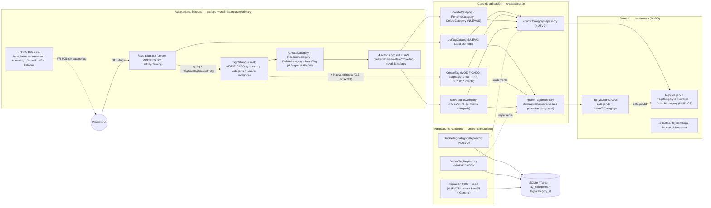

# Implementation Plan: Categorías de etiquetas — organización del catálogo

**Branch**: `feature/026-categorias-tags` | **Date**: 2026-11-02 | **Spec**: [spec.md](./spec.md)

**Input**: Feature specification from `/specs/026-categorias-tags/spec.md`

## Summary

Nivel de agrupación por encima de las etiquetas: la categoría (agregado nuevo `TagCategory`) agrupa 1..N etiquetas y cada etiqueta pertenece a **exactamente una**, obligatoriamente — la pertenencia es atributo de la etiqueta (`tags.category_id` NOT NULL FK RESTRICT), nunca del movimiento. La puesta en marcha (migración `0008` + seed) crea la **categoría genérica «General»** y asigna a ella el 100 % de las etiquetas existentes (backfill, SC-001). La gestión vive exclusivamente en `/tags` (catálogo agrupado): crear categorías («Nueva categoría»), renombrarlas, mover etiquetas de una en una («Mover a categoría…» por fila) y eliminar categorías vacías (la genérica protegida). Toda etiqueta nueva —incluida la inline de 017— nace en la genérica (FR-007). **Informes y formularios intactos** (FR-008): la categoría no computa en ningún agregado ni aparece en el Select «Etiqueta».

**Enfoque técnico** (detalles y alternativas en [research.md](./research.md)):

- **Dominio**: agregado `TagCategory` con **slug inmutable** como identidad (paridad con `Tag`/ADR 0018); la genérica se identifica por slug constante (`general`, espejo de `SystemTags`) — renombrable pero no eliminable. `Tag` gana `categoryId` obligatorio + `moveToCategory` (FR-001 por construcción, research §1/§2).
- **Aplicación**: puerto `CategoryRepository` + 3 casos de uso de categoría + `MoveTagToCategory` (misma categoría = no-op) + `CreateTag` ampliado (resuelve la genérica en el alta) + `ListTagCatalog` agrupado que jubila `ListTags` (research §4).
- **Persistencia**: tabla `tag_categories` (slug UNIQUE + `lower(name)` UNIQUE) y `tags.category_id` NOT NULL **ON DELETE RESTRICT**; la migración reconstruye `tags` (patrón SQLite) con backfill a la genérica en la misma transacción de migración; seed idempotente con `SEED_CATEGORIES` (research §3).
- **UI**: `tag-catalog.tsx` agrupado (secciones «Categoría {nombre}», genérica primera) + menú ⋮ por categoría + 4 diálogos nuevos a nivel del listado (inputs controlados, SC-004 de 014); 4 Server Actions con Zod que revalidan solo `/tags` (research §5, [ui-contract](./contracts/ui-contract.md)).
- **E2E**: `categorias-tags.spec.ts` propia — combinación libre **Cuenta de Miembro A + Octubre de 2026** (mes cerrado, sin interferencias de materialización) y catálogo global **restaurado** al terminar para no alterar los ficheros alfabéticamente posteriores (research §6).

## Technical Context

**Language/Version**: TypeScript estricto sobre Next.js (App Router) — monolito existente; sin versiones nuevas.

**Primary Dependencies**: Next.js App Router (RSC + Server Actions), React, Tailwind + shadcn/ui (diálogos/menús/Select ya versionados en el repo), Drizzle ORM, Zod. **Ninguna dependencia nueva.**

**Storage**: SQLite (dev) / Turso libSQL (prod) vía Drizzle. **Migración `0008_categorias-tags.sql`**: nueva tabla `tag_categories`, columna `tags.category_id` NOT NULL FK RESTRICT (reconstrucción de tabla + backfill), índice `lower(name)` (data-model §4).

**Testing**: Vitest (`test.projects` node/ui) co-localizado con el SUT; repos contra libsql `:memory:` con migraciones; Playwright e2e (`workers: 1`, orden alfabético, BD `e2e.sqlite` recreada) + nueva spec con restauración de estado (research §6).

**Target Platform**: local (`npm run dev`) y Vercel serverless + Turso (migraciones como paso pre-deploy, AGENTS.md «BD»).

**Project Type**: web-app monolito (Family Wallet).

**Performance Goals**: catálogo de decenas de categorías × decenas de etiquetas renderizado sin paginación ni colapso (edge «Catálogo grande»); una lectura agrupada por render de `/tags` (`ListTagCatalog`); cero queries nuevas en informes/formularios (FR-008).

**Constraints**: EUR en céntimos enteros (ADR 0007, sin cambios); invariante FR-001 reforzado por esquema (NOT NULL + FK RESTRICT); `/summary`//`/annual`/formularios/listados/KPIs funcionalmente idénticos (FR-008, SC-003); UI y specs en español; regla de unicidad réplica exacta de tags (case-insensitive, sin normalizar acentos, trim).

**Scale/Scope**: uso individual, 3 cuentas; catálogo global de etiquetas/categorías; una única US (constitución II, sin excepción).

## Constitution Check

*GATE: Must pass before Phase 0 research. Re-check after Phase 1 design.*

| # | Principio | Estado pre-diseño | Notas |
|---|-----------|-------------------|-------|
| I | Simplicidad Primero | ✅ PASS | Una entidad, un puerto, una tabla y una columna nuevas; reutiliza patrones 004/017 (menús ⋮, diálogos, slug). Sin desactivar/fusionar/reordenar categorías (YAGNI explícito de la spec). Presentación no colapsable (research §5). |
| II | Spec-Driven Development | ✅ PASS | Spec aprobada con decisiones del propietario (2026-11-02) y 3 clarificaciones; una única US pequeña con valor propio (organizar el catálogo); este plan diseña FR-001..FR-010. |
| III | Calidad Verificada | ✅ PASS | FR-010 exige dominio/aplicación/componentes/e2e (matriz research §7); flujo crítico «crear categoría → mover etiqueta → histórico intacto» end-to-end; gates íntegros. |
| IV | TypeScript estricto + Zod | ✅ PASS | Brand `TagCategoryId` espejo de `TagId`; `Tag` sin categoría irrepresentable por tipos; Zod en las 4 actions nuevas (`category-actions.schema.ts`); sin `any`. |
| V | Persistencia SQLite con Drizzle | ✅ PASS | Migración versionada `0008` (única vía de evolución); reconstrucción de tabla generada por drizzle-kit; seed idempotente por slug (data-model §4). |
| VI | Producto en español, código en inglés | ✅ PASS | Literales ES («Nueva categoría», «Mover a categoría…», mensajes de data-model §1.2); código EN (`TagCategory`, `moveToCategory`); glosario en data-model §8. |
| VII | Arquitectura Hexagonal + DDD Táctico | ✅ PASS | Dominio puro (`src/domain/tag-category/`, cero deps); puerto `CategoryRepository` en aplicación; actions/adaptadores finos que validan y delegan; agrupación/orden en `ListTagCatalog`, UI solo renderiza el DTO agrupado. |

**Resultado**: sin violaciones → Phase 0 autorizada.

## Project Structure

### Documentation (this feature)

```text
specs/026-categorias-tags/
├── spec.md                      # Especificación (2026-11-02, decisiones + 3 clarificaciones)
├── plan.md                      # Este fichero (/speckit.plan)
├── research.md                  # Phase 0 — 7 secciones verificadas contra código
├── data-model.md                # Phase 1 — entidad, puerto, migración, diagrama, glosario
├── contracts/
│   └── ui-contract.md           # Phase 1 — /tags agrupado (supersede listado plano de 004)
├── quickstart.md                # Phase 1 — Q1–Q7 de validación manual + gates
└── tasks.md                     # Phase 2 (/speckit.tasks — NO lo crea este comando)
```

### Source Code (repository root)

```text
src/
├── domain/
│   ├── shared/
│   │   └── slug.ts                          # NUEVO — deriveSlug (extraída de TagSlug)
│   ├── tag/
│   │   ├── Tag.ts                           # MODIFICADO — categoryId + moveToCategory (FR-001/5)
│   │   ├── TagSlug.ts                       # MODIFICADO — re-exporta deriveSlug como deriveTagSlug
│   │   └── (TagId/TagStatus/TagErrors/SystemTags: INTACTOS)
│   └── tag-category/                        # NUEVO (agregado)
│       ├── TagCategory.ts + .test.ts        # entidad (create/rehydrate/rename)
│       ├── TagCategoryId.ts                 # VO brand
│       ├── TagCategoryErrors.ts             # 5 errores de dominio (data-model §1.2)
│       └── DefaultCategory.ts + .test.ts    # DEFAULT_CATEGORY_SLUG + isDefaultCategorySlug
├── application/
│   ├── tag/
│   │   ├── CreateTag.ts + .test.ts          # MODIFICADO — nace en la genérica (FR-007)
│   │   ├── ListTagCatalog.ts + .test.ts     # NUEVO — agrupado (jubila ListTags + test)
│   │   ├── ListTags.ts + .test.ts           # ELIMINADO (sin llamadores)
│   │   ├── MoveTagToCategory.ts + .test.ts  # NUEVO — no-op misma categoría (FR-005)
│   │   ├── InMemoryCatalogTagRepository.ts  # MODIFICADO — soporta categoryId
│   │   └── dto.ts                           # MODIFICADO — TagCatalogGroupDTO
│   └── tag-category/                        # NUEVO
│       ├── CategoryRepository.ts            # puerto (data-model §3.1)
│       ├── CreateCategory.ts + .test.ts     # FR-003
│       ├── RenameCategory.ts + .test.ts     # FR-004
│       ├── DeleteCategory.ts + .test.ts     # FR-006
│       ├── InMemoryCategoryRepository.ts    # doble de tests (espejo InMemory tags)
│       └── dto.ts                           # CategoryDTO { id, name, isDefault }
├── app/
│   └── tags/page.tsx                        # MODIFICADO — ListTagCatalog → groups
└── infrastructure/
    ├── db/
    │   ├── schema/tag-categories.ts         # NUEVO — tabla (data-model §4.1)
    │   ├── schema/tags.ts                   # MODIFICADO — categoryId FK RESTRICT
    │   ├── schema/index.ts                  # MODIFICADO — exporta tagCategories
    │   ├── drizzle/0008_categorias-tags.sql # NUEVO — tabla + General + backfill (rebuild)
    │   ├── DrizzleTagCategoryRepository.ts + .test.ts   # NUEVO
    │   ├── DrizzleTagRepository.ts          # MODIFICADO — save/update con category_id
    │   ├── DrizzleRepositories.test.ts      # MODIFICADO — backfill y fusión conservan categoría
    │   ├── mappers/tag.mapper.ts            # MODIFICADO — rehidrata categoryId
    │   ├── mappers/tag-category.mapper.ts   # NUEVO
    │   ├── seed-data.ts                     # MODIFICADO — SEED_CATEGORIES
    │   └── scripts/seed.ts                  # (raíz scripts/seed.ts) MODIFICADO — categorías + tags
    └── primary/
        ├── actions/
        │   ├── category-actions.schema.ts   # NUEVO — 4 esquemas + CategoryActionState
        │   ├── create-category.action.ts + .test.ts       # NUEVO
        │   ├── rename-category.action.ts + .test.ts       # NUEVO
        │   ├── delete-category.action.ts + .test.ts       # NUEVO
        │   └── move-tag-to-category.action.ts + .test.ts  # NUEVO
        └── ui/
            ├── tag-catalog.tsx + .test.tsx  # MODIFICADO — agrupado + ⋮ categoría + Nueva categoría
            ├── create-category-dialog.tsx + .test.tsx     # NUEVO
            ├── rename-category-dialog.tsx + .test.tsx     # NUEVO
            ├── delete-category-dialog.tsx + .test.tsx     # NUEVO
            └── move-tag-dialog.tsx + .test.tsx            # NUEVO
e2e/
└── categorias-tags.spec.ts                  # NUEVO — flujo + restauración (research §6)
docs/
├── architecture/adr/0022-tag-categories.md  # NUEVO — taxonomía + esquema (research §7)
└── architecture/                            # ACTUALIZADO — domain-model, categorias-secuencia,
                                            #   notas overview/gestion-tags-secuencia/c4
AGENTS.md                                    # ACTUALIZADO — convención «Categorías (026)» + Seed
specs/001-family-wallet/spec.md              # ACTUALIZADO (FR-009) — fila 026 Completada al cierre
```

**Structure Decision**: la estructura hexagonal existente se mantiene (carpeta por agregado, puertos en aplicación); un único agregado nuevo (`tag-category`) y extensión mínima de `tag`. Cero cambios en `movement` (dominio/aplicación/UI) y en los agregados de lectura — FR-008 por omisión.

## Diagramas de diseño

### Componentes que intervienen



> Nota: todas las dependencias siguen apuntando hacia el dominio. La vía de 017 (círculo discontinuo) muestra que la creación inline no cambia: `CreateTag` resuelve internamente la genérica.

### Secuencia — happy path: crear categoría y mover una etiqueta a ella (escenarios 2 y 4)

```mermaid
sequenceDiagram
    autonumber
    actor U as Propietario
    participant P as "/tags page.tsx (server)"
    participant LC as ListTagCatalog
    participant C as TagCatalog (client)
    participant D as MoveTagDialog
    participant A as moveTagToCategory (action, Zod)
    participant UC as MoveTagToCategory
    participant R as DrizzleTagRepository
    participant RC as DrizzleTagCategoryRepository
    participant DB as (SQLite/Turso)

    U->>P: GET /tags
    P->>LC: execute()
    LC->>RC: findAll()
    LC->>R: findAll()
    LC-->>P: [General(3), Alimentación(0), …] grupos ordenados
    P-->>U: catálogo agrupado (genérica primera)

    U->>C: ⋮ de «Supermercado» → «Mover a categoría…»
    C->>D: abre con categorías excepto la actual (General)
    U->>D: selecciona «Alimentación» → «Mover»
    D->>A: submit { tagId, categoryId }
    A->>A: moveTagSchema.safeParse (Zod)
    A->>UC: execute({ tagId, categoryId })
    UC->>R: findById(tagId)
    R-->>UC: Tag (categoryId = general)
    UC->>RC: findById(categoryId)
    RC-->>UC: TagCategory «Alimentación»
    UC->>UC: tag.categoryId ≠ category.id → continúa
    UC->>R: update(tag.moveToCategory(alimentación))
    R->>DB: UPDATE tags SET category_id = …
    A->>A: revalidatePath("/tags")
    A-->>D: { status: "success", message: "Etiqueta movida a Alimentación" }
    D-->>U: toast + cierre; «Supermercado» aparece bajo «Alimentación» (FR-005, inmediato)
    Note over U,DB: Ningún movimiento tocado: /summary, /annual, listados y KPIs idénticos (FR-008, SC-003)
```

## Complexity Tracking

> **Fill ONLY if Constitution Check has violations that must be justified**

| Violation | Why Needed | Simpler Alternative Rejected Because |
|-----------|------------|-------------------------------------|
| (ninguna) | — | — |

**Decisiones de diseño destacadas (sin violación, registradas para `/speckit.tasks`)**:

- **Genérica por slug constante, no por flag** (research §2): `DEFAULT_CATEGORY_SLUG = "general"` espejo de `SystemTags` — renombrable sin perder su papel; seed idempotente por clave natural; sin invariante «exactamente una» extra.
- **Invariante FR-001 reforzado por esquema** (research §3): `NOT NULL` + `ON DELETE RESTRICT` — ninguna tag sin categoría, ninguna categoría borrable con etiquetas (red de seguridad de `CategoryNotEmptyError`).
- **Backfill en la propia migración** (SC-001): reconstrucción de `tags` con `SELECT` que conserva id/name/slug/status y añade la genérica; «General» sembrada en la migración (precedente `0004`).
- **`MoveTagToCategory` como no-op semántico** (edge de la spec): misma categoría = éxito sin escritura; diálogo excluye la actual.
- **`ListTagCatalog` agrupa y ordena; la UI solo anida** (constitución VII): `TagCatalogGroupDTO` pre-ordenado (genérica primero, es; activas primero) — cero lógica de negocio en el cliente; jubila `ListTags` sin llamadores.
- **Revalidación acotada a `/tags`** (research §5): las categorías no viven en ninguna otra vista; los tags siguen revalidando layout (Select «Etiqueta»).
- **E2E con combinación libre y catálogo restaurado** (research §6): Miembro A + Octubre de 2026 (cerrado, sin lectores); devolver etiqueta y eliminar categoría al final → specs alfabéticamente posteriores (`creacion-tags`, `gestion-tags`) encuentran el catálogo exacto.
- **ADR 0022 nuevo** (research §7): la taxonomía categoría/pertenencia y su esquema son decisión arquitectónica propia; 0018 (mantenimiento 004) queda como contexto, no se reescribe.

## Constitution Check (post-diseño, Phase 1)

Re-evaluación tras generar `research.md`, `data-model.md`, `contracts/ui-contract.md` y `quickstart.md`:

| # | Principio | Estado post-diseño | Notas |
|---|-----------|--------------------|-------|
| I | Simplicidad Primero | ✅ PASS | 1 agregado, 1 puerto, 1 tabla, 1 columna, 4 diálogos reutilizando patrones 004/017. Presentación no colapsable, sin colores/iconos, sin batch (YAGNI de la spec). Complejidad tracked: (ninguna). |
| II | Spec-Driven Development | ✅ PASS | FR-001→data-model §1/§2/§4; FR-002→ui-contract §1 + ListTagCatalog; FR-003/FR-004→ui-contract §3 + casos de uso §3.2; FR-005→MoveTagToCategory (no-op) + ui-contract §3; FR-006→DeleteCategory + RESTRICT; FR-007→CreateTag ampliado; FR-008→ui-contract §5 (intactos); FR-009→research §7; FR-010→research §7 (matriz). Una US (II, sin excepción). |
| III | Calidad Verificada | ✅ PASS | Matriz por capa (dominio/aplicación/repos/actions/componentes/e2e) en research §7; SC-001 verificado por migración + tests de backfill; SC-003 por suite e2e sin cambios + Q4; SC-004 por gates + quickstart. |
| IV | TypeScript estricto + Zod | ✅ PASS | `Tag` sin `categoryId` irrepresentable; brand `TagCategoryId`; Zod en las 4 fronteras nuevas; sin `any`. |
| V | Persistencia SQLite con Drizzle | ✅ PASS | Migración versionada única (`0008`) con reconstrucción estándar; seed idempotente `onConflictDoNothing` por slug; prod via `drizzle.prod.config.ts` pre-deploy (AGENTS.md «BD»). |
| VI | Producto en español, código en inglés | ✅ PASS | Literales congelados en ui-contract §3 y data-model §1.2; glosario completo (data-model §8). |
| VII | Arquitectura Hexagonal + DDD Táctico | ✅ PASS | Dominio puro sin deps; puerto en aplicación implementado por adaptador Drizzle; actions finas (validan+delegan+traducen); agrupación/orden/criterios de negocio en `ListTagCatalog`; sin eventos/CQRS/sagas; un solo contexto delimitado. |

**Resultado**: diseño aprobado; sin desviaciones que justificar. El plan queda listo para `/speckit.tasks`.
