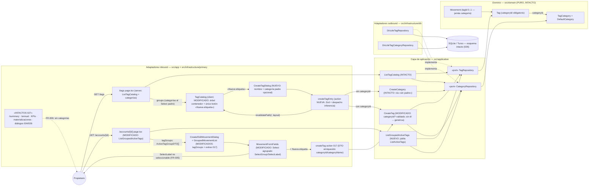

# Implementation Plan: Gestión de etiquetas y jerarquía unificada del catálogo

**Branch**: `feature/027-gestion-etiquetas` | **Date**: 2026-11-03 | **Spec**: [spec.md](./spec.md)

**Input**: Feature specification from `/specs/027-gestion-etiquetas/spec.md`

## Summary

Completa la gestión de etiquetas en `/tags` y unifica la presentación de la jerarquía categoría→etiqueta en toda la app. **Una sola vía de creación con inferencia de tipo** (Q1 resuelto por el propietario en planificación, 2026-11-03): el botón «Nueva etiqueta» abre un diálogo con nombre y **categoría padre opcional** — sin padre se crea una **categoría** (nivel superior), con padre una **etiqueta** en ella; el botón «Nueva categoría» desaparece y no hay alta inline de categorías. `/tags` presenta un **único árbol** (categorías como contenedores con borde, etiquetas sangradas dentro) y el Select «Etiqueta» de los formularios de movimiento pasa a **agrupado por categoría** con cabeceras `SelectLabel` no seleccionables (Radix — FR-005 por construcción). **Sin cambios de dominio, esquema ni migraciones** (FR-006: informes, listados, KPIs y materializaciones intactos; el inline 017 sigue naciendo en la genérica).

**Enfoque técnico** (detalles y alternativas en [research.md](./research.md)):

- **Aplicación**: `CreateTag` extiende su firma con `categoryId?` (valida existencia → `CategoryNotFoundError`; sin él, genérica — retrocompatible con 017) y nuevo `ListGroupedActiveTags` que devuelve `ActiveTagGroupDTO[]` (solo activas, genérica primera, **sin grupos vacíos**) y jubila `ListActiveTags` (research §3/§4).
- **Frontera**: nueva action `createTagEntry` (Zod + `useActionState`) que despacha por presencia de `categoryId` a `CreateTag` o `CreateCategory` — la inferencia es semántica de formulario, las reglas viven en los casos de uso; `revalidatePath("/", "layout")`; `createTag` (017) enriquece su DTO con `categoryId`/`categoryName` (research §4).
- **UI**: `tag-catalog.tsx` como árbol contenedor + `CreateTagDialog` (inputs controlados, montado a nivel del listado); `movement-form.tsx` agrupa con `SelectGroup`/`SelectLabel` ya versionados; los diálogos de movimiento fusionan los extras 017 en el grupo de la genérica; jubilados `CreateCategoryDialog` + `create-category.action` (research §2/§5, [ui-contract](./contracts/ui-contract.md)).
- **E2E**: `jerarquia-etiquetas.spec.ts` propia — **Cuenta de Miembro A + Enero de 2026** (mes cerrado, combinación libre) y restauración del catálogo (mover etiqueta a la genérica + eliminar categoría + borrar movimiento), misma disciplina que 026 (research §6).

## Technical Context

**Language/Version**: TypeScript estricto sobre Next.js (App Router) — monolito existente; sin versiones nuevas.

**Primary Dependencies**: Next.js App Router (RSC + Server Actions), React, Tailwind + shadcn/ui (diálogos/menús/Select con `SelectGroup`/`SelectLabel` ya versionados en el repo), Drizzle ORM, Zod. **Ninguna dependencia nueva.**

**Storage**: SQLite (dev) / Turso libSQL (prod) vía Drizzle. **Sin migraciones ni cambios de esquema** (spec «Out of Scope»; tablas e índices de 026 intactos).

**Testing**: Vitest (`test.projects` node/ui) co-localizado con el SUT; dobles `InMemoryCatalogTagRepository`/`InMemoryCategoryRepository` (026) para casos de uso; Playwright e2e (`workers: 1`, orden alfabético, BD `e2e.sqlite` recreada) + nueva spec con restauración de estado (research §6).

**Target Platform**: local (`npm run dev`) y Vercel serverless + Turso (sin pasos de migración nuevos, AGENTS.md «BD»).

**Project Type**: web-app monolito (Family Wallet).

**Performance Goals**: catálogo de decenas de categorías × decenas de etiquetas usable en `/tags` y en el selector agrupado (edge «Catálogo grande»); una lectura agrupada por render en página de cuenta (`ListGroupedActiveTags`) y `/tags` (`ListTagCatalog`); cero queries nuevas en informes (FR-006).

**Constraints**: EUR en céntimos enteros (ADR 0007, sin cambios); el movimiento jamás almacena categorías (FR-005 — `movements.tag_id` intacto); `/summary`//`/annual`/listados/KPIs/materializaciones funcionalmente idénticos (FR-006, SC-003); unicidades vigentes 026 por catálogo (case-insensitive, sin acentos, trim); UI y specs en español.

**Scale/Scope**: uso individual, 3 cuentas; catálogo global; una única US (constitución II, sin excepción).

## Constitution Check

*GATE: Must pass before Phase 0 research. Re-check after Phase 1 design.*

| # | Principio | Estado pre-diseño | Notas |
|---|-----------|-------------------|-------|
| I | Simplicidad Primero | ✅ PASS | Cero entidades/tablas/puertos nuevos; 1 caso de uso de lectura + 1 action + 1 diálogo; despacho en frontera en vez de caso de uso compuesto (YAGNI). Sin ADR nuevo (research §7). |
| II | Spec-Driven Development | ✅ PASS | Spec con decisiones del propietario (2026-11-03) y **Q1 resuelta en planificación** (plegada a la spec: FR-001/2/3, escenarios 2/4, edges); una única US pequeña con valor propio. |
| III | Calidad Verificada | ✅ PASS | FR-008 exige aplicación (alta + inferencia), components (`/tags` y selector agrupado) y e2e del flujo «categoría → etiqueta → movimiento» (matriz research §8); gates íntegros. |
| IV | TypeScript estricto + Zod | ✅ PASS | `categoryId?: TagCategoryId` tipado; Zod en la action nueva (`coerce.int().positive().optional()`); DTOs extendidos sin `any`. |
| V | Persistencia SQLite con Drizzle | ✅ PASS | **Sin migraciones** (esquema 026 intacto); ningún acceso directo a SQL nuevo. |
| VI | Producto en español, código en inglés | ✅ PASS | Literales ES congelados en ui-contract §2/§3 («Ninguna — se creará una categoría», toasts); código EN (`createTagEntry`, `ListGroupedActiveTags`); glosario en data-model §8. |
| VII | Arquitectura Hexagonal + DDD Táctico | ✅ PASS | Dominio intacto y puro; agrupación/orden/filtrado de vacías en `ListGroupedActiveTags` (la UI solo anida); actions finas que validan y delegan; despacho de inferencia en frontera documentado (research §4). |

**Resultado**: sin violaciones → Phase 0 autorizada.

## Project Structure

### Documentation (this feature)

```text
specs/027-gestion-etiquetas/
├── spec.md                      # Especificación (2026-11-03; Q1 resuelta y plegada en planificación)
├── plan.md                      # Este fichero (/speckit.plan)
├── research.md                  # Phase 0 — 9 secciones (Q1, árbol, selector, action, e2e, roadmap, tests)
├── data-model.md                # Phase 1 — firma CreateTag, ListGroupedActiveTags, DTOs, diagrama, glosario
├── contracts/
│   └── ui-contract.md           # Phase 1 — árbol /tags + diálogo única vía + Select agrupado (supersede 026 parcial)
├── quickstart.md                # Phase 1 — Q1–Q8 de validación manual + gates
└── tasks.md                     # Phase 2 (/speckit.tasks — NO lo crea este comando)
```

### Source Code (repository root)

```text
src/
├── domain/                                  # INTACTO (Tag, TagCategory, DefaultCategory, Movement…)
├── application/
│   └── tag/
│       ├── CreateTag.ts + .test.ts          # MODIFICADO — categoryId? opcional validado (FR-001; edge otra pestaña)
│       ├── ListGroupedActiveTags.ts + .test.ts   # NUEVO — agrupado, sin grupos vacíos (jubila ListActiveTags + test)
│       ├── ListActiveTags.ts + .test.ts     # ELIMINADO (sin llamadores)
│       └── dto.ts                           # MODIFICADO — ActiveTagGroupDTO
│   └── tag-category/                        # INTACTO (CreateCategory es la vía «sin padre»)
├── application/movement/dto.ts              # MODIFICADO — TagDTO gana categoryId/categoryName (MovementTagDTO intacto)
├── app/
│   ├── tags/page.tsx                        # MODIFICADO (menor) — pasa categorías al catálogo para el Select padre
│   └── accounts/[accountId]/page.tsx        # MODIFICADO — ListGroupedActiveTags → tagGroups
└── infrastructure/
    └── primary/
        ├── actions/
        │   ├── create-tag-entry.action.ts + .test.ts   # NUEVO — despacho inferencia (Zod, useActionState)
        │   ├── create-tag.action.ts + .test.ts         # MODIFICADO — DTO enriquecido (017 intacto en firma)
        │   └── create-category.action.ts + .test.ts    # ELIMINADO (jubilado con CreateCategoryDialog)
        └── ui/
            ├── tag-catalog.tsx + .test.tsx  # MODIFICADO — árbol contenedor + único botón «Nueva etiqueta»
            ├── create-tag-dialog.tsx + .test.tsx      # NUEVO — nombre + categoría padre opcional (inferencia)
            ├── create-category-dialog.tsx + .test.tsx # ELIMINADO (jubilado)
            ├── movement-form.tsx + .test.tsx          # MODIFICADO — Select agrupado (SelectGroup/SelectLabel)
            ├── create-movement-dialog.tsx + .test.tsx # MODIFICADO — tagGroups + extras 017 en su grupo
            ├── edit-movement-dialog.tsx + .test.tsx   # MODIFICADO — ídem
            └── grouped-movement-list.tsx + .test.tsx  # MODIFICADO — prop tagGroups a los diálogos
e2e/
└── jerarquia-etiquetas.spec.ts             # NUEVO — inferencia → etiqueta → movimiento → restauración (research §6)
docs/
└── architecture/                           # ACTUALIZADO — diagramas vivos reutilizando los del plan
AGENTS.md                                    # ACTUALIZADO — convención «Jerarquía y creación única (027)»
specs/001-family-wallet/spec.md              # ACTUALIZADO (FR-007) — fila 027 Completada + nota ~027 → ~028 al cierre
```

**Structure Decision**: la estructura hexagonal existente se mantiene; la feature es de comportamiento/presentación (extensión de firma + caso de uso de lectura + action + UI) — sin agregados, puertos ni tablas nuevos. `movement` (dominio y casos de uso de escritura/lectura agregada) intacto por omisión (FR-006).

## Diagramas de diseño

### Componentes que intervienen



> Nota: todas las dependencias apuntan hacia el dominio. La línea discontinua de 017 muestra el flujo inline intacto (nace en genérica, DTO enriquecido para colocarse en su grupo).

### Secuencia — happy path: crear categoría por inferencia y una etiqueta dentro (escenarios 1–2)

```mermaid
sequenceDiagram
    autonumber
    actor U as Propietario
    participant P as "/tags page.tsx (server)"
    participant LC as ListTagCatalog
    participant C as TagCatalog (client)
    participant D as CreateTagDialog
    participant A as createTagEntry (action, Zod)
    participant UCc as CreateCategory
    participant UCt as CreateTag
    participant RC as DrizzleTagCategoryRepository
    participant RT as DrizzleTagRepository
    participant DB as (SQLite/Turso)

    U->>P: GET /tags
    P->>LC: execute()
    LC->>RC: findAll()
    LC->>RT: findAll()
    LC-->>P: grupos ordenados (genérica primera)
    P-->>U: árbol contenedor + único botón «Nueva etiqueta»

    U->>C: «Nueva etiqueta»
    C->>D: abre (Select padre con categorías, sin selección)
    U->>D: Nombre «Suscripciones», categoría vacía → «Crear»
    D->>A: submit { name: "Suscripciones" } (sin categoryId)
    A->>A: tagEntrySchema.safeParse (Zod)
    A->>UCc: execute({ name }) — inferencia: sin padre ⇒ categoría
    UCc->>RC: findByName("Suscripciones")
    RC-->>UCc: null (sin duplicado)
    UCc->>RC: save(TagCategory.create(...))
    RC->>DB: INSERT tag_categories
    A->>A: revalidatePath("/", "layout")
    A-->>D: { status: "success", message: "Categoría creada" }
    D-->>U: toast + cierre; grupo «Suscripciones» (vacío) aparece en el árbol

    U->>D: «Nueva etiqueta» → «Netflix» + padre «Suscripciones» → «Crear»
    D->>A: submit { name: "Netflix", categoryId: suscripciones }
    A->>UCt: execute({ name, categoryId })
    UCt->>RT: findByName("Netflix")
    RT-->>UCt: null
    UCt->>RC: findById(categoryId)
    RC-->>UCt: TagCategory «Suscripciones» (existe)
    UCt->>RT: save(Tag.create({ …, categoryId }))
    RT->>DB: INSERT tags
    A-->>D: { status: "success", message: "Etiqueta creada" }
    D-->>U: toast + cierre; «Netflix» dentro del grupo y disponible en el Select agrupado
    Note over U,DB: Movimientos intactos: el Select agrupa por categoría pero guarda ids de etiqueta (FR-004/FR-005); /summary, /annual, KPIs sin cambios (FR-006)
```

## Complexity Tracking

> **Fill ONLY if Constitution Check has violations that must be justified**

| Violation | Why Needed | Simpler Alternative Rejected Because |
|-----------|------------|-------------------------------------|
| (ninguna) | — | — |

**Decisiones de diseño destacadas (sin violación, registradas para `/speckit.tasks`)**:

- **Inferencia de tipo en la frontera, no en un caso de uso compuesto** (research §1/§4): `createTagEntry` despacha por presencia de `categoryId` a `CreateCategory`/`CreateTag`; cada caso de uso conserva sus invariantes (unicidad por catálogo, trim, slug) — la decisión «qué creo» es semántica de formulario, no regla de dominio.
- **`ListGroupedActiveTags` jubila `ListActiveTags`** (research §3): agrupación, orden (genérica primera) y omisión de grupos vacíos viven en aplicación (constitución VII); espejo del jubileo `ListTags`→`ListTagCatalog` de 026.
- **Cabeceras no seleccionables por construcción** (FR-004/FR-005): `SelectLabel` de Radix no es ítem — ni clic ni foco ni typeahead pueden elegir una categoría; el modelo ya lo garantizaba (`movements.tag_id` → `tags.id`).
- **Extras 017 con DTO enriquecido** (research §3): `TagDTO.categoryId/categoryName` permiten fusionar la etiqueta inline en el grupo de la genérica desde el estado del diálogo (mecanismo `extraTags` intacto); `MovementTagDTO` (filas) no cambia (FR-006).
- **Jubilaciones simétricas**: `CreateCategoryDialog` + `create-category.action` (la vía categoría pasa por `createTagEntry`) y `ListActiveTags`; sin código muerto (criterio 026).
- **E2E con restauración completa** (research §6): Miembro A + Enero 2026 (cerrado y libre); borrar movimiento + mover etiqueta a la genérica + eliminar categoría — los ficheros alfabéticamente posteriores encuentran el catálogo y los agregados en su estado.
- **Roadmap (FR-007)**: fila 027 Completada y nota del informe por categorías re-referenciada de ~027 a ~028 en el cierre; sin ADR nuevo (research §7).

## Constitution Check (post-diseño, Phase 1)

Re-evaluación tras generar `research.md`, `data-model.md`, `contracts/ui-contract.md` y `quickstart.md`:

| # | Principio | Estado post-diseño | Notas |
|---|-----------|--------------------|-------|
| I | Simplicidad Primero | ✅ PASS | 1 caso de uso, 1 action, 1 diálogo, 0 tablas/migraciones/puertos; jubilaciones sin código muerto; sin ADR ni librerías nuevas. Complejidad tracked: (ninguna). |
| II | Spec-Driven Development | ✅ PASS | FR-001→`CreateTag` extendido + ui-contract §2; FR-002→`createTagEntry` (inferencia) + ui-contract §1/§2; FR-003→árbol contenedor (ui-contract §1); FR-004/005→`ListGroupedActiveTags` + SelectGroup/SelectLabel (ui-contract §3); FR-006→ui-contract §5 (intactos); FR-007→research §7; FR-008→research §8 (matriz). Q1 resuelta y plegada en la spec. Una US (II, sin excepción). |
| III | Calidad Verificada | ✅ PASS | Matriz por capa en research §8 (aplicación/actions/componentes/e2e); flujo crítico «inferencia → etiqueta → movimiento» end-to-end; SC-003 por suites intactas + Q8; SC-004 por gates + quickstart. |
| IV | TypeScript estricto + Zod | ✅ PASS | `TagCategoryId` en la firma; Zod con `coerce.int().positive().optional()`; DTOs tipados sin `any`; Select padre controlado con `input hidden` (patrón MoveTagDialog). |
| V | Persistencia SQLite con Drizzle | ✅ PASS | Esquema y migraciones intactos (spec «Out of Scope» respetado); repos existentes cubren las nuevas lecturas (`findAll`/`findById` ya en los puertos). |
| VI | Producto en español, código en inglés | ✅ PASS | Literales congelados (ui-contract §2/§3): «Nueva etiqueta», «Ninguna — se creará una categoría», toasts «Etiqueta creada»/«Categoría creada»; glosario completo (data-model §8). |
| VII | Arquitectura Hexagonal + DDD Táctico | ✅ PASS | Dominio intacto y puro; agrupación/orden/omisión de vacías en `ListGroupedActiveTags` (UI solo anida); action fina (valida+despacha+traduce); sin eventos/CQRS/sagas; un solo contexto delimitado. |

**Resultado**: diseño aprobado; sin desviaciones que justificar. El plan queda listo para `/speckit.tasks`.
