# Contrato de UI: Importación de hoja mensual (asistente)

**Feature**: 028-importacion-excel | **Componentes**: `import-sheet-wizard.tsx` (cliente, nuevo), `src/app/import/page.tsx` (servidor, nueva) | **Integración**: `GlobalNav` (ítem nuevo «Importar», clave `active: "import"`), `importSheetAction` (acción directa, familia ADR 0015)

## 1. Página `/import`

- Cabecera con `GlobalNav active="import"` (sin `month`) y título **«Importar hoja mensual»**.
- La página (servidor) lee `ListAccounts` y renderiza el asistente con `accounts: AccountDTO[]` (nombres mostrados derivados en personales, ADR 0020) y la ventana de meses `buildMonthWindow(currentMonth(), 24)` con `monthLabel`.

## 2. Asistente — paso 1: selección (FR-001)

```
┌──────────────────────────────────────────────┐
│ Cuenta    [ Cuenta de Miembro A        ▼ ]   │
│ Mes       [ Noviembre de 2026          ▼ ]   │
│ Fichero   [ Seleccionar CSV…]  sin fichero   │
│                       [ Previsualizar importación ] │
└──────────────────────────────────────────────┘
```

- `section aria-label="Importación de hoja mensual"`. Labels congelados: **«Cuenta»** (`Select` shadcn controlado, SC-004), **«Mes»** (`Select` controlado), **«Fichero CSV»** (`input type="file" accept=".csv,text/csv"`; el `File` se guarda en estado del cliente — research §5).
- Botón **«Previsualizar importación»** → `importSheetAction({…, intent: "preview"})` en `useTransition`; `disabled` sin cuenta/mes/fichero o con petición en curso; etiqueta en curso **«Previsualizando…»**.
- Errores de action (`status: "error"`) → `role="alert"` bajo el formulario, asistente en paso 1.

## 3. Asistente — paso 2: previsualización (FR-004)

`section aria-label="Resumen de la importación"` con:

1. **Resumen**: «{N} movimientos para {nombre de cuenta} · {mes}» + totales congelados (formato `formatAmountCents`): «Gastos personales», «Gastos compartidos», «Ingresos». Solo filas importables (SC-002).
2. **Etiquetas que se crearán** (`region aria-label="Etiquetas que se crearán"`): chips de nombres, solo si hay; texto «Ninguna etiqueta nueva.» en caso contrario.
3. **Filas ignoradas** (`region aria-label="Filas ignoradas"`): «Fila {n}: {motivo}» («fila de configuración de la hoja»); si ninguna, no se muestra.
4. **Filas con error** (`region aria-label="Filas con error"`, `role="alert"` si hay): «Fila {n}: {motivo}» con los mensajes de dominio/dialecto (data-model §2.1, §7).
5. **Tabla de movimientos** (`table aria-label="Movimientos detectados"`): columnas **Fila · Fecha · Nota · Importe · Tipo · Naturaleza · Etiqueta** («(nueva)» junto al nombre cuando `createsTag`; naturaleza «—» en ingresos). Importe magnitud sin signo, `formatAmountCents`.
6. Botones: **«Confirmar importación (N movimientos)»** (primario; `disabled` si hay errores o 0 movimientos; en curso **«Importando…»**) y **«Volver»** (paso 1, previsualización descartada).

**Invalidación**: cualquier cambio de cuenta, mes o fichero tras previsualizar descarta la previsualización y vuelve al paso 1 (el fichero revisado es siempre el confirmado; research §5).

## 4. Éxito (FR-005)

`status: "imported"` → paso de confirmación: **«Importación completada: {N} movimientos»** (+ «· {M} etiquetas creadas» si M > 0) y enlace **«Ver los movimientos en {cuenta} · {mes}»** → `/accounts/{accountId}?month={month}`. Sin redirección automática.

## 5. Diagrama de estados

```mermaid
stateDiagram-v2
    [*] --> Seleccion
    Seleccion --> Previsualizacion: Previsualizar (preview ok)
    Seleccion --> Seleccion: error de action (role=alert)
    Previsualizacion --> Importado: Confirmar (confirm ok)
    Previsualizacion --> Previsualizacion: error al confirmar (alert; preview invalidada)
    Previsualizacion --> Seleccion: Volver / cambia cuenta|mes|fichero
    Importado --> Seleccion: nueva importación
    Importado --> [*]: enlace a /accounts/{id}?month=
```



## 6. Reglas no negociables

- La UI **nunca** calcula totales ni mapea tipos: solo renderiza `SheetImportPreviewDTO` (constitución VII).
- Inputs controlados con `useState` (SC-004; el file input guarda su `File` en estado — no controlable por naturaleza).
- Sin persistencia sin confirmación explícita; `preview` no revalida ni escribe (FR-004/FR-005).
