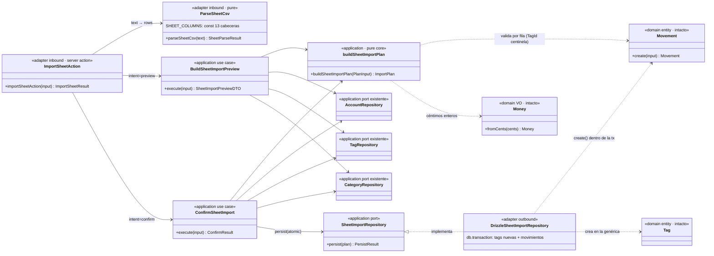

# Data Model — Importación de movimientos desde Excel, PoC (028)

**Feature**: 028-importacion-excel | **Fecha**: 2026-11-06

Sin entidades nuevas de dominio ni de esquema (spec, Key Entities): la importación produce **movimientos** existentes en una cuenta existente y, en caliente, **etiquetas** existentes. Los tipos nuevos viven en la capa de aplicación (plan de importación) y en la frontera (parseo CSV). Sin migraciones.

## 1. Dominio — INTACTO (referencia)

Se reutiliza sin modificación alguna:

- `Movement.create(input)` (`src/domain/movement/Movement.ts`): nota no vacía tras trim («La nota es obligatoria.»), fecha ISO de calendario real, importe > 0, naturaleza obligatoria en gastos y prohibida en ingresos, etiqueta obligatoria en gastos. **Única fuente de validación** de los movimientos importados (FR-006): se ejecuta por fila en el núcleo puro (para reportar el error con el mensaje de dominio) y de nuevo en la transacción de persistencia (autoritativa).
- `Money.fromCents` (céntimos enteros, ADR 0007), `MovementType` (`expense` | `income`), `ExpenseNature` (`personal` | `shared`).
- `deriveTagSlug` (`src/domain/tag/TagSlug.ts`) para los slugs de las etiquetas nuevas; `DEFAULT_CATEGORY_SLUG` (`src/domain/tag-category/DefaultCategory.ts`) — nacen en «General».

**Nota de diseño — validación con etiqueta pendiente**: un gasto cuya etiqueta se creará en la transacción aún no tiene `TagId`. El núcleo puro valida esas filas instanciando `Movement.create` con un `TagId` centinela (`TagId(-1)`) que **nunca se persiste** (la instancia se descarta; solo interesa que la validación de dominio acepte o rechaze la fila). En la persistencia, `Movement.create` se re-ejecuta con el id real resuelto dentro de la transacción.

## 2. Aplicación — módulo nuevo `src/application/import/`

### 2.1 Núcleo puro: `buildSheetImportPlan` (`sheet-import-plan.ts`)

Función pura (sin IO, testeable con literales) compartida por previsualizar y confirmar:

```ts
interface SheetCellsRow { line: number; cells: string[] } // 13 celdas post-parseo; line = nº de línea del CSV (1 = cabecera)

interface PlanInput {
  month: string;                       // "YYYY-MM" declarado en la UI
  rows: SheetCellsRow[];               // filas no vacías (el parser ya descartó las vacías)
  activeTags: { id: number; name: string; slug: string }[];   // catálogo activo (match)
  inactiveTagNames: string[];          // colisión con desactivadas → error de fila
  defaultCategoryId: number;           // categoría «General» para las etiquetas nuevas
}

type PlannedMovement = {
  date: string;                        // ISO resuelta (vacía → {month}-01)
  note: string;                        // fusión «Concepto — Descripción»
  amountCents: number;                 // parseo estricto del dialecto de la hoja
  type: MovementType;
  nature: ExpenseNature | null;        // null solo en ingresos
  tagName: string | null;              // nombre mostrado en la previsualización
  tagId: number | null;                // id existente, o null si la etiqueta se crea
  createsTag: boolean;
};

type PlanRow =
  | { line: number; status: "ok"; movement: PlannedMovement }
  | { line: number; status: "ignored"; reason: string }   // filas de configuración (FR-003)
  | { line: number; status: "error"; reason: string };    // error de fila (fila + motivo, FR-004)

interface ImportPlan {
  rows: PlanRow[];                     // en orden de línea
  totals: { movements: number; personalExpenseCents: number; sharedExpenseCents: number; incomeCents: number; ignored: number; errors: number };
  tagsToCreate: { name: string; categoryId: number }[];   // dedupe por lower(name)
  hasErrors: boolean;
}
```

Reglas que aplica (congeladas; fuentes: spec FR-002/FR-003, Edge Cases, research §1–§3, §7–§8):

1. **Clasificación por fila, en orden**: fila de 13 celdas (≠13 → error de fila) → exclusión de configuración (concepto trim === `Aportación Común` **o** tipo trim === `Ahorro` → `ignored`) → validación de dialecto y mapeo → `ok`/`error`.
2. **Dialecto estricto** (del de la hoja, distinto del formulario): importe `^\d{1,9}(\.\d{1,2})?$` con **punto** decimal parseado a céntimos por string (sin `parseFloat`); cualquier otro formato (vacío, `0`, negativo, coma decimal, texto) → error de fila con el mensaje de dominio correspondiente cuando aplique («El importe debe ser mayor que cero.»).
3. **Fecha**: vacía → `{month}-01`; rellena → debe ser del mes declarado (`slice(0,7) === month`) y de calendario real (esta última, vía `Movement.create`).
4. **Nota**: `concepto` si `descripción` vacía; `{concepto} — {descripción}` si ambas; nota vacía resultante → error de fila («La nota es obligatoria.»).
5. **Tabla de mapeo** (§3): fija e independiente de la cuenta de destino.
6. **Etiqueta**: para gastos, `Categoría` obligatoria; para ingresos, opcional. Match case-insensitive contra activas → `tagId`; colisión con desactivada → error de fila; sin equivalente → `createsTag` (dedupe en `tagsToCreate`).
7. **Validación de dominio por fila**: `Movement.create` con `TagId(-1)` centinela cuando la etiqueta se crea; los errores de dominio se reportan tal cual (motivo de fila).
8. **Totales sobre filas importables** (SC-002): gastos por naturaleza, ingresos, contadores.

### 2.2 Casos de uso

```ts
class BuildSheetImportPreview {        // execute → SheetImportPreviewDTO (§4)
  constructor(accounts: AccountRepository, tags: TagRepository, categories: CategoryRepository)
  async execute(input: { accountId: number; month: string; rows: SheetCellsRow[] }): Promise<SheetImportPreviewDTO>
}

class ConfirmSheetImport {
  constructor(accounts, tags, categories, imports: SheetImportRepository)
  async execute(input: { accountId: number; month: string; rows: SheetCellsRow[] }):
    Promise<{ status: "imported"; movementsCreated: number; tagsCreated: number }
          | { status: "invalid" }>     // plan con errores o sin movimientos → re-previsualizar
}
```

Ambos leen cuenta (valida existencia → `AccountNotFoundError`), catálogo completo (`TagRepository.findAll` — activas para match, desactivadas para colisión) y categoría genérica (`CategoryRepository.findBySlug(DEFAULT_CATEGORY_SLUG)`), y delegan en `buildSheetImportPlan`. **Confirm no persiste nada si el plan tiene errores** (FR-005); el plan se recalcula fresco (no se confía en la previsualización previa).

### 2.3 Puerto nuevo: `SheetImportRepository` (`SheetImportRepository.ts`)

```ts
interface ExecutableImportPlan {
  accountId: number;
  movements: PlannedMovement[];               // solo filas ok
  tagsToCreate: { name: string; categoryId: number }[];
}
interface SheetImportRepository {
  persist(plan: ExecutableImportPlan): Promise<{ movementsCreated: number; tagsCreated: number }>;
}
```

Paridad del patrón de multi-escritura del repo (`TagRepository.mergeInto`, `registerMaterialization` de 018/019/023): la transacción vive en el adaptador; la aplicación nunca ve SQL ni transacciones (constitución VII).

### 2.4 Resto de casos de uso — INTACTOS

`CreateMovement`, `CreateTag`, `ListGroupedActiveTags`, `ListAccounts`, materializadores y agregados no se modifican. La importación no dispara ni inhibe materializaciones (FR-007): solo crea movimientos corrientes; el comportamiento posterior es el vigente.

## 3. Tabla de mapeo congelada (FR-003; research §2)

| Tipo de Transacción (hoja) | tipo | naturaleza | etiqueta | resultado |
|---|---|---|---|---|
| `Gasto` | expense | personal | `Categoría` (obligatoria) | importa |
| `Gasto Común` | expense | shared | `Categoría` (obligatoria) | importa |
| `Gasto Fijo` | expense | personal | `Categoría` (obligatoria) | importa (salvo fila excluida) |
| `Ingreso` | income | — | `Categoría` (opcional) | importa |
| `Ahorro` | — | — | — | **ignorada** (config) |
| concepto `Aportación Común` (exacto tras trim) | — | — | — | **ignorada** (config) |

Columnas derivadas de la hoja (`Balance`, `Aportación Común`, `Gastos Comunes`, `Gastos Personales`, `Ahorro`, `Gastos Alimentación`, `Ahorro Total`): **siempre ignoradas, jamás validadas** (FR-002).

## 4. DTOs (`src/application/import/dto.ts`)

```ts
type SheetPreviewRowDTO = {
  line: number;
  status: "ok" | "ignored" | "error";
  reason?: string;                       // ignored | error
  movement?: {                           // status "ok"
    date: string; note: string; amountCents: number;
    type: MovementType; nature: ExpenseNature | null;
    tagName: string | null; createsTag: boolean;
  };
};

interface SheetImportTotalsDTO {
  movements: number;
  personalExpenseCents: number;
  sharedExpenseCents: number;
  incomeCents: number;
  ignored: number; errors: number;
}

interface SheetImportPreviewDTO {
  accountName: string;                   // nombre mostrado (derivado en personales, ADR 0020)
  month: string;                         // "YYYY-MM"
  rows: SheetPreviewRowDTO[];
  totals: SheetImportTotalsDTO;
  tagsToCreate: string[];                // nombres, orden de primera aparición
}
```

## 5. Adaptador outbound — `DrizzleSheetImportRepository` (`src/infrastructure/db/`)

Una `db.transaction`:

1. **Etiquetas nuevas**: resuelve slug único contra el catálogo (`deriveTagSlug` + sufijo `-2…` si colisiona, paridad de `CreateTag`), `INSERT … RETURNING id` (activas, `categoryId` de la genérica).
2. **Movimientos**: por cada uno, resuelve `tagId` (existente o recién creado), construye `Movement.create({ accountId, type, date, note, amount: Money.fromCents(amountCents), nature, tagId })` — validación de dominio autoritativa dentro de la tx — e inserta.
3. Cualquier error (dominio, FK, único) revierte **todo**: ni etiquetas ni movimientos (FR-005).

## 6. Frontera inbound (adaptador primary)

### 6.1 Parseo CSV — `sheet-csv.ts` (`src/infrastructure/primary/actions/`)

- `SHEET_COLUMNS`: const congelada con las 13 cabeceras exactas (FR-002, «estructura declarada y versionada»).
- `parseSheetCsv(text: string): { ok: true; rows: SheetCellsRow[] } | { ok: false; message: string }` — RFC 4180 estricto (comillas, `""`, comas embebidas, CRLF/LF, BOM UTF-8). Errores de **fichero** (no de fila): CSV ilegible, cabecera que no coincide exactamente, cero filas de datos («El fichero no contiene movimientos.»). Descarta filas totalmente vacías.

### 6.2 Server Action — `import-sheet.action.ts` (acción directa, familia ADR 0015)

```ts
type ImportSheetResult =
  | { status: "idle" }
  | { status: "preview"; preview: SheetImportPreviewDTO }
  | { status: "imported"; movementsCreated: number; tagsCreated: number; accountId: number; month: string }
  | { status: "error"; message: string };

async function importSheetAction(input: { accountId: string; month: string; intent: "preview" | "confirm"; file: File }): Promise<ImportSheetResult>;
```

- **Zod** en la frontera (constitución IV): `accountId` (dígitos), `month` (`^\d{4}-(0[1-9]|1[0-2])$`), `intent`, `file` (presente, ≤ 512 KB, nombre `.csv`). Mensajes congelados en el contrato.
- `intent: "preview"` → `BuildSheetImportPreview`; `intent: "confirm"` → `ConfirmSheetImport` (re-parsea y re-valida el fichero recibido; «La previsualización ya no es válida…» si el plan resultó inválido).
- Éxito de confirmación: `revalidatePath("/", "layout")` (pueden crearse etiquetas — paridad 027) y devuelve cuenta/mes para el enlace de éxito.

### 6.3 UI — página `/import` + `import-sheet-wizard.tsx`

Página servidor (`src/app/import/page.tsx`): `GlobalNav active="import"` (clave nueva) + `ListAccounts` → asistente cliente (research §4, ui-contract para literales/estados). El `File` viaja en estado del cliente (SC-004; React 19 resetea inputs no controlados — un file input no puede ser controlado).

## 7. Validación por capa

| Regla | Frontera (Zod/parser) | Aplicación (núcleo puro) | Dominio |
|---|---|---|---|
| accountId/mes/intent/fichero (presencia, tamaño, extensión) | ✅ | — | — |
| Cabecera exacta 13 columnas; CSV legible; ≥1 fila | ✅ parser | — | — |
| Fila ≠ 13 columnas | — | ✅ error de fila | — |
| Exclusiones (concepto `Aportación Común` / tipo `Ahorro`) | — | ✅ ignored | — |
| Dialecto importe (punto decimal, >0, 2 decimales) | — | ✅ (regex + parseo a céntimos por string) | ✅ `Money.fromCents` |
| Fecha: vacía→día 1; pertenencia al mes | — | ✅ | ✅ calendario real |
| Nota fusionada no vacía | — | ✅ (composición) | ✅ `Movement.create` |
| Tabla de mapeo tipo/naturaleza/etiqueta | — | ✅ | ✅ invariantes de `Movement` |
| Etiqueta: activa/inactiva/nueva; obligatoria en gastos | — | ✅ + catálogo | ✅ `Movement.create` |
| Cuenta existe; categoría genérica existe | — | ✅ casos de uso | — |
| Atomicidad (todo-o-nada) | — | — | — (tx del adaptador §5) |

## 8. Diagrama de clases (diseño)



> Dependencias siempre hacia el dominio (constitución VII). El parseo CSV y la action son adaptadores inbound; `buildSheetImportPlan` y los casos de uso son aplicación pura; la transacción vive solo en el adaptador Drizzle. El dominio queda intacto (FR-006: sin vías paralelas de escritura ni validación).

## 9. Glosario ES ↔ EN (constitución VI)

| Español (UI/spec) | Inglés (código) | Nota |
|---|---|---|
| Hoja (mensual) / fichero CSV | sheet / `file` | export de Google Sheets, una cuenta + un mes |
| Fila importable / ignorada / con error | `PlanRow.status: "ok" / "ignored" / "error"` | |
| Plan de importación | `ImportPlan` / `buildSheetImportPlan` | núcleo puro compartido |
| Previsualización de importación | `SheetImportPreviewDTO` / `preview` | |
| Todo-o-nada | `SheetImportRepository.persist` (transacción) | FR-005 |
| Filas de configuración | config rows → `ignored` | concepto «Aportación Común» o tipo «Ahorro» |
| Columnas derivadas de la hoja | derived columns | las 7 últimas de `SHEET_COLUMNS`; nunca se validan |
| Dialecto de importe de la hoja | sheet amount dialect | punto decimal, `^\d{1,9}(\.\d{1,2})?$` |
| Etiqueta que se creará | `createsTag` / `tagsToCreate` | nace en la genérica «General» |
| Mes declarado (UI) | `month` (`YYYY-MM`) | resuelve fechas vacías y acota las rellenas |
| `Fecha de Operación`, `Concepto`, `Descripción`, `Tipo de Transacción`, `Importe`, `Categoría` | `SHEET_COLUMNS[0..5]` | literales del fichero, congelados como datos |
