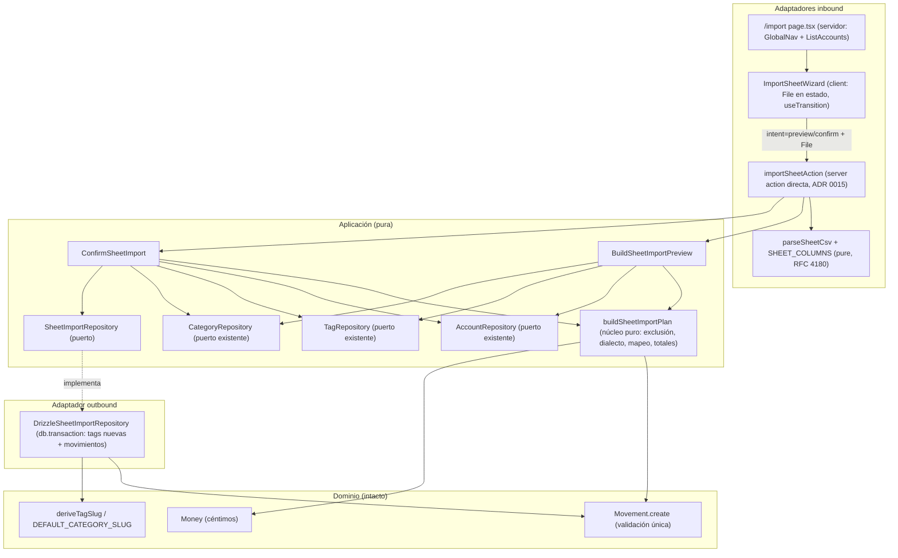
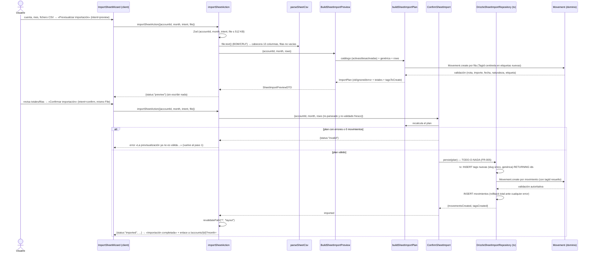

# Implementation Plan: Importación de movimientos desde Excel (prueba de concepto)

**Branch**: `feature/028-importacion-excel` | **Date**: 2026-11-06 | **Spec**: [spec.md](./spec.md)

**Input**: Feature specification from `/specs/028-importacion-excel/spec.md`

## Summary

PoC de importación de la hoja mensual de **una cuenta y un mes** (CSV exportado de Google Sheets, subido manualmente): página nueva `/import` (nav «Importar») con un asistente de dos pasos — selección de cuenta/mes/fichero y previsualización con totales, filas ignoradas y errores por fila — y una importación **transaccional todo-o-nada** que crea movimientos y etiquetas nuevas (categorías de la hoja sin equivalente, nacen en la genérica) por la vía de escritura existente (`Movement.create` + patrón de multi-escritura transaccional del repo). Parseo estricto contra la estructura de 13 columnas congelada de la muestra real («Balance 2026.xlsx - Enero Isma.csv», RFC 4180 con importes de punto decimal), mapeo fijo de tipos verificado numéricamente contra las columnas derivadas de la hoja (`Gasto`→personal 186,75 € exacto; `Gasto Común`→compartido; `Gasto Fijo`→personal, decisión del propietario; `Ingreso`→ingreso con etiqueta opcional; `Ahorro` y concepto «Aportación Común» → filas ignoradas). Sin dependencias nuevas (parser propio), sin cambios de dominio/esquema/migraciones, materializaciones y agregados intactos (FR-007). Decisiones cerradas con el propietario 2026-11-06: `Gasto Fijo` = gasto personal, nota fusionada «Concepto — Descripción», entrada en página propia `/import`.

## Technical Context

**Language/Version**: TypeScript estricto (Node.js LTS), Next.js ^16 App Router, React 19.

**Primary Dependencies**: solo las existentes — Drizzle ORM + libSQL (cliente `db` de `src/infrastructure/db/client.ts`), Zod v4 (frontera), Tailwind + shadcn/ui (`Select`, `Input`, `Button`, `Card`), sonner (toasts), radix-ui. **Ninguna dependencia nueva** (FR-010: no se introduce ADR de librería; parser CSV propio, research §1).

**Storage**: SQLite/Turso vía Drizzle — **sin cambios de esquema ni migraciones**; la importación escribe en `movements` y `tags` existentes.

**Testing**: Vitest con `test.projects` (`node`: dominio/aplicación/db/actions; `ui` jsdom: componentes) + Playwright e2e (`workers: 1`, BD determinista `e2e.sqlite`). Detalle en research §10.

**Target Platform**: monolito Next.js (local `npm run dev` + Vercel/Turso); sin estado en filesystem serverless.

**Project Type**: web-app familiar de uso individual (adaptadores inbound: página + server action).

**Performance Goals**: hoja mensual ~50–100 filas importada en < 1 min incl. revisión (SC-001); parseo y persistencia triviales a esa escala.

**Constraints**: fichero ≤ 512 KB (guard explícito; el límite por defecto de Server Actions, 1 MB, sobra); importe exacto al céntimo (string→céntimos, sin `parseFloat`, ADR 0007); sin deduplicación entre importaciones (fuera de alcance).

**Scale/Scope**: 3 cuentas, catálogo de etiquetas reducido, un único usuario; una hoja por importación (FR-008).

## Constitution Check

*GATE: Must pass before Phase 0 research. Re-check after Phase 1 design.*

| # | Principio | Estado pre-diseño | Notas |
|---|---|---|---|
| I | Simplicidad Primero | ✅ PASS | Monolito único, cero dependencias nuevas (parser CSV propio ~50 líneas sobre la estructura congelada de 13 columnas, research §1). Sin proyectos/paques nuevos. |
| II | Spec-Driven Development | ✅ PASS | Este plan deriva de `specs/028-importacion-excel/spec.md` (fila 028 del maestro; clarify 2026-11-06). Una única US pequeña (granularidad ✓). `/speckit.tasks` a continuación. |
| III | Calidad Verificada | ✅ PASS | Gates CI vigentes; lógica de negocio (parseo, mapeo, totales) con unitarios contra fixtures de la muestra real; integración transaccional (rollback) contra libsql `:memory:`; flujo crítico **subir → previsualizar → confirmar → listado** con Playwright e2e en su combinación cuenta/mes propia (FR-009; ADR 0006; research §9–§10). |
| IV | TypeScript Estricto End-to-End | ✅ PASS | Zod valida los args de la action (cuenta/mes/intent/fichero) y el parser congela la estructura del CSV; sin `any`. Los errores por fila son reglas de negocio del núcleo puro de aplicación (justificación en data-model §7). |
| V | Persistencia SQLite con Drizzle | ✅ PASS | Escritura solo vía `SheetImportRepository` → `DrizzleSheetImportRepository` (`db.transaction`); sin SQL ad-hoc; **sin migraciones** (no cambia el esquema). |
| VI | Producto en español, código en inglés | ✅ PASS | Literales UI/mensajes congelados en los contratos («Previsualizar importación», «Confirmar importación (N movimientos)», errores de fila…); identificadores en inglés (`importSheetAction`, `buildSheetImportPlan`, `SheetImportRepository`); literales del CSV (`Fecha de Operación`, …) congelados como datos en `SHEET_COLUMNS` y documentados en el glosario (data-model §9). |
| VII | Arquitectura Hexagonal + DDD táctico | ✅ PASS | Dominio **intacto** (reutiliza `Movement.create`/`Money` — FR-006, sin vías paralelas); núcleo puro + casos de uso + puerto `SheetImportRepository` en aplicación; parser y action como adaptadores inbound; Drizzle como outbound; la UI solo renderiza DTOs. Sin eventos/CQRS/EDA nuevos. |

## Project Structure

### Documentation (this feature)

```text
specs/028-importacion-excel/
├── plan.md              # This file (/speckit.plan command output)
├── research.md          # Phase 0 output (/speckit.plan command)
├── data-model.md        # Phase 1 output (/speckit.plan command)
├── quickstart.md        # Phase 1 output (/speckit.plan command)
├── contracts/
│   ├── import-sheet-action.md  # Contrato de la Server Action (args, estados, mensajes)
│   └── ui-contract.md          # Contrato UI del asistente (pasos, aria, estados)
└── tasks.md             # Phase 2 output (/speckit.tasks command - NOT created by /speckit.plan)
```

### Source Code (repository root)

```text
src/
├── application/
│   └── import/                          # NUEVO (módulo de la feature)
│       ├── dto.ts                       # SheetPreviewRowDTO, SheetImportTotalsDTO, SheetImportPreviewDTO
│       ├── sheet-import-plan.ts         # buildSheetImportPlan: núcleo puro (clasificación, dialecto, mapeo, totales)
│       ├── sheet-import-plan.test.ts    # Unitarios: tabla de mapeo, exclusiones, fechas, nota, importes, etiquetas
│       ├── BuildSheetImportPreview.ts   # Caso de uso: plan → SheetImportPreviewDTO
│       ├── BuildSheetImportPreview.test.ts
│       ├── ConfirmSheetImport.ts        # Caso de uso: plan fresco → persist atómica | invalid
│       ├── ConfirmSheetImport.test.ts
│       └── SheetImportRepository.ts     # PUERTO: persist(plan) — tx en el adaptador
├── app/
│   └── import/
│       └── page.tsx                     # NUEVO: GlobalNav active="import" + ListAccounts → asistente
├── infrastructure/
│   ├── db/
│   │   └── DrizzleSheetImportRepository.ts      # NUEVO (+test): una db.transaction — etiquetas nuevas (slug único,
│   │                                            # genérica) + Movement.create + INSERT movimientos; rollback total
│   └── primary/
│       ├── actions/
│       │   ├── sheet-csv.ts             # NUEVO (+test): SHEET_COLUMNS (13) + parseSheetCsv (RFC 4180 estricto, BOM, CRLF)
│       │   ├── sheet-csv.test.ts
│       │   ├── import-sheet.action.ts   # NUEVO (+test): acción directa (ADR 0015) — Zod args, parseo, dispatch preview/confirm,
│       │   │                            # revalidatePath("/", "layout") solo en éxito de confirmación
│       │   └── import-sheet.action.test.ts
│       └── ui/
│           ├── import-sheet-wizard.tsx  # NUEVO (+test jsdom): asistente 2 pasos; File en estado; useTransition;
│           │                            # invalidación de la previsualización al cambiar cuenta/mes/fichero
│           └── import-sheet-wizard.test.tsx
├── domain/                              # INTACTO (referencia: Movement.create, Money, deriveTagSlug, DEFAULT_CATEGORY_SLUG)
e2e/
└── importacion-excel.spec.ts            # NUEVO: Cuenta común · marzo 2027; happy path, fila inválida, estructura mala
```

**Structure Decision**: estructura vigente del monolito hexagonal (AGENTS.md); el único directorio nuevo de código es `src/application/import/` (feature vertical, paridad de `src/application/{movement,tag,...}`). El parser CSV vive en `src/infrastructure/primary/actions/` para caer en el proyecto Vitest `node` existente sin tocar `vitest.config.mts`; la UI nueva es un asistente de página, no un diálogo (decisión del propietario, research §4).

## Diagramas de diseño

### Componentes que intervienen



> Dependencias siempre hacia el dominio (constitución VII). La UI nunca mapea ni calcula totales: renderiza `SheetImportPreviewDTO`. El dominio no cambia; la transacción vive solo en el adaptador Drizzle (paridad `mergeInto`/`registerMaterialization`).

### Secuencia — happy path



## Complexity Tracking

> **Fill ONLY if Constitution Check has violations that must be justified**

Sin violaciones: no se introducen proyectos, paquetes, librerías ni patrones adicionales (el puerto transaccional replica el patrón de multi-escritura existente; la acción directa es la excepción ADR 0015 ya aceptada, extendida con una nota para el `File` en estado del cliente — tarea de documentación en tasks).

## Constitution Check (post-diseño, tras Phase 1)

| # | Principio | Estado post-diseño | Notas |
|---|---|---|---|
| I | Simplicidad Primero | ✅ PASS | Cero dependencias nuevas confirmado en el diseño (parser propio); único directorio nuevo `src/application/import/`; sin configuración de tests tocada. |
| II | Spec-Driven Development | ✅ PASS | research/data-model/contracts/quickstart trazados FR-001..FR-010 y escenarios 1–5; `/speckit.tasks` pendiente (siguiente paso del flujo). |
| III | Calidad Verificada | ✅ PASS | Matriz de cobertura por nivel (research §10): núcleo puro (tabla de mapeo completa + dialecto), integración con rollback real (libsql `:memory:` + migraciones), action mockeada, wizard jsdom, e2e del flujo crítico en combinación aislada. |
| IV | TypeScript estricto + Zod | ✅ PASS | Frontera Zod congelada (contrato §1); parseo estricto tipado (`SheetParseResult`); sin `any`; céntimos por manipulación de strings. |
| V | Drizzle/SQLite | ✅ PASS | Persistencia exclusivamente vía `DrizzleSheetImportRepository` (tx); sin SQL directo; sin migraciones (esquema intacto). |
| VI | Español / inglés | ✅ PASS | Literales congelados en contratos; glosario actualizado con los términos del CSV y de la importación (data-model §9). |
| VII | Hexagonal + DDD táctico | ✅ PASS | Dirección de dependencias verificada en el diagrama (puerto en aplicación, tx en adaptador, dominio intacto y reutilizado como única vía de validación/escritura — FR-006); UI sin lógica de negocio; sin patrones nuevos (Diagrama de clases en data-model §8). |
