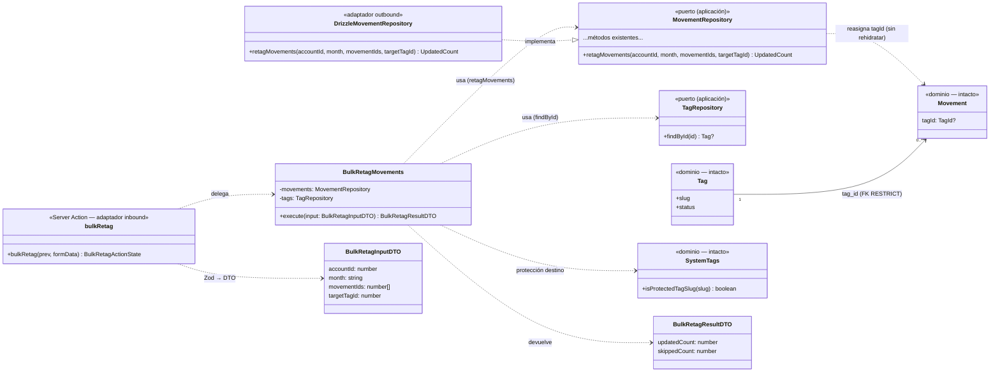

# Data Model: Reasignación masiva de etiquetas de movimientos

**Feature**: `029-retag-masivo` | Fase 1 del plan | 2026-11-07

Sin entidades nuevas de dominio ni cambios de esquema: la operación reasigna la etiqueta de movimientos existentes. Los cambios son: un caso de uso de aplicación, una extensión del puerto `MovementRepository` (y su adaptador Drizzle), DTOs de entrada/salida y la validación de frontera de la action.

---

## §1 Dominio (sin cambios estructurales, reglas aplicadas)

| Elemento | Estado | Papel en la feature |
|---|---|---|
| `Movement` (`src/domain/movement/Movement.ts`) | Intacto | Invariante preservado: **una única etiqueta** (`tagId: TagId \| null`), obligatoria en gastos, opcional en ingresos. La reasignación solo **sustituye/asigna** un valor, jamas lo retira. |
| `MovementId`, `TagId`, `AccountId` (brands) | Intactos | Ids validados (entero positivo) en el caso de uso y en Zod. |
| `Tag` / `TagStatus` | Intacto | El destino se carga por id y debe estar **activo**. |
| `SystemTags.isProtectedTagSlug` (`src/domain/tag/SystemTags.ts`) | Intacto, reutilizado | Único dueño del slug protegido `aportacion-comun`: excluye el destino (`ProtectedTagError`) y filtra las filas del listado sin checkbox en el cliente (módulo puro compartido — constitución VII). |
| `ProtectedTagError`, `TagNotFoundError`, `InvalidMovementError` | Intactos, reutilizados | Errores de dominio de la operación (mapeo a mensaje exacto en la action). |

**Validación del caso de uso** (orden):

1. `movementIds` deduplicado vacío → `InvalidMovementError("movementIds", "Selecciona al menos un movimiento.")`.
2. Etiqueta destino: no existe → `TagNotFoundError`; inactiva → `InvalidTagError` (semántica de `resolveTagId` de `movement-inputs.ts`, la misma que alta/edición de movimientos); slug protegido → `ProtectedTagError`.
3. `month` con forma `YYYY-MM` (validado antes en frontera; el caso de uso confía pero el rango lo aplica el repositorio).
4. Delegación transaccional en `retagMovements` (§2) → recuento real.

## §2 Puerto y persistencia

### `MovementRepository` (extensión — `src/application/movement/MovementRepository.ts`)

```ts
retagMovements(
  accountId: AccountId,
  month: string,                      // "YYYY-MM"
  movementIds: readonly MovementId[],
  targetTagId: TagId,
): Promise<{ updated: number }>;
```

- **Semántica**: reasigna `targetTagId` (y `updated_at = now`) a **todos y solo** los movimientos de `movementIds` que pertenezcan a `accountId` y al rango `[month-01, month+1-01)`. Los ids ajenos/inexistentes **no producen error**: quedan fuera del `WHERE` (decisión «ignorar con aviso» — Clarifications 2026-11-07) y se reflejan en `updated < movementIds.length`.
- **Contrato de error**: no lanza errores de dominio; los fallos de infraestructura propagan (la action los traduce al mensaje genérico).

### `DrizzleMovementRepository.retagMovements` (adaptador — `src/infrastructure/db/DrizzleMovementRepository.ts`)

```ts
await this.db.update(movements)
  .set({ tagId, updatedAt: new Date().toISOString() })
  .where(and(
    inArray(movements.id, ids),
    eq(movements.accountId, accountId),
    gte(movements.date, `${month}-01`),
    lt(movements.date, nextMonthFirstDay(month)),   // helper existente del repositorio
  ));
// recuento: run.changes (libsql) — devuelto como { updated }
```

- **Una sola sentencia UPDATE** ⇒ transaccional por construcción (SQLite); sin estado intermedio parcial (FR-003).
- `inArray` con la lista deduplicada; lista vacía no llega nunca (guarda del caso de uso §1.1).
- **Diferencia documentada con `TagRepository.mergeInto` (004)**: aquí `updated_at` **sí** se actualiza (decisión del propietario 2026-11-07) porque el usuario edita movimientos concretos; en 004 la operación era sobre la dimensión catálogo. ADR 0023.

## §3 Caso de uso — `BulkRetagMovements`

`src/application/movement/BulkRetagMovements.ts`

```ts
class BulkRetagMovements {
  constructor(movements: MovementRepository, tags: TagRepository) {}

  async execute(input: BulkRetagInputDTO): Promise<BulkRetagResultDTO>;
}
```

1. Deduplica y coerciona `input.movementIds` → `MovementId[]` (vacío → `InvalidMovementError` §1.1).
2. Resuelve la etiqueta destino por id con la semántica de alta/edición (`resolveTagId`: existe + activa) y rechaza la protegida (`ProtectedTagError`).
3. `retagMovements(AccountId(input.accountId), input.month, ids, tagId)` → `{ updated }`.
4. Devuelve `{ updatedCount: updated, skippedCount: ids.length - updated }`.

**Contrato para el futuro modo IA (FR-006)**: entrada/salida tipadas y autosuficientes (cuenta, mes, ids, destino → recuento y descartes) — un adaptador inbound de chat podrá construir la entrada desde su propia previsualización/confirmación sin tocar dominio ni aplicación.

## §4 DTOs y frontera (Zod)

### DTOs de aplicación (`src/application/movement/dto.ts` — ampliación)

```ts
export interface BulkRetagInputDTO {
  accountId: number;
  month: string;            // "YYYY-MM"
  movementIds: number[];    // ≥ 1; se deduplica en el caso de uso
  targetTagId: number;
}

export interface BulkRetagResultDTO {
  updatedCount: number;
  skippedCount: number;     // ids descartados por re-validación (ajenos/desaparecidos)
}
```

### Frontera (`src/infrastructure/primary/actions/bulk-retag.schema.ts`)

```ts
bulkRetagSchema = z.object({
  accountId:    z.coerce.number().int().positive(),
  month:        z.string().regex(/^\d{4}-(0[1-9]|1[0-2])$/, "El mes no es válido."),
  targetTagId:  z.coerce.number().int().positive(),
  movementIds:  z.array(z.coerce.number().int().positive())
                 .min(1, "Selecciona al menos un movimiento."),
});

export type BulkRetagActionState =
  | { status: "idle" }
  | { status: "success"; message: string }
  | { status: "error"; message: string };
```

Los ids viajan como **campos repetidos** `movementIds` del `<form>` (`formData.getAll("movementIds")`).

### Mensajes congelados (los pinta el diálogo/toast)

| Situación | Mensaje exacto |
|---|---|
| Éxito, sin descartes | `{n} movimiento actualizado` / `{n} movimientos actualizados` (n === 1 singular) |
| Éxito, con descartes | `{updated} de {total} movimientos actualizados` (total = ids únicos enviados) |
| Selección vacía (frontera) | `Selecciona al menos un movimiento.` |
| Destino no existe | `TagNotFoundError.message` |
| Destino protegido | `ProtectedTagError.message` |
| Resto de errores | `No se ha podido completar la operación. Inténtalo de nuevo.` |

## §5 Matriz de validación (requisito → capa dueña → mecanismo)

| Regla (spec) | Dominio | Aplicación | Frontera (Zod/action) | Persistencia |
|---|---|---|---|---|
| Destino existe y activo (FR-004) | `Tag` + errores de dominio | `resolveTagId` en `BulkRetagMovements` | — | FK `tag_id` RESTRICT como auditoría |
| Destino no protegido (FR-004) | `isProtectedTagSlug` → `ProtectedTagError` | paso 2 del caso de uso | Select lo excluye de opciones | — |
| Selección ≥ 1 (FR-001/002) | — | `InvalidMovementError` | `.min(1)` + botón deshabilitado | — |
| Pertenencia a cuenta+mes (FR-003) | — | delegada en el puerto | — | `WHERE account_id AND date ∈ mes` |
| Transaccionalidad (FR-003) | — | — | — | única sentencia UPDATE (atómica) |
| Gasto jamás sin etiqueta (FR-004) | invariante de `Movement` intacto | la operación solo asigna, nunca retira | Select sin «Sin etiqueta» | `tag_id` nunca a null en el SET |
| `updated_at` refleja la edición (Clarifications) | — | — | — | `SET updated_at = now` (ADR 0023, diff 004) |

## §6 Glosario

| Término (es) | Identificador (en) | Nota |
|---|---|---|
| Reasignación masiva | `BulkRetagMovements` / `retagMovements` / `bulkRetag` | «retag masivo» en coloquial del repo; cambio de la etiqueta de N movimientos, sin tocar el catálogo |
| Selección de movimientos | `selectionMode` / `selectedIds` (estado cliente) | ids del mes visible de la cuenta, sin filas protegidas |
| Movimiento protegido | fila con `tag.slug` en `SYSTEM_TAG_SLUGS` | hoy: «Aportación Común» (019/021) |
| Descartes | `skippedCount` | ids enviados que no superaron la re-validación (ajenos/desaparecidos) |

## Diagrama de clases (diseño)



> Diferencias con `docs/architecture/diagrams/domain-model.md` (vivo, a actualizar en implementación): `MovementRepository` gana `retagMovements`; aparece `BulkRetagMovements` y sus DTOs. `Movement`, `Tag`, `Money` y el resto del modelo intactos.
