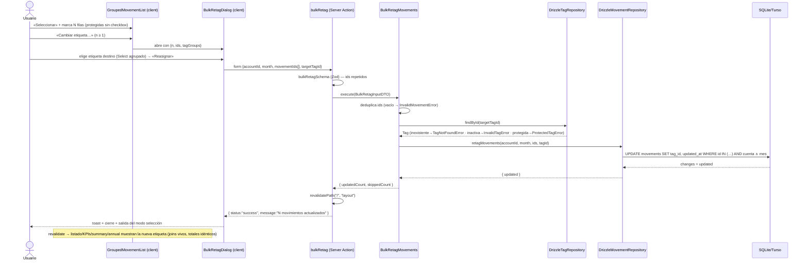

# Implementation Plan: Reasignación masiva de etiquetas de movimientos

**Branch**: `feature/029-retag-masivo` | **Date**: 2026-11-07 | **Spec**: [spec.md](spec.md)

**Input**: Feature specification from `/specs/029-retag-masivo/spec.md`

## Summary

Reasignación masiva de la **etiqueta** de movimientos existentes, por vía manual («modo estándar»): un **modo de selección** sobre el listado agrupado de la página de cuenta (cuenta + mes visibles, filas protegidas excluidas) con barra contextual, y un **diálogo de confirmación informada** (recuento + Select agrupado por categorías, solo activas y sin protegidas — patrón 027). La escritura baja por las capas: caso de uso **`BulkRetagMovements`** (contrato explícito reutilizable por el futuro modo IA — FR-006) + método de puerto **`MovementRepository.retagMovements`** (única sentencia `UPDATE` transaccional con pertenencia cuenta+mes en el `WHERE` — descarte de ids con aviso de recuento real) + Server Action **`bulkRetag`** (`useActionState`, Zod con ids repetidos, `revalidatePath("/", "layout")`). Catálogo, importes, materializaciones (018/019/021/023) y agregados intactos; `updated_at` de los movimientos **se actualiza** (decisión del propietario 2026-11-07, diferencia razonada con la fusión de 004 — ADR 0023). Cero dependencias nuevas, sin migraciones.

## Technical Context

**Language/Version**: TypeScript estricto (Node.js LTS), Next.js App Router (monolito).

**Primary Dependencies**: Next.js (Server Actions, `revalidatePath`), Drizzle ORM + libSQL/SQLite, Zod (fronteras), Tailwind CSS + shadcn/ui (`Checkbox`, `Dialog`, `Select`, `Button`, `Label`, sonner — todos ya en el repo), Vitest + Testing Library, Playwright.

**Storage**: Drizzle ORM sobre SQLite (dev fichero / Turso prod) — **sin cambios de esquema ni migraciones** (`movements.tag_id` FK RESTRICT ya soporta la reasignación).

**Testing**: Vitest (`test.projects`: `node` dominio/aplicación/actions/repos, `ui` jsdom componentes; repos contra libsql `:memory:` con migraciones) + Playwright e2e (`build + start`, BD determinista `e2e.sqlite`, `workers: 1`).

**Target Platform**: Local (`npm run dev`) y Vercel + Turso (serverless, sin estado).

**Project Type**: Web app monolítica (hexagonal + DDD táctico — constitución VII).

**Performance Goals**: Reasignar 50–100 movimientos en una sola sentencia SQL (SC-001: flujo completo < 30 s).

**Constraints**: Una operación = una cuenta + un mes (spec Assumptions); sin bypass de dominio (FR-004); UI en español (constitución VI).

**Scale/Scope**: Un único usuario; listados de mes (~50–100 filas por importación de 028).

## Constitution Check

*GATE: Must pass before Phase 0 research. Re-check after Phase 1 design.*

| # | Principio | Estado | Verificación |
|---|---|---|---|
| I | Simplicidad Primero | ✅ PASS | Sin proyectos/paques/capas nuevas; cero dependencias (el `Checkbox` ya existe); la única abstracción nueva (método de puerto masivo) tiene precedente `mergeInto` (004) y caso de uso real inmediato. |
| II | Spec-Driven Development | ✅ PASS | spec.md aprobada con Clarifications cerradas (2026-11-07); este plan + tasks.md preceden al código. |
| III | Calidad Verificada | ✅ PASS | FR-007: unit de aplicación (fake en memoria), repositorio (libsql `:memory:`, transaccionalidad), action (Zod + mapeo), componentes y **e2e nueva** `retag-masivo.spec.ts` (B + 2026-02, combinación verificada libre — research §5) — constitución III. |
| IV | TypeScript Estricto + Zod | ✅ PASS | `bulkRetagSchema` en frontera (ids repetidos por `getAll`), DTOs tipados (`BulkRetagInputDTO`/`BulkRetagResultDTO`), `BulkRetagActionState` unión discriminada; sin `any`. |
| V | Persistencia SQLite con Drizzle | ✅ PASS | Extensión del puerto implementada en `DrizzleMovementRepository` (una sentencia `update` con `inArray` + rango de mes); sin SQL ad-hoc fuera de Drizzle; sin migraciones. |
| VI | Producto en español, código en inglés | ✅ PASS | Literales congelados en ui-contract §4 / data-model §4; identificadores en inglés (`BulkRetagMovements`, `retagMovements`, `bulkRetag`, `selectionMode`); glosario en data-model §6. |
| VII | Arquitectura Hexagonal + DDD táctico | ✅ PASS | Dominio intacto (reglas reutilizadas: `isProtectedTagSlug`, invariante de etiqueta única de `Movement`); caso de uso + puerto en aplicación; action y UI como adaptadores inbound; repositorio Drizzle outbound; la UI no calcula nada (render del recuento y de opciones filtradas por datos). |

**Re-check tras Phase 1**: sin cambios — el diseño (research/data-model/contracts) no introdujo desviaciones; la diferencia `updated_at` vs 004 es una decisión del propietario registrada (ADR 0023), no una violación.

## Project Structure

### Documentation (this feature)

```text
specs/029-retag-masivo/
├── plan.md              # This file
├── research.md          # Phase 0 — decisiones §1–§7
├── data-model.md        # Phase 1 — caso de uso, puerto, DTOs, diagrama de clases
├── quickstart.md        # Phase 1 — validación manual Q1–Q7
├── contracts/
│   └── ui-contract.md   # Phase 1 — modo selección, diálogo, action, literales
└── tasks.md             # Phase 2 (/speckit.tasks — pendiente)
```

### Source Code (repository root)

```text
src/
├── domain/                              # INTACTO (reglas reutilizadas, sin cambios)
├── application/
│   └── movement/
│       ├── MovementRepository.ts        # MODIFICADO: + retagMovements(accountId, month, ids, tagId) → { updated }
│       ├── BulkRetagMovements.ts        # NUEVO: valida destino (activa, no protegida) y selección; deduplica; delega; devuelve { updatedCount, skippedCount } (+test)
│       └── dto.ts                       # MODIFICADO: + BulkRetagInputDTO, BulkRetagResultDTO
├── app/
│   └── accounts/[accountId]/page.tsx    # INTACTO (movements + tagGroups ya viajan al listado)
└── infrastructure/
    ├── db/
    │   └── DrizzleMovementRepository.ts # MODIFICADO: + retagMovements (única UPDATE: IN ids ∧ cuenta ∧ rango mes; updated_at = now; changes → updated)
    └── primary/
        ├── actions/
        │   ├── bulk-retag.action.ts     # NUEVO: useActionState, revalidatePath("/", "layout"), mensajes congelados (+test)
        │   └── bulk-retag.schema.ts     # NUEVO: bulkRetagSchema (ids repetidos) + BulkRetagActionState
        └── ui/
            ├── grouped-movement-list.tsx  # MODIFICADO: selectionMode/selectedIds, barra contextual, checkbox por fila (protegidas sin), entrada «Seleccionar», salida limpia (+test)
            └── bulk-retag-dialog.tsx       # NUEVO: confirmación informada (recuento + Select agrupado filtrado, controlado), hidden inputs ids (+test)
e2e/
└── retag-masivo.spec.ts                # NUEVO: B + 2026-02 (última del orden alfabético) — flujo completo, protección, todo/ninguno, no-op, totales intactos
docs/
└── architecture/adr/0023-reasignacion-masiva-etiquetas.md   # NUEVO (implementación, FR-008)
```

**Structure Decision**: monolito Next.js existente con capas hexagonales (`src/domain` → `src/application` → `src/app` + `src/infrastructure`); la feature es aditiva en aplicación/adaptadores, sin tocar dominio, esquema ni las vistas derivadas.

## Diagramas de diseño

### Componentes que intervienen

```mermaid
flowchart TD
    subgraph Inbound["Adaptadores inbound"]
        Page["/accounts/[accountId]/page.tsx<br/>(server, intacta)"]
        GML["GroupedMovementList (client)<br/>+ selectionMode / selectedIds"]
        BRD["BulkRetagDialog (client)<br/>NUEVO"]
        Action["bulkRetag (Server Action)<br/>NUEVA · Zod · revalidate layout"]
    end

    subgraph App["Aplicación (puertos + casos de uso)"]
        UC["BulkRetagMovements<br/>NUEVO"]
        MRepoP[("MovementRepository (puerto)<br/>+ retagMovements")]
        TRepoP[("TagRepository (puerto)<br/>findById")]
    end

    subgraph Domain["Dominio (intacto)"]
        SystemTags["SystemTags.isProtectedTagSlug"]
        Movement["Movement (invariante: etiqueta única)"]
        Tag["Tag (status)"]
    end

    subgraph Outbound["Adaptadores outbound"]
        DrizzleM["DrizzleMovementRepository<br/>+ retagMovements (única UPDATE)"]
        DrizzleT["DrizzleTagRepository"]
        DB[(SQLite / Turso)]
    end

    Page -->|movements + tagGroups (props, ya existentes)| GML
    GML -->|abre con n seleccionados| BRD
    BRD -->|form: accountId, month, movementIds[], targetTagId| Action
    Action -->|BulkRetagInputDTO| UC
    UC --> MRepoP
    UC --> TRepoP
    DrizzleM -.implements.-> MRepoP
    DrizzleT -.implements.-> TRepoP
    DrizzleM --> DB
    DrizzleT --> DB
    UC -.valida protección.-> SystemTags
    UC -.destino activo.-> Tag
    MRepoP -.reasigna tagId.-> Movement
    GML -.excluye filas protegidas (módulo puro compartido).-> SystemTags
```

### Secuencia — happy path



## Complexity Tracking

> **Fill ONLY if Constitution Check has violations that must be justified**

Sin violaciones. Notas de complejidad asumidas (sin desviación constitucional):

| Tema | Decisión | Alternativa rechazada porque |
|------|----------|------------------------------|
| Método de puerto masivo (`retagMovements`) en vez de bucle CRUD unitario | Paridad con `mergeInto` (004); una sentencia atómica; pertenencia cuenta+mes resuelta en el `WHERE` con recuento real | El bucle N-consultas no aporta reglas de dominio extra (el destino ya está validado) y multiplica viajes/puntos de fallo |
| `updated_at` se actualiza (diff vs 004) | Decisión del propietario 2026-11-07 (edición real de movimientos) — ADR 0023 | Mantener paridad ciega con 004 ocultaría la edición al usuario que sí la provocó |
