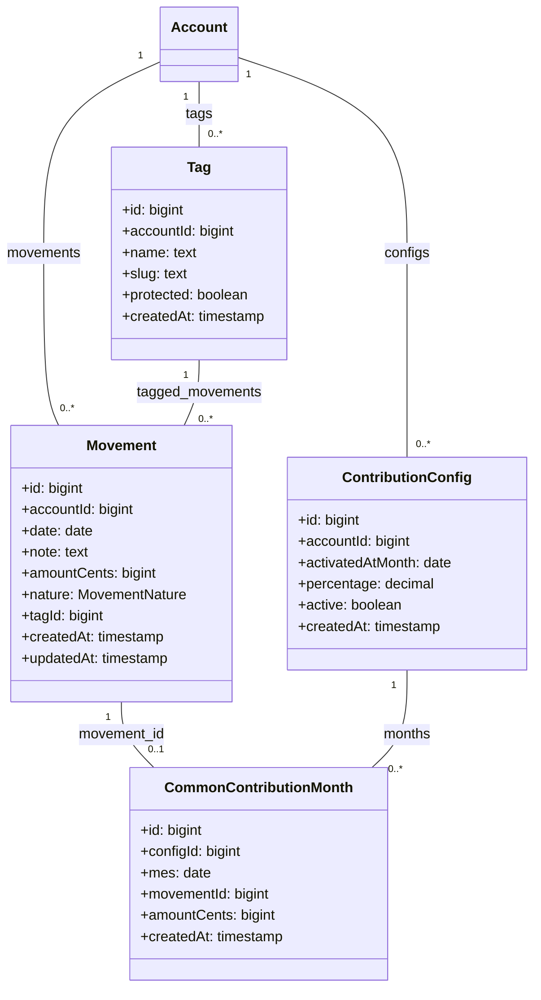

# Data Model: Registro manual de la aportación común en meses pasados

**Feature**: 032-retroactivacion-aportacion-ahorro  
**Fecha**: 2026-11-11

---

## Resumen

Esta feature **no introduce entidades nuevas** ni cambios de esquema. Reutiliza las entidades existentes del modelo actual y añade una segunda vía de escritura para el registro de materialización `common_contribution_months`.

---

## Diagrama de clases (diseño)



---

## Entidades y campos

### Movement (sin cambios)

El movimiento de aportación manual usa el tipo de gasto existente `MovementNature.OWN` y la etiqueta protegida «Aportación Común».

| Campo | Tipo | Descripción |
|-------|------|-------------|
| `id` | bigint | Identificador único |
| `accountId` | bigint | Cuenta personal con config de aportación activa |
| `date` | date | Fecha del movimiento |
| `note` | text | Nota opcional |
| `amountCents` | bigint | Importe en céntimos (neto real, sin recálculo) |
| `nature` | MovementNature | **Propio** (implícito por tipo de gasto) |
| `tagId` | bigint | **Aportación Común** (etiqueta protegida, implícita) |
| `createdAt` | timestamp | Timestamp de creación |
| `updatedAt` | timestamp | Timestamp de actualización |

### Tag (sin cambios)

La etiqueta «Aportación Común» es protegida (no renombrable ni eliminable).

| Campo | Tipo | Descripción |
|-------|------|-------------|
| `id` | bigint | Identificador único |
| `accountId` | bigint | Cuenta personal |
| `name` | text | Nombre mostrado |
| `slug` | text | Slug único (`contribution-common`) |
| `protected` | boolean | **true** (no editable) |
| `createdAt` | timestamp | Timestamp de creación |

### ContributionConfig (sin cambios)

La config de aportación define el porcentaje y la ventana de activación.

| Campo | Tipo | Descripción |
|-------|------|-------------|
| `id` | bigint | Identificador único |
| `accountId` | bigint | Cuenta personal |
| `activatedAtMonth` | date | Mes de activación (no cambia con registro manual) |
| `percentage` | decimal | Porcentaje sobre el ingreso regular |
| `active` | boolean | Estado activo |
| `createdAt` | timestamp | Timestamp de creación |

### CommonContributionMonth (sin cambios)

Registro de materialización que almacena la aportación mensual.

| Campo | Tipo | Descripción |
|-------|------|-------------|
| `id` | bigint | Identificador único |
| `configId` | bigint | FK a `ContributionConfig` |
| `mes` | date | Mes de la aportación |
| `movementId` | bigint | FK a `Movement` (nullable en legacy, obligatoria en nuevo registro) |
| `amountCents` | bigint | Importe de la aportación |
| `createdAt` | timestamp | Timestamp de creación |

**Constraints**:
- `UNIQUE (configId, mes)` con `ON CONFLICT DO NOTHING` (idempotencia)
- `FOREIGN KEY (movementId)` REFERENCES `Movement(id)` (nullable)

---

## Relaciones

### Movement ↔ CommonContributionMonth

- **Cardinalidad**: 1 a 0..1 (máximo 1 movimiento de aportación por cuenta y mes)
- **Dirección**: `CommonContributionMonth` → `Movement` (el registro enlaza al movimiento)
- **Regla de unicidad**: máximo 1 movimiento de aportación por cuenta y mes (FR-001)
- **Borrado**: eliminar el movimiento elimina también la fila del registro (FR-004)

### Account ↔ Movement

- **Cardinalidad**: 1 a 0..*
- **Naturaleza**: el movimiento pertenece a una cuenta personal

### Account ↔ Tag

- **Cardinalidad**: 1 a 0..*
- **Naturaleza**: la etiqueta «Aportación Común» pertenece a una cuenta personal

### Account ↔ ContributionConfig

- **Cardinalidad**: 1 a 0..*
- **Naturaleza**: la config de aportación pertenece a una cuenta personal

### ContributionConfig ↔ CommonContributionMonth

- **Cardinalidad**: 1 a 0..*
- **Naturaleza**: el registro de aportación pertenece a una config

---

## Estado de los datos

### Movimiento de aportación manual

| Estado | Condición | Acción |
|--------|-----------|--------|
| `pending` | Usuario teclea importe, fecha, nota | - |
| `validating` | Guardando en servidor | Validación de unicidad |
| `created` | Movimiento guardado + fila del registro escrita | Visible en listado y KPIs |
| `error` | Duplicado o error de validación | Error al usuario, movimiento no guardado |

### Fila del registro

| Estado | Condición | Acción |
|--------|-----------|--------|
| `none` | Sin registro para el mes | Permite crear movimiento manual |
| `manual` | Movimiento manual creado | KPI muestra el importe manual |
| `materialized` | Movimiento generado por materializador | KPI muestra el importe calculado |
| `orphaned` | Movimiento borrado (legacy 021) | Permite crear movimiento manual (fila existente) |

---

## Transiciones de estado

### Creación de movimiento de aportación

```
pending → validating → created
              ↓
              error (si existe registro)
```

### Borrado de movimiento de aportación manual

```
manual → deleted (movimiento + fila del registro eliminados)
```

### Edición de movimiento de aportación

```
created → updated (importe, nota, fecha)
```

---

## Reglas de negocio

### FR-001: Regla de unicidad

- **Condición**: Al guardar un movimiento de tipo «Aportación común»
- **Acción**: Consultar `common_contribution_months` por `configId` y `mes`
- **Resultado**:
  - Si existe → error con mensaje al usuario, movimiento no guardado
  - Si no existe → crear movimiento + INSERT en el registro en la misma tx

### FR-004: Borrado y edición

- **Borrado**: DELETE en movimiento + DELETE en registro enlazado (misma tx)
- **Edición**: UPDATE en movimiento (importe, nota, fecha); el registro no cambia
- **Identidad fija**: tipo, naturaleza y etiqueta inmutables

### FR-003: Materializador intacto

- **Condición**: Mes en curso con config activa
- **Acción**: El materializador respeta la fila existente (idempotencia)
- **Configuración**: `activatedAtMonth` y otros campos de la config no cambian

---

## Contratos de interfaz

### Puerto: MovementRepository

```typescript
// src/application/MovementRepository.ts

export interface MovementRepository {
  create(movement: Movement): Promise<Movement>
  update(movement: Movement): Promise<Movement>
  delete(movement: Movement): Promise<void>
  // ... otros métodos existentes
}
```

### Caso de uso: CreateMovement

```typescript
// src/application/MovementUseCase.ts

export interface CreateMovementInput {
  accountId: string
  date: string
  note: string | null
  amountCents: number
  type: MovementType
}

export interface CreateMovementOutput {
  success: boolean
  movement?: MovementDTO
  error?: string
}
```

---

## Migraciones

**No se requieren migraciones**. El esquema actual ya soporta:

- `movement.tag_id` (FK a `tags`)
- `common_contribution_months.movement_id` (FK nullable a `movements`)
- `common_contribution_months` con `UNIQUE (config_id, mes)` y `ON CONFLICT DO NOTHING`

---

## Referencias

- **Spec**: `specs/032-retroactivacion-aportacion-ahorro/spec.md`
- **Constitución**: `.specify/memory/constitution.md` (principio VII)
- **Materializador**: specs/019-materializacion-aportacion-common/spec.md, specs/021-re-sincronizacion-aportacion/spec.md
