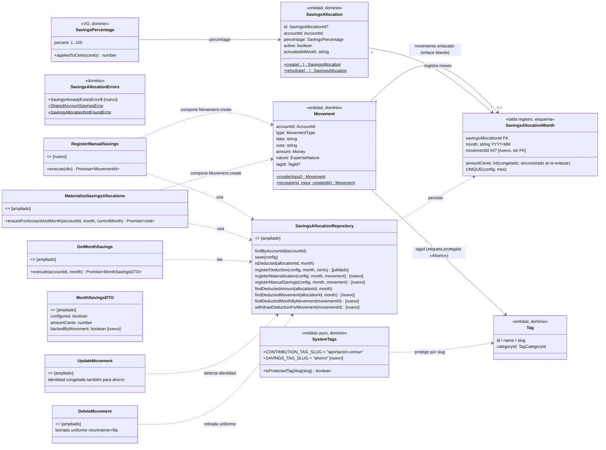
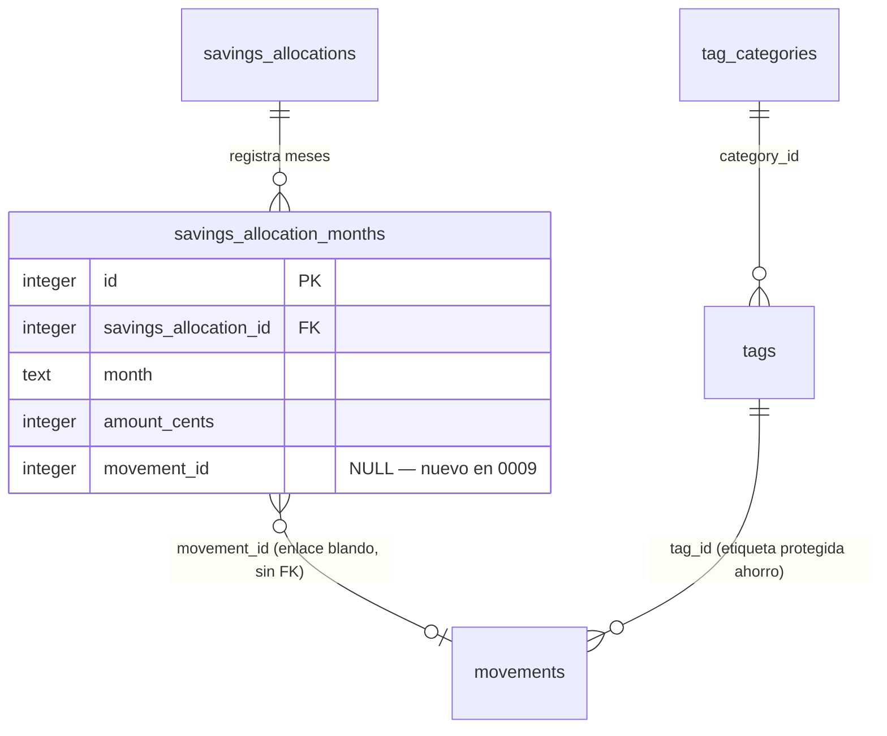

# Data Model: El ahorro mensual como movimiento editable (033)

**Feature**: 033-ahorro-como-movimiento | **Fecha**: 2026-11-15

---

## Resumen del modelo

Sin entidades nuevas: la feature reutiliza `Movement`, `SavingsAllocation` y `Tag`, y cambia el papel de la tabla registro `savings_allocation_months` (gana enlace blando `movement_id` y una segunda vía de escritura). El único agregado afectado es el de ahorro, que pasa de «apartado informativo congelado» (023) a «registro con movimiento enlazado» (dual de `common_contribution_months`, 032).

---

## Diagrama de clases (diseño)



---

## Entidades y cambios

### Etiqueta protegida «Ahorro» (nueva)

| Campo | Valor |
|---|---|
| name | `Ahorro` |
| slug | `ahorro` (`SAVINGS_TAG_SLUG`, `src/domain/tag/SystemTags.ts`) |
| status | `active` (protegida: no renombrable ni eliminable; no seleccionable a mano; movible de categoría — paridad «Aportación Común») |
| category | Genérica (`slug "general"`) |

Nace en la migración `0009` (id fijo `101`) y en `SEED_TAGS`. Al entrar en `SYSTEM_TAG_SLUGS`, todas las protecciones existentes aplican por construcción (Select de etiqueta, selección masiva 029, catálogo `/tags` 026, edición bloqueada).

### `savings_allocation_months` (tabla registro — cambios)

| Columna | Tipo | Notas |
|---|---|---|
| `savings_allocation_id` | integer NOT NULL FK cascade | config de ahorro (ancla de la fila) |
| `month` | text NOT NULL | `YYYY-MM` |
| `amount_cents` | integer NOT NULL | importe congelado en el registro; sincronizado con el movimiento al escribir/re-enlazar (R3) |
| `movement_id` | integer NULL **[nuevo]** | enlace blando sin FK (paridad `0005`); dueño: la fila |
| | | `UNIQUE (savings_allocation_id, month)` — guarda «0 o 1» por cuenta y mes |

**Vías de escritura** (ambas convergen en la misma guarda UNIQUE):

1. **Materializador** (023/033): `registerMaterialization(config, mes, movement)` — tx única: `INSERT ... ON CONFLICT (config, mes) DO NOTHING RETURNING`; fila insertada → `INSERT` del movimiento; 0 filas → `false` (idempotente, nunca sobreescribe).
2. **Manual** (033): `registerManualSavings(config, mes, movement)` — tx única: `INSERT ... ON CONFLICT (config, mes) DO UPDATE SET movement_id, amount_cents WHERE movement_id IS NULL RETURNING`; fila huérfana legacy → re-enlace (+sincronía de importe); fila ya enlazada → 0 filas → `null` → `SavingsAlreadyExistsError` («Ya existe un ahorro registrado para este mes.»), sin insertar el movimiento.

**Lecturas**: `findDeductedAmount` (importe de fila — fallback de huérfanas), `findDeductedMovement` (movimiento enlazado — fuente del KPI cuando existe; **sin heurística lazy**: no hay movimientos de ahorro pre-033), `findDeductedMonthByMovement` (detección de identidad en edición).

**Borrado**: `withdrawDeductionForMovement(movementId)` — tx única que elimina movimiento y fila donde `movement_id = id`. **Uniforme** para origen manual y materializado: sin filas huérfanas por borrado; dentro de la ventana de una config activa el materializador puede regenerar en una visita posterior (la guarda UNIQUE queda reabierta al desaparecer la fila).

### Movimiento de ahorro (concepto de frontera)

Gasto (`type: "expense"`, sin nuevo `MovementType` de dominio — paridad 032) con:
- `nature: "personal"` (implícita, nunca seleccionable),
- `tagId`: etiqueta protegida «Ahorro» (implícita),
- `note`: opcional en frontera; el caso de uso aplica `"Ahorro"` si llega vacía (nota por defecto también del materializador, R4),
- `amount`: importe tecleado por el usuario (vía manual) o `SavingsPercentage.appliedToCents(ingreso bruto regular)` (materializador); sin validación contra porcentajes (realidad histórica),
- `date`: libre en la vía manual; `${month}-01` en la materialización.

**Regla de dominio «0 o 1»**: máximo un movimiento de ahorro por cuenta y mes, cualquiera que sea su origen — pre-check `findDeductedMovement` + guarda transaccional (la tx pierde la carrera → `null` → error). El segundo intento → `SavingsAlreadyExistsError` con mensaje al usuario; nada se escribe.

### `MonthSavingsDTO` (ampliado)

```ts
{ configured: boolean; amountCents: number; backedByMovement: boolean }
```

`configured` = existe config (activa o no). Importe = movimiento enlazado si existe; si no, la cantidad congelada de la fila. `backedByMovement` alimenta la composición condicional del «Saldo del mes» (FR-004).

### Guardas por vía (matriz de decisión)

| Guarda | Manual | Materializador |
|---|---|---|
| Cuenta existe y es personal | sí (`SharedAccountSavingsError`) | sí (implícita: configs solo existen en personales) |
| Config existe | sí (**sin exigir activa** — la config es un ancla) | sí |
| Config activa | — (no aplica) | sí |
| Ventana `activatedAtMonth ≤ mes ≤ mesEnCurso` | — (no aplica: cualquier mes) | sí |
| Ingreso regular existe y activo | — (no aplica) | sí |
| `isDeducted` (fila existe) | re-enlaza si huérfana; error si enlazada | corto-circuito (mes congelado) |
| Importe ≥ 1 céntimo | validación de `Movement.create`/`Money` | `amountCents < 1` → no-op |

### Transiciones de estado (mes × cuenta)

```mermaid
stateDiagram-v2
    [*] --> SinRegistro : sin fila en el registro
    SinRegistro --> EnlazadoManual : registro manual (fila+movimiento, tx única)
    SinRegistro --> EnlazadoMaterializado : visita en ventana (fila+movimiento, tx única)
    EnlazadoManual --> EnlazadoManual : edición (importe/nota/fecha; identidad fija)
    EnlazadoMaterializado --> EnlazadoMaterializado : edición (importe/nota/fecha; identidad fija)
    EnlazadoManual --> SinRegistro : borrado uniforme (movimiento+fila, tx única)
    EnlazadoMaterializado --> SinRegistro : borrado uniforme (movimiento+fila, tx única)
    HuerfanaLegacy --> EnlazadoManual : registro manual re-enlaza (actualiza movimiento_id y amount_cents)
    SinRegistro --> EnlazadoMaterializado : regeneración tras borrado (visita en ventana)

    state "Sin registro (0)" as SinRegistro
    state "Fila + movimiento (manual o materializado)" as EnlazadoManual
    state "Fila + movimiento (materializador)" as EnlazadoMaterializado
    state "Fila congelada sin movimiento (legacy 023)" as HuerfanaLegacy
```



Nota: `HuerfanaLegacy` no se alcanza por nuevas operaciones (el borrado uniforme elimina siempre la fila); solo contiene filas congeladas por 023 pendientes de re-enlace manual (sin backfill, FR-002).

### Casos límite congelados

- **Edición con fecha a otro mes**: la fila queda registrada para el mes original (la detección es por `movement_id`, independiente de la fecha); corregir el mes = borrar y re-registrar (matiz confirmado, ver research.md).
- **Fila huérfana con importe ≠ movimiento manual**: al re-enlazar, la fila sincroniza `amount_cents` con el movimiento (R3); el KPI lee el movimiento.
- **Mes en curso con config activa**: el registro manual está permitido (paridad 032); si ya hay fila (manual o materializada), el materializador la respeta (`ON CONFLICT DO NOTHING`).
- **Sin config de ahorro**: el tipo «Ahorro» no se ofrece (no hay fila enlazable — la fila referencia la config por FK).
- **Cuenta común**: el tipo «Ahorro» no se ofrece (`SharedAccountSavingsError` como defensa de servidor).

---

## Persistencia

### Migración `drizzle/0009_ahorro-movimiento.sql`

```sql
ALTER TABLE savings_allocation_months ADD COLUMN movement_id integer;--> statement-breakpoint
INSERT OR IGNORE INTO tags (id, name, slug, status, category_id)
VALUES (101, 'Ahorro', 'ahorro', 'active', (SELECT id FROM tag_categories WHERE slug = 'general'));
```

- Sin backfill: las filas congeladas por 023 quedan huérfanas (`movement_id NULL`) a la espera de re-enlace manual.
- Esquema Drizzle: `movementId: integer("movement_id")` en `savingsAllocationMonths` (`src/infrastructure/db/schema/savings-allocations.ts`).
- Seed: `SEED_TAGS` += `{ name: "Ahorro", slug: "ahorro" }` (idempotente por slug; categoría genérica resuelta por el seed, paridad 026).

### Diagrama de persistencia (relación)



---

## Glosario

| Término | Significado |
|---|---|
| Ahorro | Movimiento-gasto con etiqueta protegida «Ahorro» (slug `ahorro`) + fila en `savings_allocation_months` enlazada; sin traducción de código (dominio: *savings allocation*) |
| Fila del registro / registro de deducciones | Fila de `savings_allocation_months` (mes congelado o enlazado) |
| Enlace blando | `movement_id` sin FK: la fila es dueña del enlace; el borrado lo gestiona el caso de uso, nunca la BD |
| Re-enlace | Actualizar `movement_id` de una fila huérfana legacy al registrar el ahorro manual del mes |
| Borrado uniforme | Cualquier origen: movimiento y fila se eliminan juntos en la misma tx (diferencia deliberada con 032/021) |
| Composición condicional | «Saldo del mes» resta el ahorro solo cuando la fila no está respaldada por movimiento (`backedByMovement`) |
| Config como ancla | La vía manual exige existencia de config (no activa): la fila la referencia por FK |
| Vía manual / materializador | Segunda/primera vía de escritura del registro (paridad terminológica con ADR 0024) |
