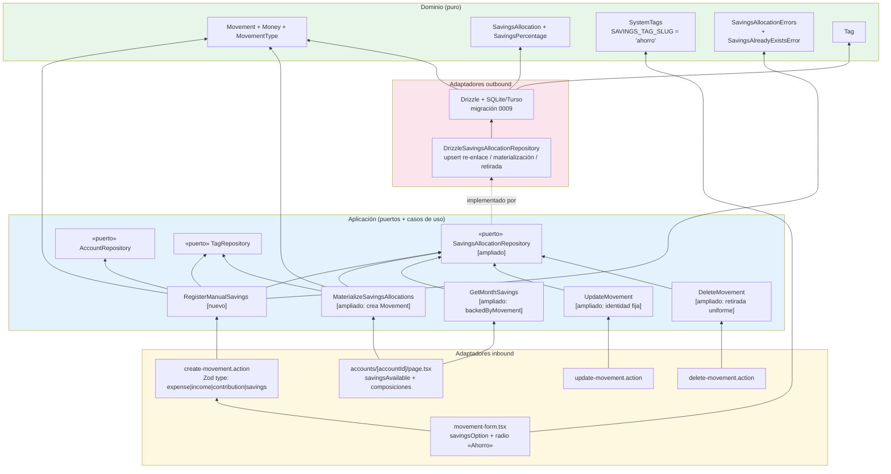

# Implementation Plan: El ahorro mensual como movimiento editable

**Branch**: `feature/033-ahorro-como-movimiento` | **Date**: 2026-11-15 | **Spec**: [specs/033-ahorro-como-movimiento/spec.md](./spec.md)

**Input**: Feature specification from `/specs/033-ahorro-como-movimiento/spec.md`

## Summary

El ahorro mensual pasa de apartado informativo congelado (023: fila en `savings_allocation_months` sin movimiento) a **movimiento real**, dual de la aportación común (032): un tipo de gasto «Ahorro» de la frontera (cuenta personal con config existente — sin exigir activa) con naturaleza propia y etiqueta protegida «Ahorro» implícitas, que escribe movimiento + fila enlazada (`movement_id`, enlace blando nuevo en la migración `0009`) en una sola transacción. El materializador de 023 pasa a crear también el movimiento (paridad 019/021). El KPI «Ahorro del mes» sigue leyendo el registro —ahora el movimiento enlazado cuando existe (`backedByMovement`)—, el «Saldo del mes» descuenta el ahorro exactamente una vez (composición condicional), «Gasto personal» lo excluye siempre, y `/summary`/`/annual` lo cuentan como gasto por construcción. Edición con identidad fija (importe/nota/fecha) y **borrado uniforme** reversible (movimiento y fila juntos, cualquier origen).

Enfoque técnico: clonación símbolo a símbolo del patrón 032 (`RegisterManualContribution` → `RegisterManualSavings`) con tres desviaciones decididas en clarify (config como ancla sin exigir activa; borrado uniforme; sin backfill — re-enlace manual de huérfanas). Ver [research.md](./research.md) R1-R11.

## Technical Context

**Language/Version**: TypeScript 5 (estricto) sobre Node.js LTS — Next.js App Router (monolito)

**Primary Dependencies**: Next.js (Server Actions, App Router), Drizzle ORM + SQLite (dev) / Turso libSQL (prod), Zod (fronteras), Tailwind CSS + shadcn/ui, Radix (RadioGroup/Select), Vitest + Testing Library, Playwright

**Storage**: SQLite/Turso vía Drizzle. Migración nueva `drizzle/0009_ahorro-movimiento.sql` (columna `movement_id` en `savings_allocation_months` + etiqueta protegida «Ahorro» id 101 en categoría genérica); esquema y seed actualizados

**Testing**: Vitest (`test.projects`: `node` dominio/aplicación/infra/actions, `ui` jsdom componentes) co-localizado con el SUT; repositorios contra libsql `:memory:` con migraciones reales; Playwright e2e contra `build + start` con BD determinista (`e2e.sqlite`, `workers: 1`)

**Target Platform**: Web (navegador), despliegue local y Vercel + Turso

**Project Type**: Web app monolítica (hexagonal + DDD táctico)

**Performance Goals**: N/A (uso individual; sin objetivos de concurrencia; escrituras transaccionales acotadas)

**Constraints**: Migraciones solo por script (nunca en runtime serverless); la UI no calcula lógica de negocio (composición de lecturas en la página, precedente 024/025); validación en servidor siempre (frontera de confianza)

**Scale/Scope**: 1 usuario, 3 cuentas, histórico mensual; alcance acotado a la familia ahorro + formularios/acciones de movimiento + KPIs de página de cuenta

## Constitution Check

*GATE: Must pass before Phase 0 research. Re-check after Phase 1 design.*

| Principio | Estado | Notas |
|---|---|---|
| I. Simplicidad Primero | ✅ | Cero proyectos/paquetes/capas nuevas; clona un patrón existente (032) en los módulos actuales. Sin abstracción «special type» generalizada (YAGNI, research R1) |
| II. Spec-Driven Development | ✅ | Spec 033 aprobada (clarify completo, decisiones del propietario registradas); este plan es el paso `/speckit.plan`; una única US con valor propio |
| III. Calidad Verificada | ✅ | FR-007 fija el mapa de tests: unidad (casos de uso), repositorio (libsql `:memory:`), actions (Zod), componentes (jsdom) y e2e del recorrido completo; gates lint+typecheck+test |
| IV. TypeScript Estricto + Zod | ✅ | Unión `MovementFormType` ampliada en frontera; action re-valida siempre; sin `any` |
| V. SQLite con Drizzle | ✅ | Única vía de evolución: migración versionada `0009`; sin SQL ad-hoc fuera de Drizzle/migraciones |
| VI. Producto en español, código en inglés | ✅ | UI/mensajes en español («Ahorro registrado», «Ya existe un ahorro registrado para este mes.»); identificadores en inglés (`RegisterManualSavings`, `SAVINGS_TAG_SLUG`); glosario en data-model |
| VII. Hexagonal + DDD | ✅ | Dominio puro (solo `SystemTags` + errores nuevos, cero deps); puertos ampliados en `application`; casos de uso orquestan `Movement.create`; UI presentacional (composiciones en la página, precedent 024/025); sin eventos/CQRS nuevos |

**Re-evaluación post-Phase 1**: sin cambios — el diseño (data-model, contracts) no introduce dependencias hacia el dominio desde fuera ni duplica lógica de negocio en la UI. Sin violaciones que justificar: **Complexity Tracking vacío**.

## Project Structure

### Documentation (this feature)

```text
specs/033-ahorro-como-movimiento/
├── plan.md              # This file (/speckit.plan command output)
├── research.md          # Phase 0 output (/speckit.plan command)
├── data-model.md        # Phase 1 output (/speckit.plan command)
├── quickstart.md        # Phase 1 output (/speckit.plan command)
├── contracts/           # Phase 1 output (/speckit.plan command)
│   └── interfaces.md
└── tasks.md             # Phase 2 output (/speckit.tasks command - NOT created by /speckit.plan)
```

### Source Code (repository root)

```text
src/
├── domain/                          # núcleo puro (sin deps externas)
│   ├── savings/
│   │   └── SavingsAllocationErrors.ts     # + SavingsAlreadyExistsError [ampliado]
│   └── tag/
│       └── SystemTags.ts                  # + SAVINGS_TAG_SLUG = "ahorro" [ampliado]
├── application/                     # casos de uso y puertos
│   ├── savings/
│   │   ├── RegisterManualSavings.ts       # [nuevo] dual de RegisterManualContribution
│   │   ├── RegisterManualSavings.test.ts  # [nuevo]
│   │   ├── MaterializeSavingsAllocations.ts(+test)  # [ampliado] compone Movement.create
│   │   ├── GetMonthSavings.ts(+test)      # [ampliado] backedByMovement
│   │   └── SavingsAllocationRepository.ts # [ampliado] 5 métodos nuevos, registerDeduction jubilado
│   └── movement/
│       ├── UpdateMovement.ts(+test)       # [ampliado] identidad congelada también para ahorro
│       └── DeleteMovement.ts(+test)       # [ampliado] borrado uniforme movimiento+fila
├── app/
│   └── accounts/[accountId]/page.tsx      # [ampliado] savingsAvailable + composición condicional
└── infrastructure/
    ├── db/
    │   ├── schema/savings-allocations.ts  # [ampliado] movementId (enlace blando)
    │   ├── DrizzleSavingsAllocationRepository.ts(+test)  # [ampliado] upsert/materialización/retirada
    │   └── seed-data.ts                   # [ampliado] SEED_TAGS += Ahorro
    └── primary/
        ├── actions/
        │   ├── movement-form.schema.ts    # [ampliado] unión "savings" + rama superRefine
        │   ├── create-movement.action.ts(+test)  # [ampliado] ruta a RegisterManualSavings
        │   └── update-movement.action.ts(+test)  # [ampliado] mapeo savings → expense/implícitos
        └── ui/
            ├── movement-form.tsx(+test)   # [ampliado] savingsOption + 4.º radio
            ├── create-movement-dialog.tsx # [ampliado] savingsAvailable
            ├── edit-movement-dialog.tsx   # [ampliado] locked por slug ahorro
            └── grouped-movement-list.tsx  # [ampliado] passthrough savingsAvailable

drizzle/0009_ahorro-movimiento.sql          # [nuevo] movement_id + etiqueta protegida (id 101)
e2e/
├── ahorro-movimiento.spec.ts               # [nuevo] cuenta 1 × 2026-05 + mes en curso, limpieza total
└── porcentaje-ahorro.spec.ts               # [ampliado] mundo nuevo: fila visible + limpieza

docs/architecture/adr/0025-ahorro-como-movimiento.md   # [nuevo, en la implementación]
AGENTS.md                                   # [ampliado, en la implementación] convención 033
```

**Structure Decision**: estructura hexagonal existente del monolito (constitución VII); la feature amplía módulos en su lugar, sin crear directorios nuevos más allá de los ficheros enumerados.

## Diagramas de diseño

### Componentes que intervienen



### Secuencia — happy path

Registro manual del ahorro de un mes pasado (US-1, escenario 1 de la spec):

```mermaid
sequenceDiagram
    autonumber
    actor User as Usuario
    participant Form as movement-form.tsx (radio «Ahorro»)
    participant Action as create-movement.action
    participant UC as RegisterManualSavings
    participant AccRepo as DrizzleAccountRepository
    participant SavRepo as DrizzleSavingsAllocationRepository
    participant TagRepo as DrizzleTagRepository
    participant Dom as Movement.create (dominio)
    participant DB as SQLite/Turso (tx)

    User->>Form: tipo «Ahorro» + importe + fecha (nota opcional)
    Note over Form: naturaleza y etiqueta implícitas: sin controles visibles
    Form->>Action: FormData (type="savings")
    Action->>Action: Zod: unión ampliada; nature/tagId ausentes; nota opcional
    Action->>UC: execute({ accountId, date, note, amountCents })
    UC->>AccRepo: findById(accountId)
    AccRepo-->>UC: cuenta personal ✓
    UC->>SavRepo: findByAccountId(accountId)
    SavRepo-->>UC: config existe (activa NO requerida — ancla)
    UC->>SavRepo: findDeductedMovement(config.id, mes)
    SavRepo-->>UC: null (mes sin ahorro)
    UC->>TagRepo: findBySlug("ahorro")
    TagRepo-->>UC: etiqueta protegida «Ahorro»
    UC->>Dom: Movement.create({ type: "expense", nature: "personal", tagId, amount, date, nota ?? "Ahorro" })
    Dom-->>UC: Movement válido
    UC->>SavRepo: registerManualSavings(config, mes, movement)
    SavRepo->>DB: tx: INSERT registro ON CONFLICT (config, mes) DO UPDATE SET movement_id, amount_cents WHERE movement_id IS NULL RETURNING
    alt fila ya enlazada (0 filas)
        SavRepo-->>UC: null
        UC-->>Action: SavingsAlreadyExistsError («Ya existe un ahorro registrado para este mes.»)
        Action-->>Form: { status: "error", errors: { _form } } → role="alert"
    else mes libre o huérfana legacy (re-enlace)
        SavRepo->>DB: tx: INSERT movements (misma tx)
        SavRepo-->>UC: MovementId
        UC-->>Action: movementId
        Action->>Action: revalidatePath("/", "layout")
        Action-->>Form: { status: "success", message: "Ahorro registrado", intent }
        Note over Form: toast + cierre (o remonte de tanda con carry)
        User->>Form: (re-render) página de cuenta
        Note over Form: fila «Ahorro» en listado; KPI Ahorro = importe del movimiento enlazado;<br/>Saldo del mes descuenta 1 vez (backedByMovement → composición no resta);<br/>Gasto personal lo excluye; /summary y /annual lo cuentan como gasto
    end
```

## Complexity Tracking

> **Fill ONLY if Constitution Check has violations that must be justified**

Sin violaciones: la feature clona patrones existentes (032) dentro de la arquitectura actual, sin nuevos proyectos, capas, librerías ni patrones de dominio adicionales.
