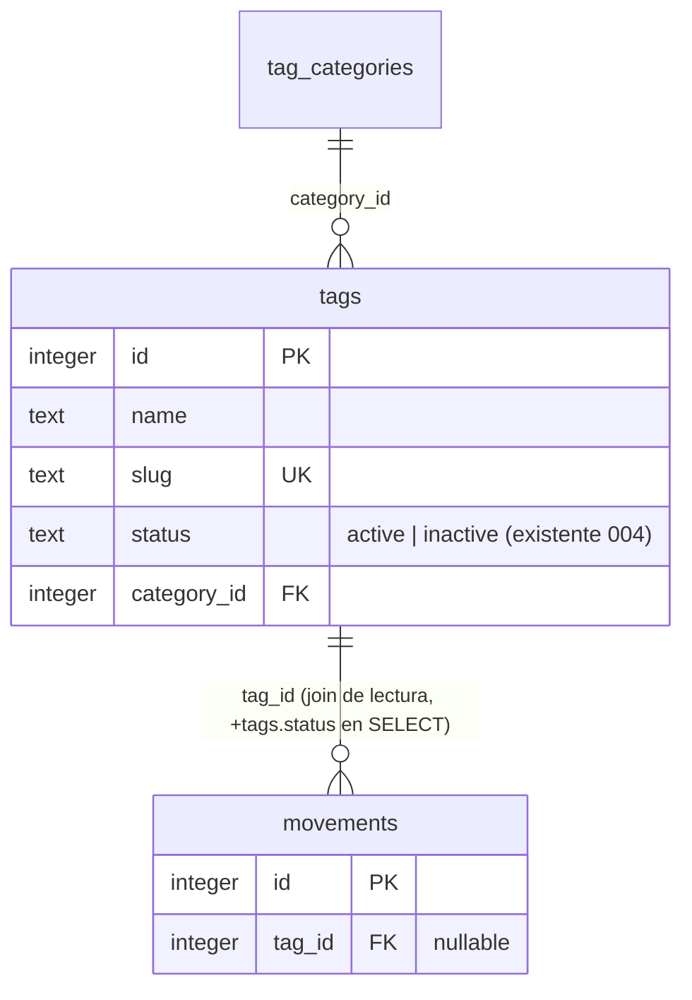

# Data Model: Etiquetas inactivas visibles en el listado de movimientos (034)

**Feature**: 034-diferenciar-tags-inactivas | **Fecha**: 2026-11-19

---

## Resumen del modelo

Sin entidades nuevas, sin cambios de esquema ni de dominio. La feature amplía **un DTO de lectura** (`MovementTagDTO` gana `status: TagStatus`) para que el estado activa/inactiva de la etiqueta —existente desde 004 y hoy visible solo en `/tags`— viaje con la lectura del mes hasta la fila del listado y el formulario de edición. Es un amend consciente y justificado del congelamiento de 027 (ver research R1). Cero cambios de cálculo: importes, KPIs, `/summary`, `/annual` y el informe anual computan exactamente igual (FR-003).

---

## Diagrama de clases (diseño)

```mermaid
classDiagram
    direction LR

    class Movement {
        <<entidad, dominio — sin cambios>>
        accountId / type / date / note
        amount: Money
        nature: ExpenseNature
        tagId: TagId?
    }

    class Tag {
        <<entidad, dominio — sin cambios>>
        id / name / slug
        status: TagStatus
        categoryId: TagCategoryId
    }

    class TagStatus {
        <<VO, dominio — sin cambios>>
        "active" | "inactive"
    }

    class SystemTags {
        <<módulo puro, dominio — sin cambios>>
        +isProtectedTagSlug(slug) boolean
        protegidas: nunca inactivas
    }

    class MovementTagDTO {
        <<DTO, aplicación — [ampliado]>>
        id: number
        name: string
        slug: string
        status: TagStatus [nuevo]
    }

    class MovementDTO {
        <<DTO, aplicación — forma intacta>>
        id / accountId / type / date / note
        amountCents / nature
        tag: MovementTagDTO?
    }

    class ListMovements {
        <<caso de uso — sin cambios>>
        +execute(accountId, month) Promise~MovementDTO[]~
    }

    class MovementRepository {
        <<puerto — sin cambios>>
        +listByMonthAndAccount(accountId, month)
        +listByMonth(month)
        +listByYear(year)
    }

    class DrizzleMovementRepository {
        <<adaptador outbound — [ampliado]>>
        selectMonthRows(): +tagStatus = tags.status
        (mismo leftJoin, misma query)
    }

    class mapJoinedRowToMovementDTO {
        <<mapper — [ampliado]>>
        MovementJoinedRow: +tagStatus
        compone tag con status
    }

    class MovementFormFields {
        <<componente client — [ampliado]>>
        +currentInactiveTag?: {id, name} | null
        ítem «{nombre} (inactiva)» disabled
    }

    class EditMovementDialog {
        <<componente client — [ampliado]>>
        computa currentInactiveTag
        desde movement.tag.status
    }

    class GroupedMovementList {
        <<componente client — [ampliado]>>
        chip inactivo: borde discontinuo
        + title + sr-only «(inactiva)»
        + data-inactive
    }

    Movement "1" --> "0..1" Tag : tagId
    Tag --> TagStatus : status
    MovementTagDTO ..> TagStatus : expone (amend 034)
    MovementDTO --> MovementTagDTO : tag
    ListMovements ..> MovementRepository : usa
    MovementRepository <|.. DrizzleMovementRepository : implementa
    DrizzleMovementRepository ..> mapJoinedRowToMovementDTO : mapea filas joined
    DrizzleMovementRepository ..> Movement : lee
    GroupedMovementList ..> MovementDTO : pinta chips
    EditMovementDialog ..> MovementDTO : editing (estado)
    EditMovementDialog ..> MovementFormFields : monta con currentInactiveTag
    MovementFormFields ..> SystemTags : filtra protegidas de destinos
```

---

## Entidades y cambios

### `MovementTagDTO` (ampliado — el único cambio de modelo)

```ts
export interface MovementTagDTO {
  id: number;
  name: string;
  slug: string;
  status: TagStatus; // nuevo — "active" | "inactive"
}
```

- **Origen del dato**: columna `tags.status` (existente desde 004; `text NOT NULL DEFAULT 'active'`) leída por el `leftJoin` que la lectura de movimientos ya hace.
- **Punto único de construcción**: `mapJoinedRowToMovementDTO` (`src/infrastructure/db/mappers/movement.mapper.ts`) — `MovementJoinedRow` gana `tagStatus: string | null`; `hasTag` lo exige junto a `tagId`/`tagName`/`tagSlug`; se aplica `as TagStatus` (paridad del cast de `type`/`nature` en el mismo mapper).
- **Cobertura**: las tres lecturas del builder compartido (`listByMonthAndAccount`, `listByMonth`, `listByYear`) sirven el estado sin tocar sus firmas.
- **Amend del congelamiento 027**: documentado como excepción consciente (FR-006 de 027 era la garantía de alcance de aquella feature; 034 existe para exponer este estado en esas filas — research R1). Los agregados (`/summary`, `/annual`, informe anual) reciben el campo y lo ignoran: **ningún cálculo lo consume** (FR-003, SC-003).

### Etiqueta (presentación de un atributo existente)

| Atributo | Valor |
|---|---|
| `status` | `"active"` \| `"inactive"` — sin cambios de reglas: protección (004/033), desactivación/reactivación (`/tags`), fusión (004) intactas |
| Visibilidad nueva | chip de fila del listado (todas las cuentas, cualquier mes, modo selección incluido) y valor actual del Select de edición |
| Invariantes | las protegidas («Aportación Común», «Ahorro») no pueden desactivarse → sin marcador por construcción; el histórico conserva su etiqueta y su estado se muestra tal cual (escenarios 6 y 8) |

### Movimiento (fila del listado — sin cambios de entidad)

La lectura del mes conoce el estado de la etiqueta de cada fila en el momento del render (FR-003: la fila no consulta nada por su cuenta ni recalcula). La inactividad no se persiste en el movimiento; tras desactivar en `/tags` y volver a la cuenta, el chip aparece diferenciado (revalidación del layout existente).

### `MovementFormFields` (frontera de edición — ampliación de props)

| Pieza | Contrato |
|---|---|
| Prop nueva | `currentInactiveTag?: { id: number; name: string } \| null` — solo la aporta `EditMovementForm` desde `movement.tag` cuando `status === "inactive"` |
| Render | `SelectItem` **disabled**, primero del `SelectContent` (fuera de grupos), texto «{nombre} (inactiva)», `value=String(id)`; renderizado solo mientras es el valor actual (`selectValue === String(id)`) — cubre el estado normal y el guard de error 027 |
| Destinos | sin cambios: `tagGroups` activas filtradas de protegidas (027); la inactiva jamás elegible |
| Envío sin cambiar | hidden input conserva el id inactivo → `InactiveTagError` existente sobre el campo (escenario 5) — actions y dominio intactos |

### Reglas de validación (sin cambios — referidas)

- Escritura: `resolveTagId` (`movement-inputs.ts`) exige etiqueta existente y activa → `TagNotFoundError`/`InactiveTagError` → «Una de las etiquetas seleccionadas ya no está disponible.» mapeado a `tagId` (reubicado a `_form` en modos ocultos, 033).
- Retag masivo (029): destino solo activas (`BulkRetagMovements`); filas con inactiva seleccionables (la exclusión es solo para protegidas).

### Matriz de decisión del render (fila × estado de etiqueta)

| Estado de `movement.tag` | Chip | Selección (029) | Edición: campo «Etiqueta» |
|---|---|---|---|
| `null` (ingreso sin etiqueta) | sin chip | seleccionable | «Sin etiqueta» / vacío, como hoy |
| `status: "active"` | chip normal (idéntico a hoy) | seleccionable | ítem activo elegido, como hoy |
| `status: "inactive"` | borde discontinuo + `title` «{nombre} (inactiva)» + sr-only + `data-inactive` | seleccionable (marcador visible) | ítem «{nombre} (inactiva)» disabled como valor actual; guardar sin cambiar → error existente |
| protegida (`isProtectedTagSlug`) | chip normal (nunca inactivable) | sin checkbox (hueco) | bloqueada por identidad (032/033) |

### Casos límite congelados

- **Etiqueta desactivada con el movimiento en pantalla**: el estado se lee en cada render de la página de cuenta; volver desde `/tags` tras desactivar muestra el chip diferenciado (edge case de la spec).
- **Etiqueta inactiva en muchos meses**: el marcador aparece en todos los meses consultados; vaciarla exige recorrer el stepper ‹ mes/año › (aceptado; la búsqueda global es 007).
- **Restauración del Select tras error (familia 027/032)**: con el error activo, `selectValue` lee `state.values.tagId` → el ítem inactivo deshabilitado sigue siendo el valor mostrado; el auto-reset de React 19 no puede borrar lo que el guard ya fija.
- **Creación inline de etiqueta (017)** en edición de una fila con inactiva: tras crear, `selectedTagId` cambia al id nuevo → el ítem inactivo desaparece (ya no es el valor actual).

---

## Persistencia

**Sin cambios**: ni migraciones, ni esquema Drizzle, ni seed (FR-003). La columna `tags.status` ya existe (`src/infrastructure/db/schema/tags.ts:12`) y ya viaja por `DrizzleTagRepository.findAll`/`findAllActive` para `/tags`.



---

## Glosario

| Término | Significado |
|---|---|
| Etiqueta inactiva | `Tag.status === "inactive"` (desactivada en `/tags`, 004): se conserva en el histórico, no se ofrece como destino |
| Chip | Píldora de etiqueta de la fila del listado (`rounded-full` + nombre) |
| Marca / marcador | Tratamiento diferenciado del chip inactivo: borde discontinuo + `title` + sufijo accesible «(inactiva)» + `data-inactive` |
| Valor actual no elegible | `SelectItem` disabled «{nombre} (inactiva)»: presenta la etiqueta inactiva vigente del movimiento sin ofrecerla como destino |
| Amend del DTO | Extensión consciente de `MovementTagDTO` con `status`, excepción documentada del congelamiento 027 (research R1) |
