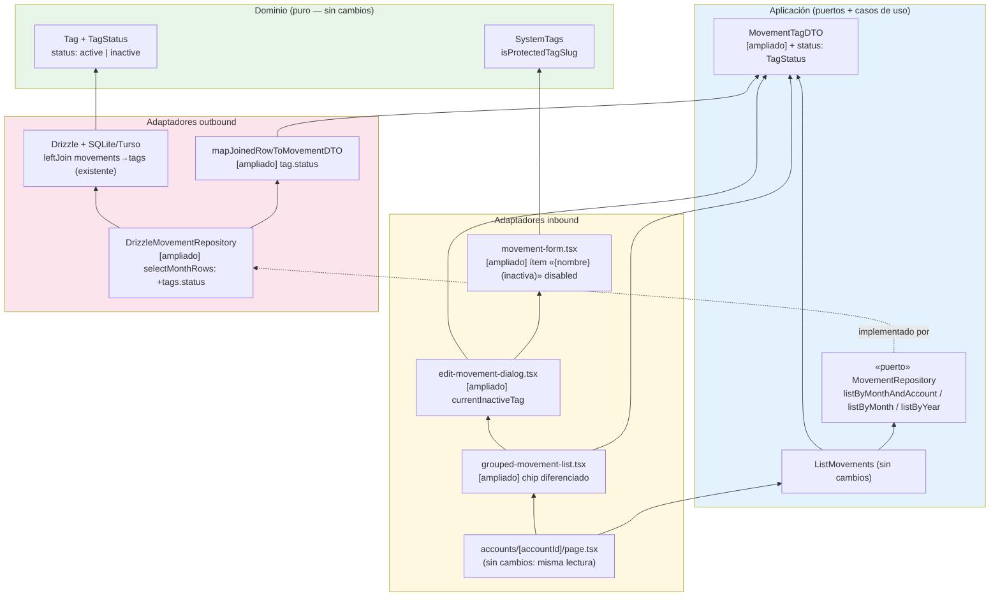

# Implementation Plan: Etiquetas inactivas visibles en el listado de movimientos

**Branch**: `feature/034-diferenciar-tags-inactivas` | **Date**: 2026-11-19 | **Spec**: [specs/034-diferenciar-tags-inactivas/spec.md](./spec.md)

**Input**: Feature specification from `/specs/034-diferenciar-tags-inactivas/spec.md`

## Summary

Feature de **lectura pura**: el listado mensual de la página de cuenta distingue las filas cuya etiqueta está desactivada (chip con borde discontinuo y texto apagado + marca textual accesible «(inactiva)» en nombre accesible y `title` + `data-inactive`), y el diálogo de edición muestra la etiqueta inactiva actual como valor no elegible («{nombre} (inactiva)», `SelectItem` disabled) en lugar del Select vacío con placeholder. El objetivo es que el propietario vea de un vistazo qué movimientos reasignar a etiquetas activas (vías existentes de edición 014 y retag masivo 029) para vaciar las etiquetas inactivas antes de la eliminación futura (030).

Enfoque técnico: **amend de `MovementTagDTO` con `status: TagStatus`** (excepción consciente y documentada del congelamiento de 027, justificada en research R1 frente a la composición en lectura estilo 015) — el dato viaja en la lectura del mes existente (`selectMonthRows` añade `tags.status` al `leftJoin` que ya hacía; el mapper lo compone), y la UI lo presenta sin consultas, cálculos ni estado nuevo. Sin cambios de dominio, application (casos de uso/puertos), actions, esquema, migraciones, seed ni agregados. Ver [research.md](./research.md) R1-R6.

## Technical Context

**Language/Version**: TypeScript 5 (estricto) sobre Node.js LTS — Next.js App Router (monolito)

**Primary Dependencies**: Next.js (App Router, Server Components), Drizzle ORM + SQLite (dev) / Turso libSQL (prod), Tailwind CSS + shadcn/ui, Radix Select, Vitest + Testing Library, Playwright

**Storage**: SQLite/Turso vía Drizzle — **sin cambios** (la columna `tags.status` existe desde 004; ni migraciones ni seed)

**Testing**: Vitest (`test.projects`: `node` dominio/aplicación/infra/actions, `ui` jsdom componentes) co-localizado con el SUT; repositorios contra libsql `:memory:` con migraciones reales; Playwright e2e contra `build + start` con BD determinista (`e2e.sqlite`, `workers: 1`)

**Target Platform**: Web (navegador), despliegue local y Vercel + Turso

**Project Type**: Web app monolítica (hexagonal + DDD táctico)

**Performance Goals**: N/A (uso individual; lectura del mes sin queries nuevas — una columna más en el SELECT existente)

**Constraints**: lectura pura (SC-003: cero cambios de cálculo); la UI no consulta nada por su cuenta ni recalcula (FR-003); sin nuevas actions/diálogos/vías de reasignación (FR-004)

**Scale/Scope**: 1 usuario, 3 cuentas, histórico mensual; alcance acotado a DTO+repositorio de lectura de movimientos y 3 componentes UI de la página de cuenta

## Constitution Check

*GATE: Must pass before Phase 0 research. Re-check after Phase 1 design.*

| Principio | Estado | Notas |
|---|---|---|
| I. Simplicidad Primero | ✅ | Cero proyectos/paquetes/capas/patrones nuevos; una columna en un SELECT existente y un campo en un DTO existente. La alternativa (composición estilo 015) tenía más moving parts (research R1) |
| II. Spec-Driven Development | ✅ | Spec 034 aprobada con diagnóstico verificado en código; este plan es el paso `/speckit.plan`; una única US pequeña con valor propio |
| III. Calidad Verificada | ✅ | FR-005 fija el mapa de tests: repositorio (libsql `:memory:`), componentes (jsdom) y e2e del recorrido completo con combinación cuenta/mes propia (R5); gates lint+typecheck+test |
| IV. TypeScript Estricto + Zod | ✅ | Sin fronteras de datos nuevas que validar (ningún input de usuario cambia); el typecheck señala todos los fixtures que construyen `MovementTagDTO` (~12 sitios, actualización mecánica); sin `any` |
| V. SQLite con Drizzle | ✅ | Sin cambios de esquema: la columna `tags.status` ya existe; solo el SELECT del repositorio la incorpora vía Drizzle |
| VI. Producto en español, código en inglés | ✅ | UI/marcas en español («(inactiva)»); identificadores en inglés (`currentInactiveTag`, `tagStatus`); glosario en data-model |
| VII. Hexagonal + DDD | ✅ | Dominio y application intactos salvo un campo de DTO de lectura (la aplicación ya importa tipos de dominio en DTOs — paridad `ExpenseNature`/`MovementType`); la UI solo presenta el dato que viaja con la lectura (FR-003); sin duplicar lógica de negocio en componentes |

**Re-evaluación post-Phase 1**: sin cambios — el diseño (data-model, contracts) no añade dependencias ni consultas en la UI, no toca reglas de escritura ni agregados, y el amend del DTO está acotado a presentación. Sin violaciones que justificar: **Complexity Tracking vacío**.

## Project Structure

### Documentation (this feature)

```text
specs/034-diferenciar-tags-inactivas/
├── plan.md              # This file (/speckit.plan command output)
├── research.md          # Phase 0 output (/speckit.plan command)
├── data-model.md        # Phase 1 output (/speckit.plan command)
├── quickstart.md        # Phase 1 output (/speckit.plan command)
├── contracts/
│   └── ui-contract.md   # Phase 1 output (/speckit.plan command)
└── tasks.md             # Phase 2 output (/speckit.tasks command - NOT created by /speckit.plan)
```

### Source Code (repository root)

```text
src/
├── domain/                          # núcleo puro — SIN CAMBIOS (Tag/TagStatus/SystemTags intactos)
├── application/
│   └── movement/
│       └── dto.ts                   # [ampliado] MovementTagDTO gana status: TagStatus (amend documentado de 027)
├── app/
│   └── accounts/[accountId]/page.tsx  # SIN CAMBIOS (la lectura existente ya sirve el estado)
└── infrastructure/
    ├── db/
    │   ├── DrizzleMovementRepository.ts       # [ampliado] selectMonthRows: +tagStatus = tags.status
    │   ├── mappers/movement.mapper.ts         # [ampliado] MovementJoinedRow.tagStatus + tag.status
    │   └── DrizzleMovementRepository.test.ts  # [ampliado] status en las tres lecturas
    └── primary/
        └── ui/
            ├── grouped-movement-list.tsx      # [ampliado] chip diferenciado (FR-001)
            ├── grouped-movement-list.test.tsx # [ampliado] chips activo/inactivo/selección/protegida
            ├── edit-movement-dialog.tsx       # [ampliado] computa currentInactiveTag
            ├── edit-movement-dialog.test.tsx  # [ampliado] valor actual inactivo visible
            ├── movement-form.tsx              # [ampliado] prop currentInactiveTag + SelectItem disabled
            └── movement-form.test.tsx         # [ampliado] ítem no elegible + error con ítem visible

e2e/
└── etiquetas-inactivas.spec.ts      # [nuevo] cuenta 1 × 2026-07, etiqueta propia inline (R5)

AGENTS.md                            # [ampliado, en la implementación] convención 034 si procede (FR-006)
specs/001-family-wallet/spec.md      # [en el cierre] fila 034 marcada Completada (FR-006)
```

**Structure Decision**: estructura hexagonal existente del monolito (constitución VII); la feature amplía módulos en su lugar (un DTO, un repositorio de lectura, tres componentes UI co-localizados con sus tests) y añade un único fichero nuevo de e2e. Sin directorios nuevos.

## Diagramas de diseño

### Componentes que intervienen



### Secuencia — happy path

Detección y reasignación de una etiqueta inactiva (US-1, escenarios 1-3 de la spec):

```mermaid
sequenceDiagram
    autonumber
    actor User as Usuario
    participant Page as accounts/[accountId]/page.tsx
    participant UC as ListMovements
    participant Repo as DrizzleMovementRepository
    participant DB as SQLite/Turso (leftJoin)
    participant List as grouped-movement-list.tsx
    participant Dialog as edit-movement-dialog.tsx
    participant Form as movement-form.tsx
    participant Action as update-movement.action (existente)

    User->>Page: GET /accounts/{id}?month=YYYY-MM
    Page->>UC: execute(accountId, month)
    UC->>Repo: listByMonthAndAccount(accountId, month)
    Repo->>DB: SELECT movements.* , tags.id, tags.name, tags.slug, tags.status [nuevo] LEFT JOIN tags
    DB-->>Repo: filas joined (status incluido)
    Repo-->>UC: MovementDTO[] (tag.status viaja con la lectura — FR-003)
    UC-->>Page: MovementDTO[]
    Page-->>List: render con movements
    Note over List: fila con tag.status === "inactive" → chip borde discontinuo + title/sr-only «(inactiva)» + data-inactive;<br/>activas exactamente como hoy (FR-001)
    User->>List: ✏️ editar fila marcada
    List->>Dialog: setEditing(movement) (DTO en estado — convención diálogos por fila)
    Dialog->>Dialog: movement.tag.status === "inactive" → currentInactiveTag = {id, name}
    Dialog->>Form: initialValues (tagId inactivo) + currentInactiveTag
    Note over Form: SelectItem disabled «{nombre} (inactiva)» como valor actual (FR-002);<br/>guardar sin cambiar → error existente (escenario 5)
    User->>Form: elige etiqueta activa → «Guardar cambios»
    Form->>Action: FormData (tagId activo)
    Note over Action: vía 014 intacta (FR-004): resolveTagId valida activa → UpdateMovement
    Action-->>Form: success + revalidatePath
    Note over Form: toast + cierre; re-render: chip normal sin marcador (escenario 3)
```

## Complexity Tracking

> **Fill ONLY if Constitution Check has violations that must be justified**

Sin violaciones constitucionales. El amend de `MovementTagDTO` no es una violación sino una excepción de convenio de feature (congelamiento 027) decidida y justificada en research R1 y data-model — sin coste arquitectónico: presentación de un atributo propio de la etiqueta en el punto exacto donde el DTO ya se consume.
