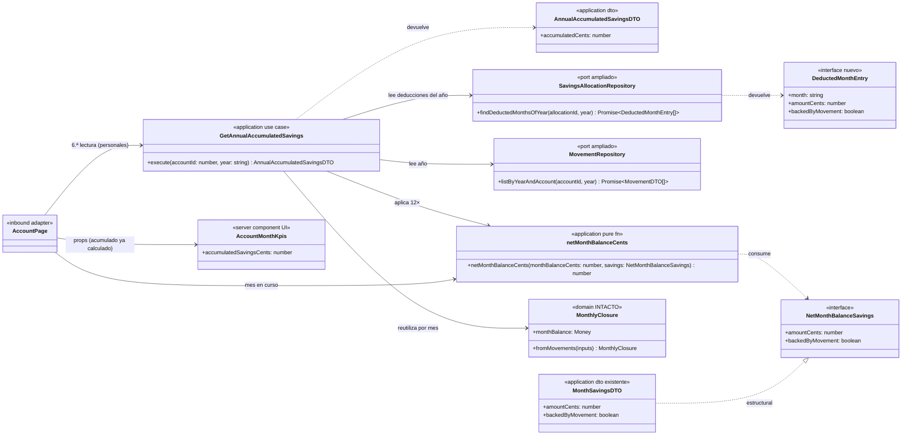

# Data Model: KPI de ahorro acumulado del año (035)

**Feature**: 035-kpi-ahorro-anual | **Fecha**: 2026-11-22

**Sin entidades de dominio nuevas ni cambios de esquema** (lectura pura, FR-005): el KPI agrega cierres mensuales del año natural derivados de `movements` + filas de `savings_allocation_months` existentes. Este documento congela los tipos nuevos/ampliados de aplicación y UI.

---

## 1. Tipos de aplicación

### 1.1 DTO `AnnualAccumulatedSavingsDTO` `[nuevo]`

**Ubicación**: `src/application/movement/dto.ts`

```typescript
export interface AnnualAccumulatedSavingsDTO {
  accumulatedCents: number; // Σ con signo de netMonthBalance(m), m = Y-01…Y-12 (céntimos EUR)
}
```

- **Validación**: el importe llega ya calculado por el caso de uso; entero en céntimos (VO `Money` interno, ADR 0007), puede ser negativo.
- La UI **solo formatea** (`formatSignedCents` + rojo si < 0); jamás recalcula (constitución VII).

### 1.2 Helper puro `netMonthBalanceCents` `[nuevo]`

**Ubicación**: `src/application/movement/net-month-balance.ts`

```typescript
export interface NetMonthBalanceSavings {
  amountCents: number;
  backedByMovement: boolean;
}

export function netMonthBalanceCents(
  monthBalanceCents: number,
  savings: NetMonthBalanceSavings,
): number; // = monthBalanceCents − (savings.backedByMovement ? 0 : savings.amountCents)
```

- **Única copia de la fórmula condicional del «Saldo del mes» (033)**; la consumen `page.tsx` (mes en curso) y `GetAnnualAccumulatedSavings` (12 meses). `MonthSavingsDTO` satisface estructuralmente `NetMonthBalanceSavings`.
- **Regla sellada**: respaldado por movimiento → el gasto ya está en el cierre → no se descuenta; fila congelada legacy (sin movimiento) → se descuenta una vez; sin fila → descuento 0.

### 1.3 Caso de uso `GetAnnualAccumulatedSavings` `[nuevo]`

**Ubicación**: `src/application/movement/GetAnnualAccumulatedSavings.ts`

```typescript
export class GetAnnualAccumulatedSavings {
  constructor(movements: MovementRepository, savingsAllocations: SavingsAllocationRepository)
  async execute(accountId: number, year: string): Promise<AnnualAccumulatedSavingsDTO>
}
```

- **Validación de entrada**: `year` con `/^\d{4}$/` → si falla, `Error` (paridad `GetAnnualIncomeStatement`/`GetMonthlyClosure`).
- **Algoritmo** (determinista, solo lectura):
  1. Lecturas en paralelo: `movements.listByYearAndAccount(AccountId(accountId), year)` y `savingsAllocations.findByAccountId` → si hay config con id, `findDeductedMonthsOfYear(config.id, year)` → mapa `month → DeductedMonthEntry` (meses sin fila → `{ amountCents: 0, backedByMovement: false }`).
  2. Agrupación de movimientos por `date.slice(0, 7)` (clave `YYYY-MM`).
  3. Para `m` de `${year}-01` a `${year}-12`: `MonthlyClosure.fromMovements(inputs de m)` (dominio intacto, reutilizado) → `netMonthBalanceCents(closure.monthBalance.amountCents, ahorro(m))`.
  4. `accumulatedCents` = Σ de los 12 valores — cada mes computa como máximo una vez (FR-002).
- **Invariante**: cero escrituras, cero materializaciones (FR-005); resultado estable a igualdad de datos para cualquier mes del mismo año (FR-003).

## 2. Puertos (ampliaciones)

### 2.1 `MovementRepository.listByYearAndAccount` `[nuevo]`

**Ubicación**: `src/application/movement/MovementRepository.ts`

```typescript
listByYearAndAccount(accountId: AccountId, year: string): Promise<MovementDTO[]>;
```

- Espejo de `listByYear` + `eq(movements.accountId)`; rango de fechas `[${year}-01-01, ${year+1}-01-01)` — fronteras inclusivas/exclusivas idénticas a las existentes. Devuelve `MovementDTO` completo (con tag unido).

### 2.2 `SavingsAllocationRepository.findDeductedMonthsOfYear` `[nuevo]` + `DeductedMonthEntry`

**Ubicación**: `src/application/savings/SavingsAllocationRepository.ts`

```typescript
export interface DeductedMonthEntry {
  month: string;          // "YYYY-MM"
  amountCents: number;    // amount_cents de la fila
  backedByMovement: boolean; // true si el movement_id enlazado EXISTE en movements
}

// en la interfaz:
findDeductedMonthsOfYear(
  allocationId: SavingsAllocationId,
  year: string,
): Promise<readonly DeductedMonthEntry[]>;
```

- Devuelve **solo los meses del año con fila** en `savings_allocation_months` para esa config (los meses sin fila no descuentan nada).
- `backedByMovement` computado por el adaptador con `LEFT JOIN movements`: una fila huérfana (`movement_id` seteado pero movimiento borrado) computa como congelada — misma semántica de existencia que `findDeductedMovement` (coherencia con el KPI del mes, SC-002).

## 3. UI

### 3.1 `AccountMonthKpisProps` (amend del contrato congelado 022/023/024/033)

**Ubicación**: `src/infrastructure/primary/ui/account-month-kpis.tsx`

```typescript
interface AccountMonthKpisProps {
  netContribution: MonthNetContributionDTO;
  personalExpenseCents: number;
  savings: MonthSavingsDTO;
  netMonthBalanceCents: number;
  month: string;
  accumulatedSavingsCents: number; // [nuevo] ya calculado por la página desde GetAnnualAccumulatedSavings
}
```

- `dl` con **5 métricas** en orden congelado: «Aportación común» · «Gasto personal» · «Ahorro del mes» · «Saldo del mes» · **«Ahorro acumulado»** — `grid grid-cols-2 gap-3 sm:grid-cols-5`; la celda 5.ª con `col-span-2 sm:col-span-1`.
- Celda «Ahorro acumulado»: `formatSignedCents` + `text-red-600` si < 0 (espejo de «Saldo del mes») + subtext permanente `Año {month.slice(0, 4)}` (FR-001). Sin estados ni subtextos condicionales (año vacío → `0,00 €`).
- Sticky/visibilidad continua de 022 intactos; sigue siendo server component presentacional puro.

### 3.2 Composición en `page.tsx` (adaptador inbound)

- `year = month.slice(0, 4)` tras resolver `month`; 6.ª lectura del `Promise.all` (solo personales): `GetAnnualAccumulatedSavings.execute(account.id, year)`.
- `netMonthBalanceCents` del render ahora sale del helper compartido (§1.2) — las «dos únicas restas de composición» siguen compuestas una única vez en la página, sin fórmula duplicada.

## 4. Diagrama de clases (diseño)



> Diferencias con `docs/architecture/diagrams/` (vivo, a actualizar en la implementación): caso de uso + helper + 2 métodos de puerto + `DeductedMonthEntry` + prop de UI nuevos; dominio y agregados anuales sin cambios.

## 5. Glosario

| Término | Significado |
|---|---|
| Ahorro acumulado (del año) | Suma con signo de los «Saldo del mes» de los 12 meses del año natural consultado. Concepto distinto del «Ahorro del mes» (deducción porcentual 023/033): literales separados, ninguno deriva del otro. |
| Año natural / de referencia | El año del mes seleccionado en el stepper ‹ mes/año ›; cubre enero–diciembre completos (meses vacíos computan 0). |
| Año vacío | Año sin movimientos en la cuenta: el KPI muestra `0,00 €`, siempre presente (lectura pura, sin estados). |
| Fila congelada legacy | Fila de `savings_allocation_months` sin movimiento (pre-033): descuenta su `amount_cents` del saldo del mes vía composición condicional. |
| netMonthBalance | Saldo del mes neto del ahorro según composición 033: `monthBalance − (backedByMovement ? 0 : amountCents)`. |

## 6. Reglas de validación y transiciones

- **Entrada del caso de uso**: `year` `/^\d{4}$/` → error explícito fuera de patrón; `accountId` ya validado por la página (existe y es personal — el caso de uso solo se consulta en esa rama).
- **Sin estados ni transiciones**: ni configuración ni materialización ni ciclo de vida nuevo (FR-005); la «actualización» del KPI es la relectura del render tras `revalidatePath` (FR-007).
