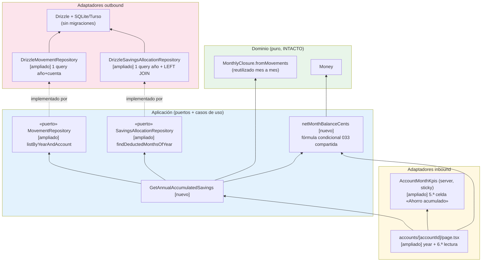

# Implementation Plan: KPI de ahorro acumulado del año en la página de cuenta personal

**Branch**: `feature/035-kpi-ahorro-anual` | **Date**: 2026-11-22 | **Spec**: [specs/035-kpi-ahorro-anual/spec.md](./spec.md)

**Input**: Feature specification from `/specs/035-kpi-ahorro-anual/spec.md`

## Summary

El bloque «KPIs del mes» de las cuentas personales pasa de 4 a 5 métricas (amend del contrato congelado de 022/023/024/033): nueva celda **«Ahorro acumulado»** con la **suma con signo de los «Saldo del mes» de los 12 meses del año natural del mes consultado**, con el año de referencia visible («Año {year}») y la visibilidad continua sticky de 022 intacta. Es una **agregación de lectura pura**: sin configuración, sin materialización (FR-005) y sin entidades nuevas.

Enfoque técnico (research R1–R9): nuevo caso de uso `GetAnnualAccumulatedSavings` que reutiliza el servicio de dominio `MonthlyClosure.fromMovements` mes a mes (coherencia por construcción, FR-004) y la fórmula de composición condicional de 033 extraída a **una única función pura compartida** (`netMonthBalanceCents` en aplicación) que pasa a usar también la página para el mes en curso; dos métodos de lectura nuevos en puertos existentes (`MovementRepository.listByYearAndAccount` y `SavingsAllocationRepository.findDeductedMonthsOfYear`) para leer el año en 2 queries; 5.ª celda presentacional en `AccountMonthKpis`; e2e propio en cuenta 2 × **2025** (año pasado que ningún otro spec escribe) con limpieza total final. Dominio, esquema, migraciones, materializadores, agregados y cuenta común: **intactos**.

## Technical Context

**Language/Version**: TypeScript 5 (estricto) sobre Node.js LTS — Next.js App Router (monolito)

**Primary Dependencies**: Next.js (App Router, Server Components), Drizzle ORM + SQLite (dev) / Turso libSQL (prod), Zod (fronteras), Tailwind CSS + shadcn/ui, Vitest + Testing Library, Playwright

**Storage**: SQLite/Turso vía Drizzle. **Sin migraciones ni cambios de esquema** (lectura pura sobre tablas existentes)

**Testing**: Vitest (`test.projects`: `node` dominio/aplicación/infra, `ui` jsdom componentes) co-localizado con el SUT; repositorios contra libsql `:memory:` con migraciones reales; Playwright e2e contra `build + start` con BD determinista (`e2e.sqlite`, `workers: 1`)

**Target Platform**: Web (navegador), despliegue local y Vercel + Turso

**Project Type**: Web app monolítica (hexagonal + DDD táctico)

**Performance Goals**: N/A (uso individual; 2 queries de lectura por render de cuenta personal)

**Constraints**: La UI no calcula lógica de negocio (composición vía helper único compartido, precedente restas de composición 022–024/033); los agregados de lectura nunca materializan (ADR 0016/0017); la fórmula del «Saldo del mes» no se duplica (FR-004)

**Scale/Scope**: 1 usuario, 3 cuentas, histórico mensual; alcance acotado al bloque KPIs de la página de cuenta personal

## Constitution Check

*GATE: Must pass before Phase 0 research. Re-check after Phase 1 design.*

| Principio | Estado | Notas |
|---|---|---|
| I. Simplicidad Primero | ✅ | Cero proyectos/paquetes/capas nuevas; extiende módulos existentes en su lugar. Sin ADR nuevo (extensión de patrones 022–024, como 024). Sin `GetAccountMonthKpis` agregado (YAGNI, research R3) |
| II. Spec-Driven Development | ✅ | Spec 035 aprobada (clarify completo, 2 decisiones registradas); este plan es el paso `/speckit.plan`; una única US con valor propio |
| III. Calidad Verificada | ✅ | FR-008 fija el mapa de tests: helper y caso de uso (node), repositorios (libsql `:memory:`), componente KPIs (jsdom) y e2e propio con aislamiento cuenta/año (convención e2e); gates lint+typecheck+test |
| IV. TypeScript Estricto + Zod | ✅ | Sin fronteras de datos nuevas (el `month`/`year` ya llega validado por Zod en la página); sin `any` |
| V. SQLite con Drizzle | ✅ | Cero migraciones: solo lectura vía Drizzle (2 selects con rango de fechas y LEFT JOIN existentes) |
| VI. Producto en español, código en inglés | ✅ | Literales nuevos en español («Ahorro acumulado», «Año {year}»); identificadores en inglés (`GetAnnualAccumulatedSavings`, `netMonthBalanceCents`, `listByYearAndAccount`); glosario en data-model |
| VII. Hexagonal + DDD | ✅ | Dominio **intacto** (reutiliza `MonthlyClosure`/`Money`); caso de uso + puertos de lectura en aplicación; UI presentacional pura (la página consume el DTO; la fórmula condicional vive en UN helper de aplicación usado por página y caso de uso — fin de la duplicación, FR-004); sin eventos/CQRS nuevos |

**Re-evaluación post-Phase 1**: sin cambios — el diseño (data-model, contracts) no añade dependencias hacia el dominio desde fuera ni lógica de negocio en la UI. Sin violaciones que justificar: **Complexity Tracking vacío**.

## Project Structure

### Documentation (this feature)

```text
specs/035-kpi-ahorro-anual/
├── plan.md              # This file (/speckit.plan command output)
├── research.md          # Phase 0 output (/speckit.plan command)
├── data-model.md        # Phase 1 output (/speckit.plan command)
├── quickstart.md        # Phase 1 output (/speckit.plan command)
├── contracts/           # Phase 1 output (/speckit.plan command)
│   ├── interfaces.md
│   └── ui-contract.md
└── tasks.md             # Phase 2 output (/speckit.tasks command - NOT created by /speckit.plan)
```

### Source Code (repository root)

```text
src/
├── domain/                                  # INTACTO (reutiliza MonthlyClosure, Money)
├── application/                             # casos de uso y puertos
│   ├── movement/
│   │   ├── GetAnnualAccumulatedSavings.ts        # [nuevo] Σ netMonthBalance(m) del año
│   │   ├── GetAnnualAccumulatedSavings.test.ts   # [nuevo]
│   │   ├── net-month-balance.ts                  # [nuevo] fórmula condicional 033 compartida
│   │   ├── net-month-balance.test.ts             # [nuevo]
│   │   ├── dto.ts                                 # [ampliado] + AnnualAccumulatedSavingsDTO
│   │   └── MovementRepository.ts                  # [ampliado] + listByYearAndAccount
│   └── savings/
│       └── SavingsAllocationRepository.ts         # [ampliado] + findDeductedMonthsOfYear
├── app/
│   └── accounts/[accountId]/page.tsx              # [ampliado] year + Promise.all + helper compartido
└── infrastructure/
    ├── db/
    │   ├── DrizzleMovementRepository.ts(+test)    # [ampliado] listByYearAndAccount
    │   └── DrizzleSavingsAllocationRepository.ts(+test)  # [ampliado] findDeductedMonthsOfYear
    └── primary/
        └── ui/
            ├── account-month-kpis.tsx(+test)      # [ampliado] 5.ª métrica «Ahorro acumulado»
            └── format.ts                          # INTACTO (formatSignedCents existente)

e2e/
└── kpi-ahorro-anual.spec.ts                       # [nuevo] cuenta 2 × 2025 (+2024), limpieza total

specs/001-family-wallet/spec.md                    # [ampliado, en la implementación] fila 035 → Completada
AGENTS.md                                          # [ampliado, en la implementación] bloque KPIs 4 → 5 métricas
docs/architecture/{overview.md,diagrams/pagina-cuenta-sequence.md}  # [ampliado, en la implementación]
```

**Structure Decision**: estructura hexagonal existente del monolito (constitución VII); la feature amplía módulos en su lugar (uso de lectura en `application/movement`, que ya es la casa de `GetMonthlyClosure`), sin crear directorios nuevos más allá de los ficheros enumerados.

## Diagramas de diseño

### Componentes que intervienen



### Secuencia — happy path

Consulta de la página de cuenta personal en un mes del año (US-1, escenario 1 de la spec):

```mermaid
sequenceDiagram
    autonumber
    actor User as Usuario
    participant Page as accounts/[accountId]/page.tsx
    participant Mat as Materializadores 018/019/033
    participant UC as GetAnnualAccumulatedSavings
    participant MRepo as DrizzleMovementRepository
    participant SRepo as DrizzleSavingsAllocationRepository
    participant Dom as MonthlyClosure (dominio)
    participant Kpis as AccountMonthKpis (sticky)

    User->>Page: GET /accounts/{id}?month=2025-07
    Page->>Page: year = month.slice(0, 4) → "2025"
    Page->>Mat: 3 awaits secuenciales (solo del mes visitado; INTACTOS)
    Note over Mat: guardas activatedAtMonth ≤ month ≤ currentMonth:<br/>un mes de un año pasado con configs activadas<br/>después JAMÁS materializa (determinismo)
    Page->>UC: execute(account.id, "2025")
    par lecturas del año (2 queries)
        UC->>MRepo: listByYearAndAccount(accountId, "2025")
        MRepo-->>UC: MovementDTO[] del año (solo esa cuenta)
        UC->>SRepo: findByAccountId → config
        UC->>SRepo: findDeductedMonthsOfYear(config.id, "2025")
        SRepo-->>UC: {month, amountCents, backedByMovement}[]<br/>(LEFT JOIN → existencia del movimiento)
    end
    loop m = 2025-01 … 2025-12
        UC->>Dom: MonthlyClosure.fromMovements(movimientos de m)
        UC->>UC: netMonthBalanceCents(cierre.monthBalanceCents, ahorro(m) ?? cero)<br/>= monthBalance − (backedByMovement ? 0 : amountCents)
    end
    UC-->>Page: { accumulatedCents } — Σ con signo, céntimo exacto
    Page->>Kpis: props (5 métricas; acumulado ya calculado)
    Kpis-->>User: «Ahorro acumulado» + «Año 2025» — visible al cargar y durante todo el scroll (sticky)
```

## Complexity Tracking

> **Fill ONLY if Constitution Check has violations that must be justified**

Sin violaciones: la feature es una lectura agregada que reutiliza el dominio tal cual, amplía dos puertos con métodos de lectura simétricos de los existentes y añade una celda presentacional. Sin proyectos, capas, librerías ni patrones nuevos.
